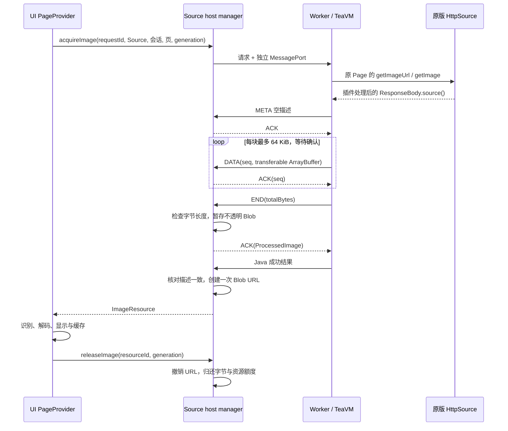

# Source 图片资源通道

本文记录当前 Source → UI 的编码正文合同。协议定义在 `protocol/karuyomi/v1/control.proto`，TS 校验与资源所有权分别在 `packages/contracts/src/image-control.ts`、`packages/runtime-host/src/image-resources.ts`；Dart 接收在 `packages/source_runtime/lib/src/transport_runtime.dart`。实施状态见 [P0 计划](plan/p0-runtime-and-reading.md)，实际环境与范围见[验证记录](VERIFICATION.md)。传输成功不表示图片能解码、已显示或峰值受控。

当前使用 `karuyomi-source-host-v4`，Page 会话及 `hostAcquireImage/hostClosePageSession` 是必需 ABI；小控制消息采用 Protobuf 生成模型和标准 ProtoJSON，正文通过独立二进制通道。控制 protocolVersion 为 2，HTTP bridgeVersion 为 2，三者含义不同。项目原型直接更新当前合同和产物，不增加旧协议兼容层；代码、协议与依赖变化按实际输入重新构建。

## 职责边界

Source 与宿主只向 UI 交付插件处理后的不透明编码字节。宿主不检查图片 MIME、尺寸、EXIF 方向或格式，不作预解码，也不决定完整图、分片或 LOD。图片识别、实际解码、尺寸学习、像素与解码工作预算、缓存和分片全部属于 UI 客户端。宿主仍必须执行传输字节/资源限额、身份与 generation 校验、背压、取消和资源回收。

这一边界不改变插件本身的业务：原请求头、Cookie、拦截器、解密、重排或其它图片处理仍通过原 Source 执行，不修改官方扩展或原始 JAR，不以原图 URL 绕过处理。

## 原始 Page 与逻辑页

`pages` 返回 `pageSessionId` 及 `pages`，每项包含 `pageKey/index/sourceIndex/url/imageUrl`。Java 在有界会话表中保留原 Source 返回的 Page 实例，包括可变字段和子类；图片阶段不能用 DTO 重新构造 Page。会话绑定创建它的 Source 实例，Worker generation 或 build 改变时全部失效。

`ChapterPageProvider` 绑定 Source、会话、generation 和稳定章节引用，将阅读核心的逻辑页键映射到会话内 opaque pageKey。阅读位置不保存临时会话 ID 或有签名的 imageUrl；`reader_core.PageRef` 不依赖 TeaVM 或 Source URL。

章节导航负责关闭 Page 会话。`releaseImage` 结束已交付正文的所有权，`closePageSession` 解除 Java 原始 Page 引用；二者分别清理，不互相代替。

## 编码正文与所有权

Java 只在 Page 的 imageUrl 尚未解析时调用原 `getImageUrl`，随后调用原 `getImage`。图片出口仍是 `teaImageOpen/Write/Close/Cancel`；`open()` 无参，交付适配不读取响应的图片 Content-Type，也不解释或转发图片 metadata。`ImageMeta` 为空消息，DATA 从序号 1 开始；每块转移 ArrayBuffer 所有权，生产者等待 ACK 后才读取下一块。

END 确认非空正文与总长度一致，暂存无 MIME type 的 Blob。内部 ACK 的 `ProcessedImage` 仅有 `resourceId/generation/byteLength`；普通 DATA ACK 不带资源。Java 成功结果必须与这一描述逐字段一致，manager 才创建受管 URL；重复发布复用同一 URL。仅收到 END、RPC 成功或完整编码正文都不等于完成像素解码。Java 失败、描述不一致或取消不得发布，暂存字节必须回收。

对外 `ImageResource` 仅有 `resourceId/generation/byteLength/url`。Web 使用 manager 创建的 Blob URL；Native 在平台所有权表确认后复制为受管文件，客户端消费该文件。文件移交仍只检查身份、位置与字节长度，不判断图片内容。具体平台实现和未验门见 [Native 图片文件](NATIVE-IMAGE-FILES.md)。HTTP handle 只属于当前 Source 调用，不能充当独立存活的图片资源。

| 传输或所有权范围            | 当前上限                    |
| --------------------------- | --------------------------- |
| DATA / 未确认块             | 64 KiB / 1 块               |
| 单份正文 / 全部在途驻留字节 | 64 MiB / 64 MiB             |
| 在途与驻留正文资源数        | 6                           |
| Java 原始 Page 会话         | 2 个会话，每个至多 2,048 页 |
| 取消退出宽限                | 1 秒，超过则失效 generation |

这些是 Source 传输与所有权限额，不是图片格式、像素准入或进程/GPU 峰值上限。字节副本、UI 解码工作及显示资源必须由各自所有者计量。

## 控制与清理

当前图片控制只有 `acquireImage({requestId,sourceId,pageSessionId,pageKey,generation,timeoutMs?})`、`cancelImage({requestId,generation})`、`releaseImage({resourceId,generation})` 和 `closePageSession({pageSessionId,generation})`。release 幂等，旧 generation 的结果不得进入当前会话。

Source 调用共享串行槽，ACK 和取消通过独立图片通道到达生产者。取消先终止 sink 与当前 HTTP 句柄，再等待 Java 真正退出；`teaDone/teaFail` 没有调用身份，提前解锁会污染下一次操作。超过宽限则回收 Worker、失效 generation，由客户端重新打开章节，不重放 Source 图片操作。

Access 失效使用阅读暂停路径：终止 Worker 与未完成的图片生产，已交付 UI 的 Blob 仍由其原 `resourceId/generation` 持有并计入预算，直到正常 release ACK。旧 generation 的新调用继续返回原鉴权错误；release、cancel 和已终止 Page 会话的 close 仍可清理。阅读器暂停图片调度与邻章准备并保留本地进度，用户手动重新登录后先卸载并确认旧 view 清理，再按同身份、同服务重新打开当前章和逻辑位置；身份改变不恢复旧作品。Native 登录页不自行重建正在显示图片的容器，清理与重建由阅读路由协调。

已交付正文不再属于待取消的获取任务；迟到 cancel 或关闭 Page 会话不应误删它。Reader 等 widget、缩放 overlay 和实际 provider cache 解除引用后调用 release；容器 invalidate/dispose 清理本代正文和在途工作。失败、超限和迟到结果同样需要结束对应所有权。

## UI 解码与客户端 codec

普通图由 Flutter `Image` 消费同一受管 Blob/文件，`ResourceImage` 从该 provider 的实际 `ImageInfo` 获取尺寸，并在 `frameBuilder` 确认显示帧后通知 Reader。正文到达、预取或缓存命中本身不能推进阅读进度。客户端学习尺寸后更新布局与解码估算，保留逻辑页、manifest 版本和归一化锚点；当前 scheduler 估算不限制平台完整图 decoder 的瞬时峰值。

`runtime/image-codec/` 保留独立 Worker、`assets.ts` 材料准备与 `tile-store.ts` 窗口/lease 管理，作为显式验证的分片候选；它与 Source host 相互独立，没有宿主页控制 API。当前默认产品只使用 UI 直接解码，不构建或打包候选 codec 到 Web Static Assets、Native 应用资源或 Source `host.js`。尚无同条件真机对照支持把候选设为默认；先测 UI 基线与候选的首屏、跳转、滚动、CPU、RSS/GPU，再决定是否接入。Reader 长图分片、LOD、方向坐标和设备峰值仍待决策与验证，见[解码设计](design/reader-image-decoding.md)。

## 已替代合同与分层验收

先前的 `EncodedImage/acquireEncodedImage`、`openImagePage/requestImageWindow/waitImageWindow/releaseImageTile/closeImagePage`、host 编码 borrow 和宿主图片 metadata/预解码已从正式协议与实现删除。[编码页所有权记录](verification/encoded-image-ownership.md)及[宿主页控制记录](verification/image-page-controls.md)保留原提交、素材和环境，属于历史证据，不能据此认定当前纯正文边界或 Reader 长图已验收。独立 codec 的[构建与 Worker 证据](verification/long-image-codec.md)也只适用于记录中的产物与执行范围。

验收分别覆盖：通道背压、序号、预算和取消；Java 原 Page、Source 绑定与处理后正文；UI 实际解码、显示、导航、尺寸与释放；真实 Web/Native Source 链以及设备进程/GPU 峰值。工程类型检查、模拟 supplier、独立 codec 与真实阅读结果不可互相替代。

## Source 内部图形桥

以下桥实现插件原业务主动调用的 Android 图形 API，不属于向 Reader 交付图片时的识别或预解码。插件现有图片处理语义继续保留；不能把这些内部能力作为宿主额外解析所有阅读图片的理由。

Bitmap / ImageDecoder 的图像正文改用 Worker 内部 byte handle，`teaGraphicsBytesOpen/Write/Read/Close/Detach` 仅接受每块最多 64 KiB 的 `Uint8Array`；Java 逐字节复制。绘图参数、handle 和长度仍走小 JSON，Java 控制请求限制 64 KiB UTF-8。解码、字体上传从 InputStream 有界读取，编码结果按块写入调用方 OutputStream，像素数组和 ByteBuffer 按行及 64 KiB 子块读写；这条图形链不再把整图塞入 Base64/Gson，也不再使用 `readAllBytes()`。

`inJustDecodeBounds` 只读取最多前 1 MiB，使用固定 `image-dimensions` 解析头部，不调用 `createImageBitmap` 或创建 canvas。头部不足或格式不支持时，BitmapFactory 返回解码失败；完整解码先检查尺寸，再核对浏览器实际尺寸。现代 ImageDecoder、Float16 和字体 API 缺失须明确报能力不足，不能伪造 HDR、帧或字体成功。旧 region-decoder 仍以完整有界 Bitmap 为 backing，并非真正的分片解码。

| 内部图形账本                                           | 当前上限 / 计量                                                                                  |
| ------------------------------------------------------ | ------------------------------------------------------------------------------------------------ |
| 桥持有 payload 账本 / raster 预留                      | 256 MiB / 192 MiB                                                                                |
| 单 surface / 单输入或编码输出                          | 16 Mi 像素 / 64 MiB                                                                              |
| surface / decoder / font / byte handle / pending codec | 64 / 8 / 32 / 64 / 4                                                                             |
| 字体输入 / 尺寸头 / JSO 暂存预留                       | 8 MiB / 1 MiB / 每操作 2 × 64 KiB                                                                |
| surface                                                | 宽 × 高 × 4，Float16 为 × 8                                                                      |
| decoder                                                | 保留输入及浏览器编码副本，并按宽 × 高 × 8 保留工作 raster；每次 decode 另预留一帧                |
| Java Frame                                             | 传输期间同时计 JS 像素与 Java ByteBuffer；Detach 后保留 Java lease，Frame.close 后释放           |
| 临时字节                                               | 合并上传、尺寸解析副本、Blob、编码副本、ImageData 和临时 canvas 均先预留；转换时允许两份同时计费 |

预算属于每个 Source Worker，与外层 manager 的图片窗口预算分别计量。Bitmap、decoder、成功加载的字体和已交付的 Java Frame 属于 Source 持有对象；普通调用结束或取消不得扫描删除它们。Bitmap 通过真实持有的 typed JSO lease 与 surface 关联；bridge 仅弱持 owner，显式 recycle 或 owner 真正被 GC 后同步 retire。普通 End 仅清尚未交付给 Java 的 surface，不删活 owner；预算前仅回收 WeakRef 已清空的对象，编码 pin 在工作终态前继续计费。标准 GC 无固定触发时间，延迟回收仍可能触及预算；独立机制与 Java 证据见 [Bitmap 所有权](verification/bitmap-lifetime-runtime.md)，原 Source 需新材料另验。decoder.close 和 Frame.close 解除各自所有权；Android Typeface 没有 close，已加载字体保留到 Worker 回收，受数量和字节预算约束。

取消只标记当前 requestId/generation。不可中断的浏览器 decode、encode 或 font.load 结束后才释放其预留、输入 pin 和临时对象，迟到结果不发布；编码期间显式 recycle 的 surface 延迟到工作完成后销毁。driver 仍等待 Java 回调退出再结束图形上下文和释放串行锁。Java 同步 JSO 和异步 fiber 错误均回传为 Java 异常，确保 finally 路径执行；预算、能力与取消错误在 driver 保留对应错误类别。

此账本约束可见对象和明确工作预留，不等于浏览器进程、GPU、codec 内部或字体 glyph cache 的实际峰值硬上限，也无法限制 Source 自行持有的任意数组或调用方缓存。已有 JVM 流式检查、受控 codec 生命周期测试，以及 Codex 内置浏览器 Chromium 156 的真实 Canvas 二进制 RGBA/PNG、头部 bounds、取消与显式回收检查。同环境的 TeaVM 0.16.0 独立 Java→JSO→Canvas oracle 也通过 131,079 字节分块往返、同步/异步 Java 异常、fiber bounds、Bitmap pixels/raw/PNG、1px region sample 别名和 Java Frame lease 检查，显式释放后账本归零；这不代表真实进程峰值为零。harness 初次遗漏正式构建器的 Android 重复类裁剪，曾触发上游 Stub，校正独立 harness 后复跑通过，未修改 Source 或原始 JAR。新 host 的真实图片解密、重排 Source、超长图和移动设备合计峰值仍须分别验收。Cache/File 等其它内部桥的大正文问题属于后续阶段，不能据此宣称整个 runtime 已无 Base64/JSON 大正文。

当前回归入口为 `pnpm teavm:check`、`pnpm test` 与 `pnpm typecheck:bridges`；真实浏览器桥场景使用官方 `BROWSER=none pnpm test:browser`，由 Codex 内置浏览器执行。旧 `bridge-browser-suite.ts` graphics phase 和独立 TeaVM harness 属于历史证据，详细日志留在忽略的 `.local/graphics-review/`，不作为当前构建或 CI 依赖。新官方 Canvas fixture 不等价于原 Source 图片处理或完整 Java→JSO→Canvas 在线验收，覆盖与待办见 [Vite 计划](plan/vite-build-and-testing.md)。
