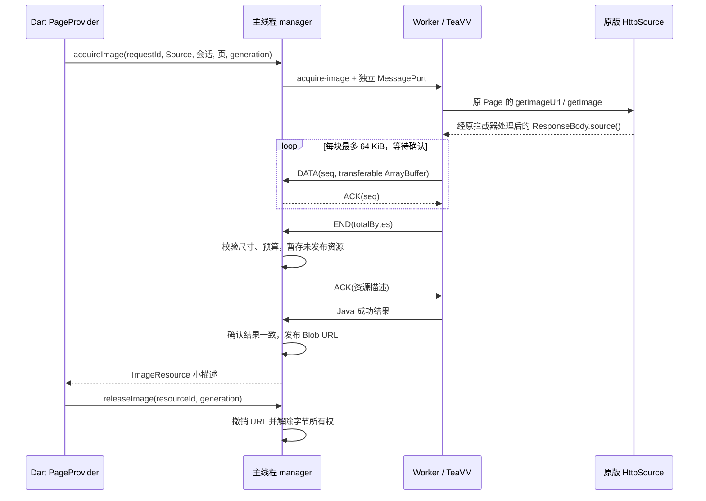

# Source 图片资源通道

本文记录 P0 的产品图片合同。实现和分层验收见 [P0 计划](plan/p0-runtime-and-reading.md)及[验证记录](VERIFICATION.md)；协议设计本身不表示真实 Source 或移动设备已经通过。

当前合同使用 `karuyomi-source-host-v3`：Page 会话及 `hostAcquireImage/hostClosePageSession` 是必需 ABI，控制边界采用 Protobuf 生成模型和标准 ProtoJSON。控制信封 protocolVersion 为 2，HTTP bridgeVersion 为 2；三者含义不同。旧 ABI 的 AOT、客户端和材料必须同步重建，不混合部署。历史 v2 图片实测结果保留其原始身份，不能作为 v3 运行验收。

## 原始 Page 与逻辑页

`pages` 返回 `pageSessionId` 及 `pages`，每项包含 `pageKey/index/sourceIndex/url/imageUrl`。Java 在有界会话表中保留原 Source 返回的 Page 实例，包括其可变字段和子类；图片阶段不能用 DTO 重新构造 Page。会话绑定创建它的 Source 实例，Worker generation 或 build 改变时全部失效。

`ChapterPageProvider` 绑定 Source、会话、generation 和稳定章节引用，内部将阅读核心的逻辑页键映射到会话内 opaque pageKey。阅读位置不保存临时会话 ID 或有签名的 imageUrl。`reader_core.PageRef` 仅含 requestId、chapterKey、pageKey 和 generation，不依赖 TeaVM 或 Source URL。

章节导航负责关闭 Page 会话。释放显示资源与关闭 Page 会话是不同操作：前者撤销已交付的 Blob，后者解除 Java 原始 Page 引用。两者都必须在取消、路由离开及容器失效时清理。

## 处理与所有权

Java 仅在 Page 的 imageUrl 尚未解析时调用原 Source 的 `getImageUrl`，随后调用原 `getImage`。原请求头、Cookie、拦截器及图片处理保留在同一网络链中；不能直接读取原图 URL。cacheless/progress helper 也须保持上游语义。

Java 图片出口为 `teaImageOpen/Write/Close/Cancel`，同步控制信息保持小；Write 每次至多 64 KiB，等待 ACK 后才生产下一块。每次获取使用独立 MessageChannel，DATA buffer 转移所有权。END 时暂存已校验 Blob 并返回内部元数据 ACK，Java Close 完成后才返回 Source 调用成功。主线程必须同时收到有效流终态和一致的 Java 成功结果，才能创建 Blob URL 并向 Dart 发布资源；单独 END 或 RPC 成功均不足以显示图片。暂存后 Java 失败也须解除字节所有权。

HTTP handle 只属于当前 Source 调用，调用结束清理。图片资源归主线程 manager 所有，独立存活至 release；不能返回 HTTP handle 充当图片资源。资源描述为 `resourceId/generation/mimeType/byteLength/width/height/url`。Web 仅接受 manager 创建的 Blob URL；Native 经平台所有权表确认后只交付受管文件，不支持的平台返回能力不足。iOS 产品文件桥与 Android 平台 sink 的实现、模拟器机制证据和未验门见 [Native 图片文件](NATIVE-IMAGE-FILES.md)。

编码字节、驻留资源与尺寸均受预算约束。尺寸头解析复用固定版本的 [image-dimensions](https://github.com/sindresorhus/image-dimensions)，先检查像素预算，再用浏览器 `createImageBitmap` 获取实际显示尺寸并立即 close，处理 EXIF 等浏览器方向语义。这会增加一次临时解码，不构成零复制或移动端峰值通过的证据。尺寸学习只更新 Reader 布局，保留 manifest.version 与逻辑锚。

| 范围                          | 当前上限                    |
| ----------------------------- | --------------------------- |
| DATA / 未确认块               | 64 KiB / 1 块               |
| 单图 / 在途与驻留编码字节合计 | 64 MiB / 64 MiB             |
| 单图 / 在途与驻留像素合计     | 16 Mi / 32 Mi 像素          |
| 在途与驻留资源数 / 尺寸头检查 | 6 / 前 1 MiB                |
| Java 原始 Page 会话           | 2 个会话，每个至多 2,048 页 |
| 取消退出宽限                  | 1 秒，超过则失效 generation |

像素预算只估算图片 surface（按 RGBA 为 64 / 128 MiB），不能代表浏览器进程合计峰值。浏览器解码无法中断时，取消也须等其完成并 close 后才能归还计数，不能用提前删除资源表来绕过总预算。

## 控制与清理

接口为 `acquireImage({requestId,sourceId,pageSessionId,pageKey,generation,timeoutMs?})`、`cancelImage({requestId,generation})`、`releaseImage({resourceId,generation})` 和 `closePageSession({pageSessionId,generation})`。release 幂等，重复释放不能复活资源。旧 generation 的结果不能落入当前会话。

ACK 和图片取消不能排在 Source 串行锁后等待。取消先终止图片 sink 与相应 HTTP 句柄，再等待当前 Java 调用退出；`teaDone/teaFail` 没有调用身份，提前解锁会使迟到回调污染下一次操作。超过取消宽限只能回收整个 Worker、失效 generation，并由客户端重新打开章节，不能静默复用旧 Page 会话。

Reader 在 widget、缩放 overlay 与解码缓存解除引用后释放资源。manager 在 invalidate、dispose 和 pagehide 中清理在途块、Blob URL 和资源表；失败、超限、解码错误及迟到结果也必须清理。图片窗口限制同时持有的页，不整章获取。

## 分层验收

- 通道：慢消费者背压、序号与字节预算、END/RPC 竞争、取消后退出、旧 generation、重复 release、空资源表。
- Java：原 Page 身份、Source 绑定、原图片方法与处理后正文、有界读取、关闭和失败路径。
- 实际 Web：未修改 Source 的真实章首中末页，经产品通道解码、阅读器导航、尺寸更新及释放。
- 后续设备门：原 Source→Native Reader、Android ArrayBuffer 实际插件链、物理 iPhone、后台恢复及合计进程/GPU 峰值。iOS 真实 Flutter Headless→受控 Blob→WKDownload 文件机制已单独通过，不代替这些门。

## Source 内部图形桥

Bitmap / ImageDecoder 的图像正文改用 Worker 内部 byte handle，`teaGraphicsBytesOpen/Write/Read/Close/Detach` 仅接受每块最多 64 KiB 的 `Uint8Array`；Java 逐字节复制。绘图参数、handle 和长度仍走小 JSON，Java 控制请求限制 64 KiB UTF-8。解码、字体上传从 InputStream 有界读取，编码结果按块写入调用方 OutputStream，像素数组和 ByteBuffer 按行及 64 KiB 子块读写；这条图形链不再把整图塞入 Base64/Gson，也不再使用 `readAllBytes()`。

`inJustDecodeBounds` 只读取最多前 1 MiB，使用固定 `image-dimensions` 解析头部，不调用 `createImageBitmap` 或创建 canvas。头部不足或格式不支持时，BitmapFactory 返回解码失败；完整解码先检查尺寸，再核对浏览器实际尺寸。现代 ImageDecoder、Float16 和字体 API 缺失须明确报能力不足，不能伪造 HDR、帧或字体成功。旧 region-decoder 仍以完整有界 Bitmap 为 backing，并非真正的分片解码。

| 内部图形账本                                           | 当前上限 / 计量                                                                                  |
| ------------------------------------------------------ | ------------------------------------------------------------------------------------------------ |
| 桥持有 payload 账本 / raster 预留                      | 256 MiB / 192 MiB                                                                                |
| 单 surface / 单输入或编码输出                          | 16 Mi 像素 / 64 MiB                                                                              |
| surface / decoder / font / byte handle / pending codec | 64 / 8 / 32 / 64 / 4                                                                             |
| 字体输入 / 尺寸头 / JSO 暂存预留                       | 8 MiB / 1 MiB / 每操作 2 × 64 KiB                                                                |
| surface                                                | 宽 × 高 × 4，Float16 为 × 8                                                                      |
| decoder                                                | 保留输入及浏览器编码副本，并按宽 × 高 × 8 保留工作 raster；每次 decode 另预留一帧                |
| Java Frame                                             | 传输期间同时计 JS 像素与 Java ByteBuffer；Detach 后保留 Java lease，Frame.close 后释放           |
| 临时字节                                               | 合并上传、尺寸解析副本、Blob、编码副本、ImageData 和临时 canvas 均先预留；转换时允许两份同时计费 |

预算属于每个 Source Worker，与外层 manager 的图片窗口预算分别计量。Bitmap、decoder、成功加载的字体和已交付的 Java Frame 属于 Source 持有对象；普通调用结束或取消不得扫描删除它们。Bitmap.recycle、decoder.close 和 Frame.close 才解除相应所有权；Android Typeface 没有 close，已加载字体保留到 Worker 回收，受数量和字节预算约束。

取消只标记当前 requestId/generation。不可中断的浏览器 decode、encode 或 font.load 结束后才释放其预留、输入 pin 和临时对象，迟到结果不发布；编码期间显式 recycle 的 surface 延迟到工作完成后销毁。driver 仍等待 Java 回调退出再结束图形上下文和释放串行锁。Java 同步 JSO 和异步 fiber 错误均回传为 Java 异常，确保 finally 路径执行；预算、能力与取消错误在 driver 保留对应错误类别。

此账本约束可见对象和明确工作预留，不等于浏览器进程、GPU、codec 内部或字体 glyph cache 的实际峰值硬上限，也无法限制 Source 自行持有的任意数组或调用方缓存。已有 JVM 流式检查、受控 codec 生命周期测试，以及 Codex 内置浏览器 Chromium 156 的真实 Canvas 二进制 RGBA/PNG、头部 bounds、取消与显式回收检查。同环境的 TeaVM 0.16.0 独立 Java→JSO→Canvas oracle 也通过 131,079 字节分块往返、同步/异步 Java 异常、fiber bounds、Bitmap pixels/raw/PNG、1px region sample 别名和 Java Frame lease 检查，显式释放后账本归零；这不代表真实进程峰值为零。harness 初次遗漏正式构建器的 Android 重复类裁剪，曾触发上游 Stub，校正独立 harness 后复跑通过，未修改 Source 或原始 JAR。新 host 的真实图片解密、重排 Source、超长图和移动设备合计峰值仍须分别验收。Cache/File 等其它内部桥的大正文问题属于后续阶段，不能据此宣称整个 runtime 已无 Base64/JSON 大正文。

相关正式回归入口：`pnpm teavm:check`、`pnpm exec vitest run packages/runtime-host/test/graphics-bridge.test.ts packages/runtime-host/test/image-driver.test.ts`、`pnpm typecheck:bridges`；真实 Worker 测试入口为 `packages/runtime-host/test/bridge-browser-suite.ts` 的 graphics phase。独立 TeaVM harness 与详细日志留在忽略的 `.local/graphics-review/`，不作为构建或 CI 依赖。
