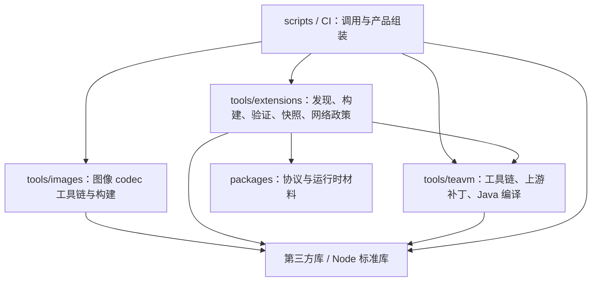

# 自动化工具与依赖

项目自有自动化统一使用 TypeScript，由固定 Node 原生执行并通过 `tsconfig.tools.json` 严格检查。Java 编译器适配与 JVM oracle 仍是 Java 源码；Flutter、Gradle、CocoaPods 等平台要求的构建配置保留原格式。上游 submodule 与生成产物不参与语言迁移。

外部进程由调用点直接使用精确锁定的 execa，明确可执行文件、argv、工作目录和输出预算。稳定 JSON、原子写入和归档直接导入 json-stable-stringify、write-file-atomic、fflate/tar/yauzl，统一 diff 应用使用 diff，流限额使用 get-stream；`tools/lib/` 已删除，不为库已有能力另建包装层。具体范围、取消顺序与验收见[执行器计划](plan/tooling-processes.md)。

## 层级

- `scripts/` 是仓库操作入口，不被工具模块或产品代码导入。CLI 参数解析与领域实现分开，领域函数可以直接测试。
- `tools/extensions/` 负责扩展描述、输入指纹、隔离 AOT、静态当前快照、传输校验和网络授权元数据。注册、同步和流水线共享同一份清单与 gzip 校验，不再动态导入 CLI 文件。
- `tools/images/` 负责图片 codec 的官方 SDK、portable 产物校验、原子安装与隔离缓存，不依赖扩展发布编排。`pnpm image-codecs:prepare` 准备锁定工具链，`pnpm image-codecs:build` 构建共同 ABI 的 PNG/JPEG decoder 与 PNG encoder WASM，`pnpm image-codecs:check --build <directory>` 另行执行真实长图回归。`pnpm image-codecs:prepare-artifacts` 为候选专项验收准备锁定 portable 归档；`pnpm image-codecs:package` 由已验证的本地构建生成归档与锁。`pnpm image-codecs:check-worker` 提供 Codex 内置浏览器的真实 Worker/tile 验收入口。`pnpm test:image-codecs` 运行不下载 SDK 的归档、构建器和消费生命周期回归，已纳入 `pnpm check`。支持平台和当前集成范围见 [image-codec README](../runtime/image-codec/README.md)。
- `tools/teavm/` 负责锁定工具链、seed、归档、上游补丁和 JVM 构建。工作目录由参数明确传入，不复制脚本后改变源码定位，不依赖扩展发布编排。
- 通用进程、序列化、原子写入、归档、文件锁和并发直接使用成熟库。seed 成员、构建身份、checkpoint 与资源预算等项目规则留在所属领域，不重新搬出一套通用 helper。
- `runtime/image-codec/` 的 C 与严格 TypeScript 是独立客户端候选库；它不导入自动化、测试或 Source host；Source host 同样不得导入该候选库。`tools/images/` 只依赖该领域与第三方库，不依赖扩展发布编排。
- 产品 `src/` 不依赖工具或测试代码。contracts 只依赖底层生成协议包及库，独立于应用、运行时和自动化。
- `packages/runtime-host/build.ts` 仅生成包自身 `dist/`；仓库入口 `scripts/assemble-native-assets.ts` 将 Native 产物装入 Flutter 应用。Web 与扩展快照由仓库资源组装入口组合。默认 `collectMaterials()` 不准备、下载或编译候选图片 codec，默认 Web/Native 成品也不携带它；只有 `tools/images/` 的专项验收显式传入 `includeImageCodecs: true`。候选源码不进入扩展 AOT 的直接输入集合。

`pnpm check:dependencies` 使用固定版本 dependency-cruiser 检查循环、工具反向引用 CLI、重新引入 tools/lib 包装层、TeaVM 依赖扩展编排，以及产品导入工具/测试。类型依赖同样参与；`cloudflare:workers` 是平台提供的模块，其他无法解析的导入会报错。检查纳入 `pnpm check`。边界变化应调整模块归属，不能靠忽略规则掩盖循环。

Wrangler 4.156.1 的 D1 `--file --json` 会由另一套 logger 输出上传进度，而错误日志级别又会抑制最终 JSON。仓库使用标准 pnpm patch，只修正 D1 `--json` 成功结果为独立 JSON 输出；执行器设置 `WRANGLER_LOG=error`，仍严格解析结果并拒绝非零退出及失败项。补丁由 `pnpm-workspace.yaml` 和锁文件固定，不维护本地复制的 CLI，也不通过截取输出寻找 JSON。

API、runtime-host 与浏览器工具已从项目自有 esbuild 调用迁移到 Vite，Workers 集成测试同时接入 Cloudflare 官方 Vitest 插件；实施和验收条件见 [Vite 计划](plan/vite-build-and-testing.md)。API 仍在 Flutter/runtime/扩展资源组装之后构建，Vite 必须显式接入已组装的 `dist/public`。正式部署使用插件生成的 Wrangler 配置重定向；隔离探针同时使用临时 Vite `root` 和输出目录，避免测试构建改变生产部署定位。迁移的集中工程、harness 与内置浏览器 Cache 证据见 [验证记录](verification/vite-build-and-testing.md)；不将已有旧工具链证据改称 Vite 或官方测试集成证据。

## 构建身份与验证

固定 checkout 中的工具模块、工具链锁、协议、材料、依赖锁和上游 pin 参与 host 输入身份。脚本迁移后建立新 baseline，不复用旧 Release/checkpoint 作为当前成果。批量构建仍需固定 supervisor、verifier 和 builder，动态 Source 请求的网络权限与公开静态分发分开。

迁移保留有意义的行为门：无变化跳过、失败保留兼容的成功、同失败不重试、删除退役、传输损坏、有界 gzip、D1 事务与明确域名、真实进程组取消、checkpoint 锁、候选原子替换与部署确认后落状态。单元测试、真实 workerd、真实 AOT 初始化和线上部署分别记录在 [VERIFICATION](VERIFICATION.md)。

命令见 [EXTENSIONS](EXTENSIONS.md) 和 [TeaVM README](../runtime/teavm/README.md)。提交前仍须先 `pnpm format`，再 `pnpm format:check`，并通过真实 prek hook。

## 业务状态与生成模型

收藏与阅读进度通过 `protocol/karuyomi/v1/business.proto` 生成 TypeScript/Dart 模型，`pnpm generate:check` 检查一致性；D1 表由 `apps/api/src/db/schema.ts` 定义，使用固定 Drizzle Kit 生成迁移。API 集成测试在真实 workerd/Miniflare D1 中执行受信 JWT、条件写入和原子失败验证。

本地业务 Drift/SQLite、build_runner 和数据库 Web WASM/Worker 资产已移除。`pnpm flutter:check` 继续执行三个 Dart/Flutter 项目的静态分析、测试和格式检查；客户端仅保留会话状态，不再生成本地数据库代码。Source 自身文件/HTTP Cache 与业务数据分离，仍保留原有存储生命周期。
