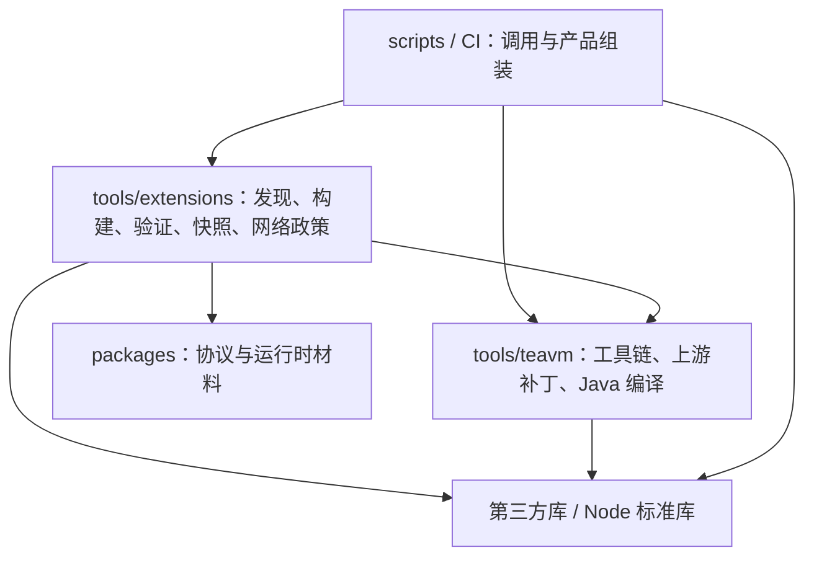

# 自动化工具与依赖

项目自有自动化统一使用 TypeScript，由固定 Node 原生执行并通过 `tsconfig.tools.json` 严格检查。Java 编译器适配与 JVM oracle 仍是 Java 源码；Flutter、Gradle、CocoaPods 等平台要求的构建配置保留原格式。上游 submodule 与生成产物不参与语言迁移。

外部进程由调用点直接使用精确锁定的 execa，明确可执行文件、argv、工作目录和输出预算。稳定 JSON、原子写入和归档直接导入 json-stable-stringify、write-file-atomic、fflate/tar/yauzl，统一 diff 应用使用 diff，流限额使用 get-stream；`tools/lib/` 已删除，不为库已有能力另建包装层。具体范围、取消顺序与验收见[执行器计划](plan/tooling-processes.md)。

## 层级

- `scripts/` 是仓库操作入口，不被工具模块或产品代码导入。CLI 参数解析与领域实现分开，领域函数可以直接测试。
- `tools/extensions/` 负责扩展描述、输入指纹、隔离 AOT、静态当前快照、传输校验和网络授权元数据。注册、同步和流水线共享同一份清单与 gzip 校验，不再动态导入 CLI 文件。
- `tools/teavm/` 负责锁定工具链、seed、归档、上游补丁和 JVM 构建。工作目录由参数明确传入，不复制脚本后改变源码定位，不依赖扩展发布编排。
- 通用进程、序列化、原子写入、归档、文件锁和并发直接使用成熟库。seed 成员、构建身份、checkpoint 与资源预算等项目规则留在所属领域，不重新搬出一套通用 helper。
- 产品 `src/` 不依赖工具或测试代码。contracts 只依赖底层生成协议包及库，独立于应用、运行时和自动化。
- `packages/runtime-host/build.ts` 仅生成包自身 `dist/`；仓库入口 `scripts/assemble-native-assets.ts` 将 Native 产物装入 Flutter 应用。Web 与扩展快照由仓库资源组装入口组合。

`pnpm check:dependencies` 使用固定版本 dependency-cruiser 检查循环、工具反向引用 CLI、重新引入 tools/lib 包装层、TeaVM 依赖扩展编排，以及产品导入工具/测试。类型依赖同样参与；`cloudflare:workers` 是平台提供的模块，其他无法解析的导入会报错。检查纳入 `pnpm check`。边界变化应调整模块归属，不能靠忽略规则掩盖循环。

Wrangler 4.156.1 的 D1 `--file --json` 会由另一套 logger 输出上传进度，而错误日志级别又会抑制最终 JSON。仓库使用标准 pnpm patch，只修正 D1 `--json` 成功结果为独立 JSON 输出；执行器设置 `WRANGLER_LOG=error`，仍严格解析结果并拒绝非零退出及失败项。补丁由 `pnpm-workspace.yaml` 和锁文件固定，不维护本地复制的 CLI，也不通过截取输出寻找 JSON。

## 构建身份与验证

固定 checkout 中的工具模块、工具链锁、协议、材料、依赖锁和上游 pin 参与 host 输入身份。脚本迁移后建立新 baseline，不复用旧 Release/checkpoint 作为当前成果。批量构建仍需固定 supervisor、verifier 和 builder，动态 Source 请求的网络权限与公开静态分发分开。

迁移保留有意义的行为门：无变化跳过、失败保留兼容的成功、同失败不重试、删除退役、传输损坏、有界 gzip、D1 事务与明确域名、真实进程组取消、checkpoint 锁、候选原子替换与部署确认后落状态。单元测试、真实 workerd、真实 AOT 初始化和线上部署分别记录在 [VERIFICATION](VERIFICATION.md)。

命令见 [EXTENSIONS](EXTENSIONS.md) 和 [TeaVM README](../runtime/teavm/README.md)。提交前仍须先 `pnpm format`，再 `pnpm format:check`，并通过真实 prek hook。

## Drift 生成模型

阅读进度数据库使用 `apps/reader/pubspec.yaml` 精确锁定的 Drift/Drift Dev 与官方 build_runner。修改表后在 `apps/reader/` 运行 `dart run build_runner build`，将自有表定义和官方 `reader_database.g.dart` 一起审阅提交。`pnpm flutter:check` 用官方生成器重建该目标并逐字节检查，发现差异时要求审阅生成结果；随后继续静态分析与测试。`.g.dart` 与现有 Protobuf 生成模型一样不参与普通源码再排版，类型分析与真实数据库测试仍包含它们。
