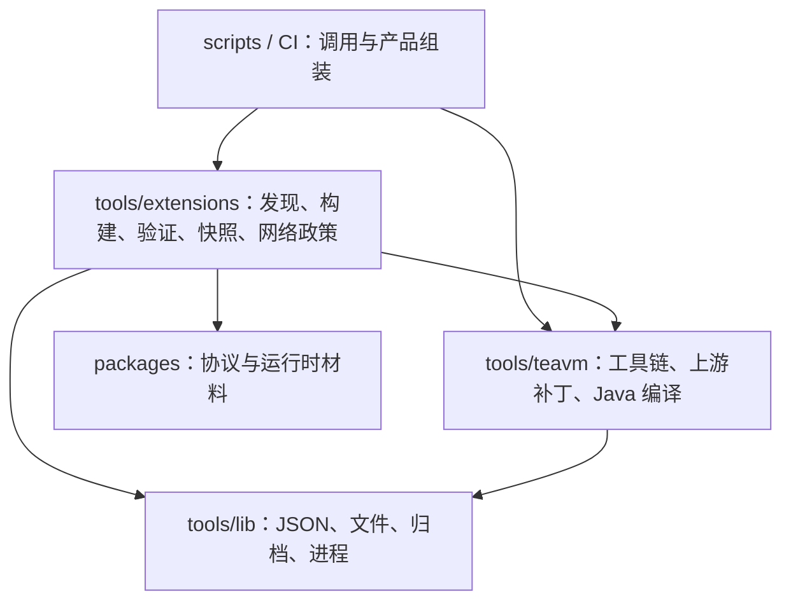

# 自动化工具与依赖

项目自有自动化统一使用 TypeScript，由固定 Node 原生执行并通过 `tsconfig.tools.json` 严格检查。Java 编译器适配与 JVM oracle 仍是 Java 源码；Flutter、Gradle、CocoaPods 等平台要求的构建配置保留原格式。上游 submodule 与生成产物不参与语言迁移。

## 层级

- `scripts/` 是仓库操作入口，不被工具模块或产品代码导入。CLI 参数解析与领域实现分开，领域函数可以直接测试。
- `tools/extensions/` 负责扩展描述、输入指纹、隔离 AOT、静态当前快照、传输校验和网络授权元数据。注册、同步和流水线共享同一份清单与 gzip 校验，不再动态导入 CLI 文件。
- `tools/teavm/` 负责锁定工具链、seed、归档、上游补丁和 JVM 构建。工作目录由参数明确传入，不复制脚本后改变源码定位，不依赖扩展发布编排。
- `tools/lib/` 只含通用基础能力，不依赖 Source、应用或领域工具。归档、文件锁、并发分别使用成熟第三方库；协议边界复用实际 contracts schema。
- 产品 `src/` 不依赖工具或测试代码。contracts 独立于应用、运行时和自动化。
- `packages/runtime-host/build.ts` 仅生成包自身 `dist/`；仓库入口 `scripts/assemble-native-assets.ts` 将 Native 产物装入 Flutter 应用。Web 与扩展快照由仓库资源组装入口组合。

`pnpm check:dependencies` 使用固定版本 dependency-cruiser 检查循环、工具反向引用 CLI、公共层依赖领域、TeaVM 依赖扩展编排，以及产品导入工具/测试。类型依赖同样参与；`cloudflare:workers` 是平台提供的模块，其他无法解析的导入会报错。检查纳入 `pnpm check`。边界变化应调整模块归属，不能靠忽略规则掩盖循环。

## 构建身份与验证

固定 checkout 中的工具模块、工具链锁、协议、材料、依赖锁和上游 pin 参与 host 输入身份。脚本迁移后建立新 baseline，不复用旧 Release/checkpoint 作为当前成果。批量构建仍需固定 supervisor、verifier 和 builder，动态 Source 请求的网络权限与公开静态分发分开。

迁移保留有意义的行为门：无变化跳过、失败保留兼容的成功、同失败不重试、删除退役、传输损坏、有界 gzip、D1 事务与明确域名、真实进程组取消、checkpoint 锁、候选原子替换与部署确认后落状态。单元测试、真实 workerd、真实 AOT 初始化和线上部署分别记录在 [VERIFICATION](VERIFICATION.md)。

命令见 [EXTENSIONS](EXTENSIONS.md) 和 [TeaVM README](../runtime/teavm/README.md)。提交前仍须先 `pnpm format`，再 `pnpm format:check`，并通过真实 prek hook。
