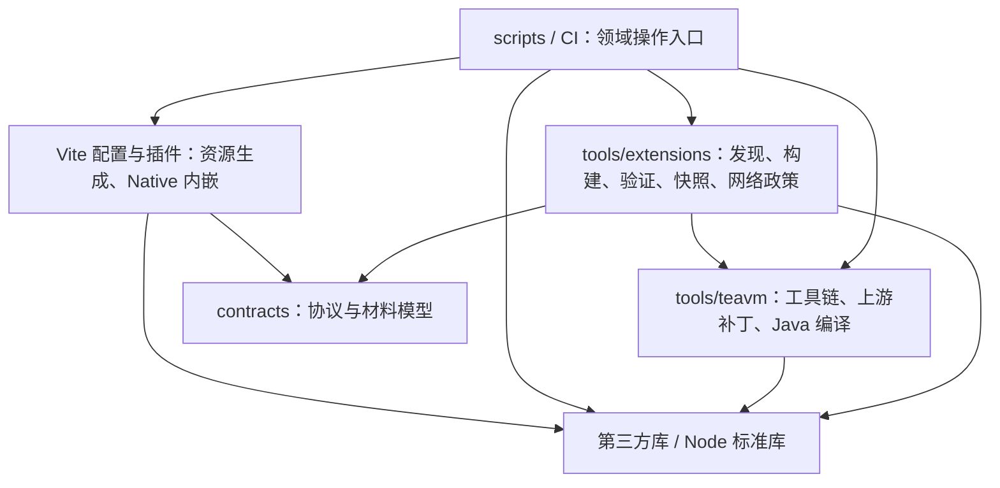

# 自动化工具与依赖

项目自有自动化统一使用 TypeScript，由固定 Node 原生执行并通过 `tsconfig.tools.json` 严格检查。Java 编译器适配与 JVM oracle 仍是 Java 源码；Flutter、Gradle、CocoaPods 等平台要求的构建配置保留原格式。上游 submodule 与生成产物不参与语言迁移。

外部进程由调用点直接使用精确锁定的 execa，明确可执行文件、argv、工作目录和输出预算。稳定 JSON、原子写入和归档直接导入 json-stable-stringify、write-file-atomic、fflate/tar/yauzl，统一 diff 应用使用 diff，流限额使用 get-stream；`tools/lib/` 已删除，不为库已有能力另建包装层。具体范围、取消顺序与验收见[执行器计划](plan/tooling-processes.md)。

## 层级

- `scripts/` 是仓库操作入口，不被工具模块或产品代码导入。CLI 参数解析与领域实现分开，领域函数可以直接测试。
- `tools/extensions/` 负责扩展描述、输入指纹、隔离 AOT、静态当前快照、传输校验和网络授权元数据。注册、同步和流水线共享同一份清单与 gzip 校验，不再动态导入 CLI 文件。
- `tools/teavm/` 负责锁定工具链、seed、归档、上游补丁和 JVM 构建。工作目录由参数明确传入，不复制脚本后改变源码定位，不依赖扩展发布编排。
- 通用进程、序列化、原子写入、归档、文件锁和并发直接使用成熟库。seed 成员、构建身份、checkpoint 与资源预算等项目规则留在所属领域，不重新搬出一套通用 helper。
- 产品 `src/` 不依赖工具或测试代码。contracts 只依赖底层生成协议包及库，独立于应用、运行时和自动化。
- `packages/runtime-host/vite.materials.config.ts` 声明五桥 classic IIFE 与共享材料输出；`vite.config.ts` 声明 Web host ESM、Web Worker 和 Native host/Worker classic IIFE。资源生成、材料清单和 Native 内嵌集中在现有 `vite.runtime-plugin.ts` 的构建 hook 中。独立 `materials.ts` 已删除；contracts 只提供纯 `runtimeMaterialCatalogSchema` 模型及类型，消费者在调用点直接 `readFile` 已生成 catalog 并 `schema.parse`，再按需读取材料字节。`pnpm build:native-assets` 使用固定 cpy-cli 将三个 Native 文件复制进 Flutter。产品材料仅包含五桥与 Zstd WASM；未采用的图片 codec 候选源码、专属工具及 Vite 配置已删除。

`pnpm check:dependencies` 使用固定版本 dependency-cruiser 检查循环、工具反向引用 CLI、重新引入 tools/lib 包装层、TeaVM 依赖扩展编排，以及产品导入工具/测试。类型依赖同样参与；`cloudflare:workers` 是平台提供的模块，其他无法解析的导入会报错。检查纳入 `pnpm check`。边界变化应调整模块归属，不能靠忽略规则掩盖循环。

Wrangler 4.156.1 的 D1 `--file --json` 会由另一套 logger 输出上传进度，而错误日志级别又会抑制最终 JSON。仓库使用标准 pnpm patch，只修正 D1 `--json` 成功结果为独立 JSON 输出；执行器设置 `WRANGLER_LOG=error`，仍严格解析结果并拒绝非零退出及失败项。补丁由 `pnpm-workspace.yaml` 和锁文件固定，不维护本地复制的 CLI，也不通过截取输出寻找 JSON。

JS/TS 产品构建使用声明式 Vite 配置和官方 CLI；API 使用 Cloudflare 官方 Vite 插件。`pnpm build` 依次构建 runtime-host、用 cpy-cli 复制 Native 资源、构建 Flutter Web，最后运行 API Vite。`apps/api/vite.assets.ts` 在 Vite config hook 中装配 Flutter/runtime/当前扩展快照，产生 `dist/public` 并检查 MIME、缓存、限额和 Native 资源排除；Cloudflare 插件生成最终客户端产物与 Wrangler 部署配置重定向。资源规则属于项目集成逻辑，不另设手写构建器。

`pnpm test` 先经 Vite CLI 构建 runtime 与 API 测试 fixture，再运行 Node/官方 Workers Vitest。官方 Test Harness 使用独立 fixture 与输出，不改写生产构建定位。浏览器桥回归使用官方 Vitest Browser Preview：运行 `BROWSER=none pnpm test:browser`，再用 Codex 内置浏览器打开其 URL；Preview 会请求打开默认浏览器，单设 `server.open: false` 不足。旧手写 socket/HTTP、Source 在线与浏览器 runner 已移除，新 fixture 测试不自动继承原 Source、Native、网络 TCP reset 或生产 Access 的验收范围。当前覆盖和剩余门见 [Vite 计划](plan/vite-build-and-testing.md)及[验证记录](verification/vite-build-and-testing.md)。

正式 Flutter Web 的交互验收使用 `pnpm acceptance:build` 构建当前产品及独立 Vite 测试产物，再运行 `pnpm acceptance:serve`。入口直接使用 Cloudflare 官方 `createTestHarness()`，监听随机 loopback URL、应用真实 D1 迁移；同一个 URL 可在 Codex 内置浏览器打开两个独立标签页。测试入口为 loopback 请求签发临时 RS256 身份，随后仍经过正式 JWT、Origin 和业务请求头校验；它不替客户端补写 `X-App-Subject` 或 `X-App-Request`。该入口不进入生产构建，测试身份不能代替生产 Access 正向验收。按 Enter 或发送 SIGINT/SIGTERM 后关闭官方 harness，隔离 D1 状态随进程销毁。

Native 分类验收使用 `pnpm acceptance:build:native` 的现有 Vite 配置 mode，将 Wrangler 的 `local_protocol` 与 `upstream_protocol` 一起声明为 HTTPS；两者必须一致，避免官方代理把 Worker 所见 scheme 改成 HTTP。通过官方 `WRANGLER_HTTPS_KEY_PATH` / `WRANGLER_HTTPS_CERT_PATH` 提供证书，Node 经 `NODE_EXTRA_CA_CERTS` 正常信任本轮 CA。可选 `ACCEPTANCE_FIXTURE=categories pnpm acceptance:serve` 经正式 API 初始化两部受控收藏；随后由 Flutter 官方 `integration_test/category_sync_test.dart` 执行五阶段 UI/确认读回。设备信任、阶段与命令见[Native 测试说明](../apps/reader/integration_test/README.md)。这个分类 fixture 不恢复旧 Source 在线服务，也不放松产品 HTTPS 检查。

## tools 与 Vite 的职责映射

Vite 插件负责把当前构建的本地输入转换、校验和写入应用资源。扩展静态快照装配已直接内化到现有 `apps/api/vite.assets.ts`，删除独立的 tools 装配模块；不增加只转发一次调用的插件。原有当前索引可达性、材料身份、上传摘要和大小限额断言继续由插件构建测试覆盖。共享清单解析与校验仍供 AOT、注册和流水线复用，保留在所属领域模块。

| 范围                                                       | 职责与当前归属                                                                                | Vite 适用性                                                                                                                   |
| ---------------------------------------------------------- | --------------------------------------------------------------------------------------------- | ----------------------------------------------------------------------------------------------------------------------------- |
| `apps/api/` 与 `packages/runtime-host/` 的 Vite 配置和插件 | Flutter/runtime/扩展快照静态装配、五桥与固定 WASM 材料、Native 内嵌及 manifest                | 已接入；产出直接属于应用构建，资源声明和项目规则放在现有配置/插件。                                                           |
| `tools/extensions/` 的发现、AOT 与流水线                   | catalog 输入闭包和指纹、隔离 builder、增量计划、checkpoint、失败保留、候选快照与部署确认      | 保留显式命令；跨包任务恢复、上游 Gradle/TeaVM 编译和发布状态不属于 Vite 模块图。流水线在启动 builder 前显式调用材料构建 CLI。 |
| `tools/extensions/` 的交付与校验                           | assets 传输、有界 gzip、verify-manifest 与 verify-build 报告                                  | 保留领域函数和独立命令；线上读取、产物传输和验收有各自的输入与失败边界。资源插件可复用纯校验，默认 build 不触发远端操作。     |
| `tools/teavm/`                                             | JDK/Maven/Android SDK 与 seed 准备、上游补丁和生成重命名、Java/TeaVM 编译、JVM/Android oracle | 保留领域工具；这些步骤使用独立锁文件、缓存和编译器，产出供 AOT 或验证使用。给 execa 再套 Vite hook 不能替代工具链。           |
| `tools/protocol/`                                          | Buf 生成和一致性检查、官方 Dart protoc 插件启动                                               | 保留官方生成命令；它同时生成受版本管理的 TS/Dart 源码，并服务于 Flutter、API 和运行时，执行时机独立于 Vite bundle。           |
| `tools/cloudflare/`                                        | 部署隔离权限探针、检查上传结果并恢复远端基线                                                  | 保留显式验证入口；操作真实 Cloudflare 资源并使用部署凭据，不能附加到普通 build。                                              |
| `scripts/` 与平台 CLI                                      | Flutter SDK、Web/Native 构建及检查；Drizzle 生成与 Wrangler D1 迁移                           | 保留各自官方命令；Flutter、数据库迁移和平台工具链有独立生命周期。三个 Native 文件的复制直接使用 cpy-cli。                     |

未采用的自研图片 codec 及其 SDK、归档、构建和验证入口已删除，历史范围见 [codec 记录](verification/long-image-codec.md)。`model`、`types` 等纯模型及测试 fixture/helper 不承担构建编排，无需改成插件。后续新增可由 Vite 表达的 JS/静态资源步骤优先加入已有配置；下载、发布、DB 和网络副作用继续通过明确的命令执行。

## 构建身份与验证

固定 checkout 中的工具模块、工具链锁、协议、材料、依赖锁和上游 pin 参与 host 输入身份。脚本迁移后建立新 baseline，不复用旧 Release/checkpoint 作为当前成果。批量构建仍需固定 supervisor、verifier 和 builder，动态 Source 请求的网络权限与公开静态分发分开。

迁移保留有意义的行为门：无变化跳过、失败保留兼容的成功、同失败不重试、删除退役、传输损坏、有界 gzip、D1 事务与明确域名、真实进程组取消、checkpoint 锁、候选原子替换与部署确认后落状态。单元测试、真实 workerd、真实 AOT 初始化和线上部署分别记录在 [VERIFICATION](VERIFICATION.md)。

命令见 [EXTENSIONS](EXTENSIONS.md) 和 [TeaVM README](../runtime/teavm/README.md)。提交前仍须先 `pnpm format`，再 `pnpm format:check`，并通过真实 prek hook。

## 业务状态与生成模型

收藏与阅读进度通过 `protocol/karuyomi/v1/business.proto` 生成 TypeScript/Dart 模型，`pnpm generate:check` 检查一致性；D1 表由 `apps/api/src/db/schema.ts` 定义，使用固定 Drizzle Kit 生成迁移。API 集成测试通过 Cloudflare 官方 Workers Vitest 在真实 workerd/D1 中执行受信 JWT、条件写入和原子失败验证；出站请求使用官方推荐的 MSW 集成。

本地业务 Drift/SQLite、build_runner 和数据库 Web WASM/Worker 资产已移除。`pnpm flutter:check` 继续执行三个 Dart/Flutter 项目的静态分析、测试和格式检查；客户端仅保留会话状态，不再生成本地数据库代码。Source 自身文件/HTTP Cache 与业务数据分离，仍保留原有存储生命周期。
