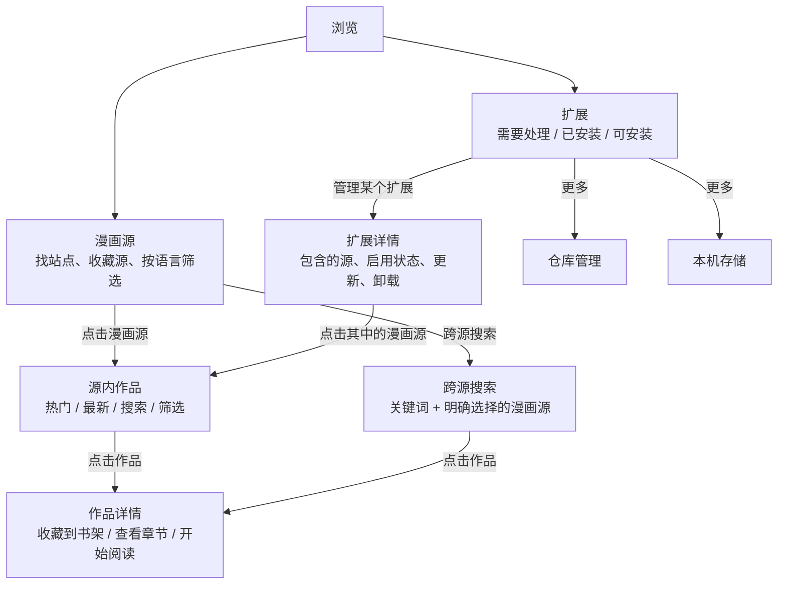
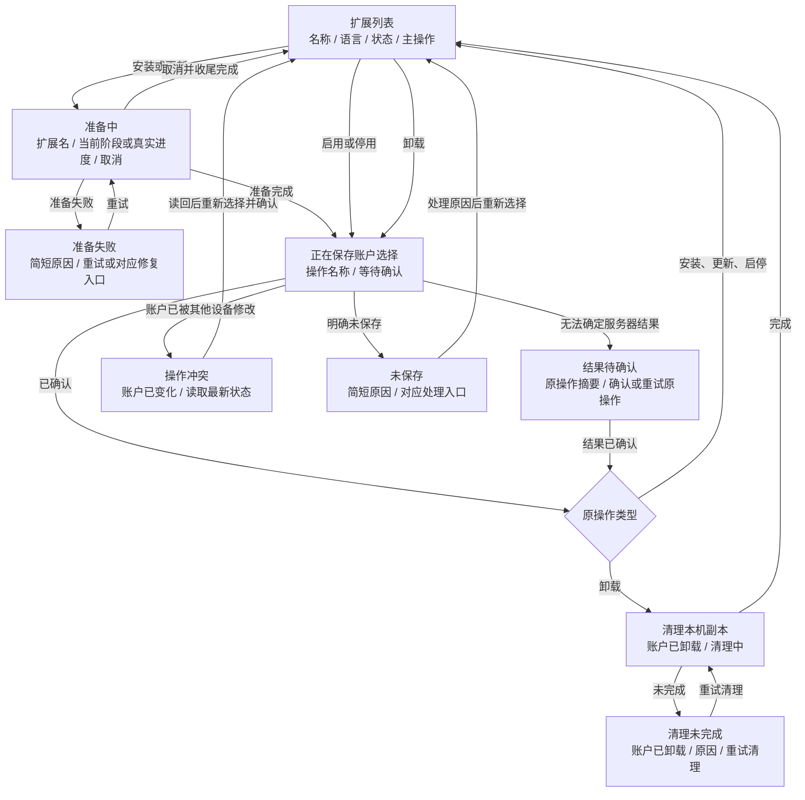
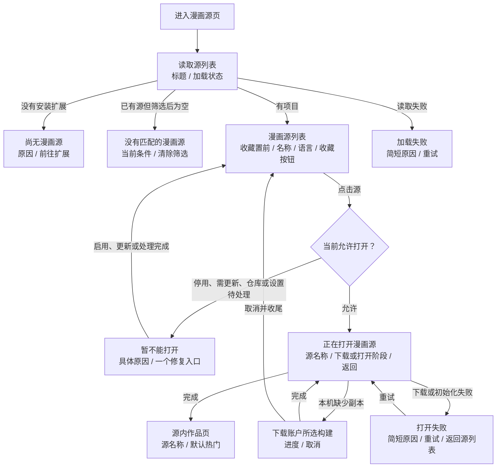
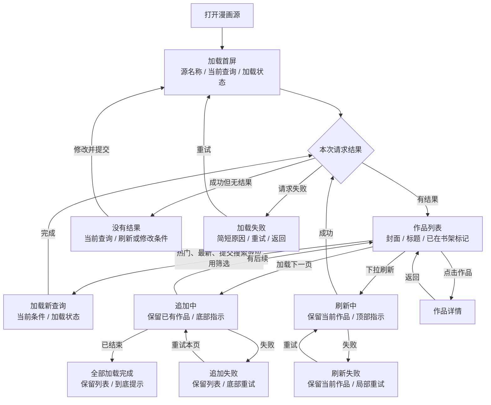
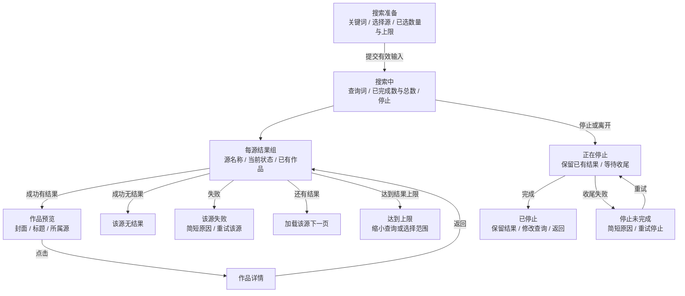
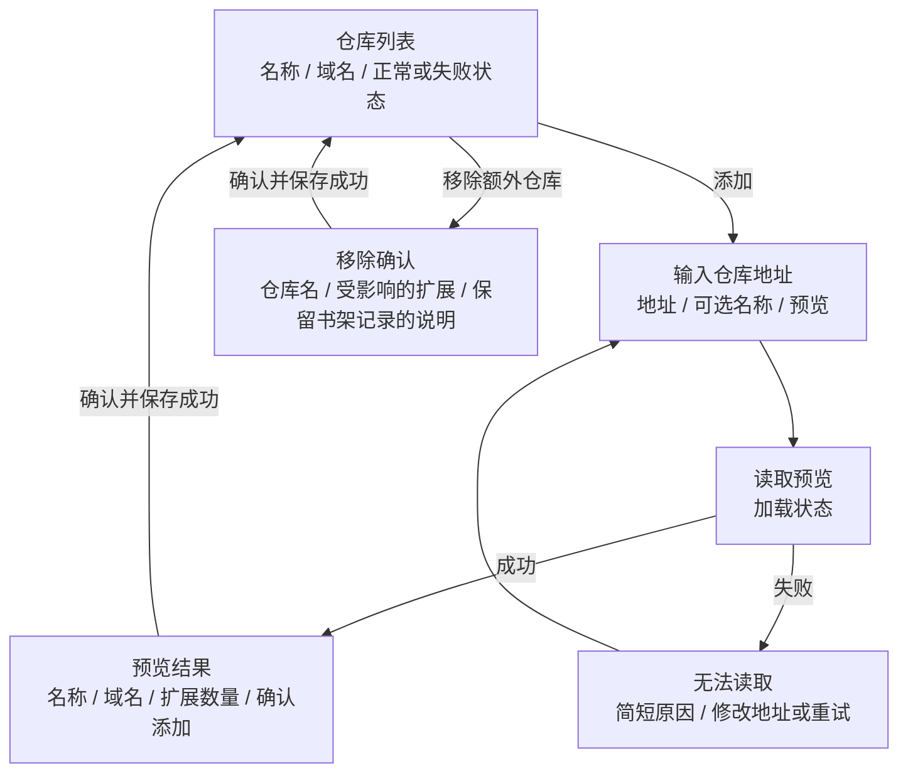

# 扩展管理与浏览：UI 状态流程提案

2026-11-12。本文整理页面职责、用户操作、可见状态及每个状态的最小必要信息，供后续 UI 调整评审；不表示客户端已经按此实现。

参考 Mihon v0.21.3 的[浏览入口](https://github.com/mihonapp/mihon/blob/v0.21.3/app/src/main/java/eu/kanade/tachiyomi/ui/browse/BrowseTab.kt)、[扩展列表](https://github.com/mihonapp/mihon/blob/v0.21.3/app/src/main/java/eu/kanade/presentation/browse/ExtensionsScreen.kt)、[漫画源列表](https://github.com/mihonapp/mihon/blob/v0.21.3/app/src/main/java/eu/kanade/presentation/browse/SourcesScreen.kt)与[作品列表](https://github.com/mihonapp/mihon/blob/v0.21.3/app/src/main/java/eu/kanade/presentation/browse/BrowseSourceScreen.kt)：源和扩展分区；扩展按状态分组；源直接进入作品；首次加载、空结果、已有结果的后续加载分别处理。使用路径也见[官方入门指南](https://mihon.app/docs/guides/getting-started/)。

Karuyomi 的账户选择、本机副本与目录可用性仍遵守[账户扩展设计](extension-management.md)。本提案复用[语言筛选](source-language-filter.md)、[跨源搜索](cross-source-search.md)及[额外仓库](additional-repositories.md)的业务边界。

## 1. 页面职责与入口

用户在“漫画源”选择站点，在“扩展”获取和维护提供这些站点的扩展。一个扩展提供多个漫画源时，漫画源直接平铺到源列表；打开扩展及选择 Source 的内部步骤由客户端完成。

- “漫画源”的搜索框筛选源名称；“源内作品”的搜索框搜索作品；“跨源搜索”有独立入口和范围。三者使用明确的占位提示。
- 扩展列表按“需要处理 → 已安装 → 可安装”分组，组内按语言和名称组织；有更新时在扩展页签显示数量。搜索与语言筛选保留分组语义。
- 仓库管理、本机存储放在二级入口；包名、构建 ID、摘要、运行槽和日志收进详情的“诊断信息”。
- 当前扩展页的仓库、账户状态、缓存清单拆开；当前浏览页的“扩展目录 → 打开包 → 包内选源”改为“源列表 → 源内作品”。

## 2. 所有列表共用的页面状态

页面状态与单条扩展、单个漫画源的状态分开。某个项目失败只影响对应项目；已经显示的内容继续可见。

| 状态             | 最小必要信息                         | 操作                       |
| ---------------- | ------------------------------------ | -------------------------- |
| 首次加载，无内容 | 页面标题、正在加载                   | 返回；可取消的任务提供取消 |
| 有内容，正在刷新 | 原列表、局部刷新指示                 | 继续查看原内容             |
| 加载成功，有内容 | 列表、当前搜索/筛选条件              | 选择项目                   |
| 搜索或筛选无匹配 | 无匹配、当前条件                     | 清除条件                   |
| 数据本身为空     | 为空的具体原因                       | 一个与原因对应的入口       |
| 首次加载失败     | 简短原因                             | 重试当前请求               |
| 部分加载失败     | 成功内容、失败范围                   | 重试失败部分               |
| 会话需要处理     | 登录、访问权限或未确认操作的明确说明 | 对应恢复入口               |

扩展列表为空、没有安装扩展、语言筛选无匹配、源请求失败分别表达，不能共用“没有找到漫画”。

## 3. 扩展管理

### 3.1 稳定状态：账户、目录、本机分别判断

同一个扩展可以同时“已安装、已停用、有更新、本机未下载”。这些是组合信息；行内优先呈现影响下一步操作的状态，不为每种组合创建一种新页面。

列表行的固定最小信息为：**可读名称、语言、需要处理的状态、一个主操作**。同名或同包来自多个仓库时补充仓库名；版本变化、包含哪些源和本机占用放进详情。

| 状态                      | 额外最小信息                   | 主操作 / 去向                        |
| ------------------------- | ------------------------------ | ------------------------------------ |
| 未安装                    | 无                             | 安装                                 |
| 已安装、启用、本机就绪    | 已安装                         | 管理；在漫画源页直接浏览             |
| 已安装、本机未下载        | 首次打开时需要下载             | 在漫画源页打开时补齐；详情可单独下载 |
| 已停用                    | 已停用                         | 启用                                 |
| 有新构建 / 所选构建已下架 | 有更新；阻断打开时明确“需更新” | 更新；保持原启用/停用选择            |
| 仓库已移除                | 仓库名、仓库已移除             | 管理仓库                             |
| 仓库暂时读取失败          | 失败的仓库名、简短原因         | 重试该仓库                           |
| 应用不支持该扩展材料      | 需要更新应用                   | 更新应用                             |
| 实际初始化失败            | 简短原因                       | 重试打开；详情中查看诊断             |

账户安装清单决定安装状态。缓存尚未读取时显示“正在检查本机副本”，不能提前标为“未下载”。清理本机副本后仍是已安装；另一设备安装的扩展也不要求用户重新“安装”。

### 3.2 安装、更新、停用与卸载

- 下载完成后仍需等待账户确认；只有确认后才显示“已安装”“已更新”或“已卸载”。下载失败保持原选择。
- 取消入口只作用于可取消的准备阶段。账户写入结果不明时进入“结果待确认”，暂停新的账户编辑；恢复时沿用原操作，不悄悄新建一次安装。
- 卸载保留书架、分类、阅读记录和源数据；本机清理失败不将账户状态改回“已安装”。
- 同包换仓先展示原仓库、新仓库以及登录/设置不会继承的影响，再明确确认。普通检查更新只读目录，打开漫画源不代替用户更新或换仓。
- 已安装扩展仅在新设备补齐同一所选构建时，走“本机下载 → 就绪”，不再提交一次账户安装。

## 4. 漫画源列表与打开流程

漫画源行只需要：**源名称、语言、收藏状态；存在阻断时补充原因与修复入口**。正常项目无需重复显示“可用”。所属扩展和仓库在重名时用于区分，其余放在详情。

- 源名称、语言和所属扩展从静态目录投影；滚动、搜索源名和切换语言不运行其他扩展。
- 尚未安装与筛选无匹配使用不同空态。已有安装但全部停用或需要处理时，保留对应的状态行和启用、更新、恢复仓库入口，不显示“尚未安装”。
- 无法取得账户所选版本的源资料时，显示所属扩展的待处理行；不把新版本的源列表当成所选旧版本的已安装源。
- 收藏按钮沿用账户确认状态；保存中在按钮附近提示，未确认时提供原操作恢复入口。改变语言筛选不改变收藏、启用状态或当前阅读。
- “本机未下载”属于准备状态；点击已安装且允许打开的源即可补齐同一构建，无须先去管理页。

## 5. 源内作品：加载、搜索、筛选与分页

顶部固定保留**源名称、当前热门/最新/搜索模式、关键词、已应用筛选提示**。最新入口按真实返回能力展示；不支持时使用热门或搜索。作品卡片最少为**封面、标题、已在书架标记**，封面失败使用占位。

查询变更后，旧结果不能标为新查询的结果；迟到响应不能覆盖后来选择。

| 交互状态             | 最小信息与行为                                     |
| -------------------- | -------------------------------------------------- |
| 输入搜索词，尚未提交 | 输入框、提交入口；输入本身不触发搜索               |
| 筛选条件加载中       | 筛选标题、加载状态                                 |
| 筛选条件失败         | 原因、重试；源页仍可按默认条件浏览                 |
| 筛选草稿             | 实际提供的字段、当前草稿、重置、取消、应用         |
| 筛选已应用           | 源页显示“筛选已应用”；重新打开可查看和修改         |
| 返回列表             | 恢复同一源、模式、关键词、筛选和滚动位置           |
| 源设置修改中         | 设置名称、当前值、保存范围、保存操作               |
| 设置保存中 / 未确认  | 就地反馈，必要时恢复原操作；受影响的源暂停重新打开 |

作品为空时，热门或最新列表提供刷新；有关键词/筛选时提供修改或清除。源内筛选与源列表的语言筛选使用不同入口。取消筛选面板保留已应用条件；重置先修改草稿，点击应用才请求作品。

## 6. 跨源搜索

范围由用户明确选择；默认不自动全选。最小输入为**关键词、所选漫画源、已选数量及上限、开始搜索**。进行中按源呈现结果，某个源失败不覆盖其他源成功结果。

每源状态包含等待、搜索中、有结果、无结果、失败、已停止、达到上限。总数提示只作汇总，不能将部分失败显示为“所有源都没有结果”。现有选择上限为 32，显示已选数量即可；并发槽、请求 ID 等留在内部。

## 7. 仓库与本机存储的次级流程

默认仓库已提供；首次使用从安装扩展开始。额外仓库走预览与明确添加流程。

保存中、结果待确认、账户冲突复用扩展操作的对应状态。添加仓库不自动安装扩展；移除仓库后，受影响的已安装扩展显示恢复仓库入口。

本机存储页只显示名称、占用和清理入口。清理中显示进度；使用中提示关闭相关阅读后重试；失败保留重试入口。清理成功保持账户安装关系，重新打开时可重新下载。原始摘要、预算账本和运行时恢复工具放入诊断详情。

## 8. 错误信息与操作收敛

| 已确认的原因               | 用户最少需要知道           | 主操作                 |
| -------------------------- | -------------------------- | ---------------------- |
| 应用登录失效               | 需要重新登录               | 登录后重试原入口       |
| 当前账户无访问权限         | 当前账号无法访问           | 切换账号或返回         |
| 网络 / 源请求失败          | 失败范围与简短原因         | 重试当前请求           |
| 内容已显示，刷新或分页失败 | 原内容仍可查看，哪一步失败 | 局部重试               |
| 目录身份或资料变化         | 目录已变化，需要重新读取   | 刷新目录               |
| 所选构建下架               | 需要用户选择当前更新       | 前往更新               |
| 扩展所需应用材料缺失       | 当前应用不支持此构建       | 更新应用               |
| 本机空间达到限额           | 需要释放空间               | 管理本机存储           |
| 账户写入结果未知           | 原操作尚未确认             | 确认或重试原操作       |
| 账户并发修改               | 另一处已修改账户           | 读取最新状态后重新选择 |
| 资源清理未完成             | 业务结果与本机清理结果     | 重试清理               |

站点登录、验证码或脚本限制只有在原因可确认且产品提供对应入口时才给出专门引导；普通 403 不直接命名为“需要验证码”。编译或下载成功不标成“已验证可阅读”。面向用户的入口始终提供可执行的下一步，完整日志与原始错误按需展开。

## 9. 评审与后续实现边界

本次交付为 UI 流程与信息层级提案。当前实现仍见 `apps/reader/lib/features/extensions/extensions_page.dart`、`apps/reader/lib/features/browse/catalog_page.dart`；不会把新布局写成已完成或已验收能力。采用本提案后，再在对应实施计划中拆分导航、状态投影、结果分页与异常恢复任务，保留现有账户确认和精确构建选择合同。
