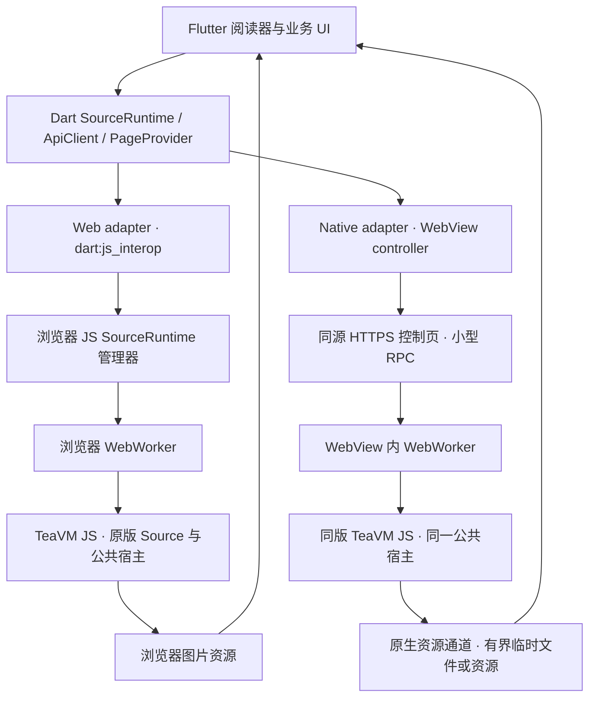

# Flutter + TeaVM 跨平台接入设计

日期：2026-11-03。本文是持续维护的接入设计，不再冻结。已采用 Flutter + TeaVM 的浏览器宿主路线：Web Worker + 原生 WebView；工程已有分项实现与机制验证，完整 Source 图片、生产 Access 与真机门仍未完成。实现状态见[计划目录](../plan/README.md)及[验证记录](../VERIFICATION.md)。TeaVM 0.16.0 / release9 是研究起点，当前宿主继续维护，原版扩展 JAR 业务代码保持不变。

**已采用：共用 Dart SourceRuntime 接口与同一套 TeaVM JS 产物，Web 端使用 JS interop + WebWorker，iOS/Android 使用系统 WebView + WebWorker。** 原生容器使用 flutter_inappwebview 的受管理 WebView，具体版本以工程锁文件为准；iOS 图片资源通道仍须产品验证，容器实现调整不改变浏览器宿主路线。图片正文使用独立资源通道，不能将现成 JSON 消息 API 当作已完成的二进制桥。

首版决策固定为：Flutter 渲染阅读界面；扩展在浏览器/WebView 的 Worker 中执行；原生控制页通过当前单一 hostname 的 HTTPS origin 加载；控制消息与图片资源分开；默认一个扩展执行槽，按包复用。内嵌 JS 引擎、C/FFI 与 WasmGC 未采用，第 5–7 节仅保留评估记录，不形成实施阶段、自动回退路径或并行研究任务。

多端同步是业务设计的首要目标。Web、iOS、Android 使用同一份业务协议和 Worker API + D1 权威状态；书架、进度和设置随服务端合同共同交付，不先建立各端独立业务数据库再补同步。收藏与进度已切换到同一服务端业务 API，本地业务 SQLite 已移除；历史本地恢复证据保留原范围，当前实际跨平台闭环按[同步计划](../plan/p2-sync.md)重新验收。

Flutter widgets 替代此前 React UI 三选一；Dart 依赖交给 Pub，pnpm 继续管理 TypeScript 后端、JS 宿主和构建编排。Java/Maven/TeaVM 工具链保留。RN、SwiftUI 和纯 React PWA 不再是产品选型候选；Flutter Web 可按需要提供 PWA 安装外壳。

## 1. 跨平台需要统一到哪一层

目标平台为 iOS、Android 原生和桌面 Chrome/Firefox/Safari。Windows/macOS/Linux 原生应用不加入首版要求。移动性能优先，桌面可以接受一定框架开销，但仍需满足日用、兼容性与有界内存要求。

跨平台统一的是 Source 操作、DTO、异步事件、资源生命周期及错误语义，而非所有平台必须调用同一个插件方法。Dart 的 JS interop 面向 Web，FFI 面向 Dart Native，两者不能互相替代。[JS interop](https://dart.dev/interop/js-interop)、[Dart FFI](https://dart.dev/interop/c-interop)。

| 接入方式                    | Flutter Web                      | iOS / Android                                        | release9 复用程度                        | 定位               |
| --------------------------- | -------------------------------- | ---------------------------------------------------- | ---------------------------------------- | ------------------ |
| JS interop + 浏览器 Worker  | 直接适用                         | 原生 Dart 不能直接用它执行 JS                        | 高                                       | Web 默认路径       |
| 系统 WebView + TeaVM Worker | 可用 iframe 模拟容器，但没有必要 | WKWebView / Android WebView                          | 高，仍需产品与平台回归                   | 原生默认路径       |
| 内嵌 JS 引擎 + FFI          | 另走浏览器适配                   | QuickJS、JavaScriptCore 等                           | 原 JS 产物有复用可能，浏览器宿主需要重做 | 未采用，仅保留评估 |
| TeaVM C backend + Dart FFI  | 另走 JS 或独立 Web 构建          | 生成 C，再编译对应原生库                             | 原 JAR 可保留，宿主/编译适配需重新验证   | 未采用，仅保留评估 |
| TeaVM WasmGC                | 浏览器/Worker 中加载             | WebView 中可验证；独立 Wasm 引擎需要另查 GC/宿主支持 | 需要重编译和后端回归                     | 未采用，仅保留评估 |

TeaVM 当前 Maven 文档列出 JAVASCRIPT、WEBASSEMBLY_GC、C 目标；JSO 适用于 JS 和 WasmGC，不适用于 C。不能用一个后端选项变更代替兼容验证。[Maven](https://teavm.org/docs/tooling/maven.html)、[JSO](https://teavm.org/docs/runtime/jso.html)。

## 2. 已采用架构：两种容器，共用一个运行协议



Web 适配器用 dart:js_interop / package:web 接现有 JS 管理器，不在 Flutter UI 主线程调用重型 TeaVM 方法。Worker 中保留 HTTP、文件/缓存、脚本和图像宿主。Flutter Web 编译成 JS 或 Wasm 都不要求 TeaVM 随之换后端。[Dart JS interop](https://dart.dev/interop/js-interop)、[Flutter Web 条件导入](https://docs.flutter.dev/platform-integration/web/faq)。

原生适配器创建一个受管理的 WebView 控制页，再由控制页创建 TeaVM Worker。插件注入的 window 消息对象通常属于页面，不直接存在于 DedicatedWorker 中，因此小型控制消息要经控制页转发。默认一个执行槽、按包复用；资源验证后最多两个，不为每个源或每章重建 WebView。

控制壳使用当前 hostname 的公开 `/runtime/host`（旧 `.html` 路径规范化跳转），保留真实 HTTPS origin 的 Worker、Cookie 和安全上下文。Web 从 Static Assets 获取通用 host/worker/桥/WASM；Native 使用应用内置的同版材料，校验后注入，材料缺失不回退网络。Web 与 Native 的扩展索引、清单和 AOT 均以 Static Assets 为最终权威来源，只发布每扩展最新 build；index/catalog 决定版本，客户端或 Service Worker 管理更新与缓存。新分发路径不再发布扩展到 GitHub Release，已有扩展和索引 Release 已按用户要求删除，不参与客户端版本定位；扩展正文不经过 R2 或 Worker 代理，客户端不需要 GitHub 凭据。私有个人数据与 Source 网络桥继续位于 Access 保护的 `/api` 下。此前内置浏览器 Release 直下/Range 因 CORS 失败，用户已将方案改为全客户端 Static Assets；当前最新版发布、跨端下载/CSP、缓存更新、有界解压及完整装载仍待实现验收。

容器握手检查 protocolVersion、host ABI、buildId/hash、实例 generation 和能力集合；不能仅以 loadStop 表示 Source 已就绪。页面 ready、Worker ready、文件恢复、包加载和 Source 初始化分别记录。进程终止后重建容器与 generation，使旧结果、回调和临时资源失效。

Headless 只表示不需要放入可见 widget tree，不承诺应用后台继续执行或永不被系统回收。应用关闭停止扩展任务的边界保持不变。需要交互登录/验证码的源仍须能力声明与可见界面，不把隐藏 WebView 当作所有验证问题的解决方案。

## 3. Flutter WebView 插件怎么选

| 方案                 | 核查到的能力                                                                           | 本项目取舍                                                                                    |
| -------------------- | -------------------------------------------------------------------------------------- | --------------------------------------------------------------------------------------------- |
| webview_flutter      | 官方 Flutter 发布；iOS WKWebView、Android WebView；公开平台列表为 Android/iOS/macOS    | 适合基础容器与 JS channel；不把未挂载 controller 当作保证可用的 headless 执行宿主，需实际验证 |
| flutter_inappwebview | 明确的 HeadlessInAppWebView、JS handlers、Web Message Channels；平台还包括 Web/Windows | 优先验证原生宿主；控制和生命周期 API 较丰富，仍需检查稳定版具体能力与原生资源适配             |
| 自有薄原生插件       | 直接包装 WKWebView / Android WebView，再由 Pigeon/platform channel 暴露接口            | 现成插件无法接入所需原生资源路径时采用；维护量更大，不先重写完整 WebView 插件                 |

依据：[webview_flutter](https://pub.dev/packages/webview_flutter)、[HeadlessInAppWebView](https://inappwebview.dev/docs/webview/headless-in-app-webview/)、[InAppWebView 通信](https://inappwebview.dev/docs/webview/javascript/communication/)。

InAppWebView 的 Web 实现是 HTMLIFrameElement；“支持 Web”不等于所有原生通信接口在 Web 都存在。官方通信文档对 JS handlers、Web Message Channels 各列不同平台，部分新选项标注 beta。Web 默认直接连 Worker，避免为表面 API 统一增加 iframe 和 Access 回跳边界。[平台实现](https://inappwebview.dev/docs/intro/)、[通信能力](https://inappwebview.dev/docs/webview/javascript/communication/)。

插件版本和平台能力以工程锁文件及实际验证记录为准；不将最新网站示例中的 beta 参数直接视为稳定版可用。版本锁定不代表所有目标设备或图片资源通道均已通过。

## 4. 控制消息与图片资源分开

统一接口只暴露业务和生命周期。示意 API 非可直接运行的实现：

```dart
abstract interface class SourceRuntime {
  Stream<RuntimeEvent> get events;
  Future<RuntimeSession> open(BuildDescriptor build);
  Future<SourceResult> invoke(SourceRequest request);
  Future<ImageResource> acquireImage(ImageAcquireRequest request);
  Future<void> cancelImage(ImageCancelRequest request);
  Future<void> releaseImage(ImageReleaseRequest request);
  Future<void> closePageSession(PageSessionCloseRequest request);
  Future<void> cancel(RequestId requestId);
  Future<void> dispose();
}
```

SourceRequest 携带 requestId、session/generation、package/sourceId、操作与显式漫画/章节引用。小型 DTO 可用 JSON；错误区分取消、超时、Access 失效、源站错误、宿主能力不足和 runtime 丢失。按实例串行前台 Source RPC，回调与底层网络异步运行；不能因为 Dart API 返回 Future 就认为 Java/JS 操作已获得正确取消能力。

ImageResource 是可释放资源，不统一成“每次完整 Uint8List”：

| 平台 | 资源表示与交付                                                                                                                 |
| ---- | ------------------------------------------------------------------------------------------------------------------------------ |
| Web  | Blob/对象 URL 或适合 Flutter Web 的受控图片资源；Worker 内使用 transferable ArrayBuffer 时遵守所有权，Dart/JS 转换是否复制另测 |
| 原生 | 临时文件或受控资源句柄，附尺寸/MIME/字节数；适配图片 provider 消费，尽量不让 Dart、WebView 与原生各留一份整章正文              |
| 共用 | 明确 acquire/release、引用与 generation；限制图片窗口、未完成字节、并发和过期资源；取消时停止生产及清理残留                    |

HTTP/JSO 二进制网络桥 P0-B 与上述 WebView → 原生通道是不同边界，两者都须验证。仅将控制 JSON 传通不算完成图片桥。

产品 Web 图片通道采用每次获取一个 MessageChannel、至多一块未确认 DATA、主线程管理 Blob 资源的方式。Java 保留原始 Page 会话，经原 Source 图片链输出处理后正文；Dart 通过绑定章节的 PageProvider 将逻辑页键映射到会话页键。HTTP handle 不跨 Source 调用存活，不能充当图片资源。合同、取消时等待 Java 退出的原因及验收边界见[图片资源通道](../IMAGE-RESOURCES.md)。Native 受管文件未接通前明确返回能力不足，不把 Web Blob URL 当作原生文件。

### 原生二进制通道的核查结果

Android 有明确公开路径：WebViewFeature.WEB_MESSAGE_ARRAY_BUFFER + WebMessageCompat/Listener，可在 JavaScript ArrayBuffer 和原生 byte[] 间传递。需要运行时能力检测，插件稳定版是否完整暴露要另查；必要时扩展平台实现。大正文按流控协议分块，不把“支持 ArrayBuffer”解释成零复制或无限消息大小。[Android WebMessageCompat](https://developer.android.com/reference/androidx/webkit/WebMessageCompat)、[官方桥接示例](https://developer.android.com/develop/ui/views/layout/webapps/native-api-access-jsbridge)。

iOS 常规 WKScriptMessage 的公开类型列表没有把 ArrayBuffer → Data 作为统一承诺。查到的新 WebKit 开发记录包含以 NSData 替换早期 WKJSScriptingBuffer 的工作，但这不能证明用户设备、所选 SDK 和 Flutter 插件已经支持可直接采用的数据路径。需要按最低系统版本核对公开 API，并在真机验证；不把 WKJSHandle 当作零复制缓冲区。[WKScriptMessage.body](https://developer.apple.com/documentation/webkit/wkscriptmessage/body)、[WebKit 变更记录](https://bugs.webkit.org/show_bug.cgi?id=318234)。

iOS 数据通道按以下次序做能力探针，尚未确定最终方式：

1. 若目标 SDK/系统提供合适的公开二进制或资源交接能力，验证实际字节类型、分块、复制、取消及内存。
2. 验证经过处理的 Blob 能否在同一 WebView 上下文中通过 WKDownload 写入受控临时文件；已有 iOS Simulator HTTPS 下 Blob/Worker → WKDownload 临时文件的机制验证；真实 Source 处理后图片、真机和总峰值仍未验收。这是内部在线阅读资源交接，不增加下载队列功能。[WKDownload](https://developer.apple.com/documentation/webkit/wkdownload)。
3. 仅作为备选探针评估本机二进制 WebSocket/HTTP 通道：需验证 HTTPS 页面到 loopback 的混合内容/权限、origin、随机会话令牌、监听地址和生命周期。不能直接宣称加一个 localhost server 就跨平台可用，也不默认新增该服务。

原版处理后的字节必须经过同一通道；不能把图片 URL 给原生再下载来跳过拦截器或解密。不以整图 Base64/JSON 数组作为最终桥接实现。若 iOS 数据通道未通过，标记接入未完成，不以只测搜索 DTO 的结果宣布可用。

## 5. 未采用方式记录：内嵌 JavaScript 引擎

flutter_js 提供通过 Dart FFI 调用的 JS runtime，包描述为 Android 使用 QuickJS、iOS 使用 JavaScriptCore；其平台列表不含 Web。flutter_qjs 则以 QuickJS 为核心，文档同样说明不支持 Web。浏览器端仍需独立适配。[flutter_js](https://pub.dev/packages/flutter_js)、[flutter_qjs](https://pub.dev/documentation/flutter_qjs/latest/)。

潜在收益是省去完整 WebView/内容进程，原生字节与文件资源更容易在同进程桥接；是否减少峰值或首图需实测。代价是 JS 引擎不是浏览器，fetch/Promise 的部分封装并不提供 WebWorker、IndexedDB、DOM、WebCrypto、Canvas 及现有脚本回调环境。

以下是初次评估时核对的 release9 ZIP 宿主依赖（不是当前项目源码清单）：

- public/teavm-worker.js 使用 importScripts、fetch、postMessage。
- public/file-bridge.js 直接使用 IndexedDB。
- java/src/main/java/prototype/Bridge.java 使用 @JSBody 调用 self.teaHttp、teaFile、teaCache、teaBrowser、teaCrypto、teaGraphicsAsync 等宿主函数。

因此要保留接口并重新实现网络/存储/调度/图片/脚本能力，不能只执行 classes.js 就声称原宿主等价。同步 FFI 执行不得阻塞 Flutter UI；需要独立执行上下文、事件循环、线程归属和取消策略。

iOS 的独立 JSC 不等同于 WKWebView 内容进程的 JIT 条件；QuickJS 路线也不能预期获得浏览器 JIT 吞吐。若部分源仍需要 DOM，可能最终仍要额外 WebView，从而削弱简化收益。这条路线适合有界的后续原型，不作为首版静默降级引擎。

## 6. 未采用方式记录：TeaVM C backend + Dart FFI

路径是原版 JAR → TeaVM C → 平台编译器 → 原生库 → Dart FFI；Web 可继续用 JS backend。它有机会移除扩展主执行路径中的 JS 引擎与跨进程正文交接，适合作为移动性能长期研究方向。[TeaVM C 入门](https://teavm.org/docs/c-backend/getting-started.html)、[Dart FFI](https://dart.dev/interop/c-interop)。

对本项目有四项实质改造：

1. JSO 不支持 C backend。上述 Bridge 的宿主调用要改成可替换的平台实现；原扩展 JAR 不改，宿主允许适配。
2. C backend 自带需要平台适配的 runtime，不能把生成 C 等同于 iOS/Android runtime、GC、协程、异常和回调都已验证。
3. 按稳定 C ABI 提供 init/call/cancel/release，并明确线程、buffer 所有权和回调寿命；TeaVM 原生互操作不是 JNI。[C 互操作](https://teavm.org/docs/c-backend/native.html)。
4. 平台/CPU 构建与库打包方式不同。若采用随 App 签名/静态打包的方案，扩展包更新会与 App 构建绑定；当前从 Static Assets 安装最新 JS 包的机制不能直接用于原生库。库体积、多包实例及动态源脚本支持都要重新设计。[Flutter 原生库打包](https://docs.flutter.dev/platform-integration/legacy-ffi-plugin)。

release9 的 77 包证据来自 JS backend，不能继承为 C backend 兼容率。首版不更换后端，也不在此次探索中承诺完成 C 迁移。

## 7. 未采用方式记录：TeaVM WasmGC

TeaVM 官方 WasmGC loader 面向浏览器、WebWorker、Node.js。Flutter Web 可通过 JS interop 加载，原生端可以继续放入 WebView；这条路径仍保留浏览器容器，未自动消除图片桥。[Loader API](https://teavm.org/docs/wasm-gc-backend/loader.html)。

若想在原生 Dart 中嵌入独立 Wasm runtime，须逐项确认 WasmGC、所需指令与导入、JSO 所需 JS 互操作，以及 iOS 下允许的运行模式。普通 Wasm/WASI 插件的示例不能证明这些条件成立；Flutter Web 自己使用 Wasm 也不意味着原生 Flutter 内置了可运行 TeaVM 模块的 Wasm 引擎。

当前 JS release9 与宿主较成熟，切换 WasmGC 应作为单独后端实验，比较编译、兼容、首图、内存及真实字节路径，不凭格式预测更快。不把过时的 classic Wasm/WASI 示例作为当前 TeaVM 0.16.0 的直接实施配置。

## 8. Access、存储和代码组织

优先让移动宿主从真实 HTTPS origin 运行，受保护请求先归属 WebView 的 Access 会话。Dart 业务 ApiClient 可以通过小型 authenticated RPC 委托该上下文请求后端；图片正文仍走资源通道。这样首轮不要求所有原生 HTTP 客户端自动共享浏览器 Cookie。

交互登录必须可见且符合实际 IdP 行为。若使用系统认证会话，要显式验证与 WebView 的会话交接；不能假设外部浏览器登录成功即使隐藏 WebView 自动获权。Cloudflare Access 仍保护全部后端，前端壳公开，不内置 service token 或增加应用账号系统。

Dart 业务数据通过 ApiClient 读写 Worker API，D1 是书架、分类、进度、书签和非敏感设置的唯一权威；Web/Native 只保留当前会话状态和可丢弃缓存，收到服务端确认才标记已保存。当前会话的未确认草稿可重试，断网不阻断已加载阅读，但不承诺关闭后保留，也不建设持久 outbox 或离线合并层。收藏与阅读进度已接入该路径，Drift/SQLite 业务路径已移除，不维护双写或旧数据库转换；分类、书签与同步设置尚待实施。TeaVM 文件/HTTP Cache 仍独立所有权，继续复用浏览器存储语义并按身份/包/版本分区；图片临时文件与 WebView 缓存共同计入预算，不引入整章离线保存。

工程边界：

- Flutter app 与 Dart packages：reader_core、source_runtime 接口、平台 adapter、业务 repository、图片 provider。
- JS runtime-host：同一版本的控制页、Worker 引导、公共宿主、脚本/文件/HTTP 桥；pnpm 管理构建和协议生成。
- Worker API：TypeScript/Hono、Access/jose、D1/DO，按个人对象需要使用 R2；不承载扩展正文，也不提供私有 GitHub 下载 token 服务。
- Java/Maven：锁定 TeaVM 工具链与真实上游 submodule，每包 AOT 编译；项目宿主持续维护，变化后更新构建指纹并回归。
- 原生插件：仅管理必要的 WebView/字节通道/临时资源，平台代码不进入业务 UI。
- 当前运行时控制协议使用 Protobuf + Buf 双端生成与 ProtoJSON 小控制消息，正式边界已接入，实际运行范围以[协议计划](../plan/cross-language-protocol.md)为准。收藏与阅读进度的状态查询、幂等写入、revision/epoch、条件更新和标准错误已通过 `business.proto` 接入同一协议体系；分类、书签与同步设置的合同尚待扩展。控制握手与工程检查不证明完整业务同步已完成，实际跨端范围见[P2 计划](../plan/p2-sync.md)。比较与边界见[协议决策](cross-language-protocol.md)。Dart Native 与 Web 用条件导入选择 adapter，Web 条件使用 dart.library.js_interop，支持范围由实际 JS/Wasm 构建验证。

不建立全平台假同步接口，不在 UI 层暴露 Java对象、任意 JS 引擎对象或平台裸指针。

## 9. 实施验证次序

P0-F 实施已确定的浏览器宿主路线。F1/F2 验证两端对同版 JS 宿主的接入，F3 优先解决 iOS 图片资源交付，F4 完成真实阅读。插件版本、消息协议细节和资源通道属于实现验证项，不再比选 UI 框架或执行后端。

| 探针                  | 最小内容                                                       | 验收                                                               |
| --------------------- | -------------------------------------------------------------- | ------------------------------------------------------------------ |
| F1 Web 接入           | Flutter Web → interop → 同版 TeaVM Worker → 搜索/详情/章节 DTO | 请求与输出一致、重入/取消/实例回收正确，UI 主线程不执行扩展        |
| F2 原生容器           | iOS/Android Headless 或受管理 WebView → 控制页 → Worker        | 初始化、文件恢复、包复用、Access 登录/过期、WebView 重建与后台恢复 |
| F3 图片通道，优先 iOS | 受控字节 → 处理后图片 → 临时资源 → Flutter 图片                | 字节校验、分块背压、取消/释放、无整图字符串中转、合计峰值受控      |
| F4 完整阅读           | 3–5 个原版源，覆盖直图/请求头/正文处理；长图、双页、缩放和切章 | 首图/切章分布、持续交互、内存/能耗、位置恢复；桌面 Web 达日用门槛  |

公共宿主 P0-A 与网络二进制 P0-B 继续推进，Flutter 阅读器 P0-R 共享 Dart 核心，在 P0-C 合成真实在线阅读。若某个平台失败，先修 adapter/资源通道，不自动重开框架选型或启用另一引擎。

测试按固定系统/插件/产物版本、真实 HTTPS、release/profile 构建，分开冷启动、产物缓存后新实例和热实例。记录应用与 WebKit 合计内存；插件有 headless 方法、原型 DTO 成功或某个 hello-world FFI 成功，都不替代完整源与图片链验收。

上述顺序是当前产品验收要求，不是全部通过的清单。历史文档核查、已完成机制验证与尚未完成的真实 Source/图片/移动验收在验证记录中分别说明；暂缓功能、单应用 hostname、Workers 后端与前台执行边界保持不变。
