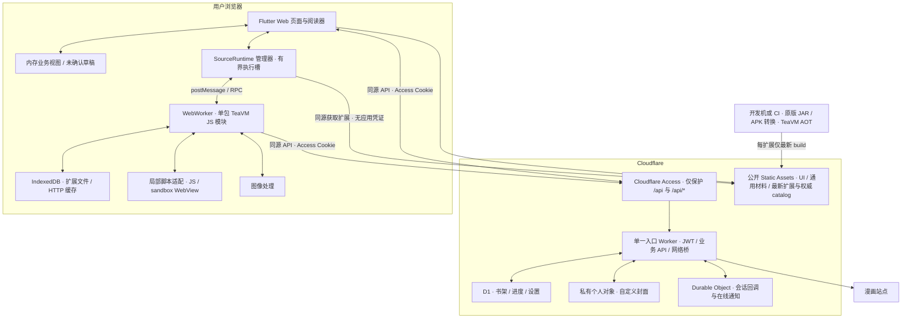

# 个人漫画阅读 App 设计

设计日期：2026-11-01；最近修订：2026-11-13。本文是可持续修改的现行设计，不再冻结。当前工程已建立并有分项实现和验证，P0 尚未完整验收；执行状态见[计划目录](../plan/README.md)与[验证记录](../VERIFICATION.md)。TeaVM 0.16.0 JavaScript backend / release9 是项目宿主的研究起点，不是要求产品源码保持原样的快照。

**选型已确定：Flutter + TeaVM，采用浏览器宿主路线。首版功能为浏览漫画源、管理书架、在线阅读。** 移动端原生优先、桌面端浏览器优先，并尽量共享代码；允许以一定桌面性能换取移动性能。Flutter Web 通过 JS interop 连接 TeaVM Worker，iOS/Android 通过系统 WebView 内的 Worker 复用同版 TeaVM JS 宿主；统一 Dart 接口，原生图片通道与鉴权仍待验证。具体方式见[Flutter + TeaVM 接入设计](./flutter-teavm-integration.md)。RN、SwiftUI 与纯 React PWA 不再是选型候选。后端采用 Cloudflare Workers API + D1 + Durable Objects，R2 仅用于需要的私有个人对象（如自定义封面），无需常驻 JVM、容器或自有服务器。扩展仅在应用打开时按需执行，关闭后停止；不承诺后台任务续跑。完整 Mihon 功能仅作为长期参考，首版范围以下表为准。

**部署与信任范围：一个 hostname、一个入口 Worker；浏览器按需运行按扩展包 AOT 编译的 TeaVM 模块。** 使用数量受限的 WebWorker 执行槽，复用当前包实例；扩展按应用依赖信任。分包是产物与状态管理需要，不新增跨 origin 沙箱或每包 JVM。源站脚本保留局部执行边界。CheerpJ 保留为开发对照，产品不自动切换引擎。

**访问方式：前端公开，后端由 Cloudflare Access 鉴权。** 页面、共享材料与 Static Assets 扩展产物无需登录；个人数据、Source 网络桥和回调统一走同源 `/api` 和 `/api/*`，只允许本人通过 Access 访问。Access 登录不增加应用内账号系统，也不改变暂缓的“私密使用”范围。

**首要设计目标：多端同步。** 同一部署、同一身份在 Web、iOS、Android 共享书架、分类、阅读进度、书签和非敏感设置。Worker API + D1 是唯一业务权威，客户端只保留当前会话内存状态、未确认草稿与可丢弃缓存；服务端确认后才能显示已保存。先实现跨端在线读写与恢复，再扩展完整外围功能。初版不建立持久本地业务数据库/outbox 或离线合并系统。收藏与阅读进度已接入服务端权威状态，本地业务 SQLite 已移除；分类、书签与同步设置尚待实施，历史本地验证不算同步完成。执行顺序与门槛见[P2 主线计划](../plan/p2-sync.md)。

**当前交付决定：** Static Assets 是 Web 与 Native 扩展索引、清单和 AOT 的最终权威来源，每个扩展只发布最新 build。客户端依据 index/catalog 定位当前版本，由客户端或 Service Worker 管理更新与缓存；新分发路径不再要求向 GitHub Release 推送扩展；已有扩展和索引 Release 已按用户要求删除，不供客户端定位或下载。通用资源继续走 Web Static Assets / Native 内置。Worker 只负责个人数据与 Source 网络控制，不代理扩展正文、不签发私有下载地址，也不给客户端 GitHub 凭据。该决定覆盖此前的 R2 代理、Release 全客户端直下及 Web 镜像提案。**方案已确定，待实现验收：** 2026-11-03 的 Codex 内置浏览器 Release 直下/Range 实测报 `Failed to fetch`，初始 302 与最终 CDN 缺少 `Access-Control-Allow-Origin`；这是此前方案的失败证据。当前 Static Assets 发布、最新版 index/catalog、跨端下载、更新缓存、有界解压和完整加载链路仍须实测，不能把已选方案写成已通过。

## 1. 已有实现可以复用到什么程度

实施来源为 TeaVM release9 研究快照：源码指纹 `06b2e8f9b560f41c60ce6779ee320ac50523780bf5dd24c08dc01a65010fe299`，TeaVM 0.16.0 JavaScript backend。交付源在 [实测报告](/Users/wybxc/Codex/2026-11-02/ji-x/outputs/实测报告.md)、[完整 ZIP](/Users/wybxc/Codex/2026-11-02/ji-x/outputs/teavm-compatibility-v2.zip) 和[独立完成审计](/Users/wybxc/Codex/2026-11-02/ji-x/outputs/teavm-compatibility-v2-completion-audit.json)。ZIP 是含历史证据的研究交付，不是部署包；其初始源码已内化为项目宿主并继续维护，真实第三方上游通过固定提交的 submodule 引入。研究快照的原始指纹只用于溯源，不约束当前设计或项目源码修改。

| 已有证据                                                                         | 设计含义                                                                                                  |
| -------------------------------------------------------------------------------- | --------------------------------------------------------------------------------------------------------- |
| release9 的 77 包编译加载、447 Source 身份全部通过，原扩展 JAR 字节未改          | 采用其宿主、依赖 ABI、JDK/IR 补丁和浏览器桥；固定编译工具链，按包 AOT 分发                                |
| 2235 项在线业务：2133 通过、6 空、40 失败、56 跳过；422 读链、418 五项非空       | 是筛选样本中的在线观测，按 Source/版本/操作声明支持；页面列表通过不等于完整阅读器通过                     |
| 各候选失败并集 29 包/125 Source/625 项同输入配对：语义差异和 fixture miss 均为 0 | 已完成原型语义验收；严格请求差异仍保留并有处置证据，不能表述为所有请求完全一致                            |
| 最终包文件重启 40 项、图片 48 项、multipart 18 项、异常路径检查通过              | 复用真实 HTTP Cache、普通文件持久层、图像桥、URL/JSON/协程异常修复；重点验证产品化后的同版回归            |
| 3600 次固定输入业务性能调用及 18 次连续启动通过输出/请求等价性审计               | 用 release9 最新数据替代早期三插件性能；移动端、Access、公网产物与完整首图仍须产品实测                    |
| 宿主仅输出部分漫画/章节/页面摘要，使用隐式当前对象；Worker 有单一 pending 入口   | 改成完整 DTO 和显式引用；每个实例串行前台 Source 调用，使用 requestId/实例代次防止结果串线                |
| 浏览器 IndexedDB 文件/HTTP Cache、异步 init/load/select 已实现                   | 接入身份与扩展命名空间、版本切换和 Worker 回收，不把实例当无状态；不增加下载或本地漫画模块                |
| JS/DOM/WebView 有真实执行与回调检查                                              | 复用能力，但完整 WebView/QuickJS 字节码与任意对象回调不保证支持；产品仍须验证 Access 下无死锁中转         |
| 本机网络出口、测试保存服务和诊断静态资源                                         | 生产改用 Workers fetch；移除本机代理、测试端口、结果 API、fixtures 和历史产物，不直接部署原型 public 目录 |

遵循原版扩展约束：**扩展业务源码和输入 JAR 保持原样，宿主、依赖和编译器兼容映射可以修复。** AOT 输出是编译产物，不承诺运行时直接执行任意新 JAR；原生官方 JAR 与 APK 转换 JAR 分别验证，77 包证据只覆盖后者。

## 2. 产品功能与边界

| 模块         | 目标行为                                                                                               | 实现和限制                                                                                                                                                          |
| ------------ | ------------------------------------------------------------------------------------------------------ | ------------------------------------------------------------------------------------------------------------------------------------------------------------------- |
| 书架         | 收藏、分类、多分类、排序、过滤、搜索、未读角标、批量操作、自定义封面                                   | D1 权威保存，客户端维护内存视图；封面放私有 R2 / 可丢弃缓存；未读数只按最近一次读取到的章节列表计算                                                                 |
| 浏览         | 源列表、语言、收藏源、热门、最新、搜索、分页、源自定义筛选                                             | 调用原版 Source；源未实现的能力隐藏或明确禁用                                                                                                                       |
| 跨源搜索     | 已启用源并发搜索，结果分源展示、可取消                                                                 | 有界并发、逐源返回；一个慢源不阻塞全部结果                                                                                                                          |
| 扩展管理     | 添加仓库、安装、更新、卸载                                                                             | 原版 JAR 或 APK 转换产物在本地/CI 按包 AOT；安装已验证构建，没有产物时显示待构建/不支持；只发布最新 build；客户端或 Service Worker 管理更新和缓存，不做后台扩展执行 |
| 扩展设置     | 开关、文本、密码、单选、多选、分组、依赖项、修改后刷新                                                 | 新增 typed preferences 协议；自定义 Android Activity 设置页不自动等价支持                                                                                           |
| 漫画详情     | 完整元数据、标签、状态、章节列表、搜索/排序/筛选、重复章节处理                                         | 保存原始 Source URL 与 stable ID；章节编号可空，保留文本和小数                                                                                                      |
| 阅读器       | 左右翻页、RTL/LTR、竖向连续、Webtoon、双页、缩放、适宽/适高、裁白、背景/亮度、点击区域、键盘、阅读方向 | 按漫画覆盖全局设置；跨页/跨章、书签、恢复位置；浏览器无法接管音量键等系统行为                                                                                       |
| 基本阅读进度 | 当前章节/页码、已读标记、书签、继续阅读                                                                | 每部作品的状态；不保存按日浏览历史、阅读时长或统计事件                                                                                                              |
| 源迁移       | 跨源查找、用户确认对应作品、复制分类/已读/书签、保留旧源                                               | 章节号 + 标题 + 扫描组辅助匹配；模糊项人工确认；创建目标条目后保留原条目，不依赖备份模块                                                                            |
| 多设备同步   | 书架、分类、阅读进度、书签和非敏感设置                                                                 | 同一部署的个人多设备；无任务同步、历史同步或文件同步                                                                                                                |
| 登录/验证    | 源支持的账号、token、cookie 输入；展示需人工验证状态                                                   | 网页不能读取原站 HttpOnly cookie，也不能保证在 iframe 完成站点挑战                                                                                                  |

**暂不实现，也不列入首版实施阶段或验收：**

| 暂缓模块 | 移出范围                                                     |
| -------- | ------------------------------------------------------------ |
| 更新     | 书架自动/定时/批量查更新、更新页、更新通知、智能更新策略     |
| 下载     | 章节离线下载、下载队列、断点续传、读后清理、云端漫画归档     |
| 历史统计 | 历史页、时间线、阅读时长、阅读数量汇总与统计事件             |
| 追踪     | 所有第三方 tracker 登录、作品关联、评分和进度推送            |
| 本地漫画 | 图片目录、ZIP/CBZ/RAR/CBR/EPUB 导入、解析与阅读              |
| 备份恢复 | 手动/自动备份、导入导出、Mihon/Tachiyomi 备份互通、恢复流程  |
| 私密使用 | 应用内账号/设备会话管理、隐私/无痕模式、应用锁、退出清理流程 |

范围说明：源的“最新”目录、详情页按需读取章节、扩展手动升级仍保留；它们不触发全书架查更新。基本阅读进度用于继续阅读，不建立历史统计。运行时仍保留已有的 Source 登录设置；Cloudflare Access 保护后端，前端公开，不建设应用内账号系统。暂缓模块只记录为范围外需求，不预建空页面、数据表或接口。

不会宣称完整 Android 兼容：WebView 登录、验证码、原生 JNI/图像库、特殊图片格式必须有独立能力检测和失败提示。付费、账号和地区条件由原站决定。

## 3. 页面设计

2026-11-13 确定 Web / iOS / Android 全端使用官方 `cupertino_ui`，维护一套 Cupertino 界面。Mihon 继续提供信息架构与操作逻辑参考；具体组件、主题、导航和反馈方式按[Cupertino 设计](cupertino-ui.md)集中迁移，实施与验收见[计划](../plan/cupertino-ui.md)。

工作名「页间」，移动端以底部导航为主，桌面端使用左侧导航。主要入口：**书架 / 浏览 / 设置**。

- **书架**：顶部本地搜索和分类标签；封面网格可切列表；主操作为“继续阅读”。卡片显示基于已获取章节的未读数。同步状态只在正在同步或出错时突出。
- **详情**：封面、简介、来源、收藏、继续阅读；下方完整章节列表，支持按需读取、筛选、范围选择和已读标记。源迁移与批量操作放更多菜单。
- **阅读**：默认让图片占据视野；点击中间显隐工具栏。顶部作品/章节，底部页码、章节切换、设置。在线获取并临时缓存当前页附近的图片，长条使用虚拟列表；不提供离线阅读入口。
- **浏览**：先选源，再看热门/最新/搜索。全局搜索独立入口，源结果逐组出现。能力提示区分“待检查 / 可读 / 需登录 / 受限 / 不支持”。
- **设置**：分类、扩展、阅读设置、基本同步状态和诊断。移除更新、下载、历史、追踪、本地文件、备份和隐私模块的入口。

未登录时仍能打开以上页面外壳和阅读器说明；需要业务数据的操作显示“登录后连接”，通过 Cloudflare Access 完成验证后回到原页面，再读取 D1 的当前状态。不能将真实书架、扩展配置或凭证写进公开 HTML；当前会话失效的处理见第 7 节。

窄屏至少支持 360px，触控目标约 44px；所有核心操作有可见标签/无障碍名称、键盘焦点、非颜色状态说明。交互示意中的作品和状态均为虚构示例。

## 4. 部署与运行架构

下图描述桌面 Web / 可选 PWA 路径；原生客户端的 UI、存储、Access 会话与 WebView 资源桥按跨端评估另行适配，不将浏览器 API 直接视为原生实现。部署的 hostname 与后端鉴权边界保持一致。



使用一个 hostname，例如 `read.example.com`，一个入口 Worker 项目提供公开 PWA 静态资源和受保护 API。Access 按路径拦截，入口 Worker 再校验 JWT；公开路径不访问 D1/R2/DO。模块共享应用身份，不把路径或执行槽划分当作扩展权限隔离。关闭 `workers.dev` 和版本预览入口；Access 登录页使用 Cloudflare 团队域名，不增加本项目第二个 hostname。

UI 创建同源通用 Worker 引导；Web 与 Native 均从 Static Assets 的 index/catalog 定位最新清单与 AOT bundle，获取扩展不依赖 Access 登录。客户端或 Service Worker 管理下载、版本切换与缓存，服务端不提供旧 build 的客户端定位。应用个人数据与 Source 网络桥仍要求 Access。每个执行槽装载一个扩展包，同包多个语言 Source 复用；槽位回收后可为另一包创建新 Worker。主线程不执行扩展；生产不加载 CheerpJ CDN/JDK，不要求 WasmGC 或 SharedArrayBuffer。DOM sandbox 仅针对源站脚本。

| 组件                                  | 职责                                                                              | 不应承担                                                |
| ------------------------------------- | --------------------------------------------------------------------------------- | ------------------------------------------------------- |
| Flutter Web / JS SourceRuntime 管理器 | UI、状态、实例调度、RPC 与取消                                                    | 同步解析大型扩展或在 UI 主线程运行 Source               |
| TeaVM WebWorker                       | 编译后的 Source、OkHttp、协作调度、图像/文件适配                                  | 任意新 JAR 动态类加载、云端常驻任务                     |
| 单一入口 Worker                       | Access JWT、个人数据/安装状态 API、Source HTTP/回调桥                             | AOT 正文代理、TeaVM 编译、Java/dex2jar、无限制开放代理  |
| 局部脚本适配                          | sandbox WebView、绑定回调与超时                                                   | 向网页脚本提供应用凭证或完整 API                        |
| D1                                    | 书架、章节元数据、进度、设置的权威状态、幂等记录与 revision、已安装构建指针       | 图片 blob 或扩展运行文件                                |
| Durable Object                        | 会话代次、必要的跨云端回调关联、WebSocket 通知                                    | 扩展执行、图片正文、永久保存 Promise                    |
| GitHub Release（构建依赖）            | 仅锁定的 runtime seed，不属于扩展分发路径                                         | 新扩展发布、客户端定位或下载                            |
| Static Assets / Native 内置材料       | Static Assets 提供全客户端最新扩展与权威 catalog；共享材料 Web 静态 / Native 内置 | 按扩展重复发布共享材料                                  |
| R2（个人对象）                        | 自定义封面等私有个人数据                                                          | 扩展 AOT/共享材料交付、漫画整章归档                     |
| IndexedDB / Web Locks                 | 按身份/扩展隔离的普通文件与 HTTP Cache、实例所有权                                | 书架/进度业务权威、云同步扩展文件、永久离线保证         |
| Service Worker                        | 公开 app shell 缓存与版本切换，API 走网络                                         | 保存 Access 登录响应、预缓存全仓 bundle、维持运行时常驻 |

不引入 KV、Queues、Workflows、Cron 或持久 job 队列。原插件前台会话内的异步网络任务需要追踪和取消；应用关闭后停止，不变成后台更新服务。DO 保留会话协调用途；可在浏览器内完成的回调直接用绑定的消息通道，不强制经过云端。

### 技术栈与阅读器优先级

客户端确定为 **Flutter / Dart**，共享阅读核心和 UI，平台资源通过适配器实现。移动帧耗时、图片内存、能耗、首图和恢复优先；桌面允许额外渲染/启动成本，但须达到日用与兼容性门槛。Flutter widgets 替代此前 React UI 三选一，Dart 依赖由 Pub 管理；pnpm 保留 TS/JS 依赖与任务编排，这是本次 Flutter 选型带来的工具链调整。先验证 flutter_inappwebview 原生容器与 Web 直接 Worker 适配，不默认将其 iframe Web 实现作为全端入口。

后端继续使用 **pnpm workspace + Hono + Zod + jose + D1 / Drizzle + Durable Objects**；需要私有个人对象时使用 R2，不存放扩展产物。Flutter Web 产物交给入口 Worker 的 Static Assets；Flutter SDK 构建 UI，Wrangler 构建部署 Worker。Java / Maven / TeaVM 构建工具单独固定版本，由 pnpm scripts 中的 TypeScript 入口编排。当前接入方案见[Flutter + TeaVM 接入设计](./flutter-teavm-integration.md)；[原技术栈文档](./technology-stack-and-reader.md)保留通用阅读规范、后端方案及历史 React/RN 分析，React 依赖不再是产品前置条件。

跨端漫画阅读器仍须完成 P0 验收：页序、单双页、RTL、逻辑位置、图片窗口、像素内存、缩放和平移、旋转后的锚点恢复进入 P0。阅读核心使用 Dart，不依赖后端或 TeaVM 实现；PageProvider 返回可释放图片资源，Web 与原生分别实现资源交付，不要求 UI 持有全部正文。

iOS 下 WebKit 在安全策略允许时可对 TeaVM JS 使用 JIT；Flutter 原生端使用 WKWebView 宿主。Flutter AOT 不会自动加速 TeaVM，也不消除 WebView 启动和图片交接成本；尚无本项目 iOS 对照数据。真机测量使用 HTTPS，区分首次执行、预热后 CPU 和完整首图。内嵌 JS 引擎、TeaVM C/FFI 与 WasmGC 未采用，仅保留评估记录，不形成当前实施或研究任务。

Flutter 原生接入分离控制消息和图像资源，阅读视图消费有界临时资源；专用图片通道、总内存、Access 会话和 WebView 生命周期是实施门槛。Android ArrayBuffer 消息能力可检测，iOS 图片资源交接须优先探针验证；普通 JSON/JS handler 不是已完成的数据通道。现有 WebWorker 与语义夹具继续作为基线，原生改造验证完整阅读，不重新打开框架比选。

## 5. 扩展运行时与 HTTP / 图片链路

### 原型改造

以下文件名用于追溯 release9 研究交付中的 `teavm-compatibility-v2/`；现有正式实现位于 `runtime/teavm/` 与 `tools/teavm/`，按当前上游和项目适配持续更新。

| 原型位置                                                                  | 产品化改造                                                                                             |
| ------------------------------------------------------------------------- | ------------------------------------------------------------------------------------------------------ |
| `public/teavm-worker.js`、`java/src/main/java/prototype/TeaHost.java`     | 提取 SourceRuntime 适配器；异步初始化、完整 DTO、版本握手、按实例串行 RPC、取消和安全销毁              |
| `prototype/BrowserCall.java`、`Bridge.java`、HTTP 客户端                  | 复用正确的浏览器传输/缓存/异常语义；P0-B 改为二进制正文与有界读取                                      |
| `public/file-bridge.js`、`cache-bridge.js` 及 Java 适配层                 | 复用普通文件和 HTTP 缓存；增加身份/包/存储 schema 分区、版本切换检查、配额和异常终止处理               |
| `public/browser-bridge.js`、`dom-bridge.js`、图像/加密/Zstd 桥            | 从测试页拆出运行依赖；原版图片/脚本路径保持；局部回调绑定实例与代次                                    |
| `scripts/build.py`、`build_matrix.py`、`java/pom.xml`、宿主依赖与 IR 补丁 | 固定 TeaVM 0.16.0 JS backend 与版本；按包独立构建，保留输入/源码/产物哈希；建立可安装清单              |
| 原 `Host.kt` / `HttpSource` ABI 和 `TeaHost` 输出                         | 去除隐式当前漫画与截断输出，支持显式 manga/chapter、分页、latest、typed filters/preferences、图片      |
| 原 Workers 网络/回调实现                                                  | 单入口 API、Access、DO 会话与流式转发；删除本机诊断服务和 `/api/results` 等入口                        |
| 最终审计/fixtures                                                         | 作为研究来源；可复用测试内化，临时工程/历史输入留 ignored 目录，产品清单不含诊断响应、测试器或历史候选 |

技术栈采用第 4 节及独立技术栈设计中的分工。Java/Kotlin 保留扩展 ABI 与兼容宿主，通过 TeaVM 编译；不重写网站解析业务。阅读器通过 PageProvider 接收原版扩展处理后的图片，与 TeaVM 的具体实现分离。

**运行时决定：首版实施默认 TeaVM release9。** CheerpJ 作为开发语义/性能对照，b-jvm 不进入首版关键路径；产品不携带双引擎自动回退。release9 已完成原型验收，后续检查针对产品改造和真实部署，不要求重复研究已关闭的候选缺口。

### P0-A：公共宿主、AOT 产物与基础运行

原“公共宿主改进”继续实施，以 release9 的通用浏览器宿主为基线；b-jvm 对照中的浏览器传输经验用于核对语义，CheerpJ 专用预加载清单、ClassLoader 和字节码适配不再是产品交付项。

| 工作项             | 实施约束                                                                                                            | 验收证据                                                                                                   |
| ------------------ | ------------------------------------------------------------------------------------------------------------------- | ---------------------------------------------------------------------------------------------------------- |
| 固定构建与独立安装 | 按原包 AOT；固定编译器/JDK/依赖/转换与补丁版本、反射和资源登记；校验全部产物哈希与 ABI                              | 从独立工作目录可重建，原 JAR 不变；按包安装/更新无需重建前端；可重建不等于字节级输出相同                   |
| 公共 HTTP 宿主     | 沿用应用拦截器、重定向/Cookie、原 CacheInterceptor/CacheStrategy、网络拦截器和 fetch 传输；避免无用 Java SSL 初始化 | 真实 HTTPS 仍由 Workers 校验证书；覆盖命中、Vary、304、Cookie 真实过期、取消、原异常类型与有副作用后台请求 |
| 持久文件与缓存     | 保留独立 IndexedDB 存储、原子事务/rename、实例所有权、异步 init/load/select；命名空间增加身份/仓库/包/schema        | 最终包的文件重启、并发/终止、缓存故障 fixtures 在产品适配后通过；正常关闭不等待 unload 才持久化            |
| 宿主行为           | 保留 URL 解码与空查询串、JSON null、协程 IOException 传播、SocketException 等 release9 修复                         | 原负对照/修复 fixtures 不回退；结构化错误保留 Java 类、消息和 cause，不统一包装为未知错误                  |
| 执行槽与加载       | 一个槽一个包，前台 Source 调用串行；按清单获取/校验后执行，阶段计时包含存储恢复                                     | 不串 Source/版本/requestId；身份未确认不开源请求；超时能停止 Worker 并释放网络/回调/句柄                   |

旧 CheerpJ 宿主遗漏 CacheInterceptor，因此验收以原 OkHttp 策略、JVM oracle 和已解释差异为准，不以旧宿主所有请求次数都相等为目标。公共宿主和二进制桥分别留可解释的验证结果；原文本桥只作为历史开发对照，当前协议切换直接维护 v2，不保留产品 v1 回退。内部文件/缓存不增加章节下载、后台更新或本地漫画模块。

### RPC 草案

```ts
type SourceKey = { repoId: string; packageName: string; sourceId: string };
type MangaRef = { source: SourceKey; url: string; snapshot?: MangaSnapshot };
type ChapterRef = { manga: MangaRef; url: string; snapshot?: ChapterSnapshot };
// sourceId 是十进制字符串，不转成 JS number，避免 Long 精度丢失。
interface SourceRuntime {
  load(build: CompiledExtension): Promise<SourceInfo[]>;
  popular(source: SourceKey, page: number): Promise<MangaPage>;
  latest(source: SourceKey, page: number): Promise<MangaPage>;
  search(
    source: SourceKey,
    query: string,
    page: number,
    filters: FilterState[],
  ): Promise<MangaPage>;
  details(manga: MangaRef): Promise<MangaSnapshot>;
  chapters(manga: MangaRef): Promise<ChapterSnapshot[]>;
  pages(chapter: ChapterRef): Promise<PageDescriptor[]>;
  image(chapter: ChapterRef, page: PageDescriptor): Promise<ImageResult>;
  preferences(source: SourceKey): Promise<PreferenceNode[]>;
  setPreferences(source: SourceKey, changes: PreferenceChange[]): Promise<void>;
  cancel(requestId: string): Promise<void>;
}
```

`CompiledExtension` 来自已鉴权、已校验的构建清单，含 buildId、bundleHash、hostAbi、bridgeVersion、storageSchema 和入口；入口不可来自任意用户字符串。所有调用外包 `{protocolVersion, workerInstanceId, runtimeGeneration, requestId, buildId, deadlineMs}`；响应保留状态码、原始错误种类、可否重试、是否需要登录。`MangaSnapshot` 包含 author/artist/genres/status/description/cover/title/url 等真实字段；`ChapterSnapshot` 包含 source order、章节编号、上传时间、扫描组和 URL。不通过列表索引定位漫画。筛选结构支持 Header、Separator、Text、CheckBox、TriState、Select、Sort、Group；把控件状态还原到扩展对象后再搜索。

### 图片是 P0 链路

`pages → 需要时 getImageUrl → 扩展 imageRequest/getImage 与其 client → Worker 转发 → 扩展响应拦截器/解密/重排 → 浏览器可解码字节 → 在线阅读器`。

只拿到 `imageUrl` 不能算通过；绕过拦截器可能破坏 Referer、cookie、签名、解密和反盗链。只有经过该 Source 独立验证的透明图片请求，才允许后续加入直接流式快路。扩展需要 Android 原生位图/JNI 时，标记不支持并补宿主能力；不改扩展源码。

HTTP 桥按下节 P0-B 改为小元信息与二进制正文。改造必须覆盖 Workers↔浏览器与浏览器↔Java 两段，不能只将云端响应改为二进制、随后又在 TeaVM/JS 适配边界编码成整段 Base64。图片不会统一存 D1；不假定 Java 数组与 JavaScript 数组能零拷贝。

当前阅读会话持有 `PageList`：章节标识、扩展构建身份、页面顺序及清单版本；图片字节只做有界临时缓存，解码后渲染。切章或内存紧张时释放 Blob URL 与位图。页面列表变化时校验页码/偏移是否仍有效，不建立逐页持久化完成状态、离线章节清单或 R2 漫画归档。普通 HTTP 缓存和少量预取属于在线阅读优化，不提供离线可用性保证。

### P0-B：二进制网络桥

**范围与交付。** 替换当前 `BrowserCall.transport()` 中“Gson 解析含 Base64 body 的整个响应 → Base64 解码”的路径，以及请求 body 的反向编码；保留小型 JSON 元信息。P0 默认实现 TeaVM JS backend 适配，协议与运行时分离；CheerpJ/b-jvm 适配不作为首版依赖。release9 仍使用文本/Base64 网络桥，二进制桥是待实现产品任务，不是已通过的原型能力。

1. **先完成字节接口探针。** 在固定 TeaVM 0.16.0 JS backend 上通过 JSO 验证 `Uint8Array` / `ArrayBuffer` 与 Java `byte[]` 的有界双向传递或复制、fiber 异步等待和取消；验证 `0x00`、`0xff`、Unicode 文本字节和随机二进制。测量每块调用/复制开销，不直接承诺零拷贝。Worker 间转移 ArrayBuffer 时验证所有权转移后不可继续读取；不以每块写入 IndexedDB 文件作为默认网络桥，避免引入持久 I/O 和额外整段复制。该步骤未通过时不能将整段 Base64 作为最终完成标准。
2. **采用单请求、分帧的 v2 协议。** 继续使用 `POST /api/bridge/http`；媒体类型和协议版本区分旧桥。一个 HTTP 请求承载元信息和可选请求正文，一个响应承载元信息和响应正文，避免另建云端 body-token 存储及一次请求多次取正文。框架为 `版本标识 → META → DATA* → END`，每帧含类型与字节长度；元信息是有界 UTF-8 JSON，DATA 是原始字节，END 含已传正文总字节数。流已开始后的错误用有界 ERROR 帧或中断表示；缺少 END、长度不符、未知版本都算传输失败，不能把截断图片当作成功。
3. **Worker 流式转发，Java 按需读取。** Worker 读取上游 `ReadableStream` 后逐块输出 DATA，不对大响应调用整段 `text()` / `arrayBuffer()`。浏览器解帧，按 Java 消费速度读取；Java 通过 `open → read(handle, maxBytes) → close/cancel` 的运行时适配获得元信息和字节块，包装为 Okio Source / ResponseBody，再交回原扩展。handle 只存在当前浏览器运行会话，绑定 requestId/generation，不增加公开正文端点。取消、ResponseBody.close、超时、异常和执行槽重启均释放 reader、队列、临时对象并传播上游终止；传播效果需实测。
4. **限制缓冲和并发。** 初始 DATA 块上限 64 KiB、每响应排队最多 4 块、元信息上限 64 KiB；最终参数按手机与 JSO 字节传递测量调整。请求正文首版允许最多 8 MiB 的有界二进制缓冲，以兼容缺少流式上传支持的浏览器，不依赖浏览器提供全双工上传。响应正文初始总量上限 64 MiB，读取中持续计数，Source 有依据的例外再单独配置；超过限制或不支持的流式/双工请求明确报错。插件主动调用 `bytes()` / `string()` 仍可能分配完整正文，这与桥本身的队列上限分开记录。

| 协议项           | 保留语义                                                                                                                                                                                                                            |
| ---------------- | ----------------------------------------------------------------------------------------------------------------------------------------------------------------------------------------------------------------------------------- |
| 请求 META        | requestId、runtimeGeneration、目标 URL、方法、按顺序保存的 header 二元组、正文是否存在/已知长度、源站读取空闲期限；方法与正文语义不能由桥随意改写                                                                                   |
| 响应 META        | `upstreamStatus`、状态消息、实际 URL、header 二元组、正文是否存在、已知长度及是否经过传输解压；重复 Set-Cookie 保留在元信息中，交给 Java CookieJar，不作为应用域的响应 Cookie 发给浏览器                                            |
| 桥状态与上游状态 | 外层 HTTP 状态表示 Access/桥本身的结果；已取得的上游 401/403/404/500 均在 META 中保留，正文正常可读，不误报应用登录失效。Access 重定向/HTML 在进入解帧前由统一鉴权处理识别                                                          |
| 重定向与编码     | Worker 对每次目标请求手动处理重定向策略边界，重定向响应交由宿主按 client 设置决定是否跟进；每跳重新校验目标和凭证范围。明确哪一层已解压并修正失效的 Content-Encoding/Content-Length，避免重复解压；上游 HTTP 分块边界不成为应用语义 |
| 请求 body        | 原始二进制保留；文本编码、表单与 multipart 正文由扩展 RequestBody 决定，不经 JSON 字符串转换；没有正文与空正文分别表示                                                                                                              |
| 错误与重试       | Access 失效、源站状态、网络中断、协议截断、取消和限额错误分开；整段自动重试只限尚未向插件交付响应的安全读取。一旦交付响应/正文，不透明重放；POST 等有副作用请求不自动重试                                                           |

**鉴权与资源边界。** v2 沿用 `/api/*` 的 Access JWT、Origin、自定义请求头、目标域名和逐跳校验；不能因二进制媒体类型跳过中间件。出站只使用扩展构造的凭证，私有响应不进公共缓存；元信息和帧解析都先校验长度再分配。网络 body 不存 DO；DO 继续仅处理回调协调和通知。

桥按 Source 的 `timeoutMs` 限制等待源站响应头或下一段非空字节的时间。持续收字节的响应可以超过该间隔；消费端未拉取时不计入源站读取空闲。API 和本地 HTTP handle 各自保留 300 秒总限，外层 Source 操作仍可提前取消。详见 [HTTP v2](../HTTP-BRIDGE.md#metadata)。

**功能与性能验收。** 固定响应覆盖空正文、二进制/UTF-8、重复 Cookie、POST 表单、301/302/303/307/308、HEAD/204/304、206/Range、压缩响应、错误状态、半途取消和截断；逐字节摘要及扩展处理结果一致，慢消费者下桥缓冲保持有界。对 256 KiB、4/16/32 MiB 固定正文，以及 Coomer/Pawchive/JJCOS 的受控真实响应重放，记录 bridge 开销、进入 Java 的字节数、插件解析、内存峰值和取消释放情况。响应重放数据仅进入本地开发证据，移除凭证，不成为公开产品资产。

历史对照分为 release9 研究宿主+原文本桥、产品宿主+原文本桥、产品宿主+二进制桥；固定运行时、输入、资源缓存条件和业务期限，保留失败样本，不混加分段中位数。完成标准包括：body 不再经 Gson/Base64 往返、桥不为每个大响应额外生成整段字符串、固定输入功能不回退，以及大响应桥处理开销/额外分配的实测改善。收益不足时继续定位，不宣称已消除全部运行时或插件解析成本。最后在线验证完整首图、翻页和切章，正常源无可重复的明显退化；测试中旧协议仅用于开发 A/B，产品发布不以隐式回退掩盖 v2 失败。

### 会话与负载

- 默认一个活跃执行槽；跨源搜索可按设备能力启用第二槽，全局同时最多两个。一个槽仅加载一个包，同包多个 Source 复用，前台 RPC 串行；依赖内部异步回调不加入阻塞自身的前台队列。跨包搜索按优先级排队，不能每安装一包就常驻一个 Worker。
- 公开页面与服务端书架视图不等待扩展初始化。Access 身份确认后，首屏显示完再按最近阅读作品按需准备一个包；预热不调用热门/搜索/章节或全仓扫描。用户请求复用同一初始化 Promise。重包默认只占一个槽，停止额外预热；是否扩容由移动端内存实测决定。
- 同包页面切换复用实例；跨包调度先使用空闲槽，回收不活跃实例后启动目标包。当前阅读和图片任务优先。原型全局 `pending` 改为按实例/requestId 关联，所有消息检查 buildId、generation 和 Source；64 位 Source ID 不转 JS number。
- 普通文件和 HTTP 缓存分库存储，按已确认身份/仓库/包/storageSchema 分区；同一包不同版本不并发写同一可变存储。升级先取消并排空旧实例，再切换已验证构建指针；只复用当前 schema；原型不实现旧 schema 迁移/兼容，必要时重建运行缓存。设置/阅读位置属于应用业务存储，不随实例销毁而消失。
- 回收需追踪该实例的 HTTP、`enqueue` 后台请求、回调、图片和文件句柄；正常关闭给予有界清理时间，超时/卡死终止 Worker，撤销代次并 Abort 对应请求。关闭不能撤销上游已接受的 POST；不把整次 Source 调用自动重放到新实例来补偿。
- 使用 release9 文件层的事务与 Web Locks 所有权恢复；产品验证多标签页、取消和异常终止后的回收。已提交写入直接持久化，不依赖 unload。HTTP Cache 异常终止的写锁租约与普通文件所有权分开验收，避免将等待租约误报为引擎卡死。
- 当前页图片最高优先，其次手动搜索/详情，再到邻页预取；预取默认 2–3 页，长图限制存活位图。切章/回收释放 Blob URL、ImageBitmap、reader 和无用 bundle 文本；按宽×高×4估算像素内存并实测峰值。
- 会话活跃时使用一个通知通道；本地能完成的异步回调用 MessagePort，云端回调需要时通过 DO。DO 重建或断线使旧回调显式失败，不声称恢复 Java fiber 调用栈。
- 网络超时初值 30 秒，详情/章节可设更长业务期限；宿主与桥各有取消。瞬时 GET 重试限于单个尚未交付的 HTTP 请求。由于 Source 内部可能触发计数 POST，整次业务重试要按实际副作用标记控制。
- PWA 被系统回收后重建实例并读取已提交状态，不依赖扩展在浏览器关闭后常驻。

### 局部脚本边界

可信扩展与扩展获取的网页脚本分别处理。保留现有 WebView `sandbox="allow-scripts"`，只开放该实例确实需要的回调，绑定来源窗口、MessagePort 和实例标识；不向 iframe 传入应用登录凭证或通用 API 转发接口。

现有 QuickJS 替代实现的同源 Worker `eval(source)` 仍可访问浏览器网络和存储 API，不能被描述为受限脚本环境。[WebWorker 能力说明](https://developer.mozilla.org/en-US/docs/Web/API/Web_Workers_API/Using_web_workers)。P0 用可信固定输入做兼容探针，不把重写 JS 引擎作为普通图片阅读链的前置条件；P1 针对实际需要执行源站脚本的源补局部适配，只暴露必要的 Java 回调与序列化数据。受限解释器（如 QuickJS/WASM）可作为选项，由兼容性验证决定，简单覆盖 `fetch` 等全局变量不算完成隔离。未完成该适配的远程脚本路径标为受限，不计入已支持源。

局部验收针对源站脚本访问应用数据、调用未绑定接口、超时及回调重入；不扩大为任意恶意 APK 的完整安全验证。

## 6. 数据模型和同步语义

下表为完整范围的目标模型。收藏、阅读进度及幂等结果的协议、D1 约束和原子写入已接入；分类和章节书签模型也已接入，同步设置等其余模型尚待实施。实际表与合同以源码及[P2 计划](../plan/p2-sync.md)为准，不要求保留原型本地模型：

| 表                                                          | 关键字段与约束                                                                                                                                                                              |
| ----------------------------------------------------------- | ------------------------------------------------------------------------------------------------------------------------------------------------------------------------------------------- |
| `repositories`, `extensions`, `extension_builds`, `sources` | 仓库/包/版本、原输入哈希、转换版本、TeaVM/宿主/桥 ABI、bundle/资源哈希、storageSchema和能力；安装项指向已验证 buildId，Static Assets index/catalog 用于安装定位，归档及构建来源用于问题追溯 |
| `manga`, `library_entries`                                  | 受信 subject、稳定作品键、package/source/original URL；收藏/元数据分离，包含状态 revision                                                                                                   |
| `chapters`                                                  | manga_id、原 Source 引用、number_text/number_value、source_order、scanlator；重复引用保留序列发生位置，不按标题或 URL 全局去重                                                              |
| `categories`, `entry_categories`                            | 自定义顺序，多对多关系                                                                                                                                                                      |
| `chapter_progress`, `bookmarks`, `reading_positions`        | 已读、书签、每部作品当前章节/页码、页面内偏移、清单版本、阅读 epoch、客户端 ID、服务端 revision；不保存时间线事件                                                                           |
| `reader_settings`, `source_preferences`                     | 全局/漫画覆盖，typed values；敏感项分离                                                                                                                                                     |
| `sync_mutations`                                            | 受信 subject、幂等 mutation ID、操作内容身份、已确认结果及 revision；重复请求不重复执行，也不允许同 ID 更换内容                                                                             |
| `cover_assets`                                              | 自定义封面对象路径、类型、大小、校验和及所属条目                                                                                                                                            |

不建立历史事件、统计、任务租约、下载页、tracker、文件导入或备份表。首版读取 D1 当前状态，暂不要求 `change_log`、cursor 或 DO 通知；确有体量/延迟数据支持后再引入增量机制，其日志也不作为用户历史或备份。源站敏感凭证暂留当前客户端，不做云端凭证同步。

Flutter 收藏与进度已改为 Worker API + D1，Drift/SQLite 业务路径已移除。历史本地分项保留在[本地书架记录](../verification/p1-local-library.md)，不能代替当前跨端验收；不做旧数据迁移或长期双写。复用已验证的稳定作品键 `SHA256(JSON[packageName, sourceId, originalMangaUrl])`、完整 Protobuf Manga 快照、Source 名称/语言和阅读逻辑锚；buildId/generation 不进入作品身份。取消收藏保留进度，打开作品仍按当前静态索引定位原 package/Source，再主动取当前作品详情/章节。对已取得的业务视图做搜索/排序不触发 Source 请求；封面未接正式图片通道前使用占位图，不直接请求 thumbnail URL。实施状态见[P1](../plan/p1-library-and-progress.md)和[P2](../plan/p2-sync.md)。

规范化 URL 只使用保守的 Source 明确规则；保留 release9 已验证的 URI 解码、空查询串和非法 URI 回退，不另加全局 decodeURIComponent、空格替换、删 query 或按标题去重。Source 换域不重新发明 ID；来源变化使用显式迁移。外部 64 位 ID 全部保持字符串。

**同步：** 客户端通过同一套 Protobuf/ProtoJSON 业务 API 读写 D1 当前状态。每次变更携带稳定 mutation ID 和所需的 expected revision/epoch；Worker 在 D1 原子校验、应用并记录结果后返回权威状态与 revision。客户端仅在确认后标记已保存，失败或响应丢失时保持当前会话的明确待保存状态，用同一 mutation ID 有限重试。进入书架/详情、继续阅读、应用恢复前台和显式刷新时重取服务端状态；初版先使用有界全量/分页读取，不依赖持久 outbox、离线合并、增量日志或实时通知。初版不开 D1 读副本；未来若启用，仍必须保证读到自己的写入。

- 同一阅读 epoch 内最远进度不倒退；只有同一清单或可靠稳定页映射下才比较位置，不跨清单直接比较旧序号。
- “标为未读 / 重新阅读”由服务端显式提升 epoch；迟到请求与未确认重试携带旧 epoch 时不能覆盖新状态。并发 reset 使用 revision 前置条件处理，不能只比设备时钟。
- “当前继续阅读位置”与“最远读到位置”分开；回看第 5 页不把第 20 页的完成进度抹掉。
- 分类、标签、设置按实体/字段 revision 或明确操作更新；删除后仍须有版本前置条件，防止旧请求复活项目。冲突返回服务端状态，不静默以客户端旧视图覆盖。当前继续阅读位置的并发规则与最远进度分开定义，远端变化不强制跳转正在阅读的页面。
- 同步只涉及保留模块的结构化状态；不传输图片、历史事件、后台任务或源站敏感凭证。断网时仍可看已加载页面，当前会话内保留有界草稿并提示未保存；关闭前未获确认的变更不承诺恢复，不因此引入离线阅读或离线写入系统。

## 7. 前台请求与错误恢复

请求状态：`idle → loading → success`，旁路包括 `cancelled`、`access_required`、`access_denied`、`source_login_required`、`needs_verification`、`error`。Access 登录与漫画站账号/验证是两种独立状态，不能把上游 401/403 当作应用会话过期。状态属于当前浏览器会话，不持久化成服务端任务。

1. 无需登录即可加载前端。首次访问展示空态和“登录后连接”；请求 `/api/bootstrap` 确认 Access 身份后读取 D1 当前业务状态。同一会话内已确认的视图可暂时保留并标注连接状态；新进程不能把旧本地表作为真实书架。未登录不强制跳转，不扫描书架检查新章。
2. 完成 Access 验证并显示首屏后，按第 5 节预热最近使用包的执行槽；用户浏览源、搜索、打开详情或章节时，复用正在初始化/已就绪的运行时，按需加载扩展并提交带 requestId 的请求。详情页可主动重新读取当前作品的元数据/章节，不建立更新页或批量检查队列。
3. 用户切换搜索条件、退出页面或关闭应用时，取消不再需要的请求和预取；旧结果通过 requestId / runtimeGeneration 检查后丢弃。
4. 执行槽或 DO 会话中断后重建实例/会话；保留已保存阅读位置和扩展已提交文件，按实际副作用能力有限重试安全读取。下次打开按当前页面需要重新请求，不自动补发旧后台 POST。
5. GET 类瞬时网络错误有限退避并加抖动；429 遵循 Retry-After；验证、源站登录、Access 拒绝分别提示；无幂等保证的 POST 不盲目重试。网络断开不能直接判定 Access 已失效。
6. Access 会话失效时暂停新的网络桥调用、业务提交和预取，保留当前已加载页面与当前身份的会话内草稿，明确显示未保存；重新验证同一身份后，先核对服务端 revision/epoch，再重试原幂等操作。身份或服务变化后不能把草稿提交给新身份；不自动跳转打断阅读，也不承诺未确认变更在关闭后保留。

阅读进度按节流批次保存，切章和显式退出时尽力提交；不依赖 unload 一定成功。前台读取与状态同步分别处理，单个源失败不会阻塞书架操作。此阶段不需要云端任务领取、heartbeat、checkpoint 或下载完成协议；浏览器存储层的内部锁/租约只用于一致性和异常回收。

## 8. API 轮廓与访问控制

### 8.1 公开前端与受保护路由

| 路径                                                                          | 访问要求                            | 内容                                                                             |
| ----------------------------------------------------------------------------- | ----------------------------------- | -------------------------------------------------------------------------------- |
| `/`、`/library`、`/browse`、`/reader/*`、`/settings`                          | 公开                                | SPA 页面外壳；个人内容由鉴权 API 提供                                            |
| `/auth/complete`                                                              | 公开                                | 仅提示返回应用，不加载应用脚本或读取业务数据                                     |
| `/assets/*`、`/runtime/*`、`/source-worker.js`、manifest、Service Worker 脚本 | 公开                                | 公开 UI、通用桥与 Worker 引导；不包含扩展 AOT bundle、用户配置或已安装扩展清单   |
| `/api`、`/api/*`                                                              | Cloudflare Access + Worker JWT 校验 | 私有业务数据/安装状态、Source 网络桥、回调、通知连接、自定义封面；不承载扩展正文 |
| Static Assets 扩展目录                                                        | 公开、全客户端共用                  | index/catalog、清单与每扩展最新 AOT；客户端下载、更新与缓存须实测                |
| GitHub Release（构建依赖）                                                    | 仅锁定的 runtime seed               | 新分发路径不使用，不要求继续推送扩展                                             |
| `/cdn-cgi/access/*`                                                           | Cloudflare 管理                     | 登录相关平台端点；不由 SPA fallback 接管                                         |

只创建一个 Access **Self-hosted application**，覆盖 `read.example.com/api` 与 `read.example.com/api/*`，共享同一个 AUD；不保护整个 hostname。通配路径不包含裸 `/api`，所以两者都配置。公开前端不创建全站 Bypass，API 子路径也不设置更具体的 Bypass 应用。Access 按路径匹配的行为见[官方文档](https://developers.cloudflare.com/cloudflare-one/access-controls/policies/app-paths/)。

该应用的 Allow policy 只包含本人完整邮箱，通过现有身份提供商或邮箱一次性验证码登录；其他身份不允许。初始会话时长设为 24 小时，可在 Access 中调整，不在应用中复制账号管理。部署时同时检查 Worker 级及账户级 Access 兜底，确保没有将公开静态路径也纳入登录保护。

### 8.2 API 与登录流程

收藏与阅读进度已通过 `business.proto`、D1 模型及 `GET /api/library`、`GET /api/state/manga/:mangaKey`、`POST /api/state/mutations` 接入正式入口；分类和章节书签的协议、D1 与正式 UI 已接入，同步设置尚待实施；实际跨端范围仍以计划与证据为准。下表同时保留其余目标接口轮廓，是否已实现以对应计划和源码为准，不能据路径草案认定服务已存在。初版采用当前状态读取与幂等变更，增量接口按实测需要另行引入。

| 接口                                                      | 行为                                                                                                |
| --------------------------------------------------------- | --------------------------------------------------------------------------------------------------- |
| `GET /api/auth/login`                                     | 顶层页面导航入口；Access 验证后由 Worker 校验 JWT，固定 303 跳转到 `/auth/complete`                 |
| `GET /api/bootstrap`                                      | 已验证身份的最小标识、会话到期时间、协议、设置、当前 revision；不返回 JWT                           |
| `POST /api/state/mutations`                               | 有界幂等变更，校验 expected revision/epoch，返回权威状态与服务端 revision                           |
| `GET /api/library` / `GET /api/state/manga/:mangaKey`     | 查询服务端状态；Source 实时调用由浏览器执行                                                         |
| `POST /api/runtime/sessions`                              | 在 Access 授权会话下建立运行会话，登记客户端、代次和回调实例                                        |
| `GET /api/runtime/events`                                 | 鉴权后的 WebSocket upgrade，复用会话回调和同步通知通道                                              |
| `POST /api/bridge/http`、`/api/bridge/callback/*`         | 网络桥使用第 5 节 v2 元信息/二进制帧协议；回调仍按自身协议校验运行会话、代次、实例及方法            |
| `GET /api/covers/:assetId` / `POST /api/covers/:mangaKey` | 自定义封面读写，multipart 上传与当前身份引用，清除沿 state mutation；见[封面设计](custom-covers.md) |
| `GET /api/extensions/builds`                              | 扩展定位以 Static Assets index/catalog 为准；账户安装由业务设置返回                                 |

旧 `/bridge/*`、`/extensions/*` 后端路径停止服务，不保留公开别名；新的后端功能必须进入 `/api/*`。未知 API 在鉴权后返回 JSON 404，不能返回 `index.html`。通用宿主/桥、Worker 引导与 WASM 由 Web Static Assets 或 Native 内置材料提供；构建清单与 AOT 在所有客户端均从 Static Assets 获取，只保留每扩展最新 build。删除 `/api/extensions/artifacts/:hash` 的扩展正文交付，不保留 R2 或 Worker 代理回退，也不新增私有下载地址/token 服务。

1. 前端用 `fetch('/api/bootstrap', { credentials: 'same-origin', redirect: 'manual', cache: 'no-store' })` 探测状态。成功且响应结构正确才进入已连接状态；Access 可能先于 Worker 返回登录重定向或拒绝页，不能假定未授权总是 JSON 401。
2. `opaqueredirect` 或明确的鉴权失败显示“登录后连接”；无法识别的 HTML/403 显示“连接被拒绝，可重新验证”，不能当作业务 JSON。断网、超时、5xx 单独显示连接错误，不触发自动登录循环。
3. 用户点击登录时，Web 打开独立窗口，Native 打开共享 Cookie 的可见 WebView。两端保留原页面与本次会话草稿，并携带一次性 UUID 导航到 `/api/auth/login`。Access 设置 Cookie，Worker 校验后将 UUID 随 303 返回到公开 `/auth/complete`。客户端只接受当前登录窗口或主框架中与本次 URL 完全一致的回跳，再由原应用正式 bootstrap 核对服务和身份后恢复。回跳页不启动第二个客户端，不在 URL 或前端存储中传递 JWT。
4. 普通 UI 请求和同源 TeaVM WebWorker 请求都由浏览器自动携带 Access Cookie。浏览器不能通过 fetch 在后台完成交互登录；运行时收到 Access 失效信号后通知 UI，按第 7 节暂停和恢复。
5. 网络桥将漫画站状态放在带来源标识的 `upstreamStatus` / 结构化错误中；上游 401、403、重定向不冒充后端 Access 响应。已过期会话下的写请求不得盲目重放，只在重新验证后按 mutation ID 幂等重试。

明确启用 Access 应用 Cookie 的 **HttpOnly**，使用 HTTPS 和 **SameSite=Lax**；本版关闭 Cookie Path 限定选项，使应用 Cookie 在同一 hostname 下正常携带，公开静态路由仍不要求它。应用不读取 `CF_Authorization`，不自行签发第二套登录 token，不把 Access service token 放入前端、扩展或构建资源。[Access Cookie 配置](https://developers.cloudflare.com/cloudflare-one/access-controls/applications/http-apps/authorization-cookie/)。

### 8.3 Worker 校验与静态资源路由

本项目使用 Workers Static Assets，静态资源 router 不传递 `ctx.access`，因此不能依赖 `ctx.access.getIdentity()`。API 中间件显式校验 `Cf-Access-Jwt-Assertion`，不能只检查头存在或信任邮箱头。[Workers Access 限制](https://developers.cloudflare.com/workers/configuration/cloudflare-access/)。

- 服务端配置：`APP_ORIGIN`、`ACCESS_TEAM_DOMAIN`（完整 HTTPS 团队域名）、`ACCESS_AUD`；不接受请求传入 issuer 或密钥地址。
- 使用 `jose` 的 `createRemoteJWKSet` / `jwtVerify`，公钥取自固定团队域名的 `/cdn-cgi/access/certs`；复用 JWKS 缓存并支持轮换，限制算法为 RS256，校验签名、issuer、AUD、必需的 exp/sub/email，以及存在时的 nbf。准入名单只由 Access 管理；Worker 使用已验证的 subject 隔离账户。缺少或无效凭据返回 401，配置或密钥不可用返回 503。
- 只有校验通过才能访问 D1、R2、DO 或发起上游 HTTP。DO 从 Worker binding 接收已验证身份、到期时间和会话上下文，不通过公网自行信任前端身份字段。WebSocket 建连同样鉴权并校验 Origin；连接最晚到 JWT exp 时关闭，重连重新鉴权，不把一次成功 upgrade 视为永久授权。
- UI、TeaVM Worker 保留版本化消息协议、requestId 与参数校验。写操作和网络桥/回调 POST 必须是预期同源 Origin，要求自定义请求头（如 `X-App-Request: 1`）作为 CSRF 防护的一部分；不开放跨源凭证 CORS，不通过 GET 修改业务状态。不增加逐 Source 权限签发或独立身份域。

Wrangler 关键配置草案（并非完整部署文件，静态资源目录由 Flutter Web 与 runtime-host 构建组装）：

```jsonc
{
  "workers_dev": false,
  "preview_urls": false,
  "assets": {
    "binding": "ASSETS",
    "not_found_handling": "single-page-application",
    "run_worker_first": ["/api", "/api/*"],
  },
}
```

`run_worker_first` 确保 API 包括同名文件和页面导航都先进入应用中间件，之后只走 API router，不回退到静态资产。其他路径提供不含个人数据的静态资源或 SPA；D1/R2/DO 不能由公开分支读取。生产只绑定计划中的自定义 hostname，R2 不启用 `r2.dev` 或公共自定义域名。[静态资源路由](https://developers.cloudflare.com/workers/static-assets/routing/worker-script/)。本地验证使用专用测试签名/JWKS 注入；线上联调用真实 Access，不添加可随请求开启的鉴权跳过参数。

### 8.4 扩展回调与网络桥

局部 sandbox 的回调通过已绑定的 MessagePort 交给可信宿主；由能携带 Access Cookie 的同源浏览器 Worker 访问 `/api/bridge/callback/*`。宿主只接受该实例获准的 Java 方法和数据，不提供任意 URL 或应用 API 转发。短期回调标识绑定身份、运行会话、generation、实例及方法，仅用于关联调用；持有标识不能代替 Access。DO 重建或实例销毁后旧标识失效，Access 凭证不传给 iframe。

**原型兼容性门槛：** opaque-origin iframe 的 `Origin: null` 不能直接作为同源已登录调用方，现有同步 XHR 回调不能原样搬到受保护 API。目标是能挂起执行的宿主回调与异步消息中转；若 iframe 同步等待阻塞主线程，父页面 `postMessage` 中转也会阻塞，不能声称换用 DO 即可解决。P1 对需要这种脚本路径的源验证宿主适配；完成前标为受限，P0 先验证不依赖该路径的真实阅读源。不为旧回调增加 Access Bypass、`Origin: null` CORS 或前端 service token。

网络中继使用 Cloudflare Access 认证后的应用会话和 Workers 公网 fetch，所有扩展采用相同转发路径。重定向由 Source 自己处理，每跳重新经同一中继；应用 Cookie、Authorization 和 Access 头不复制到上游，只转发 Source 自己为站点构造的请求凭证。

Cookie 与偏好按扩展包/Source 登录配置分组，正确处理 Domain/Path/Expires/Secure，避免串账号；这些分组不构成对可信扩展的权限隔离。浏览器到同源网络桥按部署会话鉴权；Worker 到漫画站的出站请求只使用扩展请求描述构建，不复制入站应用 Cookie、Authorization 或 Access 头。敏感 cookie/token 仅保留在当前客户端，不增加云端凭证同步模块。

业务数据、登录返回和错误响应使用 `Cache-Control: private, no-store`；API 不进入 Service Worker Cache Storage 或公共 CDN 缓存。公开 AOT 与共享材料不使用 Access 私有缓存重验证：AOT 按 Static Assets index/catalog 定位最新 build 并校验下载字节，由客户端或 Service Worker 管理更新缓存，共享材料使用内容寻址静态缓存。公开缓存与个人运行文件/HTTP Cache 分开所有权；缓存命中、版本变化和解压上限仍须实测。

内存业务视图、未确认草稿和阅读临时图片按已验证身份、部署 origin 与内容版本分区；身份未确认前不提交业务变更，身份切换后不复用原草稿。公开扩展产物缓存可以独立于身份，但安装指针、Source 偏好和运行文件仍按身份隔离。仅加载符合当前协议/材料集合的构建；原型不为旧产物增加兼容分支。普通文件/HTTP Cache 是原扩展内部运行状态，不能作为书架业务权威或 Access 授权凭据。服务端若引入私有对象缓存，必须在 JWT 校验后读取。日志去除 cookie、JWT、token、请求正文与带凭证 URL；DO 回调标识不放长期 URL 日志里。正式版删除 `/api/results` 等原型测试入口。

首版按个人应用信任所安装的原版扩展，接受它们共享应用级权限；原版来源与哈希用于追溯构建身份，不代表代码已通过安全审计。完整扩展隔离不属于首版发布条件。若特定源无法通过正常受限网络请求或手动账号配置访问，保留为受限源，不承诺自动绕过站点挑战。

## 9. 源迁移和部署资源

**源迁移**保留为书架操作：搜索候选作品 → 用户确认 → 预览章节映射 → 创建目标收藏并复制明确匹配的分类/进度/书签。原条目完整保留，由用户另行决定是否移除；不做自动快照、备份文件或恢复向导。模糊章节不自动标为已读，不迁移尚未实现的 tracker 数据。

**部署资源**：一个自定义 hostname、一个入口 Worker（含 Static Assets 及 DO 类）、一个 D1、按个人对象功能需要的私有 R2、一个 SQLite-backed DO namespace、一个仅保护 API 的 Access application。全客户端的最新扩展通过 Static Assets 交付，已有扩展和索引 Release 已按用户要求删除；扩展交付不依赖 R2 binding。线上不需要 Node/Java 服务器；Java/Maven/TeaVM 和 APK 转换只在开发机/CI 构建时运行。

部署顺序：先配置 Access API 路径、本人 Allow policy、Cookie/会话和 issuer/AUD；绑定 Worker 资源和 hostname，关闭额外入口；发布公共前端与选定产物，分别验证未登录和登录流程。具体部署与实测状态见[验证记录](../VERIFICATION.md)；本节描述资源边界，不把已部署的外壳当作完整产品验收。

### 扩展构建、安装与切换

1. **输入和编译。** 原版 JAR 直接作为 AOT 输入；仅 APK 时先在本地/CI 转换并记录原 APK/JAR 哈希。使用锁定的工具链、固定 submodule、当前项目宿主/依赖、反射/资源登记与兼容补丁；不要把测试源码、历史修改过的扩展或原型结果 API 纳入产品。
2. **构建清单。** 每包产出独立 JS 与必要资源，记录 repo/package/version、输入/转换器、TeaVM/backend/JDK、源码/宿主 ABI、bridgeVersion、storageSchema、各文件 hash/字节数/MIME、Source IDs 和已验证能力。buildId 标识这一组不可变输出；编译器/宿主变更使相关构建缓存失效，不只按插件版本复用。保持可重建和业务验证，不宣称 AOT 输出已字节级可复现。
3. **发布。** 通过构建/完整性检查后，将每扩展最新 build 的索引、清单和 AOT 发布到 Static Assets，index/catalog 作为客户端版本权威；旧 build 不留在在线扩展目录。不再向 GitHub Release 推送扩展，已有扩展和索引 Release 已按用户要求删除；provenance 记录实际构建身份。首次本地构建和 CI 增量直接更新 Static Assets，checkpoint 与构建缓存用于恢复。初次全量在本地固定 checkout 执行，CI 仅做有界上游增量。编译成功但未实测的包保持 `compiled_unverified`，不宣称可读。扩展与 UI 可独立构建，无对应产物时明确待构建/不支持。
4. **装载。** 公共 Worker 引导在 Web 与 Native 均从 Static Assets 的 index/catalog 获取最新 manifest 和压缩 bundle，有界解压并校验传输字节、原文字节、ABI 与资源集合后再执行；仅在下载/解压边界校验对应字节域，执行复用已验证字节。客户端或 Service Worker 管理更新与本地缓存，不把本地缓存当作旧版本的服务端可下载保证。Source 网络调用仍需 Access；移除原型默认包名命名空间，加载前设置已确认身份/仓库/包/schema。可用显式 fetch 后 Blob import 复用原型形式，但必须验证 CSP、峰值内存、错误页误载和相对资源路径；原型执行后计算哈希的诊断流程不能替代执行前校验。JS、资源和 manifest 均不得用登录 HTML 代替。
5. **切换与重建。** 固定当前 buildId，校验新构建后排空/终止旧实例并切换指针；通过跨标签页版本锁/通知保持同一可变 namespace 的单一写入版本。原型只维护当前协议，不保留旧桥、旧材料或旧存储 schema 兼容；必要时重建运行缓存，不覆盖书架/Source 稳定身份或别的标签页正在写的数据。
6. **交付边界。** 研究 ZIP（约 1.15 GB）包含 6019 个源码/证据/历史文件，不整体上传。生产使用显式文件清单，排除 fixtures、响应录制、日志、测试页、结果保存服务和历史候选；保留 NOTICE 与所需许可声明。

**增量发布目标（待迁移）：** 保留现有源码及依赖闭包指纹；构建状态迁移为静态构建清单，记录 upstream commit、input fingerprint、host fingerprint 与构建结果，和只列当前可用版本的客户端 index/catalog 分开。定时 CI 只构建输入变化的包；失败时保留该包上次成功产物，同一失败输入不反复重试。发布最新 Static Assets 快照，不依赖 Release；首全量仍在本地完成，CI 缺少 baseline 时明确停止，不能退化为全量构建。此处是发布器迁移目标，尚非已完成能力。

Static Assets 是所有客户端扩展 AOT 的最终来源，只保留每扩展最新 build；GitHub Release（构建依赖） 仅仅锁定的 runtime seed，不属于扩展分发路径；首次本地构建和 CI 增量直接更新 Static Assets，依靠 checkpoint 与构建缓存恢复。正文不经过 R2 或 Worker 代理，也不编入 UI 或入口 Worker 脚本。通用 host、桥、WASM 等共享材料使用 Web Static Assets 或 Native 内置资源，不随每个扩展重复发布；Native 材料缺失时明确失败，不从网络回退。构建时生成确定性 gzip 与传输元数据，下载/解压分别验证不同字节域，后续执行复用已验证的字节，不重复 hash 同一份数据。当前发布器迁移尚待实施；最新版发布、index/catalog 更新、客户端或 Service Worker 缓存切换、跨端下载/CSP 与有界解压仍须实测；目前这项交付决策不等于产品链路已通过。AOT JS 仍需解析执行，传输优化不能掩盖实例化内存。

R2 如启用只保存自定义封面等私有个人对象，D1 只含保留业务表，DO 只协调会话/可选通知；不增加漫画归档、备份、任务消费者或 Cron。生产不依赖 CheerpJ 官方 CDN；开发对照仍遵循其许可。断网可保留当前会话已加载的业务视图和图片，明确未确认写入状态；不承诺重启后未保存数据恢复、新扩展离线启动或完整章节可读。

## 10. 运行时决定、证据与性能预算

### 当前决定：TeaVM release9 为首版默认实现

2026-11-03 核对「继续目标并设为 goal」的冻结报告与独立完成审计：`pass=true`、`goalAchieved=true`，原型任务已完成。此前“等待第六候选/新版性能、暂留 CheerpJ”的条件已过时，本版将 TeaVM 从候选提升为实施默认；这是运行时选择依据，不等于当前产品已完成验收；工程实现与分项验证见现行计划和验证记录。CheerpJ 留作开发对照，b-jvm 不进入首版依赖；不提供自动双引擎重试。

初始研究输入为 TeaVM 0.16.0 JavaScript backend、release9，源码指纹 `06b2e8f9b560f41c60ce6779ee320ac50523780bf5dd24c08dc01a65010fe299`；ZIP SHA-256 为 `af26e3c797a72dbd684875d87a62b0006b85f52c97b736d37f67d2d71b619f17`。项目源码由该版本内化后持续维护，后续构建记录当前宿主/上游指纹并对应回归；这里的摘要只标识初始研究输入。

### 兼容性验收已经完成到哪里

| 范围             | release9 结果                                                             | 产品含义                                                                    |
| ---------------- | ------------------------------------------------------------------------- | --------------------------------------------------------------------------- |
| 包/身份          | 77/77 包编译加载，447/447 Source 身份                                     | 证明本批原版 APK 转换 JAR 的可行性，不外推全部仓库/任意官方原生 JAR         |
| 在线五接口       | 2133/2235 业务通过；6 空、40 失败、56 跳过；422 Source 读链、418 五项非空 | 读链止于页面列表；失败为 HTTP/传输症状，不能直接作为引擎缺陷数              |
| 失败并集固定输入 | 29 包/125 Source/625 项，状态、宿主字段、异常差异 0，fixture miss 0       | 已做同输入语义对照；不是每项业务成功，也不能证明历史未留正文的失败原因      |
| 请求与头         | 请求序列/次数差异 189 项、头序列差异 205 项，忽略顺序后头内容差异 32 项   | strict pass=false、semantic pass=true；逐项处置证据保留，不宣称严格完全等价 |
| 最终包定向回归   | 文件重启 40 项、图片 48 项、multipart 18 项及 Webtoons 异常路径通过       | 复用已集成修复；产品 DTO/桥/生命周期修改后复跑相关证据                      |

差异处置按并发顺序、原宿主缓存策略、后台文件状态、请求元数据等价和短期 Cookie 过期分别归因。75 个诊断 Worker/595 项计划包含重复输入，不与 625 项相加为独立覆盖。关键证据包括 Coomer 强制 miss、Grabberzone/MangaDotNet 异步计数 POST 等待收敛、FSIComics 空文件状态观察、Honeytoon Max-Age=1 Cookie 真实等待过期。产品必须追踪后台请求到受控结束，不能通过缩短观测窗口遗漏 POST，也不能排序请求后抹去语义差异。

已集成的宿主修复包括：URL 解码及非法 URI 回退、空查询串、JSON null、XCOMIC 协程传递原 IOException、Webtoons SocketException、真实 HTTP Cache 和普通文件持久化。完整反射/Android WebView/原生 QuickJS 字节码/部分图像格式/自定义 Okio 文件系统/Java TLS 元数据仍有边界；按实际源声明能力，不把补齐整个 JVM 设为产品前置条件。

### 最新性能：有收益，边界明确

固定业务响应放在浏览器 Worker 内存中。三插件×两引擎×三个新 Worker；每个预热后 40 轮、每轮五项业务，共 3600 次调用，全部序列化返回字段和请求序列一致。轮次先取每 Worker 中位数再取三个 Worker 中位数，不把 40 轮当作 40 个独立设备样本。

| 原插件      | 五项业务一轮：TeaVM / CheerpJ | 40 轮 renderer CPU：TeaVM / CheerpJ | 连续启动至首次有效业务：TeaVM / CheerpJ |
| ----------- | ----------------------------: | ----------------------------------: | --------------------------------------: |
| MangaDraft  |              32.71 / 42.87 ms |                      2.12 / 3.28 秒 |                        0.174 / 2.348 秒 |
| Xiutaku     |              42.69 / 72.90 ms |                      2.21 / 3.41 秒 |                        0.193 / 2.387 秒 |
| ProjectSuki |          2083.73 / 2065.11 ms |                      6.93 / 9.59 秒 |                        0.549 / 2.445 秒 |

连续启动是另一次 18/18 成功的实验，包含创建 Worker、固定响应配置、引擎/宿主/原插件初始化至非空热门列表；输出和请求一致。浏览器保留 HTTP 缓存，TeaVM bundle 位于本地、CheerpJ JDK 位于远端 CDN，构建/APK 转换不计入启动。不能把约 4–14 倍启动差称为编译器速度或手机公网保证；也不是完全清缓存、真实网站请求或首图。CheerpJ 对照是原宿主，不代表此前公共宿主进一步优化后的极限表现。

MangaDraft/Xiutaku 的业务轮耗时改善约 1.31/1.71 倍；ProjectSuki 受原插件限速等待影响，两者相近，TeaVM CPU 较低。CPU/RSS 是 renderer 进程指标，RSS 是结束快照而非峰值，不能称 Java 堆或手机实际内存。UA 上下文估计中 ProjectSuki 加载运行业务后 TeaVM 约 158.36 MiB、CheerpJ 约 105.52 MiB，方向与小包相反；此单组估计足以要求重包专项测量，不能据此给所有引擎排名。

从最终构建矩阵复算，77 个 JS bundle 合计约 287.53 MiB，中位 3.38 MiB，最大 42.26 MiB。MangaDraft/Xiutaku JS 约 3.47/3.44 MiB，离线 gzip 约 0.74/0.73 MiB；ProjectSuki gzip 约 14.26 MiB。压缩尺寸不等于实测传输字节；研究 ZIP 大小也不是产品大小。只安装/获取需要的包，不预缓存全仓。

### 产品启动、内存与发布门槛

- 首屏先显示公开 UI，Access 确认后读取 D1 当前业务状态并准备最近使用包；不以旧 CheerpJ 的 16 路径预加载清单驱动 TeaVM，也不自动读取各源目录来“预热”。
- 采用第 5 节有界执行槽；普通文件恢复、HTTP Cache 命中、bundle 校验/解析/实例化均计入测量。按普通包与 ICU 重包分别测新 Worker、同包复用、跨包切换和压力回收。
- P0 测“打开应用→首张漫画可见”及下一章，单列 Access 探测/交互登录、产物获取、文件恢复、宿主/Source 就绪、页面列表、图片请求/处理/解码；交互登录不混入引擎指标。覆盖桌面、Android Chrome、iOS Safari/PWA 和真实 Workers 出口；IndexedDB/Web Locks/CSP/回调不通过的平台明确限制。
- 待测 UI 目标维持当前会话已确认书架视图热开 <1 秒、缓存页操作 <100 ms；服务端首读与重新验证单独测量。首图、重包和内存不以桌面本地报告直接定数值 SLA。记录成功率、分布、实际传输量和峰值，再确定目标设备预算。
- runtime 请求/后台 enqueue 超时能终止并释放；检查会话过期、跨标签页写入、更新/缓存切换、HTTP Cache 异常写锁恢复与大文件吞吐。文件层单值存放正文、真实配额耗尽/断电、完整 POSIX 等边界继续保留。
- 二进制桥的实现和验证进度以现行计划为准；在相同 TeaVM/输入/状态下比较原桥与新桥，不将换引擎收益归入桥改造。原版限速、Cookie 时钟和真实缓存保持正确，诊断模式干预只用于解释原因。
- 发布还须验证完整 DTO/分页/filters/preferences、3–5 个常用与图片处理代表源完整章节、源迁移和同步；研究原型完成不替代这些产品功能。

### 运行成本

纯 Workers 的云端成本主要来自个人数据与 Source 网络桥请求、CPU、D1/DO 操作及私有封面交付；AOT 编译是本地/CI 成本，全客户端扩展下载与 Web 共享材料流量由 Static Assets 提供，新分发不依赖扩展 Release 发布。按需实例化节省浏览器运行开销，不等于云端代理免费。先在免费额度内测量，付费与容量按部署时 [Workers](https://developers.cloudflare.com/workers/platform/pricing/)、[R2](https://developers.cloudflare.com/r2/pricing/)、[D1](https://developers.cloudflare.com/d1/platform/pricing/) 文档核算，域名另计。

Worker 仅为 Source 网络桥流式转发上游 HTTP 正文，不转发扩展 AOT；避免大 JSON/Base64、在线编译、同步压缩和整包缓冲；网络等待与 CPU 分开计量。当前 Workers 每 isolate 128 MB，不能把 R2 大对象放入内存再响应。[Workers 限制](https://developers.cloudflare.com/workers/platform/limits/)。

早期 CheerpJ 预加载、b-jvm 与 TeaVM 逐候选分析保存在[历史评估](./runtime-evaluation-history-2026-11-02.md)，不作为当前实施依赖。

## 11. 实施顺序与验收

| 阶段                             | 交付内容                                                                                                                    | 必须通过                                                                                                                                                                 |
| -------------------------------- | --------------------------------------------------------------------------------------------------------------------------- | ------------------------------------------------------------------------------------------------------------------------------------------------------------------------ |
| P0-F：Flutter 接入验证           | 共用 Dart 接口；Web interop/Worker；原生 WebView/Worker；Access 与资源通道；优先 iOS 图片探针                               | 协议/DTO/取消/恢复一致；图片字节正确、缓冲有界、无整图字符串中转；移动总峰值/首图可测；不再比选 UI 框架                                                                  |
| P0-R：跨端阅读器基线             | Flutter 工程；独立 Dart 阅读核心；分页与长条视图；局部缩放、逻辑位置、图片窗口；仅开发使用的固定图片夹具                    | 声明支持的 Android / iPhone 真机及桌面浏览器验证翻页、惯性滚动与缩放不争抢；旋转、单双页及图片尺寸变化保持锚点；连续阅读内存受控；测试夹具不计入真实源支持               |
| P0-A：TeaVM 公共宿主与产物运行   | 当前项目宿主；按包 AOT 清单与 Static Assets 最新扩展交付；有界执行槽；文件/HTTP Cache；单 hostname、公开 UI 和 Access API   | 原输入/构建/执行哈希与 ABI 一致；执行前校验；原桥下产品宿主相关语义回归；存储重启/取消/版本切换正确；首屏不等运行时                                                      |
| P0-B：TeaVM 二进制网络桥         | JSO/byte[]/ArrayBuffer 探针；v2 帧；Worker 流、Okio/fiber 有界读取、取消/限额                                               | 固定响应语义与字节一致；body 无整段 Gson/Base64；慢消费者缓冲有界；与同版原桥对照；HTTP Cache/图片/异常不回退，Access 通过                                               |
| P0-C：真实在线阅读与移动部署     | P0-R 接入 SourceRuntime / PageProvider；完整 DTO/分页、图片拦截器/处理、D1 进度确认、异步回调、实际 Workers/Access 与客户端 | 3–5 个原版源覆盖直图/请求头/图片处理；原生图片桥及 Access 会话通过；完整章节首中末页及下一章可交互阅读；测手机/重包首图与合计峰值；跨包切换/回收恢复不串状态或重发副作用 |
| P2：多设备同步（首要主线）       | 先建立 Worker API + D1 权威状态、统一业务协议、幂等写入/revision 和前台重取，再与 P1 一起扩展分类/书签/设置                 | 独立客户端 A 写入确认后 B 可读取并继续阅读；并发、响应丢失重试及 reset/旧 epoch 正确；身份隔离；不以本地 SQLite、共享内存或模拟 supplier 代替跨端证据                    |
| P1：可日用核心（与同步共同交付） | 书架/分类/详情；完善阅读模式与全部阅读设置；基本进度、书签和继续阅读；PWA 更新恢复；实际所需的局部脚本适配                  | 重启后从服务端恢复已确认书架/位置；新业务状态按同步合同交付；按需取章、网络重试、触控/键盘/分屏和已支持远程脚本边界通过，不另建本地权威系统                              |
| P3：源管理与迁移                 | 扩展仓库/最新版更新与缓存、完整筛选与设置、源迁移                                                                           | 每个兼容操作有真实 fixture；扩展更新失败可重试且不误用旧协议；迁移预览准确且保留原条目，不依赖备份或追踪模块                                                             |
| P4：覆盖与优化                   | 扩大候选 Source 集、在线图片格式兼容、性能/可访问性                                                                         | 按源、版本、浏览器、Cloudflare 出口记录结果；基准不混入合成输入或前置跳过；不增加暂缓模块                                                                                |

Access 专项验收：

- 新浏览器无 Cookie 能打开首页、SPA 深链接及静态资源，不被送往登录页；个人书架、配置和对象不能从公开资源获得。
- 未登录、过期、伪造 JWT、错 issuer/AUD、非本人身份均不能访问 `/api` 或任一 API 子路由；仅携带邮箱头或回调标识也失败。边缘拒绝与 Worker JWT 校验分别覆盖，密钥轮换后有效会话仍可用。
- 点击登录、Access 验证、固定回跳、bootstrap 和原路由恢复完整通过；取消或拒绝登录没有循环跳转。会话过期暂停后台请求，当前会话保留明确的未确认草稿；同身份重新登录后核对服务端状态再提交。断网与漫画站 401/403 不误报 Access 失效，不把未确认写入显示为已保存。
- 验证静态文件同名 API、未知 API、裸 `/api`、路径尾斜杠及编码变体，不得绕过中间件、读到私有数据或返回 SPA 成功页；`workers.dev`、版本预览和 R2 公网入口不可作为后端替代入口。
- API/登录响应不被 Service Worker 或共享缓存保存；凭证不出现在公开 bundle、URL、日志或上游请求中。个人对象的 304/206 也须鉴权，过期会话不能凭 ETag 获得成功响应；图片网络桥和 WebSocket 使用正确 Access 会话。公开扩展下载不依赖应用 Cookie/Authorization/Access 头；真实 Web/Native Static Assets 下载、index/catalog 更新、缓存切换、解压及摘要验证通过后才能执行，登录 HTML 或错误页不可当作 JS。
- 旧 iframe 同步回调不能靠 Bypass 恢复；声明支持的脚本路径必须通过异步中转、Access 鉴权、实例约束及无主线程死锁验证。iOS PWA 顶层登录回跳和 Cookie 可用性单独实测，不假定与普通浏览器完全一致。

发布门槛：HTTP/回调不得未鉴权访问；失效 Access 会话、过期或错实例回调标识被拒绝；重定向不能逃出允许域；应用登录头不会转发给漫画站；自定义封面等私有对象不公开；基本进度正确持久化；源迁移保留原条目；Chrome/Firefox/Safari 桌面以及声明支持的移动原生、移动 Web/PWA 实际验证，原生侧额外通过 Access 会话、图片资源桥与 WebView 回收恢复。某平台不通过则显示限制，不提前宣称全平台同等能力。暂缓功能不得出现在导航、数据表、API 或发布门槛中。第二 hostname、浏览器 JVM 和完整恶意扩展沙箱不列入首版验收；按包执行槽是 TeaVM 产物管理要求。

**阅读器与扩展运行时同列 P0，先打通完整阅读，再扩展外围页面。** 现有兼容层和测试资产解决 Source 执行问题；阅读器的输入、布局、位置和图片内存单独验证，页面列表通过不能替代完整漫画阅读。

Flutter + TeaVM 已确定。P0-F 验证运行适配与原生图片通道，P0-R 验证阅读器；两者与 A → B 路线可独立推进，在 C 合流。B 的字节接口探针可以在 A 的验证期间提前进行，但各项变更保留独立对照结果。P0 不再等待 UI 框架比选、CheerpJ/b-jvm 优化或 TeaVM C/WasmGC 研究，重点完成产品化改造、跨端阅读和真实部署验收。

## 12. 参考证据

- 初始研究交付：[继续目标并设为 goal](codex://threads/01a19c7e-1a74-7f82-8942-d6201b0c5d0e)。已读取最终聊天、[实测报告](/Users/wybxc/Codex/2026-11-02/ji-x/outputs/实测报告.md)、[完成审计](/Users/wybxc/Codex/2026-11-02/ji-x/outputs/teavm-compatibility-v2-completion-audit.json) 和交付副本校验；从 ZIP 只读核对 `PERFORMANCE-V2.md`、`STARTUP-V2.md`、对应最终审计、`V2-FREEZE.json`、最终构建矩阵，复算总/中位/最大包体积。
- 原 TeaVM 开发：[实现 TeaVM 原型并对比性能](codex://threads/01a199be-23ce-7571-bfc5-be9a5b6f14da)，用于追溯原型修复；早期 release3/5/6 等未完成状态已由 release9 取代，不与最终版拼接兼容率。
- 原 CheerpJ 宿主：[查找浏览器 JVM 运行方案](codex://threads/01a18a59-2c07-7473-8ccd-241f0cb09a36)，目录 `/Users/wybxc/Codex/2026-10-30/you/outputs/mihon-web-prototype`；作为原 ABI、网络桥和语义对照，不直接当作 TeaVM 产品运行时。
- b-jvm：[实现并对比 b-jvm 原型](codex://threads/01a199bf-5186-77d3-b806-39ad3ee513ad)。公共浏览器宿主经验保留，运行时不进入当前关键路径；历史结论见独立历史评估。
- TeaVM JSO 只作为字节适配的官方接口依据，具体复制/异步/取消须 P0-B 探针验证：[官方 JSO 文档](https://teavm.org/docs/runtime/jso.html)。不把文档能力当作本项目二进制桥已实现。
- 上述性能与兼容率属于原研究快照，不外推到当前上游全量。本文设计持续更新；实际实现、模拟测试、真实网络和产品验收分开记录。

## 修订历史（不是当前验收状态）

2026-11-03 确定接入路线：用户采用浏览器宿主，即 Web 直接 WebWorker、原生系统 WebView 内 WebWorker。两端共用 TeaVM JS 产物和运行协议；当前只验证该路线的容器、Access 与图片资源交接。已同步主设计和接入文档，未创建工程或运行新探针。以下“推荐路线”记录反映决策前状态。

2026-11-03 确定 Flutter + TeaVM：前端改为 Flutter widgets / Dart / Pub，pnpm 保留 TS/JS 工具链；推荐 Web 直接 Worker、原生 WebView/Worker、统一 Dart API 与独立图片资源桥。新增接入方式设计，核查公开文档及 release9 宿主源码；P0-F 改为接入验证。尚未创建 Flutter 工程、安装依赖、运行新基准或部署。以下框架待定记录已成为历史。

2026-11-03 客户端比较收敛：用户放弃 SwiftUI，比较 Flutter / RN/RNW / 纯 PWA，并允许一定桌面开销换取移动性能。评估改为 Flutter 第一性能验证候选、RN/RNW 原生备选、纯 PWA 低成本方案与性能对照；保留原生优先目标及原工具链约束。同步更新 P0-F 和主设计，尚未最终选型或新增性能实测。以下记录反映此前各轮结论。

2026-11-03 跨端方向修订：移动端原生优先、桌面端浏览器优先，框架待定。新增 Flutter / RN / SwiftUI 评估及 P0-F，核查 SwiftUI Web 方案、阅读器复用边界、TeaVM 原生桥与工具链约束。仅修改计划；未安装依赖、创建原生工程、运行新性能测试或部署。下列 PWA 优先的框架建议属于修订历史，不覆盖当前方向。

2026-11-03 iOS JIT 补充：区分 TeaVM AOT 到 JavaScript、Hermes 字节码与 WebKit JIT；补充 PWA / RNW / RN Hermes / WKWebView 的执行边界和 HTTPS 真机对照方法。当时建议首版保留浏览器运行时，未开展新的性能实验或原生适配。

2026-11-03 技术栈与阅读器规划：新增独立技术栈设计，选择 pnpm workspace、React / Vite / shadcn/ui、Hono / D1 / Drizzle 等；阅读器的输入、图片调度、逻辑位置与真机验证提前为 P0-R。补充 RN / RNW / Expo 可行性与原生宿主边界，当前建议仍按 PWA 目标采用 React DOM。仅修改计划，未创建应用工程、安装依赖、测试原生方案或部署。

2026-11-03：已将默认运行时与全篇架构切换为 TeaVM release9 设计，同步修改 AOT 分发、API/缓存、实例与文件生命周期、公共宿主、二进制桥和 P0 验收。冻结原型已完成；手机/Access/首图等产品工作仍待实施。仅修改计划，未修改代码、交互示意或线上资源。

以下是修订历史，反映当时决定；当前要求以本版正文为准。

设计文档与交互示意已生成。早期示意使用虚构作品与本地状态，没有接入真实漫画源、D1、R2 或线上 Workers；历史示意检查不等同于产品功能验收，首版范围以本版计划为准。

2026-11-01 计划修订：部署架构、运行时生命周期、API 访问控制、资源清单和分阶段验收统一为单 hostname / 单入口 Worker / 共享 JVM；保留局部脚本边界及正常应用鉴权。本次仅更新计划，未修改原型代码或线上配置。

2026-11-01 范围缩减：更新、下载、历史统计、追踪、本地漫画、备份恢复、私密使用暂不实现。已同步移除相关导航、持久任务调度、数据表、接口、存储用途和验收依赖；保留基本阅读进度、多设备状态同步、源迁移和扩展手动管理。

交互示意同步缩减为书架、浏览、设置及详情/阅读器；已移除暂缓功能的路由、按钮和状态，语法与范围一致性检查通过。本次本地浏览器预览连接超时，尚未完成修订后的浏览器交互复验；正式产品仍未实现或部署。

2026-11-02 Access 设计修订：明确前端静态页面公开，全部后端及私有资源归入 `/api` 与 `/api/*`；加入 Access 应用配置、Worker JWT 校验、顶层登录与过期恢复、受保护回调改造、缓存约束和专项验收。已检查文档中的路由与范围一致性；本次仅修改设计文档，未修改交互示意、原型代码或线上配置，尚未执行真实 Access 联调。

2026-11-02 性能证据更新：纳入原型默认预加载的宿主 A/B 与三插件首次业务实测，区分已有资源缓存、新 JVM、资源重新读取与完全冷启动。启动方案改为首屏后预热并在前台会话内复用，细化哈希 JAR 私有缓存及鉴权重验证；优先验证生产 Access、手机和首图链路。数据来自已完成的原型测量，本次仅复核证据并修改设计，未进行新的浏览器测试或部署。

2026-11-02 运行时选型复核：读取 b-jvm 原型的同批性能、大规模兼容性、大响应和无网络 Gson 分项结果。默认继续 CheerpJ，b-jvm 保留为开发候选；记录可复用的公共宿主优化、桥接改造和重新评估条件。本次只补充设计判断，未切换或修改任一原型运行时，未新增性能测试或线上部署。

2026-11-02 P0 任务细化：公共宿主改进与二进制网络桥升级为明确实施项，补充代码范围、v2 协议、Java 字节接口探针、内存/取消/错误边界、固定响应与三组对照验收；P0 拆为 A 宿主、B 二进制桥、C 完整阅读链。本文中的协议和限额为待实现的设计初值，本次仅更新计划，未实现协议、运行测试或修改线上配置。

2026-11-02 TeaVM 选型复核：列为优先验证的替换方向，补充原始性能、后续兼容性进展、按包 AOT 分发方案、资源成本和切换门槛。当前可实施基线仍为 CheerpJ；公共宿主与二进制桥任务保留。本次只更新设计并检查一致性，没有迁移运行时、修改参考原型或运行新的性能/兼容测试。

2026-11-02 TeaVM 兼容增强复核：更新至第五候选完整业务审计及文件持久化独立候选修复，移除 NamiComi、HTTP Cache、multipart 尚未实现的过时判断；新版包体积与修复后的状态行为已补证据，第六候选整批集成及最终性能仍待完成。建议 TeaVM 作为目标运行时开展集成，发布设计暂留 CheerpJ 基线。切换门槛加入最终版状态/业务回归及缓存行为归因；公共宿主验收不再把旧 CheerpJ 的 CacheInterceptor 缺失当作标准。仅更新设计，未迁移运行时或新增功能。
