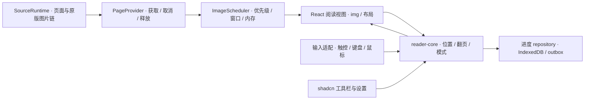
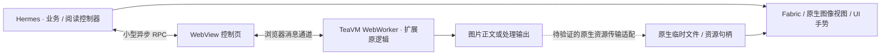

# 技术栈与跨端漫画阅读器设计：通用规范及历史方案

日期：2026-11-03。本文持续维护通用阅读规范与历史技术方案，不再冻结；当前架构以[主设计](./mihon-web-design.md)和[Flutter 接入设计](./flutter-teavm-integration.md)为准，工程与验收状态见[计划目录](../plan/README.md)。下文 React/Vite 目录、命令、依赖及 RN 采用门槛是选型背景，不是当前 Flutter 工程要求。

**当前已确定 Flutter + TeaVM，并采用 Web Worker + 原生 WebView 的浏览器宿主路线；实施接口与工具链以[Flutter + TeaVM 接入设计](./flutter-teavm-integration.md)及主设计为准。** 本文的 React/TypeScript 阅读核心、Vite/shadcn、Expo/RN 选型与框架采用门槛属于历史方案，不再要求实现。逻辑位置、图片预算、原版处理链、Access、后端及真实设备验收等通用规范保留，由 Dart/Flutter 与平台 adapter 实现。Flutter UI 使用 Pub；pnpm 管理 TS 后端与 JS 宿主。当前已有分项实现和验证，不能据此宣称完整图片阅读或真机性能通过。

**当前交付边界：** Static Assets 是 Web 与 Native 扩展的最终权威来源，只发布每扩展最新 build；index/catalog 决定版本，客户端或 Service Worker 管理更新与缓存。不再要求扩展 Release 发布，已有扩展和索引 Release 已按用户要求删除。通用 host/桥/WASM 使用 Web Static Assets 或 Native 内置材料；Worker 只处理个人数据和 Source 网络控制，不经 R2/Worker 交付扩展正文，不向客户端发放 GitHub 凭据。此前 Release Web 直下/Range 因 CORS 失败；当前 Static Assets 方案已确定，发布与完整加载仍待实现验收，具体限制见主设计。

前端的首要工程目标是跨端阅读。本文 Web 方案覆盖桌面 Chrome / Firefox / Safari、Android Chrome / PWA、iPhone Safari / PWA 和 iPad 的触控、横屏及分屏；原生阅读器增加各平台图片、手势、存储、Access 会话与 WebView 生命周期验收。通用的逻辑位置、图片预算和源处理链要求保留，具体语言与组件由已确定的 Dart/Flutter 和平台 adapter 承担。

## 1. 历史 React UI 选型

| 候选                                     | 对本项目的价值                                                   | 取舍                                                                                         |
| ---------------------------------------- | ---------------------------------------------------------------- | -------------------------------------------------------------------------------------------- |
| MUI                                      | Material 风格完整，导航、表单和设置页能快速统一                  | 可实现本应用；阅读器的分页、图片调度、缩放和位置恢复仍需独立开发，现成组件优势主要在外围页面 |
| Chakra UI                                | 组合式组件与主题适合构建应用外壳                                 | 同样可实现；阅读核心仍需自行处理浏览器输入和布局，不因换组件库而减少这部分工作               |
| **shadcn/ui，采用 Base UI 基础组件版本** | 组件源码进入项目，便于调整工具栏、浮层、焦点恢复及移动端设置面板 | 选用；项目负责维护修改后的组件及可访问性回归，按需引入组件                                   |

判断依据是阅读器需要高度定制的布局和交互，而外围 CRUD 页面相对简单。shadcn/ui 的源码分发方式适合这种分工；这不是三者包体积、内存或流畅度的实测排名。[shadcn/ui](https://ui.shadcn.com/docs)、[MUI](https://mui.com/material-ui/getting-started/)、[Chakra UI](https://chakra-ui.com/docs/get-started/installation)。

统一选择 shadcn/ui 的 **Base UI** 版本，避免不同组件混用两套基础组件约定。当前官方新项目默认 Base UI，Radix 仍受支持；记录所选 preset、CLI 版本及生成源码，后续更新按差异审核。[官方说明](https://ui.shadcn.com/docs/changelog/2026-07-base-ui-default)。

shadcn/ui 负责按钮、菜单、对话框、设置面板、滑条和表单；样式采用 Tailwind CSS、CSS 自定义属性和 Lucide 图标。阅读画布、图像窗口和输入控制器由项目实现，普通 Carousel 或图片灯箱不作为阅读引擎。移动端面板和桌面弹层共享设置内容，打开后暂停阅读快捷键，关闭后恢复焦点。

## 2. 历史 React 前端技术栈

| 领域         | 选定技术                                                                       | 职责与约束                                                                                    |
| ------------ | ------------------------------------------------------------------------------ | --------------------------------------------------------------------------------------------- |
| 应用框架     | React、TypeScript strict                                                       | 应用页面、阅读视图、可访问控件；手势逐帧数据不走整棵 React 渲染树                             |
| 构建         | Vite、`@vitejs/plugin-react`、`@cloudflare/vite-plugin`                        | 同一工程构建公开 SPA 和入口 Worker；阅读路由、扩展设置等按路由拆包                            |
| UI / 样式    | shadcn/ui（Base UI）、Tailwind CSS / Vite 插件、`lucide-react`                 | 共用主题和触控尺寸；阅读背景与应用主题可独立设置                                              |
| 路由         | React Router，客户端 library 模式                                              | 书架、详情、阅读、浏览与设置路由；章节/作品深链接和返回位置；首版使用 SPA                     |
| 请求状态     | `@tanstack/react-query`                                                        | API 请求状态、分页目录和元数据短期缓存；实际 Source 调用经过 SourceRuntime 调度，不放图片正文 |
| UI 状态      | Zustand                                                                        | 工具栏、阅读模式、当前逻辑位置及设置面板等会话状态；按 selector 订阅                          |
| 业务本地存储 | Dexie / IndexedDB                                                              | 书架镜像、设置、阅读位置、同步 outbox；持久业务状态以 repository 层为入口                     |
| 长列表       | `@tanstack/react-virtual`                                                      | 竖向阅读页窗口、长章节列表；动态尺寸、稳定 key、锚点恢复由阅读器适配                          |
| 手势         | Pointer Events、`@use-gesture/react`、`requestAnimationFrame`                  | 触点识别、缩放和平移；原生滚动与自定义手势按阅读模式明确分工                                  |
| 图片显示     | DOM ``、CSS transform、ResizeObserver                                     | 图片呈现、视口测量、适宽/适高、裁切显示；重处理仍走扩展原图片链和独立图像适配                 |
| PWA          | `vite-plugin-pwa` 的 `injectManifest`、Workbox                                 | 可审查的自定义 Service Worker；公开应用外壳缓存、版本提示和安装元数据                         |
| 扩展接入     | 自有 `source-runtime` 包、WebWorker、MessageChannel / transferable ArrayBuffer | 版本握手、requestId / generation、有限执行槽、取消；复用 release9 并实现主设计 P0-B 二进制桥  |

选择 Vite SPA 是因为书架与阅读器依赖浏览器本地状态及 SourceRuntime，当前产品没有服务端渲染需求。Cloudflare Vite 插件使后端开发运行在本地 workerd，并提供 Workers 集成；仍须在线验证 Access 和真实源站网络。[官方插件说明](https://developers.cloudflare.com/workers/vite-plugin/)。

**状态分工必须固定：** D1 是云端业务真相；Dexie 是当前身份的本地镜像和待同步变更；TanStack Query 管请求生命周期及短期结果；Zustand 管阅读会话和 UI。组件通过 repository 写业务状态，避免这几处各自保存一份可修改的书架。TeaVM 已有的文件 / HTTP Cache IndexedDB 桥继续复用，采用独立数据库与命名空间，Dexie 不接管其已审计的文件事务语义。

Source 请求默认关闭自动 retry、refetch-on-focus、自动重挂载重取与自动重连重取；是否重试由 SourceRuntime 的副作用、取消及错误策略决定。API 的安全读取单独设置有限重试；outbox 同步由幂等协议控制。Query 的默认后台刷新和重试不能直接套到 Source，开发环境 React 重挂载也不能重复启动源请求。[Query 选项](https://tanstack.com/query/latest/docs/framework/react/reference/functions/useQuery)。

## 3. 历史阅读器组织与通用规则

### 模块边界



`reader-core` 是独立的 TypeScript 包，维护章节/page key、单双页分组、方向、位置锚点、输入状态转换和设置合并。它不依赖 shadcn、D1 或 TeaVM；坐标、视口和尺寸由浏览器适配器输入。React 视图和手势适配器放在应用的 `features/reader` 中。这样可以直接用确定性输入测试翻页和进度，再用真实浏览器验证触摸和渲染。

`PageProvider` 对阅读器提供页面清单和可取消的图片获取，返回尺寸/类型、Blob 或可释放的显示资源；内部仍经过 Source 原版 headers、拦截器、解密和重排。阅读器不绕过扩展直接取原始图片 URL。Provider 同时提供开发测试适配器，但图片夹具只属于测试工程，不形成用户本地漫画入口或线上源兼容性证据。

### 两套显示模式，共用位置与图片调度

| 模式                 | 实现                                                                  | 必须解决的问题                                                                                                                     |
| -------------------- | --------------------------------------------------------------------- | ---------------------------------------------------------------------------------------------------------------------------------- |
| LTR / RTL 单页与双页 | 有界页组窗口，CSS 布局与 transform；由 reader-core 控制分页和拖动落点 | 按源页面顺序生成逻辑页组，RTL 只改变展示及前进方向；封面单页、横图独占、奇数页、单双页切换后保留当前页；不镜像图片或把整站设成 RTL |
| 竖向连续 / Webtoon   | 原生 overflow 滚动 + TanStack Virtual；预留图片纵横比，区分页间距     | 图片后到、尺寸修正、横竖屏和前后章接续时保持阅读锚点；不在每次滚动中强制写 scrollTop；Webtoon 关闭页间距                           |

横向分页选受控布局，避免滚动吸附与自定义缩放同时争抢横向手势；竖向阅读保留浏览器惯性滚动。两者都使用原生 `` 呈现。虚拟化只管理可见窗口，不自动解决超长图解码内存；动态尺寸测量还需要应用维护稳定页标识和恢复规则。[TanStack Virtual](https://tanstack.com/virtual/latest/docs/introduction)。

### 输入与缩放

- 单指点击分区、翻页拖动、双击、双指缩放分别进入明确状态；拖动超过阈值后不再触发点击；收到 `pointercancel` 必须释放触点和中间状态。缩放后的平移不会顺带翻页，到边界后需明确的新手势才切页。
- 分页模式在图像交互区处理 pinch / pan；竖向模式默认让浏览器滚动，放大查看时进入局部缩放视图，关闭后返回原阅读锚点。避免同一手势同时驱动长条滚动和图片平移。
- `touch-action` 在手势开始前按区域及模式设置；普通长条滚动区保留纵向滚动和浏览器缩放，明确接管 pinch 的局部图像区才限制原生手势。处理 Safari GestureEvents / 触控板差异的监听绑定到该区域；不在整个 document 禁用浏览器缩放，也不设置 `user-scalable=no`。提供可聚焦的放大、缩小及重置按钮。[手势库文档](https://use-gesture.netlify.app/docs/gestures/)、[touch-action](https://developer.mozilla.org/en-US/docs/Web/CSS/Reference/Properties/touch-action)。
- 桌面提供方向键、PageUp / PageDown、Home / End、空格及可见翻页按钮；编辑输入框或打开对话框时停用阅读快捷键。触控板连续滚动保持惯性，不把每个 wheel 事件都视为一次翻页。
- 拖动和缩放中的坐标存于 ref / 控制器，使用 rAF 更新局部 CSS transform；手势结束或逻辑页变化后才提交 Zustand 和进度。动画初版使用 CSS / rAF，不为简单控件过渡增加动画框架；遵守 reduced-motion。

### 位置恢复、屏幕与设置

持久位置采用 `chapterKey + pageKey + manifestVersion + pageIndexHint + normalizedOffset`；归一化偏移相对原图坐标，并记录视口内锚点。缩放、裁白和双页显示要映射回同一原图位置。页面有稳定身份时优先匹配；源只返回易变签名 URL 时，不把该 URL 当永久 ID，按稳定元数据与序号降级；清单变化不能静默跳到另一页。

浏览器返回、旋转、平板分屏、地址栏变化或图片尺寸补全时，先定位逻辑页，再恢复页内锚点；跨设备同步同样使用该位置，不同步裸 scrollTop。当前回看位置和最远已读位置继续按主设计分开保存，写入采用节流、切章及时落盘和幂等 outbox。

布局采用 CSS Grid / Flex、容器查询、`dvh` 和 safe-area；必要时利用 VisualViewport 处理可见区域变化，但不能因工具栏动画反复重新解码图片。单页/双页随实际可用宽度调整，用户设置可覆盖默认值；控制器适配输入能力而非仅用 UA 判断手机。

阅读亮度通过应用内遮罩或图像样式实现，不承诺控制设备背光。裁白可在图像适配中低分辨率采样生成裁剪边界，显示时应用 CSS 裁切并缓存边界；保留关闭选项和原始图像位置。需要 canvas 的像素分析或解密重排按实际能力执行，不把所有页面重新绘制到一张超大 canvas。

Fullscreen、Screen Orientation lock、Screen Wake Lock 均作为能力检测后的增强；不可用时保留正常阅读和旋转适配。平台支持及后台恢复以真机结果为准。工具栏支持键盘焦点、约 44px 触控目标和无障碍名称；图片提供页码标签，但不把它表述成漫画内容已具备文本替代。

### 图片调度和性能预算

1. 当前可见页优先，其后是阅读方向上的相邻页，再是反方向保留页；并发和窗口均可配置。P0 起始值为手机同时获取最多 2 张、保留当前页组及前后各 1 组，长条按约前后各 1 个视口 overscan，随后依据真机调整。重图可进一步收缩，不一次创建整章 Blob。
2. 切章、跳页和退出阅读取消无用请求；结果检查 chapter / generation，过期结果立即释放。仅在邻近章末时允许有界下一章准备，不遍历整本作品。
3. ImageScheduler 持有图片资源和引用计数；React / Zustand / Query 只保存资源标识与状态。离开窗口后清除 DOM 引用、撤销 Object URL、关闭不再使用的 ImageBitmap，处理中的 ArrayBuffer 避免额外复制。释放引用不保证浏览器立刻归还物理内存。
4. 记录可见页/预取页的像素、压缩字节、处理中副本及 TeaVM 占用。`宽 × 高 × 4` 只作为常见 RGBA 解码开销的粗估，不能当浏览器实际内存；超长单图即使虚拟化也可能超预算。优先减少预取和并发，必要时单独验证降采样/分片方案，切片前完整解码本身也可能产生峰值。
5. 首图完成可见渲染、滑动/缩放帧耗时、掉帧、主线程长任务、切章延迟和连续阅读内存分别测量。已解码图片交互以目标设备 60Hz 下接近 16.7ms 帧预算为调优目标；首图公网时间和内存上限经 P0 真机基线确定，不把桌面 TeaVM 首次业务数据当手机指标。

图片窗口与 TeaVM 执行槽共用设备资源预算；手机默认一个扩展槽，避免大包加载与多页解码同时冲击内存。性能计数用于开发诊断与验收，不建设用户阅读历史/时长统计模块。

## 4. PWA 和启动

公开应用外壳先显示，本地镜像提供已有状态；TeaVM 包在 Web 与 Native 均从 Static Assets 按需获取最新版，Source 网络操作仍需 Access。阅读器路由代码可在进入详情或准备继续阅读时预取，扩展产物保持独立分发，书架首屏不加载所有阅读设置和扩展代码。

Service Worker 使用 `injectManifest` 以明确控制路由和缓存。预缓存清单只包含公开 shell / UI 资源；`/api`、`/api/*`、Access 登录端点和登录回跳走网络，未知后端请求不能落入 SPA navigation fallback。AOT bundle 从 Static Assets 按需下载最新 build，由客户端或 Service Worker 管理更新缓存，不进入全仓首次预缓存；公开材料缓存和个人业务/Source 状态分开。下述 Workbox 配置是历史 React 实现提案，当前 Flutter 的缓存策略以产品实现为准。[自定义 Service Worker](https://vite-pwa-org.netlify.app/guide/inject-manifest)。

使用提示式更新：正在阅读时不强制 `skipWaiting` / reload，先持久化位置，在安全时机应用新版本。首版不启用 background sync、周期同步或章节离线清单。iOS PWA 的存储、顶层 Access 回跳及从后台恢复独立验证，不能依靠 Service Worker 维持扩展持续运行。

## 5. 后端技术栈

| 领域        | 选定技术                                                      | 用法                                                                                            |
| ----------- | ------------------------------------------------------------- | ----------------------------------------------------------------------------------------------- |
| 运行平台    | Cloudflare Workers ES modules + Workers Static Assets         | 一个 hostname、一个入口 Worker；公开 SPA，受保护 `/api` 与 `/api/*`                             |
| API 框架    | Hono                                                          | 路由、鉴权/Origin 中间件、错误封装；只在确认身份后访问业务 bindings                             |
| 合同与校验  | Zod + 共享 TypeScript DTO                                     | 请求、响应、Source DTO / 控制帧的运行时边界校验；外部 Long ID 使用字符串                        |
| 鉴权        | Cloudflare Access + `jose` / Web Crypto                       | `createRemoteJWKSet` / `jwtVerify` 校验固定 issuer、AUD、签名、期限和本人身份；完整规则见主设计 |
| 数据库      | D1 + `drizzle-orm/d1`                                         | schema、类型化查询、索引、幂等 mutation 和同步增量；与 SQLite / D1 能力对齐                     |
| 迁移        | Drizzle Kit 生成 SQL + Wrangler D1 migrations 执行            | SQL 入库审核；本地先验证，再对目标环境显式应用；单一迁移历史                                    |
| 扩展分发    | Static Assets 最新扩展与权威 index/catalog                    | Web 与 Native 共用，只发布每扩展最新 build；不经 Worker 或 R2 代理正文                          |
| 共享材料    | Workers Static Assets / Native 内置                           | host、桥、Worker 引导和 WASM；Native 不从网络回退                                               |
| 个人对象    | 按功能需要的 R2 binding                                       | 仅私有自定义封面等个人数据；鉴权后交付，不保存扩展产物                                          |
| 会话 / 通知 | SQLite-backed Durable Objects、原生 WebSocket                 | 必要的运行会话与回调关联、同步通知；D1 保持业务真相，DO 不承载 Source 或图片正文                |
| 网络桥      | 原生 fetch、ReadableStream / TransformStream、AbortController | 上游域名/重定向检查、Cookie/头映射、二进制转发、背压与取消                                      |
| 开发 / 发布 | Cloudflare Vite 插件、Wrangler、`wrangler types`              | 由 bindings 生成 Env 类型；固定 compatibility_date，本地和线上分别验证                          |

Hono 有 Workers 适配；Drizzle 提供 D1 driver。选用互相兼容的稳定版本，不直接照搬文档中的 `@rc` 安装命令。[Hono](https://hono.dev/docs/getting-started/cloudflare-workers)、[Drizzle D1](https://orm.drizzle.team/docs/sqlite/connect-cloudflare-d1)。

Drizzle 不改变 D1 的事务能力。同步写入使用受支持的 batch / 条件 SQL、唯一约束与幂等键实现原子更新；不可把常驻数据库的交互式事务假设搬进 Worker。元数据和二进制协议分开处理：普通 JSON API 用共享 schema；Source 图片等网络正文走有界二进制桥，AOT 由客户端直接下载、有界解压并校验。两者均不经 JSON / Base64 或逐字节 Zod 校验，Worker 不处理 AOT 正文。

前后端通过共享 DTO 和薄 fetch client 保持类型一致；HTTP 错误、Access HTML / redirect 和上游错误分别处理。当前不需要 GraphQL、tRPC 或 Node 常驻 API。Cloudflare 部署凭证只存在于开发/CI；前端通过同源 Access Cookie 访问 API。

## 6. pnpm 工程与工具链

以下是当时 React/Vite 提案的目录，不是当前 Flutter 工程结构；当前目录与实际命令见根 README：

```text
project/
├── apps/app/
│   ├── src/
│   │   ├── features/reader/       # React 视图、输入适配、ImageScheduler
│   │   ├── features/             # 书架、浏览、详情、设置
│   │   ├── components/ui/        # shadcn 源码，首版只有一个应用
│   │   ├── repositories/         # Dexie、业务镜像与 outbox
│   │   └── sw.ts                 # 自定义 Service Worker
│   ├── worker/                   # Hono、Access、D1 schema、DO、网络桥
│   ├── migrations/              # 审核后的 D1 SQL
│   ├── vite.config.ts
│   └── wrangler.jsonc            # 唯一部署入口
├── packages/
│   ├── reader-core/             # 纯 TS 阅读规则和位置模型
│   ├── contracts/               # Zod、DTO、协议版本
│   └── source-runtime/          # 浏览器调度、Worker 引导、JS 桥
├── runtime/teavm/               # release9 宿主工作副本、pom.xml、补丁
├── tools/extensions/            # 复用 Python AOT 编排及构建清单工具
├── tests/                      # 浏览器/协议 fixtures 与 E2E
├── pnpm-workspace.yaml
├── pnpm-lock.yaml
└── package.json
```

`pnpm-workspace.yaml` 包含 `apps/*` 和 `packages/*`；内部包使用 `workspace:*`，全仓一份锁文件。根 `packageManager` 固定精确 pnpm 版本，固定受所选 Vite / Wrangler 支持的 Node LTS；CI 使用 `pnpm install --frozen-lockfile`。初次建工程时核对兼容的稳定版本并锁定，计划不凭空填写未经组合验证的包版本。[pnpm workspace](https://pnpm.io/workspaces)。

所有 JS / TS 依赖由 pnpm 管理；Java 依赖仍由 Maven 管理，TeaVM 固定 0.16.0 和 release9 对应宿主/JDK/补丁。Python 转换/构建工具单独固定环境。pnpm scripts 可以统一调用 Maven / Python，但 pnpm 不替代它们的依赖解析。普通 UI 构建不会每次重编全部扩展；AOT 最新 build 发布到 Static Assets，不再要求扩展 Release 发布，已有扩展和索引 Release 已按用户要求删除；共享材料进入 Web Static Assets 或 Native 打包资源，不随扩展重复上传。

| 计划命令                                           | 职责                                                        |
| -------------------------------------------------- | ----------------------------------------------------------- |
| `pnpm dev`                                         | 启动 Vite + 本地 Workers bindings，按需接入已构建测试扩展   |
| `pnpm build`                                       | 构建公开 UI、自定义 SW 与入口 Worker，检查产物边界          |
| `pnpm check`                                       | 分环境 TypeScript、ESLint / React Hooks 规则、Prettier 检查 |
| `pnpm test` / `pnpm test:worker` / `pnpm test:e2e` | 分别执行纯逻辑/组件、Workers、浏览器验证                    |
| `pnpm db:generate` / `pnpm db:migrate:local`       | 生成并验证 SQL；远端迁移使用独立的显式命令                  |
| `pnpm extensions:build -- <package>`               | 调用锁定工具链按指定包 AOT，输出清单/哈希及 ABI             |
| `pnpm deploy`                                      | 发布单一应用 Worker；与扩展产物发布、数据库迁移分开执行     |

浏览器 DOM、浏览器 Worker、Service Worker 和 Cloudflare Worker 使用独立 tsconfig / 类型入口；共享包不引入 Node globals。初版 pnpm workspace 足够，不预设额外 monorepo 调度器。shadcn CLI 按需运行并锁版本，不在每次构建时重新生成组件。

## 7. 验证与实施顺序

单元测试使用 Vitest 验证页组、RTL、位置映射和进度合并；React Testing Library 验证控件、焦点与可访问名称。Workers 集成使用官方 `@cloudflare/vitest-plugin`，覆盖 Access JWT、D1 幂等批次、私有个人对象与 DO 会话；Static Assets 最新发布、跨端下载、客户端/SW 缓存更新与压缩/摘要另作客户端集成验证。当前官方该插件要求 Vitest 4.1 或更高；建工程时选择兼容的稳定组合，不套用旧 pool 配置。[Workers 测试文档](https://developers.cloudflare.com/workers/testing/vitest-integration/write-your-first-test/)。

Playwright 在 Chromium / Firefox / WebKit 验证导航、恢复、网络中断和 API 边界；其设备配置模拟视口、UA 和触摸能力，不能替代 iPhone Safari / 已安装 PWA 的触控、内存和 Access 回跳实测。[Playwright 设备模拟](https://playwright.dev/docs/emulation)。

| 验证环境 / 夹具                | 关键验收                                                                              |
| ------------------------------ | ------------------------------------------------------------------------------------- |
| 桌面 Chrome / Firefox / Safari | LTR / RTL、单双页、键盘、鼠标与触控板、浮层焦点、浏览器返回                           |
| 真机 Android Chrome / PWA      | 快速连续翻页、长条惯性、双指缩放、旋转、后台恢复、连续多章内存                        |
| 真机 iPhone Safari / PWA       | safe-area / 地址栏、滚动与 pinch 互斥、pointercancel、Access 顶层回跳、存储与后台回收 |
| iPad Safari / PWA              | 双页、分屏动态宽度、横竖屏、触控与外接键盘切换                                        |
| 开发图片夹具                   | 混合尺寸、超长单图、奇数页、封面/横跨页、延迟解码、损坏图、上方尺寸补全时锚点稳定     |
| 真实 3–5 个代表 Source         | 原版直图/请求头/图片处理完整链；章首中末及下一章；Access 过期保留当前图和待同步位置   |

**阅读器与扩展宿主同列 P0。** 新增 P0-R：先用固定开发图片验证两种显示模式、缩放/滚动互斥、位置恢复和手机内存；同时推进主设计 P0-A 公共宿主与 P0-B 二进制桥。P0-C 将两条路径接成真实源 → 原版图片处理 → 可交互阅读器 → 进度落盘的完整链。

P1 再完成书架/分类、完整阅读设置（裁白、页组规则、背景等）、书签和日用错误恢复；P2/P3 延续基本同步、扩展管理和源迁移。阅读器已有 P0 真机基线后再扩大外围 UI，更新、下载、历史统计、追踪、本地漫画、备份恢复和私密使用继续暂缓。

本文只确定选型、模块职责和验收方法。库体积、端到端帧率、首图及峰值内存尚无本产品测量结果；实施时在固定设备和图片输入下记录，组件库的选择本身不作为性能证据。

## 8. React Native / React Native Web 备选评估

本节保存从 PWA 向 RN 演进的分析；其中“当前建议的演进路径”等 PWA 优先判断是当时的取舍。现已把移动原生作为目标，采用条件以跨端框架评估为准，下面的宿主和组件兼容性边界仍有效。

**可以采用，并且不要求改变 Cloudflare 后端。** React Native Web（RNW）将 React Native 兼容组件渲染为 React DOM，能用于纯 Web 或多平台应用，也能与现有 React DOM 页面逐步组合。它在浏览器中仍使用浏览器渲染能力，不会把 iOS / Android 原生视图带进网页。[RNW 官方说明](https://necolas.github.io/react-native-web/docs/)。

| 目标                                    | 可行路径                                                          | 对当前项目的判断                                                                            |
| --------------------------------------- | ----------------------------------------------------------------- | ------------------------------------------------------------------------------------------- |
| 桌面 / 手机浏览器和 PWA                 | React DOM 或 RNW 都可；两者均可部署到 Workers Static Assets       | 继续推荐 React DOM；更直接控制长条滚动、CSS、图片生命周期及浏览器宿主，RNW 没有已测性能收益 |
| 近期同时交付 Web、iOS、Android 原生应用 | Expo + React Native + RNW，按平台实现必要适配                     | RNW 的代码复用价值明显增加，值得重新选择前端；须先验证扩展运行时和原生鉴权                  |
| 先做 PWA，未来再加入原生客户端          | 共享 reader-core、DTO、进度/设置逻辑；增设原生视图和平台 provider | 当前建议的演进路径；先固定接口，不预建未使用的原生工程                                      |
| 原生外壳快速复用现有 Web 功能           | Expo DOM components / WebView 加载 Web 阅读器或完整应用           | 可验证的过渡方案；阅读部分仍是 WebView，需要另测生命周期、存储、登录和跨桥资源传递          |

### 哪些代码能共用

| 部分                                                  | 复用程度与平台边界                                                                                                                                        |
| ----------------------------------------------------- | --------------------------------------------------------------------------------------------------------------------------------------------------------- |
| 页序、RTL、双页分组、逻辑位置、设置合并、同步冲突规则 | 纯 TypeScript 核心可共用；输入坐标和持久资源通过接口提供                                                                                                  |
| React hooks、Zustand 会话状态、DTO / 校验             | 大部分可共用；调用浏览器 API 的代码需分离                                                                                                                 |
| 图像显示、长列表、触控与动画                          | 可以共用部分 RN 组件/手势声明，但原生图片、Web DOM、滚动和解码策略仍需平台实现与实测                                                                      |
| shadcn/ui、MUI、Chakra UI                             | 本次候选都是 Web DOM UI 方案；可用于 Web 外壳，不能直接作为 RN 原生控件。NativeWind 等样式方案也不会自动转换它们的 DOM 组件                               |
| TeaVM 宿主与文件 / 缓存桥                             | 当前 release9 产品路线依赖 WebWorker、IndexedDB、浏览器脚本和图像 API；在 RNW 浏览器端可继续用，原生 JS 环境需要新适配或浏览器容器                        |
| Access 和数据存储                                     | Web 的同源 Cookie / IndexedDB 继续成立；原生登录、Cookie 存储及 HTTP 客户端与 WebView 的会话共享必须重新验证，不能假定外部浏览器登录后原生 fetch 已获授权 |

React Native 通常运行于 Hermes，支持部分 Web API，但不等于完整浏览器环境。因此，TeaVM 生成 JavaScript 只说明存在复用可能，不能据此认定现有浏览器宿主可在原生端原样启动。这是对当前宿主依赖的工程判断，尚无原生实验结果。[RN JavaScript 环境](https://reactnative.dev/docs/javascript-environment)。

### 如果决定采用 Expo 通用前端

前端工具链改成 **pnpm + Expo / Metro + Expo Router + React Native + RNW**；手势与动画候选为 React Native Gesture Handler + Reanimated。Web 导出使用 `pnpm exec expo export --platform web`，部署产物仍由同一个入口 Worker 的 Static Assets 提供；Hono / Access / D1 / R2 / DO 继续保留。Expo 官方支持 pnpm、Web 导出和按平台模块。[Expo Web](https://docs.expo.dev/workflow/web/)。

此时不继续让 Vite 构建 Expo 前端：Expo/Metro 构建 UI，Wrangler 构建部署 Worker；pnpm scripts 编排，仍是一套线上入口。PWA 改为在 Expo 导出后运行 Workbox 的自定义 SW 构建流程，保留公开 shell 与受保护 API 的缓存边界。[Expo PWA](https://docs.expo.dev/guides/progressive-web-apps/)。

Web 外壳仍可选 shadcn/ui，阅读区域采用 RNW；原生侧单独实现工具栏、设置等控件。若追求连外围 UI 都跨平台共用，则需重新讨论此前 UI 三选一要求的适用范围。按 `.web` / `.native` 等平台模块拆分图片、存储和运行时适配，不能只写一次 UI 后宣称全链路原生支持。[平台代码组织](https://reactnative.dev/docs/platform-specific-code)。

Reanimated 在原生端和 Web 端的执行实现不同；官方明确 Web 功能使用 JavaScript 实现，不能把原生端动画体验当作 RNW 性能保证。需要以同一真机、同一章节，比较滚动/缩放、长图内存、首图及运行时并行负载。[Reanimated Web](https://docs.swmansion.com/react-native-reanimated/docs/guides/web-support/)。

Expo DOM components 提供 WebView 中运行现有 DOM 组件的路径；它适合评估浏览器宿主复用，但不同于将图片改为原生视图。若只把 TeaVM 放进 WebView、图片显示放在原生侧，还要解决图像正文、文件引用和取消跨越容器的传输开销，不能重新引入整图 Base64 桥而忽略原 P0-B 的目标。[Expo DOM components](https://docs.expo.dev/guides/dom-components/)。

### iOS JIT 对 TeaVM 选型的影响

**PWA 中的 TeaVM JS 在计算吞吐上可能优于直接在 RN 原生 Hermes 中执行同一产物，这加强了首版保留浏览器运行时的理由。** 这是执行机制带来的预期，不是本项目已取得的 iPhone 对照结果。是否采用 RNW 组件，与 TeaVM 放在 WebKit 还是 Hermes 中运行，是两个独立决定。

当前 release9 的 AOT 指 `Java / Kotlin → JVM 字节码 → TeaVM JavaScript`，没有生成 iOS ARM 机器码。生成的 JS 仍由宿主 JavaScript 引擎执行；JSC 对热代码的解释、baseline JIT、DFG / FTL 优化层次仍可能影响它。[TeaVM 编译说明](https://teavm.org/docs/intro/overview.html)、[JavaScriptCore 架构](https://docs.webkit.org/Deep%20Dive/JSC/JavaScriptCore.html)。

| 运行位置                                 | iOS 常规发行环境中的执行方式                                                   | 对本项目的含义                                                                             |
| ---------------------------------------- | ------------------------------------------------------------------------------ | ------------------------------------------------------------------------------------------ |
| Safari / 已安装 PWA 中的 TeaVM WebWorker | WebKit / JavaScriptCore，可在安全策略允许时使用 JIT                            | 现有浏览器宿主可以延续，热路径计算存在优化机会                                             |
| RNW 构建的网页 / PWA                     | 同样运行在浏览器引擎中                                                         | 选择 RNW 不会使 TeaVM 自动改由 Hermes 执行；WebKit 的条件相同                              |
| RN 原生 Hermes                           | 常规 release 路线使用预编译字节码和解释执行；不具有 WebKit 内容进程的 JIT 条件 | 字节码可减少加载时解析成本；不能据此预期 Java 风格计算吞吐优于 WebKit                      |
| RN 内嵌 WKWebView，TeaVM 放在其中        | WebKit 内容进程通常也可使用 JIT，具体受系统/视图安全策略影响                   | 是未来原生壳可评估的运行时；仍需测试启动、生命周期与跨容器传输，不能与原生 Hermes 混为一谈 |

RN 官方说明其嵌入的 JSC 在 iOS 上不使用 JIT；仅将 Hermes 换成 JSC 不等于 Safari 的执行条件。Hermes 官方将常规执行方式描述为 AOT 字节码加运行时解释，RN release 构建可提前生成 `.hbc` 改善启动；这与原生机器码 AOT 不同。此处不将实验性 native AOT 或特殊授权能力当作当前可直接使用的基线。[RN 执行环境](https://reactnative.dev/docs/javascript-environment)、[Hermes 执行方式](https://github.com/meta/hermes/blob/static_h/doc/Features.md)、[RN Hermes 构建](https://reactnative.dev/docs/hermes)。

WebKit 的 WKWebView 具有 JIT 控制及安全限制接口，因此不能笼统说所有 iOS 原生应用中的网页都没有 JIT；App 内直接使用 JS 引擎与系统 WebKit 内容进程需要区分。[WebKit JIT 控制实现](https://bugs.webkit.org/show_bug.cgi?id=191822)。

对 release9，Jsoup / Java 风格的 HTML 和 JSON 解析、字符串与集合运算，以及仍在生成 JS 中执行的解码/加密处理，是值得对照的 CPU 路径。原站网络等待、插件主动限速、调用浏览器原生图像解码的部分不会按同样比例改善。JIT 还需要预热并可能增加内存；下载、解析、首次执行和完整首图不因此保证更快，原生视图的滚动体验也不能据此排名。

若比较 Hermes 冷启动，必须分别注明预打包 `.hbc` 与运行时获取 JS；当前按包安装的远程 TeaVM bundle 不会自动获得 Metro 在 App 构建时的预编译收益。新增 Hermes 字节码产物需要匹配引擎版本、加载机制和宿主兼容性，不能把预装全部扩展的一方与按需网络获取的一方直接归因为 JIT 差异。

P0 的 iOS 测量使用 HTTPS，记录 OS、设备、安全模式和热状态。WebKit 开发者确认较新系统的增强安全启发式可对明文 HTTP 场景应用限制；Lockdown Mode 也会禁用 JIT。不要用手机访问局域网 HTTP 开发服务器得到的数字代表 HTTPS PWA 性能，也不通过改变用户安全设置来制造优势。[WebKit 增强安全说明](https://bugs.webkit.org/show_bug.cgi?id=324968)、[Apple Lockdown Mode](https://support.apple.com/guide/personal-safety/harden-your-devices-with-lockdown-mode-ipsd5baf79d0/web)。

若未来启动原生路线对照，使用同一台 iPhone、相同 release9 产物/固定输入及等价宿主，分别记录 Safari、独立 PWA、RN release Hermes 和 RN + WKWebView；保留首次调用与预热后结果，验证返回值/请求等价性，区分 CPU、首图、峰值内存与阅读手势，测量阶段脱离调试器。Hermes 尚未完成宿主适配时，只能比较可移植子集，不能宣称完整应用更快。这组研究不是首版新增原生客户端的验收前置条件。

**本次结论：首版优先保留 TeaVM 的 WebKit 浏览器执行路径，React DOM + shadcn/ui 仍为 UI 建议。** RNW 也能保留该路径，其价值仍取决于共享 UI 的需求；直接迁移到 RN / Hermes 不能假设会带来运行时性能提升。未来原生客户端优先比较 WebView 承载扩展与原生宿主适配两条路径；reader-core 和 provider 边界保持可移植。本次只补充机制分析和测量方案，没有做 iOS / RN 基准或切换工具链。

## 9. 原生阅读界面 + WebView TeaVM 的混合方案

**这是原生客户端值得优先验证的候选，有机会兼顾扩展计算和原生阅读交互，但不能仅凭组合推导出“性能最好”。** Hermes 执行 React 组件与应用逻辑，Fabric 将其提交为原生视图；图像最终由原生组件显示。高频手势/动画用原生滚动与 Reanimated UI worklet 完成，不把每帧事件送给 WebView 或主 JS 状态树。[RN 渲染流程](https://reactnative.dev/architecture/render-pipeline)、[Reanimated worklet](https://docs.swmansion.com/react-native-reanimated/docs/fundamentals/glossary/)。



WebView 内复用按包执行槽和浏览器宿主，保留必要的 DOM / 脚本回调；原生页面切换时复用这个前台会话，不为每章重建 WebView。实际窗口挂载、不可见状态和系统调度必须实测，不能将“隐藏的 WebView”当作保证持续运行的后台服务。首版关闭应用停止任务的边界继续成立。

### 决定性能的是图片路径

控制桥只传搜索结果、章节/page DTO、requestId、generation、取消、进度及资源标识。标准 `react-native-webview` 的 `window.ReactNativeWebView.postMessage` 只接受字符串；适合有界 JSON，不适合把每张图变成整段 Base64。Base64 字符数约增加三分之一，还可能叠加字符串复制、JSON 处理及解码成本。[WebView 消息协议](https://github.com/react-native-webview/react-native-webview/blob/master/docs/Guide.md#the-windowreactnativewebviewpostmessage-method-and-onmessage-prop)。

浏览器内 Worker 的 transferable ArrayBuffer 不能直接视为跨 WebKit 内容进程到 Hermes 的传输方案。JSI 改善 RN 与原生代码的互操作，也不会自动把两个 JS 引擎/进程的对象变成共享内存。WebKit 的 Blob URL 仅引用对应浏览器上下文的资源，不能直接交给原生 Image 当文件路径。

目标是 **原生图像组件消费临时文件或受控资源句柄，Hermes 只拿元数据**。适配模块在原生侧管理文件写入、引用、取消和释放，形成一个明确的图像缓存所有者。该资源通道是待实现和测量的原生模块，不将标准 postMessage、WKJSHandle 或任意新 buffer API 等同于已经具备双向零复制传输。跨边界至少一次必要复制可以接受，重点是有界、无整图字符串中转且不重复解码。

| 图片路径                   | 可考虑的优化                                                             | 正确性要求                                                                                                           |
| -------------------------- | ------------------------------------------------------------------------ | -------------------------------------------------------------------------------------------------------------------- |
| 正文无需变换的图片         | 在已完成兼容适配的传输层保留最终压缩正文到原生缓存，再给原生图像组件读取 | 仍执行扩展原请求/响应拦截器、Cookie、缓存和错误逻辑；不能只返回图片 URL 后另行下载一遍，或跳过会检查正文的响应拦截器 |
| 扩展会解密、重排或改变正文 | 处理后字节通过专用有界通道交给原生；输出资源校验后再显示                 | 不绕过原处理链；包含 WebKit 端处理副本、跨桥复制、原生解码的峰值；不能只用直图源证明方案性能                         |
| 宿主图像桥执行像素操作     | 后续可探索原生图像桥，用操作/资源句柄替代反复传输 RGBA                   | 这是独立的宿主兼容改造，须与原版输出对照；不作为现有 TeaVM 直接复用能力或首轮性能结果                                |

原生缓存只保存有界阅读窗口中的临时资源，不建立整章离线清单或下载队列。应用 JS 和 WebKit DOM 不再各保留一份完整章节；浏览器内部必需的扩展 HTTP Cache 语义仍保留，并在总内存/存储核算中计入。

### 收益与新增成本

| 维度          | 混合方案的预期                                                                                                               |
| ------------- | ---------------------------------------------------------------------------------------------------------------------------- |
| 热态扩展计算  | 可保留 WebKit JIT；相对同引擎的 PWA，不能预期仅换原生界面就使 TeaVM 更快                                                     |
| 阅读交互      | 可使用原生滚动、图片解码/显示及 UI 线程手势；是否优于已有 Web 实现须真机比较                                                 |
| 冷启动 / 首图 | 增加 Hermes/App 与 WebView 的初始化协调、图片资源交接；预热可改善后续调用，不能消除首次成本                                  |
| 内存 / 电量   | 同时存在原生视图、Hermes、WebKit 和 TeaVM；更好的原生图片窗口可能抵消部分成本，但总峰值可能高于 PWA                          |
| 生命周期      | WebKit 内容进程可独立终止；原生 UI 应保留已落盘位置和当前可用图片，重建 runtime 后递增 generation，废弃旧请求                |
| 鉴权          | WebView Access 会话与原生网络会话需明确分工；不假设原生 Image / fetch 自动共享 WebView Cookie；不得以公开图片链接绕过 Access |

现有 PWA 已将 TeaVM 放在 WebWorker 中，因此“扩展计算不阻塞 UI JS”并非混合方案独有优势。它额外提供的是原生阅读视图与平台资源管理，同时引入新的跨进程边界。原生壳的内存统计必须合并 App 和 WebKit 内容进程，不能只看 Hermes heap 或 App 单一进程就宣称更省内存。

WebView 必须处理 `onContentProcessDidTerminate`，不能假定前台创建一次便永远存活。离窗、不可见、前后台切换及系统内存回收都进入测试矩阵；不使用维持虚假媒体活动等方式规避系统调度。[WebView 进程终止接口](https://github.com/react-native-webview/react-native-webview/blob/master/docs/Reference.md#oncontentprocessdidterminate)。

### 采用门槛

现已采用移动原生优先的目标；先比较同一 iPhone 上的 Web 基线与选定混合候选，覆盖直图和正文处理源、冷启动/预热、连续多章、长图缩放、Access 过期和 WebView 重建。记录首图与切章分布、交互帧耗时、跨桥延迟/字节/复制、App + WebKit 总峰值及能耗；原版扩展语义保持一致后再比较性能。

原生图像通道若尚未解决，只能把原型标为功能验证，不能将 JS-only 微基准外推为整章阅读收益。Flutter 已确定，以上边界用于验证 Flutter adapter，不再用于重开 RN/PWA 比选。按移动性能优先、桌面达到日用门槛衡量；当前接入设计继续验证 iOS 产品图片交接与 Access；已完成的局部实现或模拟器机制不得当作真机或完整阅读验收。
