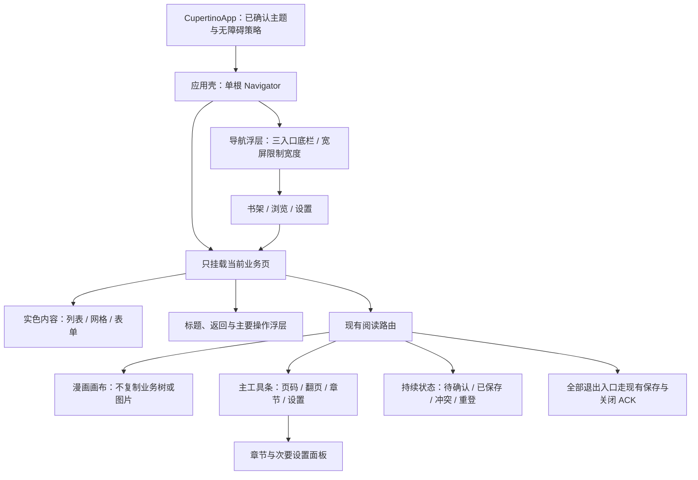

# Liquid Glass 界面重构

## 目标与状态

状态：**进行中；视觉与交互实现、正式 Flutter 检查及设置 API 回归通过，等待 CI 构建、真实 Web 验收和发布。** 2026-11-13 用户要求评估给定 pub.dev 搜索中的库并计划一次界面重构。[选型与视觉依据](../design/liquid-glass-evaluation.md)维护比较和风险，本文件维护实施、待办与验收；当前已上线的 Cupertino 交付及原生待验状态继续保留。

计划以 `liquid_glass_widgets: 1.17.2` 为首选，在一个实施分支完成应用壳、所有正式页面的导航/操作浮层和阅读控制区重整，再由主线 CI 一次发布。保留 Cupertino 内容语义与 generator / Hooks，不长期维护新旧界面、重复主题或旧布局分支。Web 默认采用无背景截图的轻量玻璃，原生按引擎能力使用完整效果；Web 真折射属于另一个有明确成本的要求，不能暗中用静态背景代替。

2026-11-13 实施统计生产手写 Dart 为 30,560 行，较原基线净增 264 行，尚未达到原计划净减 300 行的目标。用户明确选择“本轮先完成视觉与交互，代码削减另立重构”，因此本轮交付保留真实代码量，后续削减转入[UI 代码收敛](ui-code-consolidation.md)，不将新增策略与集成成本隐去，也不为行数删除业务状态、类型检查或生命周期校验。

## 基线与范围

计划基线：`d7416f0ab5981b405dd5d8998158d3868b53971c`，生产手写 Dart 为 30,296 行。复用[上次统一统计口径](../verification/cupertino-ui.md#代码量)：受版本管理的 `apps/reader/lib`、`packages/reader_core/lib`、`packages/source_runtime/lib`，排除 `.g.dart` 与 `/src/pb/`；生成物、测试、文档单列。实施前重新核对同口径，不重复计入此前迁移的削减。

| 范围               | 主要文件/目录                                                                                    | 本轮结果                                                                             |
| ------------------ | ------------------------------------------------------------------------------------------------ | ------------------------------------------------------------------------------------ |
| 依赖与主题         | `apps/reader/pubspec.yaml`、对应 lock、`lib/main.dart`                                           | 精确固定一个玻璃库；明确亮/暗、玻璃与实色、高对比和减少动态效果策略                  |
| 应用壳             | `lib/main.dart` 的 AppShell                                                                      | 三入口浮动底栏，宽屏限制导航宽度、标题及主要操作；保持一个根 Navigator、单活动业务页 |
| 书架与浏览         | `features/library/`、`browse/`、`sources/`、`extensions/`、`search/`、`migration/`               | 统一导航与操作层；内容清晰，保留既有状态、范围和恢复入口                             |
| 阅读               | `features/reader/reader_screen.dart`、`chapter_reader_route.dart`、必要的设置布局                | 精简主工具条、展开章节/次要设置；画布视口、保存和关闭流程正确                        |
| 编辑与设置         | `widgets/choice_field.dart`、`edit_sheet.dart`、`features/settings/`、分类/书签/封面等编辑调用点 | 直接复用官方或已选库组件，删去重复布局，草稿与保存仍由业务持有                       |
| 路由、诊断、Access | `widgets/app_page_route.dart`、诊断入口、`platform_runtime_native.dart`                          | 统一视觉、明确返回、正确 PlatformView 路径；不接管业务导航                           |

以上路径均相对 `apps/reader/`。不扩张为 Worker/D1、Source 宿主、图片处理或 AOT 重构；UI 改动复用现有 runtime 与扩展快照。若增加“减少透明度/实色外观”用户选择，按既有非敏感设置的 Worker API + D1 权威路径同步，直接维护当前协议及生成模型，不引入本地独立偏好数据库或旧版兼容分支。

## 目标布局

- 书架保留分类范围、排序/搜索、续读与批量操作；浏览保留源目录、扩展维护和跨源搜索的既定信息架构，继续遵守[各 UI 状态的最小信息](../design/extension-browse-ui-flow.md)。不随玻璃库 demo 增加入口或导航层。
- 360px 起保证标签、触控区与正文可用；宽屏复用同一带标签的浮动底栏并限制为 640px，删除额外侧栏实现，窗口变化不更换导航或业务树。仅绘制必要的几个浮层，不把每个列表项套上 BackdropFilter。
- 阅读主工具条保留当前页/总页、翻页及章节/设置入口，缩放等次要操作移入可达面板；已有键盘和直接手势继续可用。复杂背景下增加足够着色，避免文字仅依赖背景采样自动变色。
- 已确认、未确认、结果未知、冲突和 Access 失效分别显示；异常状态不能随工具条自动隐藏。保留明确返回，隐藏状态下也能恢复操作，不能只依赖边缘手势或长按。
- 编辑面板保持正文滚动、保存/取消常驻、提交中关闭策略、失败与草稿提示。正文面板可为实色，与统一玻璃导航并不冲突，不追求整屏透明。

## 集中实施顺序

以下是同一次交付的开发提交，不是多期上线。首个技术门直接在正式应用壳和真实阅读布局验证，不新建长期探针工程；通过后连续完成其余范围。

### 1. 依赖和关键路径技术门

- [ ] 复核最终候选精确版本、许可证和当前固定 SDK 要求；用正式 pub 命令维护依赖及 lock，核对包内 iOS 插件、旧设计包导入和实际主题/祖先耦合。保持严格类型检查，不复制上游源码进项目修补。
- [ ] 在 CupertinoApp 中接入首选库，关闭实验性自动跑分及非必要的性能监控；Web 固定轻量模式，支持 Impeller 的小面积控制层再采用完整模式。不默认开启背景采样、亮度读回或多透镜融合。
- [ ] 用正式的自适应底栏和一处真实阅读工具条核对布局、主题、输入与性能路径，确保背景模糊更新，效果层切换不重挂业务子树、不新增 Source；普通库 navigation stack 不进入产品。
- [ ] 核对高对比/减少动态效果/禁用动画，以及实色外观的可达方式。减少透明度不能只误用 highContrast；若需新设置，使用既有权威保存与确认流程。
- [ ] 首选若在固定 SDK、可访问性或无捕获 Web 路径存在阻断，按评估改选 `cupertino_liquid_glass` 等单一备选，并更新计划。只有明确要求 Web 真折射时才改验 easy；不同时接入两套效果库，也不为解决库缺陷自研捕获器或 shader。

### 2. 完成全界面重整

- [ ] 完成上述所有导航/操作浮层与内容层的统一，直接在调用点使用成熟组件；只保留项目实际重复的业务组合，不新建通用玻璃 facade 或转发整个第三方 API。
- [ ] 重排阅读控制区，将次要选项移入章节/设置面板；对照现有功能清单逐项保留动作、停用原因、保存/恢复状态和键盘路径。图像区域的可用高度、页位锚点与安全区改变后保持原位。
- [ ] 保留 `_exit()` / PopScope、重复退出防护、`route.completed`、图片释放与 `catalog.closeChapter`；关闭 ACK 未完成前不打开新的互斥 Source。浮层显隐、质量/主题切换、旋转和宽窄切换不附带业务写入。
- [ ] 保持 Worker API + D1 权威、CAS、幂等提交、身份隔离、未确认草稿、requestId/generation、取消和迟到结果丢弃；不能通过删除真实复杂度换取行数下降。
- [ ] 删除被替代的样式、导航分支和重复布局，计入所有新增包装后复核生产手写 Dart 的新增/删除/净变化，并列出实际删去的重复结构；净减目标按用户决定转入后续计划。第三方/生成代码不移入生产源码充当削减。

### 3. 回归、实际测量与一次发布

- [ ] 按下表完成工程、UI 和真实 Web 验收，建立独立 `docs/verification/liquid-glass.md`；测试和性能证据记录版本、提交、产物、浏览器、设备/视口及测量方式。计划不能先勾选未执行项。
- [ ] 按可审阅里程碑提交、推送；完成后合入主线，沿用[主线 CI 自动发布](../DEPLOYMENT.md)。复用现有构建合同和扩展快照，不等 AOT 全量、不重复部署扩展。
- [ ] 生产核对同一产物的公开资源、Access、真实图片阅读、保存与独立新文档续读，更新本计划和索引。原生现场验证保持停止并列为待验，不把共享代码或 CI 编译称为真机效果验收。

## 验收门槛

| 层级           | 必须通过                                                                                                           | 证据与处理                                                                                                                                                 |
| -------------- | ------------------------------------------------------------------------------------------------------------------ | ---------------------------------------------------------------------------------------------------------------------------------------------------------- |
| 工程与代码收敛 | 精确依赖、生成一致性、riverpod_lint、严格分析、全范围格式、既有 Dart 正确性回归，以及真实代码量记录                | 实施前复核现有回归集；不为纯视觉增加大量脆弱快照，关键布局/状态/生命周期补有意义断言                                                                       |
| 视觉与输入     | 360px / 宽屏，亮/暗/系统主题，文字缩放，高对比、实色模式、减少动态效果，Tab/Enter/Escape、中文输入、触控与鼠标可达 | 菜单和面板关闭后焦点恢复；文字不裁切，列表末项与输入框不被浮层/软键盘遮住；实色仍具备全部操作                                                              |
| 状态与生命周期 | 三入口切换、宽窄/主题/质量变化、反复阅读进出、身份切换、保存冲突、迟到结果、返回与关闭 ACK                         | 一份业务子树；不重复打开 Source，不附带保存，不丢未确认状态或资源释放                                                                                      |
| Web 真实背景   | 正式 CanvasKit 产物中滚动真实漫画/源列表，切换明暗背景；玻璃控制层可读、实时 blur 正常，没有陈旧截图               | 默认路径无业务背景截图、额外图片解码或常驻截图调度；不以壁纸 demo 代替动态内容                                                                             |
| 帧率与资源     | 相同环境对比基线和候选的首帧、滚动/跳页帧时、CPU、可观测的 GPU/纹理与内存，反复开关工具条及阅读路由                | 先用同一代表章节、视口、缩放和缓存条件做短对照；60Hz 下以 UI/raster P95 各不超过 16.7ms 为目标。若基线已超预算，候选不得加重瓶颈，须说明原因并减小效果成本 |
| 空闲与释放     | 工具条隐藏、页面静止、应用进入后台后没有由玻璃持续驱动的帧/捕获；退出后纹理释放，循环进出内存不持续增长            | 不保证所有浏览器都能暴露 GPU 指标；测不到的列待验，不填造估算或把作者数据代入。若库不能满足，改用已有无捕获/实色路径或换库                                 |
| 业务与发布     | 完整 CI / Web 构建、资源隔离；内置浏览器下源选择/扩展维护、详情/收藏、设置保存、真实阅读/退出和独立新文档续读      | Access 测试身份与生产证据分开；以独立 API/D1 核对确认状态，不以视觉截图证明保存                                                                            |
| 原生边界       | 共享代码与可用 CI 编译检查；PlatformView 不盲套 shader，平台桥与资源声明完整                                       | 原生现场、真实安全区/手势、签名真机帧率和能耗待验，继续遵守停止原生验证的指示                                                                              |

性能目标是本轮验收标准，尚无测量结果。先取得小面积浮层的真实基线，发现瓶颈时优先用库已有质量/实色能力或更换方案，不引入自研分片、背景 atlas、多级缓存或设备自动跑分系统。项目测量结果和用户可见效果决定是否采用完整折射。

## 执行与交付约束

本机允许 Flutter 修改、轻量生成、严格分析和必要的单并发回归；使用低优先级任务，不开模拟器、常驻 generator watch 或本机完整 Flutter 编译。完整构建交给既有 CI，AOT 只有确有输入变化时才在获准的 clab 运行；禁止使用 pku-dasys，远端查询保持较长周期。

工程入口沿用 `pnpm flutter:generate:check`、`pnpm generate:check`、`pnpm format`、`pnpm format:check`、`pnpm check:dependencies` 与 `pnpm flutter:check --concurrency=1`；完整 `pnpm check` / `pnpm build` 使用现有 CI。更改设置协议时同时覆盖协议生成、API 与并发确认回归。文档计划本身只运行格式和链接/范围核对，不触发产品发布或重跑业务矩阵。
