# Mihon 参考截图状态机

2026-11-20，Karuyomi 跨版本双主题主图为 168/169（99.4%），未连接（27.K1）仍缺两侧。固定 Mihon 参考补齐四种阅读等待与失败，141/170 行（82.9%）完成双主题主图核对。最终像素、各触发变体与完整转场继续验收。[阅读器瞬态参考](mihon-cupertino-fidelity.md#mihon-单页与切章等待的双主题参考) · [章节批量与恢复](mihon-cupertino-fidelity.md#章节部分提交与编辑失效的正式-web-双主题验收)

`b29c3bb` 正式 Web 复验跨源搜索空态禁用语义，以及分类、封面、迁移和漫画设置的系统深色失效行为。[历史复验](mihon-cupertino-fidelity.md#禁用语义与编辑身份失效的正式-web-复验)

2026-11-14，进行中。用户要求截图触及每个 UI 状态，并同时考虑浅色、深色。此表细化[30 组界面矩阵](../design/mihon-cupertino-fidelity.md)，作为参考采集与后续 Cupertino 对照的工作清单。**目前尚无一组完成包含全部转换与变体的双主题验收；绿色只代表该节点的两张主状态参考图已核对。**

## 记录规则

- 状态由固定 Mihon v0.21.3 的页面、ViewModel 分支和弹层分支确定；不能仅按路由名计数。加载、内容、空结果、失败、选择、输入校验、确认和操作进行中分别记录。取消、返回、重试及成功后的落点也是待核对的转换。
- 每行分别记录浅色与深色截图。`待`表示未采集，文件名表示已核对实际 PNG/XML 的参考画面；只完成一侧仍为待完成。表内以不含后缀的采集编号标识同一画面的 PNG 和 XML。采集编号用于比对矩阵中的状态，不是仓库附件。
- 图中节点对应表中 ID；橙色表示主图仍缺一侧或必要信息，未着色表示仍待采集，绿色只用于两种主题均已核对的主状态。**参考截图完成不等于 Karuyomi 像素或交互验收通过。**
- DEFAULT 固定主题，360×800 逻辑视口、720×1600 物理像素、320dpi；系统栏单列。两种主题使用同一数据和同一状态。早期 Monet 图保留为历史，不填入 DEFAULT 栏。键盘、长中文、双倍字号、宽屏/横屏、减少动态另列变体，不用它们替代主状态。
- 同一可见状态只保留一个主 ID，可关联多组页面。Mihon 没有的服务端确认、CAS 冲突、身份失效、部分提交、清理 ACK 等状态列在末节，须由 Karuyomi 实测；不能伪造 Mihon 对应图。用户已列入后续的下载、历史、追踪、备份等独立功能保持原范围，不增加无效入口。
- 当新增源码分支或实际操作发现表外弹层，先补节点及转换，再采集；不把“不易触发”改记为不适用。瞬时状态须实际截到才能填表，未截到继续为待。
- 第一阶段保留Mihon的DEFAULT配色、布局和像素测量；最终Karuyomi采用官方Cupertino颜色、导航、控件与转场。目标页面的截图不能继续用旧Material色系的历史图代替，也不能因最终设计变化删去参考阶段的失败或缺口。
- 双主题不是黑白反转：分别核对背景、表面、正文、次级文字、分隔、选中、禁用和错误角色，弹层与阅读黑/白/跟随主题画布也分别核对。主题切换须覆盖已确认浅色↔深色、跟随系统的亮度变化、编辑未保存及保存失败；切换后保留当前页面、选择、输入草稿、滚动锚点和阅读页位。显式浅/深设置不受系统亮度变化覆盖，草稿不提前改变全局主题；只有服务端确认才应用新的设置。

## 01–06：导航、书架、分类

依据：`ui/home/HomeScreen.kt`、`ui/library/LibraryTab.kt`、`presentation/library/LibrarySettingsDialog.kt`、`DeleteLibraryMangaDialog.kt`、`presentation/category/CategoryScreen.kt`、`components/CategoryDialogs.kt`。

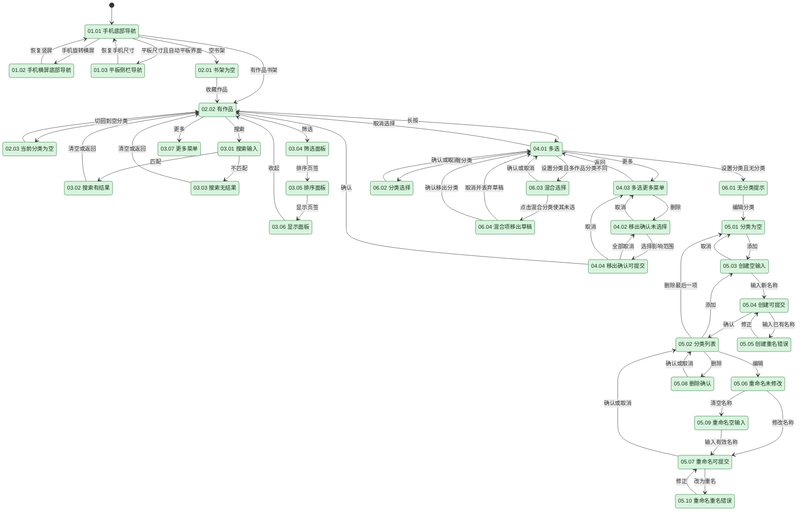

| 状态 ID | 最小必要信息/采集触发                                                                          | 浅色                                                                                                                              | 深色                                                                                                                         |
| ------- | ---------------------------------------------------------------------------------------------- | --------------------------------------------------------------------------------------------------------------------------------- | ---------------------------------------------------------------------------------------------------------------------------- |
| 01.01   | 三入口对应的 Mihon 底部导航：书架/浏览/更多的活动入口、图标、标题及正文边界                    | `s0202-library-content-light`、`s0702-source-list-light`、`s0101-more-light`                                                      | `s0202-library-content-dark`、`s0702-source-list-dark`、`s0101-more-dark`                                                    |
| 01.02   | 手机横屏仍为底部导航，书架/浏览/更多分别采集；800×360dp                                        | `s0102-{library,browse,more}-landscape-light`                                                                                     | `s0102-{library,browse,more}-landscape-dark`                                                                                 |
| 01.03   | 自动平板界面的侧栏、当前入口与正文边界；768×1024dp                                             | `s0103-{library,browse,more}-tablet-light`                                                                                        | `s0103-{library,browse,more}-tablet-dark`                                                                                    |
| 02.01   | 空书架标题、原因、入门指南；移出最后一部测试作品                                               | `s0201-library-empty-light`                                                                                                       | `s0201-library-empty-dark`                                                                                                   |
| 02.02   | 封面、标题、未读标记、续读位置及网格边界                                                       | `s0202-library-content-light`                                                                                                     | `s0202-library-content-dark`                                                                                                 |
| 02.03   | 空分类名、空态及切回入口；切到新建分类                                                         | `s0203-library-category-empty-light`                                                                                              | `s0203-library-category-empty-dark`                                                                                          |
| 03.01   | 已打开的搜索框、查询、清空/退出；点搜索                                                        | `s0301-library-search-light`                                                                                                      | `s0301-library-search-dark`                                                                                                  |
| 03.02   | 查询与匹配作品；输入 `xkcd`                                                                    | `s0302-library-match-light`                                                                                                       | `s0302-library-match-dark`                                                                                                   |
| 03.03   | 查询、无结果说明、清空/退出；输入不会匹配的文本                                                | `s0303-library-no-results-light`                                                                                                  | `s0303-library-no-results-dark`                                                                                              |
| 03.04   | 筛选页签、选项及三态当前值；打开筛选                                                           | `s0304-library-filter-light`                                                                                                      | `s0304-library-filter-dark`                                                                                                  |
| 03.05   | 排序页签、当前排序和方向                                                                       | `s0305-library-sort-light`                                                                                                        | `s0305-library-sort-dark`                                                                                                    |
| 03.06   | 显示页签、当前网格/列表设置                                                                    | `s0306-library-display-light`                                                                                                     | `s0306-library-display-dark`                                                                                                 |
| 03.07   | 可用菜单项及正文锚点；点更多                                                                   | `s0307-library-more-light`                                                                                                        | `s0307-library-more-dark`                                                                                                    |
| 04.01   | 选中数量、选中封面、退出/全选和底部批量操作                                                    | `s0401-library-selection-light`                                                                                                   | `s0401-library-selection-dark`                                                                                               |
| 04.02   | 移出确认初态：影响范围选项均未选、确认禁用、取消                                               | `s0402-library-remove-confirm-light`                                                                                              | `s0402-library-remove-confirm-dark`                                                                                          |
| 04.03   | 多选中的迁移/删除菜单、当前选择上下文及关闭                                                    | `s0403-library-selection-more-light`                                                                                              | `s0403-library-selection-more-dark`                                                                                          |
| 04.04   | 仅选移出书架、确认可用；浅色确认后为空书架；深色取消后返回迁移/删除菜单                        | `s0404-library-remove-enabled-light`                                                                                              | `s0404-library-remove-enabled-dark`、`s0404-library-remove-cancel-dark`                                                      |
| 05.01   | 无分类说明及添加入口                                                                           | `s0501-category-empty-light`                                                                                                      | `category-manager-default-dark`                                                                                              |
| 05.02   | 名称、拖动顺序、编辑和删除入口                                                                 | `s0502-categories-two-light`                                                                                                      | `s0502-categories-two-dark`                                                                                                  |
| 05.03   | 标题、空名称、必填、禁用提交、取消及键盘                                                       | `s0503-category-create-keyboard-light`                                                                                            | `s0503-category-create-empty-dark`                                                                                           |
| 05.04   | 名称、可用提交、取消及键盘                                                                     | `s0504-category-create-keyboard-light`                                                                                            | `s0504-category-create-keyboard-dark`                                                                                        |
| 05.05   | 创建时重复名称、错误说明、禁用添加及键盘                                                       | `s0505-category-create-duplicate-light`                                                                                           | `s0505-category-create-duplicate-dark`                                                                                       |
| 05.06   | 原名称、禁用确认、取消及键盘                                                                   | `s0506-category-rename-second-light`                                                                                              | `s0506-category-rename-second-dark`                                                                                          |
| 05.07   | 修改后名称、可用确认、取消及键盘                                                               | `s0507-category-rename-valid-light`                                                                                               | `s0507-category-rename-valid-dark`                                                                                           |
| 05.08   | 待删分类名、影响、取消和确认                                                                   | `s0508-category-delete-second-light`                                                                                              | `s0508-category-delete-second-dark`                                                                                          |
| 05.09   | 重命名清空名称、必填、禁用确认和键盘                                                           | `s0509-category-rename-empty-light`                                                                                               | `s0509-category-rename-empty-dark`                                                                                           |
| 05.10   | 重命名为另一现有分类、重名错误、禁用确认和键盘                                                 | `s0505-category-rename-duplicate-light`                                                                                           | `s0505-category-rename-duplicate-dark`                                                                                       |
| 06.01   | 无分类说明及编辑分类入口                                                                       | `s0601-no-category-dialog-light`                                                                                                  | `library-categories-default-dark`                                                                                            |
| 06.02   | 分类名、已选项、取消和确认                                                                     | `s0602-library-category-choice-light`                                                                                             | `s0602-library-category-choice-dark`                                                                                         |
| 06.03   | 两部作品跨分类选中，a 部分选中、b 未选；取消后保持多选，重开仍混合；未修改混合项的直接确认仍待 | `s0603-library-categories-current-light`、`s0603-library-categories-cancel-light`、`s0603-library-categories-reopen-light`        | `s0603-library-categories-reopen-dark`、`s0603-library-categories-cancel-dark`                                               |
| 06.04   | 点击混合 a 后变为未选；双主题确认后 a 为空、默认分类含两部作品，随后分别恢复原分类             | `s0604-library-categories-none-current-light`、`s0604-library-categories-applied-light`、`s0604-library-categories-default-light` | `s0604-library-categories-none-draft-dark`、`s0604-library-categories-applied-dark`、`s0604-library-categories-default-dark` |

01 已实看 `navigation-more-pairs.jpg`、`navigation-landscape-pairs.jpg` 与 `navigation-tablet-pairs.jpg`。手机横屏仍是底部导航，不将可用宽度 800dp 当作自动平板条件；宽屏参考另在同一模拟器设为 1536×2048/320dpi，得到 768×1024dp 的侧栏。平板的三入口布局锚点一致，手机横屏浏览页的列表滚动位置不同，只用于导航分项，排除正文同位置叠图。两种尺寸的“更多”首屏不能展示所有行，完整设置目录仍独立采集。尺寸和旋转已恢复为 720×1600/320dpi 与原 `free`，加速度旋转仍为 1。

06 新图及确认后落点已实看 `categories-transition-pairs-0.jpg` 至 `categories-transition-pairs-2.jpg`。移出草稿确认后退出多选，a 显示真实空态，默认分类包含 One Piece/xkcd；再只选择 One Piece 设回 a，核对默认仅 xkcd、a 仅 One Piece，b 保持空。新的双主题弹层边界一致；早期浅色图的系统底栏边界不同，弹层纵坐标相差 8 物理像素，因此用同轮 `current-light` 与深色主图比较。浅深空态的随机表情不同，不作为字形叠图锚点。先前的取消丢弃草稿证据继续保留，未修改混合值直接确认仍是转换缺口。

## 07–11：漫画源、扩展、仓库与存储

依据：`presentation/browse/SourcesScreen.kt`、`SourcesFilterScreen.kt`、`ExtensionsScreen.kt`、`ExtensionFilterScreen.kt`、`ExtensionDetailsScreen.kt`、`extension/model/InstallStep.kt`、`presentation/more/settings/screen/browse/components/ExtensionStores*.kt`、`SettingsDataScreen.kt`。

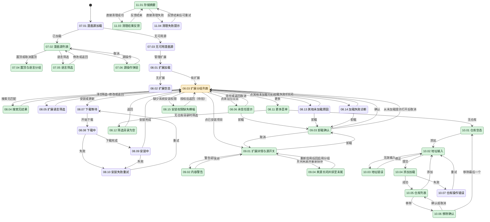

| 状态 ID | 最小必要信息/采集触发                                                                            | 浅色                                                                                                       | 深色                                                                                                    |
| ------- | ------------------------------------------------------------------------------------------------ | ---------------------------------------------------------------------------------------------------------- | ------------------------------------------------------------------------------------------------------- |
| 07.01   | 漫画源标题及加载指示；冷启动进入源页                                                             | 待                                                                                                         | 待                                                                                                      |
| 07.02   | 源名、语言、最近使用、可执行尾部操作                                                             | `s0702-source-list-light`                                                                                  | `s0702-source-list-dark`                                                                                |
| 07.03   | 无可用源说明与扩展入口；关闭在线语言仍有Local source，普通UI触发未取得                           | 待                                                                                                         | 待（Local source 项与真正空态分开）                                                                     |
| 07.04   | Mihon 置顶分组与普通分组、取消置顶入口；对照 Karuyomi 收藏分组                                   | `s0704-source-pinned-light`                                                                                | `s0704-source-pinned-dark`                                                                              |
| 07.05   | 语言列表及当前启用项；两侧只启用多语言/English                                                   | `s0705-source-language-light`（上段）；下段待补                                                            | `s0705-source-language-dark`（上段）；下段待补                                                          |
| 07.06   | 当前源及置顶/隐藏等可用动作                                                                      | `s0706-source-actions-light`                                                                               | `s0706-source-actions-dark`                                                                             |
| 08.01   | 标题、加载状态及禁用刷新；重新读取目录                                                           | 待                                                                                                         | 待                                                                                                      |
| 08.02   | 无扩展原因与仓库入口                                                                             | 待                                                                                                         | 待                                                                                                      |
| 08.03   | 未加载/已安装/可安装/更新分组、名称、语言、版本、主操作；更新仍待                                | `s0803-extensions-installed-light`、`s0803-extension-catalog-light`、`s0803-extensions-untrusted-light`    | `s0803-extensions-installed-dark`、`s0803-extension-catalog-dark`、`s0803-extensions-untrusted-dark`    |
| 08.04   | 查询、无匹配说明、清空/返回；清空后恢复列表                                                      | `s0804-extension-empty-light`；恢复 `s0804-extension-clear-light`                                          | `s0804-extension-empty-dark`；恢复 `s0804-extension-clear-dark`                                         |
| 08.05   | 语言和内容筛选当前值                                                                             | `s0805-extension-filter-light`；启用语言与深色不同，待对齐重拍                                             | `s0805-extension-filter-dark`；待同条件重拍                                                             |
| 08.06   | 未信任风险、信任/卸载与返回取消；取消仍未加载，浅色已确认恢复原信任，深色确认转换待              | `s0806-extension-trust-light`、`s0806-extension-trust-cancel-light`、`s0806-extension-trusted-light`       | `s0806-extension-trust-dark`、`s0806-extension-trust-cancel-dark`                                       |
| 08.07   | 对象、等待标记、取消                                                                             | 待                                                                                                         | 待                                                                                                      |
| 08.08   | 对象、下载标记、进度/取消                                                                        | 待                                                                                                         | 待                                                                                                      |
| 08.09   | 对象、安装中及系统权限/确认（若出现）                                                            | 待                                                                                                         | 待                                                                                                      |
| 08.10   | 对象、失败与重试                                                                                 | 待                                                                                                         | 待                                                                                                      |
| 08.11   | 筛选和仓库入口                                                                                   | `s0811-extension-menu-light`                                                                               | `s0811-extension-menu-dark`                                                                             |
| 08.12   | 筛选页没有仓库语言目录时的独立空态、标题和返回                                                   | `s0812-extension-filter-empty-light`                                                                       | `s0812-extension-filter-empty-dark`                                                                     |
| 08.13   | Filtered / Unsigned / UnsupportedLibVersion / Malformed 的具体原因、关闭与卸载；每种原因分别待采 | 待                                                                                                         | 待                                                                                                      |
| 08.14   | Failed 的具体错误、等宽简要诊断、复制完整堆栈、关闭与卸载                                        | 待                                                                                                         | 待                                                                                                      |
| 08.15   | Android 安装权限缺失横幅及系统授权入口；本轮未改变安装权限                                       | `s0803-extensions-untrusted-light`                                                                         | `s0803-extensions-untrusted-dark`                                                                       |
| 09.01   | 图标、名称、包名、版本/语言/警告、卸载、来源启用/偏好；恢复后 Afrikaans 回首行                   | `s0901-mangadex-details-light`、`s0901-mangadex-restored-light`                                            | `s0901-mangadex-details-dark`、`s0901-mangadex-restored-dark`                                           |
| 09.02   | 内容警告原因和关闭动作                                                                           | `s0902-extension-warning-light`                                                                            | `s0902-extension-warning-dark`                                                                          |
| 09.03   | 同一 MangaDex 的系统卸载确认和取消；浅色从未信任列表发起，深色从详情发起，确认卸载待             | `s0903-extension-uninstall-light`、`s0903-extension-uninstall-cancel-light`                                | `s0903-extension-uninstall-dark`、`s0903-extension-uninstall-return-dark`                               |
| 09.04   | Afrikaans 关闭后移到末尾、关闭开关与独立偏好入口；重新启用恢复首行                               | `s0901-mangadex-disabled-light`                                                                            | `s0901-mangadex-disabled-dark`                                                                          |
| 10.01   | 无仓库说明、返回、刷新和添加                                                                     | `s1001-repository-empty-light`                                                                             | `s1001-repository-empty-dark`                                                                           |
| 10.02   | 地址、必填、提交可用性、取消、键盘                                                               | `s1002-repository-add-empty-light`、`s1002-repository-add-filled-light`                                    | `s1002-repository-add-empty-dark`、`s1002-repository-add-filled-dark`                                   |
| 10.03   | 提交数字 `987654321` 后的实际 scheme 错误、修正/取消                                             | `s1003-repository-invalid-result-light`                                                                    | `s1003-repository-invalid-result-dark`                                                                  |
| 10.04   | 提交正式公开仓库地址后实际可见的“处理中…”                                                        | `s1004-repository-add-processing-light`                                                                    | `s1004-repository-add-processing-dark`                                                                  |
| 10.05   | 仓库名、地址、移除/刷新；使用正式公开仓库                                                        | `s1005-repository-list-light`                                                                              | `s1005-repository-list-dark`                                                                            |
| 10.06   | 待移除仓库、确认/取消；取消保留列表，确认移除最后一项回空态                                      | `s1006-repository-remove-confirm-light`、`s1006-repository-cancel-light`、`s1006-repository-removed-light` | `s1006-repository-remove-confirm-dark`、`s1006-repository-cancel-dark`、`s1006-repository-removed-dark` |
| 10.07   | 失败原因和可用恢复入口；连接失败分支                                                             | 待                                                                                                         | 待                                                                                                      |
| 11.01   | 占用、存储范围及清理入口；两主题清理前均 165 kB，主图上下两段                                    | `s1101-storage-top-light`、`s1101-storage-usage-light`                                                     | `s1101-storage-top-dark`、`s1101-storage-usage-dark`                                                    |
| 11.03   | 清理后占用与实际反馈；两主题稳定状态均 1.37 kB；浅色删除3文件，深色再次清理删除0文件             | `s1103-storage-cleared-light`、`s1103-storage-clear-feedback-light`                                        | `s1103-storage-cleared-dark`、`s1103-storage-clear-feedback-dark`                                       |
| 11.04   | 清理失败 toast 与保留占用，随后可再次点击清理；不能用成功反馈代替                                | 待                                                                                                         | 待                                                                                                      |

原 11.02“清理确认”是未经调用点核对的假设，现已移除。Mihon 的 `SettingsDataScreen.getDataGroup()` 直接调用 `chapterCache.clear()`，只在完成/失败时显示 toast，没有独立确认框或可见忙碌分支；Karuyomi 的 `ExtensionStoragePage` 同样直接调用 `controller.forget(sha256)`。Karuyomi 的取消 ACK、资源清理失败和身份约束仍须另验，不因此省略。

08.06 仅表示 `Reason.Untrusted` 的风险提示。`Filtered`、`Unsigned`、`UnsupportedLibVersion`、`Malformed` 共用另一种关闭/卸载弹层，`Failed` 还增加等宽错误及复制堆栈，故拆为 08.13/08.14，未采集的原因仍待，不能用信任提示代替。08.15 是 Android 安装权限横幅；本轮未更改该权限，也未完成下载、安装或更新状态。

09.04 的开关关闭后，`ExtensionDetailsViewModel.subscribeToSources()` 按 `!enabled` 排序，将 Afrikaans 移到末尾；两主题都已拍到真正关闭的行，再重新启用回到首行。`s0901-mangadex-disabled-sorted-top-*` 只记录原位置移走，不作为关闭开关主图。09.03 的系统弹层两次均为 Android English 浅色，应用主题不控制其颜色；浅色从未信任列表发起，取消返回列表，深色从详情发起，取消返回详情，底层不同不计同状态像素叠图。`s0903-extension-uninstall-cancel-stale-dark` 的 XML 已返回详情，但 PNG 与确认图完全相同，已排除；另拍并实看稳定 `s0903-extension-uninstall-return-dark`。

11.01 清理前两主题均为 165 kB；浅色清理删除 3 个文件，稳定占用为 1.37 kB，深色再次清理删除 0 个文件，占用保持 1.37 kB。上游明确保留 cache journal，非零值不表示清理失败。反馈图截到 toast 淡入，只用于确认内容，不能作稳定合成色/字形基准；失败反馈仍待。备份/导出等未实现功能只作为本页背景，不扩大本轮产品范围。

## 12–15：源内浏览、筛选、偏好与跨源搜索

依据：`presentation/browse/BrowseSourceScreen.kt` 的 refresh/append Loading/Error/Empty、`ui/browse/source/browse/SourceFilterDialog.kt` 的 typed Filter、`ui/browse/extension/details/SourcePreferencesScreen.kt`、`presentation/browse/GlobalSearchScreen.kt` 的 Loading/Success/Error。

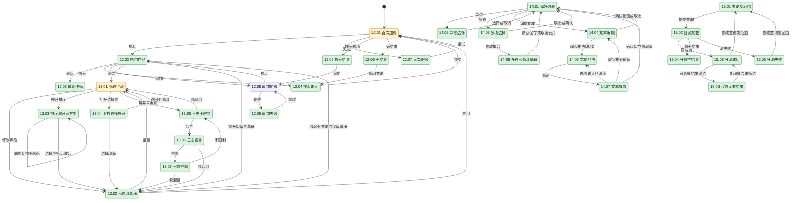

| 状态 ID | 最小必要信息/采集触发                                                                          | 浅色                                                                                                                           | 深色                                                                                                                             |
| ------- | ---------------------------------------------------------------------------------------------- | ------------------------------------------------------------------------------------------------------------------------------ | -------------------------------------------------------------------------------------------------------------------------------- |
| 12.01   | 源名、当前模式、加载指示；冷启动、切模式及重试分别记录                                         | `s1203-source-latest-loading-light`（切最新）、`s1201-source-retry-loading-light`（重试）；冷启动图截到路由动画，待补          | `s1201-mangadex-loading-dark`（冷启动）、`s1203-source-latest-loading-dark`（切最新）、`s1201-source-retry-loading-dark`（重试） |
| 12.02   | 源名、热门模式、封面与标题网格                                                                 | `s1202-xkcd-popular-light`、`s1202-mangadex-popular-light`                                                                     | `s1202-xkcd-popular-dark`、`s1202-mangadex-popular-dark`                                                                         |
| 12.03   | 源名、最新模式、作品；真实动态目录内容会变化，不用于同数据叠图                                 | `s1203-source-latest-light`                                                                                                    | `s1203-source-latest-dark`                                                                                                       |
| 12.04   | 空输入和精确查询 `987654321`、键盘、清空和提交                                                 | `s1204-source-search-input-light`、`s1204-source-search-filled-light`                                                          | `s1204-source-search-input-dark`、`s1204-source-search-filled-dark`                                                              |
| 12.05   | 精确查询 `one piece`、匹配作品、清空与返回；键盘已收起                                         | `s1205-mangadex-search-loaded-light`                                                                                           | `s1205-mangadex-search-loaded-dark`                                                                                              |
| 12.06   | 当前查询 `987654321`、无结果说明和恢复动作；主图含键盘                                         | `s1206-source-empty-light`；无键盘/恢复待补                                                                                    | `s1206-source-empty-dark`；无键盘/恢复待补                                                                                       |
| 12.07   | 模拟器断网时首次失败，错误正文、重试/帮助/WebView；离线重试仍失败，联网重试恢复热门            | `s1207-source-network-error-light`、`s1207-source-offline-retry-light`、`s1207-source-recovered-light`                         | `s1207-source-network-error-dark`、`s1207-source-offline-retry-dark`、`s1207-source-recovered-dark`                              |
| 12.08   | 已有作品、追加指示、滚动位置；只有实际可见旋转指示才通过                                       | 待（追加重试帧已为新内容，未截到指示）                                                                                         | 待（慢网/重试帧仍未截到指示）                                                                                                    |
| 12.09   | 追加失败保留已有作品，底部持久错误条、重试；恢复网络后加载更多                                 | `s1209-source-append-error-light`、`s1209-source-append-recovered-light`                                                       | `s1209-source-append-error-dark`、`s1209-source-append-recovered-dark`                                                           |
| 13.01   | text/check/select/tri-state/sort/group 当前值、重置/应用；文本筛选仍需其他真实源               | `s1301-source-filters-light`、`s1301-source-filter-group-light`；text 待                                                       | `s1301-source-filters-dark`、`s1301-source-filter-group-dark`；text 待                                                           |
| 13.02   | group/check/select 草稿，重置、收起重开和实际应用；下述转换另列文件                            | `s1302-source-filter-draft-light`、`s1302-source-filter-reset-light`、`s1304-source-filter-select-draft-light`                 | `s1302-source-filter-draft-dark`、`s1302-source-filter-reset-dark`、`s1304-source-filter-select-draft-dark`                      |
| 13.03   | Sort 展开、默认 Relevance 降序、点同项升序；上下滚动内容                                       | `s1301-source-filter-sort-light`、`s1301-source-filter-sort-lower-light`、`s1303-source-filter-sort-ascending-light`           | `s1301-source-filter-sort-dark`、`s1301-source-filter-sort-lower-dark`、`s1303-source-filter-sort-ascending-dark`                |
| 13.04   | Created within last 下拉展开，Any/Day/Week/Month/Year 和原值                                   | `s1304-source-filter-select-light`                                                                                             | `s1304-source-filter-select-dark`                                                                                                |
| 13.05   | Genre 的 Action 不限制，空框；点击后进入包含                                                   | `s1305-source-filter-tristate-neutral-light`                                                                                   | `s1305-source-filter-tristate-neutral-dark`                                                                                      |
| 13.06   | Action 包含，勾选图形与强调色；点击后进入排除                                                  | `s1305-source-filter-tristate-include-light`                                                                                   | `s1305-source-filter-tristate-include-dark`                                                                                      |
| 13.07   | Action 排除，叉号与强调色；点击后回不限制                                                      | `s1305-source-filter-tristate-exclude-light`、`s1305-source-filter-tristate-reset-light`                                       | `s1305-source-filter-tristate-exclude-dark`、`s1305-source-filter-tristate-reset-dark`                                           |
| 14.01   | MangaDex EN 偏好标题、当前值、说明及开关，上下段均采集                                         | `s1401-source-preferences-light`、`s1401-source-preferences-lower-light`                                                       | `s1401-source-preferences-dark`、`s1401-source-preferences-lower-dark`                                                           |
| 14.02   | Cover quality 字段、Original 当前选中、其他选项、取消；取消后值不变                            | `s1402-source-choice-light`、`s1402-source-choice-cancel-light`                                                                | `s1402-source-choice-dark`、`s1402-source-choice-cancel-dark`                                                                    |
| 14.03   | Filter original languages 多选初态，选项未选、确认/取消                                        | `s1403-source-multiple-light`                                                                                                  | `s1403-source-multiple-dark`                                                                                                     |
| 14.04   | Block groups by UUID 空输入、非必填、确定可用、取消与键盘                                      | `s1404-source-text-empty-light`                                                                                                | `s1404-source-text-empty-dark`                                                                                                   |
| 14.05   | Japanese 已选草稿、确认/取消；取消重开未选，确认重开已选                                       | `s1405-source-multiple-draft-light`、`s1405-source-multiple-cancel-reopen-light`、`s1405-source-multiple-applied-reopen-light` | `s1405-source-multiple-draft-dark`、`s1405-source-multiple-cancel-reopen-dark`、`s1405-source-multiple-applied-reopen-dark`      |
| 14.06   | 文本 `123`，非法 UUID 错误说明、确定禁用、可修正/取消                                          | `s1406-source-text-invalid-light`                                                                                              | `s1406-source-text-invalid-dark`                                                                                                 |
| 14.07   | 有效测试 UUID，错误消失、确定可用；确认后重开仍保留                                            | `s1407-source-text-valid-light`、`s1407-source-text-applied-reopen-light`                                                      | `s1407-source-text-valid-dark`、`s1407-source-text-applied-reopen-dark`                                                          |
| 15.01   | 空输入/查询、已置顶/全部范围、有结果筛选、返回与键盘                                           | `s1501-global-empty-light`、`s1501-global-query-light`                                                                         | `s1501-global-empty-dark`、`s1501-global-query-dark`                                                                             |
| 15.02   | 每源名称与实际旋转指示、总进度；瞬态 PNG 先于 XML，不用后来的 XML 推导该帧位置                 | `s1502-global-naruto-loading-light`                                                                                            | `s1502-global-loading-dark`                                                                                                      |
| 15.03   | 源名/语言与横向封面、封面下三行标题、进入源箭头；深色打开真实 One Piece 详情并返回，浅色转换待 | `s1503-global-top-light`                                                                                                       | `s1503-global-top-dark`、`s1503-global-open-before-dark`、`s1503-global-open-details-dark`、`s1503-global-return-dark`           |
| 15.04   | Local source 无结果；与 MangaDex 成功同屏                                                      | `s1503-global-top-light`                                                                                                       | `s1503-global-top-dark`                                                                                                          |
| 15.05   | 源名/语言、错误图标与说明；无独立重试按钮；混合成功/失败同屏另待                               | `s1505-global-error-light`                                                                                                     | `s1505-global-error-dark`                                                                                                        |
| 15.06   | 有结果筛选选中，只保留 MangaDex 两组；关闭恢复空结果源                                         | `s1503-global-only-results-light`                                                                                              | `s1503-global-only-results-dark`                                                                                                 |

实际转换补充（两种主题均已操作并核对 PNG）：

- MangaDex 筛选勾选 `Has available chapters`，返回收起后热门结果不变，重开仍勾选。证据为 `s1302-source-filter-checkbox-draft-{light,dark}`、`s1302-source-filter-dismissed-{light,dark}`、`s1302-source-filter-dismissed-reopen-{light,dark}`。这是保留未应用草稿，不能写成“取消丢弃”。Karuyomi 的显式取消继续丢弃草稿，作为已确认业务合同的交互差异记录。
- 点击筛选后截到实际加载指示，随后得到 Domino Kick 等真实结果，见 `s1302-source-filter-applying-{light,dark}` 与 `s1302-source-filter-applied-{light,dark}`。浅色瞬态同时截到面板淡出，不能当稳定面板像素基准；两侧等待与结果状态已取得。搜索 `one piece` 的匹配作品在加载完封面、收起键盘后另拍 12.05，不使用早期空封面帧作成对主图。
- 偏好多选的取消/确认后分别重开，检查未选/已选，最后恢复未选。文本编辑用 `00000000-0000-4000-8000-000000000001` 验证，通过确认及重开后清空恢复。完整动作图见同前缀的 `cancel`、`applied`、`reset` 及 `reset-draft` 文件。空值合法且确定可用；错误节点仅由实际非法 UUID 触发。
- 12.07/12.09 仅关闭专用模拟器 Wi-Fi/移动数据触发，真实错误是连接参考代理 `10.0.2.2:7890` 失败。首次失败使用整页错误与三个动作；追加失败保留列表并显示持久错误条，恢复网络重试后继续得到作品。两者均有双主题实际 PNG。错误页表情随机，封面缓存和追加后的滚动位置不同，排除同数据像素叠图；追加加载帧未明确出现旋转指示，12.08 仍待。曾尝试模拟器 2000ms/128kbit/s 网络配置，未据此推断其生效或性能；已恢复 delay none、speed full、Wi-Fi/移动数据启用并暂停模拟器。
- 跨源搜索两主题实际选择“全部”并查询 `one piece`，MangaDex 多语言/English 成功，Local source/xkcd 无结果；有结果筛选开启/关闭已操作。首次进入默认“已置顶”且无可搜源时是空内容区，不误记为加载。浅色真实旋转帧另用 `Naruto` 新查询捕获；`s1502-global-loading-light` 实际无目标、`s1502-global-all-loading-light` 实际为成功布局动画，均排除加载证据。断网后换查询才触发错误，重复提交相同查询没有重发；Mihon 跨源错误没有独立重试按钮，Karuyomi 继续保留单源重试。深色已从全局搜索打开真实 English One Piece 详情，返回后保留查询与结果。成功/失败混合同屏、浅色打开作品、进入源及恢复后再次成功仍是转换缺口。网络已恢复、模拟器已暂停。
- 旧 Android Preference/View 偏好弹层的浅色容器偏蓝，区别于 Mihon Compose 弹层；系统键盘仍按 Android 系统浅色，作为系统变体保留。筛选列表的滚动位置和打开/收起动画存在差异，当前只确认状态覆盖，未计为同位置叠图通过。最新目录两次请求间数据有变化，同样不能用于同数据像素叠图。

## 16–21：作品、章节、封面与迁移

依据：`ui/manga/MangaScreen.kt` 的 Loading/Success/dialog、`presentation/manga/MangaScreen.kt`、`ChapterSettingsDialog.kt`、`components/MangaCoverDialog.kt`、`DuplicateMangaDialog.kt`、`presentation/browse/Migrate*.kt`、`mihon/feature/migration/{config,list,dialog}`。Karuyomi 的只读映射预览是自身状态，不能把 Mihon 迁移选项截图称作映射预览。

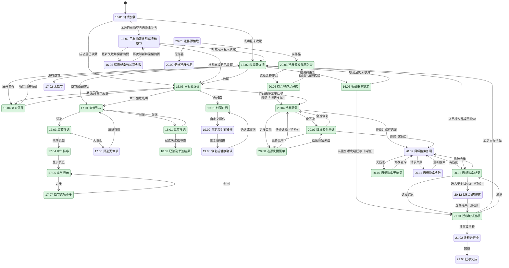

| 状态 ID | 最小必要信息/采集触发                                                                          | 浅色                                                                                                                           | 深色                                                                                                                       |
| ------- | ---------------------------------------------------------------------------------------------- | ------------------------------------------------------------------------------------------------------------------------------ | -------------------------------------------------------------------------------------------------------------------------- |
| 16.01   | 本地读取前的全屏加载指示；源码此分支没有独立标题或返回按钮，系统返回另验                       | 待                                                                                                                             | 待                                                                                                                         |
| 16.02   | One Piece / MangaDex ALL 的完整未收藏详情、作者、状态、摘要和添加入口                          | `s1602-one-piece-ready-light`                                                                                                  | `s1602-one-piece-ready-dark`                                                                                               |
| 16.03   | 已在书架状态、分类/续读入口及同一元数据                                                        | `s1603-details-light`                                                                                                          | `s1603-details-dark`                                                                                                       |
| 16.04   | 同一 One Piece 的长简介、完整标签及收起；分首屏与末段，并核对收起后回原详情                    | `s1604-one-piece-expanded-{top,tail}-light`、`s1602-one-piece-ready-light`                                                     | `s1604-one-piece-expanded-{top,tail}-dark`、`s1602-one-piece-ready-dark`                                                   |
| 16.05   | 加载失败保留资料、具体错误与再次刷新入口；元数据/章节失败分别采集                              | 待                                                                                                                             | 待                                                                                                                         |
| 16.06   | 重复作品名称、封面、来源、章节数、仍然添加与取消；两侧取消后目标仍未收藏，查看/迁移/添加转换待 | `s1606-one-piece-duplicate-light`、`s1606-duplicate-cancel-light`                                                              | `s1606-one-piece-duplicate-dark`、`s1606-duplicate-cancel-dark`                                                            |
| 16.07   | 已有摘要时补载元数据/章节，保留摘要并显示更新反馈；早期 XML 的 0 章不能证明稍后 PNG 的加载态   | 待                                                                                                                             | 待                                                                                                                         |
| 17.01   | 同一 xkcd 的章节数量、名称、日期、已读/未读和下载操作；Dragonfly 已读，其余首屏章节未读        | `s1701-chapter-list-light`                                                                                                     | `s1701-chapter-list-dark`                                                                                                  |
| 17.02   | 空章节说明和重新读取入口                                                                       | 待                                                                                                                             | 待                                                                                                                         |
| 17.03   | 筛选页签、未读/书签等三态、翻译组入口                                                          | `s1703-chapter-filter-light`                                                                                                   | `s1703-chapter-filter-dark`                                                                                                |
| 17.04   | 当前排序字段/方向                                                                              | `s1704-chapter-sort-light`                                                                                                     | `s1704-chapter-sort-dark`                                                                                                  |
| 17.05   | 当前显示方式                                                                                   | `s1705-chapter-display-light`                                                                                                  | `s1705-chapter-display-dark`                                                                                               |
| 17.06   | 生效条件、无章节及清除/返回                                                                    | 待                                                                                                                             | 待                                                                                                                         |
| 17.07   | 默认设置/重置菜单及底层上下文；参考附加分支，不据此扩展本轮产品功能                            | `s1707-chapter-options-more-light`                                                                                             | `s1707-chapter-options-more-dark`                                                                                          |
| 18.01   | 选中数量、选中行、退出/全选和底部动作                                                          | `s1801-chapter-selection-light`                                                                                                | `s1801-chapter-selection-dark`                                                                                             |
| 18.02   | 已读/未读/书签三类结果各自可见，不能只凭点击记录                                               | `s1802-chapter-read-light`、`s1802-chapter-unread-light`、`s1802-chapter-bookmarked-light`、`s1802-chapter-unbookmarked-light` | `s1802-chapter-read-dark`、`s1802-chapter-unread-dark`、`s1802-chapter-bookmarked-dark`、`s1802-chapter-unbookmarked-dark` |
| 19.01   | 实际大封面、关闭和操作；旧 `cover-view-default-dark` 不符合                                    | `s1901-cover-light`                                                                                                            | `s1901-cover-dark`                                                                                                         |
| 19.02   | 当前封面、可用自定义/重置动作                                                                  | 待                                                                                                                             | 待                                                                                                                         |
| 19.03   | 替换或恢复对象、影响、确认/取消；系统文件选择单列                                              | 待                                                                                                                             | 待                                                                                                                         |
| 20.01   | 迁移标题和加载指示                                                                             | 待                                                                                                                             | 待                                                                                                                         |
| 20.02   | 无作品说明及返回                                                                               | 待                                                                                                                             | 待                                                                                                                         |
| 20.03   | 源名、语言、书架数量、排序入口及源内未选择作品列表；排序变更与空书架待                         | `s2003-migration-{sources,titles}-light`                                                                                       | `s2003-migration-{sources,titles}-dark`                                                                                    |
| 20.04   | 目标源已选分组、名称/语言、排序把手、全选/全不选与继续；更多菜单入口                           | `s2004-migration-config-light`、`migration-config-restored-light`                                                              | `s2004-migration-config-dark`、`migration-config-restored-dark`                                                            |
| 20.05   | 实际迁移查询 one piece、分源结果与原源标记；主图带键盘，选首个结果后进入21.01                  | `s2005-migration-one-piece-light`                                                                                              | `s2005-migration-one-piece-dark`                                                                                           |
| 20.06   | 待迁移作品的选中行、源名、继续与返回清除选择；继续转换待验                                     | `s2006-migration-selected-light`                                                                                               | `s2006-migration-selected-dark`                                                                                            |
| 20.07   | 全不选后仅显示可选源、无排序把手；参考继续按钮仍可见，全选恢复；未选时继续待验                 | `s2004-migration-none-light`                                                                                                   | `s2004-migration-none-dark`                                                                                                |
| 20.08   | 选择已启用/已置顶源的快捷菜单；返回后保持原选择，快捷选择执行待验                              | `s2004-migration-options-light`                                                                                                | `s2004-migration-options-dark`                                                                                             |
| 20.09   | 实际迁移查询、分源旋转指示、已返回项与搜索进度；不得以15的图替代                               | 待                                                                                                                             | 待                                                                                                                         |
| 20.10   | 实际迁移查询 xkcd、各源无结果及原源标记；改为 one piece 后恢复结果                             | `s2005-migration-search-light`                                                                                                 | `s2005-migration-search-dark`                                                                                              |
| 20.11   | 实际迁移查询、失败源和具体错误、重新搜索；混合成功/失败另列变体                                | 待                                                                                                                             | 待                                                                                                                         |
| 20.12   | 单个目标源内的迁移搜索、查询与原作品上下文；加载/成功/空/失败均待                              | 待                                                                                                                             | 待                                                                                                                         |
| 21.01   | 参考弹层为章节/分类选项及显示作品/共存/迁移；显示作品后实际打开目标并返回；改选、取消和提交待  | `s2101-migration-confirm-light`、`s1602-one-piece-ready-light`                                                                 | `s2101-migration-confirm-dark`、`s1602-one-piece-ready-dark`                                                               |
| 21.02   | 原/目标上下文和进行中反馈、操作禁用                                                            | 待                                                                                                                             | 待                                                                                                                         |
| 21.03   | 目标作品落点、原书架关系及完成后可用操作                                                       | 待                                                                                                                             | 待                                                                                                                         |

16–21 已实看 `migration-reference-pairs-0.jpg` 至 `migration-reference-pairs-3.jpg`、`migration-reference-selected-pairs.jpg`，以及 `manga-reference-pairs-0.jpg` 至 `manga-reference-pairs-2.jpg`。原作品为 xkcd，目标源保持最初三个已选项；先全不选、查看菜单、返回并全选恢复，再继续搜索。xkcd 查询真实返回三源无结果；输入 one piece 得到 MangaDex ALL/EN 的真实作品，选择 ALL 第一项进入数据选择。此操作只查看目标作品，未执行共存或迁移。One Piece ALL 与书架已有 EN 版本触发真实重复提示，两主题均取消，目标保持未收藏。返回书架后原 xkcd/One Piece EN 关系保持；模拟器已暂停。

长简介展开首屏和末段已成对，完整显示正文与标签，再收起回原详情。首个目标详情的 XML 曾为未知作者/0章，而随后同前缀 PNG 已完成元数据和章节加载；该帧不能作为16.01/16.07或17.02的图片证据。早期输入丢字产生的 o ie 查询只留在忽略目录，不填入同条件主图。20.06 的正式成对图包含选中背景与继续按钮；未实际点击此入口进入配置，不能用作品更多菜单的成功转换替代。空书架迁移、冷加载、迁移失败、共存/迁移后的落点和所有修改/取消变体仍待。

以下为两主题稳定 XML 相同的主要矩形，均为720×1600/320dpi的物理像素；仅建立参考锚点，尚未与 Karuyomi 迁移页叠图：

| 元素             | 矩形 (left, top, right, bottom) |
| ---------------- | ------------------------------- |
| One Piece 封面   | (32,296,232,596)                |
| One Piece 标题   | (264,346,460,442)               |
| 未收藏详情章节数 | (32,1060,170,1108)              |
| 迁移数据选择标题 | (88,617,520,687)                |
| 迁移章节选项文字 | (152,747,210,787)               |
| 迁移显示作品动作 | (112,987,226,1027)              |
| 重复作品提示标题 | (48,278,440,360)                |
| 重复作品取消文字 | (327,1408,393,1456)             |

## 22–25：阅读器与图片

依据：`presentation/reader/appbars/ReaderAppBars.kt`、`ReadingModeSelectDialog.kt`、`settings/ReaderSettingsDialog.kt` 的阅读模式/常规/滤镜页签、`ReaderPageActionsDialog.kt`、`ui/reader/ReaderActivity.kt`、`loader/ChapterLoader.kt`、`viewer/pager/{PagerPageHolder,PagerTransitionHolder}.kt` 及 webtoon holder。错误、空章节、首末页和章节间过渡均须实拍；首次章节失败的返回反馈与画布内图片失败不能合并。

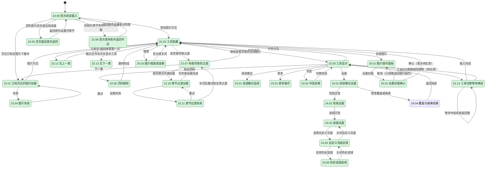

| 状态 ID | 最小必要信息/采集触发                                                          | 浅色                                                                                                     | 深色                                                                                                  |
| ------- | ------------------------------------------------------------------------------ | -------------------------------------------------------------------------------------------------------- | ----------------------------------------------------------------------------------------------------- |
| 22.01   | xkcd 3321 页列表已返回，画布保留 `1 / 2` 和第一张图片的加载指示                | `s2201-reader-page-loading-light`                                                                        | `s2201-reader-page-loading-dark`                                                                      |
| 22.02   | 实际图片与页码，工具隐藏                                                       | `s2202-reader-canvas-light`                                                                              | `s2202-reader-canvas-dark`                                                                            |
| 22.03   | 返回、作品/章节、书签/更多、页码与底部工具                                     | `s2203-reader-tools-light`                                                                               | `s2203-reader-tools-dark`                                                                             |
| 22.04   | xkcd 3321 第一张图片连接失败，页码、错误及同页重试                             | `s2204-reader-page-error-light`                                                                          | `s2204-reader-page-error-dark`                                                                        |
| 22.05   | 初始空页返回原作品并显示系统 toast「没有图片」                                 | `s2205-reader-empty-toast-light`                                                                         | `s2205-reader-empty-toast-dark`                                                                       |
| 22.06   | 3322 Dragonfly 的当前/总页数、滑杆落点；1→2 的实际第二页图片及返回 1           | `s2206-reader-jump-{before,result,restored}-light`                                                       | `s2206-reader-jump-{before,result,restored}-dark`                                                     |
| 22.07   | 已读完第 1 章与下一章第 2 章，继续翻页到下一章图片                             | `s2207-reader-neighbor-next-auto-light`                                                                  | `s2207-reader-neighbor-next-auto-dark`                                                                |
| 22.08   | 初始章节请求失败，退出阅读器回原作品并显示真实错误；恢复网络后重开同章成功     | `s2208-reader-initial-failure-light-5`、`s2209-reader-retry-light-settled`                               | `s2208-reader-initial-failure-dark-5`、`s2209-reader-retry-dark-settled`                              |
| 22.09   | 首次进入的黑色阅读画布、实际旋转指示；尚无页位工具，读取阶段不由瞬态图推断     | `s2209-reader-retry-light-5`                                                                             | `s2209-reader-retry-dark-5`                                                                           |
| 22.10   | 3320 第 1 页向上一章翻动，过渡保留原章和目标 3319，显示加载指示与说明          | `s2210-reader-neighbor-loading-light`                                                                    | `s2210-reader-neighbor-loading-dark`                                                                  |
| 22.11   | 保留相邻两章，显示「图片加载失败：没有图片」和「重试」                         | `s2211-reader-neighbor-error-auto-light`                                                                 | `s2211-reader-neighbor-error-auto-dark`                                                               |
| 22.12   | 越过首章第一页后显示「前面没有啦」与原章节                                     | `s2212-reader-no-previous-auto-light`                                                                    | `s2212-reader-no-previous-auto-dark`                                                                  |
| 22.13   | 越过尾章末页后显示「后面没有啦」、已完成章节与工具                             | `s2213-reader-no-next-auto-light`                                                                        | `s2213-reader-no-next-auto-dark`                                                                      |
| 22.14   | 3321 工具栏「上一章」等待 3320，弹层显示加载指示，按系统返回键时保留           | `s2214-reader-toolbar-wait-light`                                                                        | `s2214-reader-toolbar-wait-dark`                                                                      |
| 23.01   | 当前模式、可选模式、应用及关闭                                                 | `s2301-reader-mode-light`                                                                                | `s2301-reader-mode-dark`                                                                              |
| 23.02   | 当前章节可用操作与关闭                                                         | `s2302-reader-more-light`                                                                                | `s2302-reader-more-dark`                                                                              |
| 23.03   | 已加与已移除两种书签状态、可用反向动作                                         | `s2303-reader-bookmarked-light`、`s2303-reader-unbookmarked-light`                                       | `s2303-reader-bookmarked-dark`、`s2303-reader-unbookmarked-dark`                                      |
| 24.01   | 本作品范围、阅读模式、默认/显式值、输入选项；完整滚动段分项                    | `s2401-reader-settings-light`、`s2401-reader-settings-lower-light`、`s2401-reader-settings-bottom-light` | `s2401-reader-settings-dark`、`s2401-reader-settings-lower-dark`、`s2401-reader-settings-bottom-dark` |
| 24.02   | 常规页签、当前图像适配/显示选项；完整滚动段分项                                | `s2402-reader-settings-light`、`s2402-reader-settings-lower-light`                                       | `s2402-reader-settings-dark`、`s2402-reader-settings-lower-dark`                                      |
| 24.03   | 滤镜页签、亮度/色彩/灰度/反色关闭状态                                          | `s2403-reader-settings-light`                                                                            | `s2403-reader-settings-dark`                                                                          |
| 24.04   | 切换继承/显式设置后实际阅读呈现；两种各一图                                    | 待                                                                                                       | 待                                                                                                    |
| 24.05   | 亮度开关启用、当前数值和滑杆；参考附加分支                                     | `s2405-reader-brightness-enabled-light`                                                                  | `s2405-reader-brightness-enabled-dark`                                                                |
| 24.06   | 色彩开关、RGBA当前值、混合模式、灰度/反色；参考附加分支，RGB等未实现功能列后续 | `s2406-reader-color-filter-enabled-light`、`s2406-reader-color-filter-lower-light`                       | `s2406-reader-color-filter-enabled-dark`、`s2406-reader-color-filter-lower-dark`                      |
| 25.01   | 当前图片上下文、设置封面/保存等真实动作                                        | `s2501-reader-image-actions-light`                                                                       | `s2501-reader-image-actions-dark`                                                                     |
| 25.02   | 设置封面影响、确认/取消；取消返回图片操作面板，确认落点待验                    | `s2502-reader-cover-confirm-light`；取消图 `s2502-reader-cover-cancel-light`                             | `s2502-reader-cover-confirm-dark`                                                                     |
| 25.03   | 双击放大的实际 Dragonfly 图片及再次双击复位；Karuyomi 独立图片页另验           | `s2503-reader-zoom-confirmed-light`、`s2503-reader-zoom-reset-light`                                     | `s2503-reader-zoom-confirmed-dark`、`s2503-reader-zoom-reset-dark`                                    |

阅读新图已实看 `reader-initial-burst-{light,dark}.jpg`、`reader-retry-burst-{light,dark}.jpg`、`reader-jump-pairs.jpg` 和四张 `s2503-reader-zoom-{confirmed,reset}-{light,dark}.png`。同一 xkcd 3322 在专用模拟器断网时实际返回 `Failed to connect to /10.0.2.2:7890`，退出阅读器并由系统显示 toast；恢复网络后重开同章得到真实图片。进入时的旋转指示与阅读模式 toast 同屏，不能把模式提示当作错误。采样帧为先截图的短时连续 PNG，时间记录在同前缀 `.timing.json`，没有同帧 XML；随后 `settled.xml` 只代表稍后的页面。首次章与图片加载复用指示组件，仅凭黑底旋转帧不能证明内部所处阶段，已知页位的 22.01 继续待采。

页码滑杆从 1 拖至 2 后菜单自动隐藏，重开工具后显示页码 2 及真实第二页，再拖回 1；操作前后的稳定主图成对，拖动中的浮动反馈帧仍待。第二页是 Source 提供的文字图片，按原比例显示可能横向裁切，不当作缩放证据。早期无明确双击间隔的 `doubletap` / `zoomed-picture` 图仅切换了工具，均排除；正式 25.03 使用两次触点间 100ms，取得约两倍放大的实际第一张图片及复位。深色主图有完整页码，浅色放大图的页码未显示，工具/计时变体继续单列。两主题沿用黑色阅读背景，图片本身未染色；已读标记因实际阅读改变，失败前的读状态不同不作同数据叠图。未触发空页、单张图片失败或章节过渡分支。Wi-Fi/移动数据已恢复为原启用值，模拟器暂停。

2026-11-19 使用固定 Mihon 0.21.3 的本地图源补齐 22.05、22.07、22.11–22.13。两主题使用同样的章节和翻页方向，稳定过渡使用自动阅读背景。空章直接退出显示系统提示，两份稍后 XML 核对相同的三章排序及唯一未读项。相邻章失败保留当前与目标，浅色为目标补页后原重试恢复，并继续到实际图片。已知页位加载、单页解码错误、过渡加载及工具切章等待继续采集。[参考图片与归一化量测](mihon-cupertino-fidelity.md#mihon-章节过渡与空页的双主题参考)

同日，`4026db3` 正式 Web 深浅色对照 22.03 的同一 xkcd 3324 第一页及从右到左模式，保留图片区与两个方向按钮的实测坐标。Karuyomi 通过工具栏切章，实际核对无上一章与无下一章、保持原图以及重返 3324 第 2 页。`21f23d6` 正式 Web 双主题通过页与章首尾的可见说明及辅助禁用，方向排列和页码工具的布局差异继续核对。[产品画面与读回](mihon-cupertino-fidelity.md#阅读器同页与边界的正式-web-双主题对照)

`7db8551` 在相同 3324 章和双主题复验 22.03 的方向几何，22.06 通过滑杆拖动、键盘、点按及新文档续读。主图计数保持 168/169 和 137/170，画布纵向位置及控制区仍有差距。[页码滑杆量测与读回](mihon-cupertino-fidelity.md#阅读页码滑杆与方向排列)

`313bbc9` 正式 Web 双主题核对 22.02 与 22.03 的同页显隐。三种工具阶段的图像边界均为 `[128,673)`，Mihon 的同页显示工具参考约为 `[132,673)`。23.02 的阅读选项和 23.03 的书签入口移入顶部并通过原动作。底栏与其余阅读状态继续验收。[阅读器工具区与画布](mihon-cupertino-fidelity.md#阅读器工具区与画布)

2026-11-20，`66be7cd` 补齐 22.02 隐藏后的可见页码，并在同一 3324 章双主题核对分页、连续、条漫显隐和页码恢复入口。连续和条漫双击查看仍可回到同页。短横屏的页码可触达，分页显示、隐藏、复显的图片边界一致。已知页位加载、图片失败、过渡加载和工具切章等待仍需同范围参考和复验。[阅读器显隐与页码](mihon-cupertino-fidelity.md#阅读器显隐与页码)

`e5ba265` 补充 Karuyomi 画布内的 22.07、22.10–22.13 正式 Web 实拍。两色覆盖首尾、真实页列表就绪、受控加载和空列表，重试进目标章后可独立续读。[画布内章间过渡](mihon-cupertino-fidelity.md#阅读画布内的章间过渡)

2026-11-20 使用固定 Mihon 0.21.3 的同一英文 xkcd 章目补齐 22.01、22.04、22.10 和 22.14。隔离中继暂扣图片连接或目标章页列表连接，完整保留真实 Source 和图片处理。两主题核对画布内的指示、页位、同页重试、工具栏等待时按返回键、放行后的实际切章。深色重试后的第一张图仍在等待，浅色实际取得同页图片。工具弹层背后的图片不同页，弹层本身同状态配对。[参考画面与归一化量测](mihon-cupertino-fidelity.md#mihon-单页与切章等待的双主题参考)

## 26–30：设置、选择与通用弹层

依据：`presentation/more/settings/screen/SettingsMainScreen.kt`、`SettingsAppearanceScreen.kt`、`SettingsReaderScreen.kt`、`SettingsAdvancedScreen.kt`、`debug/DebugInfoScreen.kt`、`WorkerInfoScreen.kt`，以及官方 Preference 对应选择/编辑对话框。通用弹层复用前面已定义状态，不用另一个页面的常态代替。

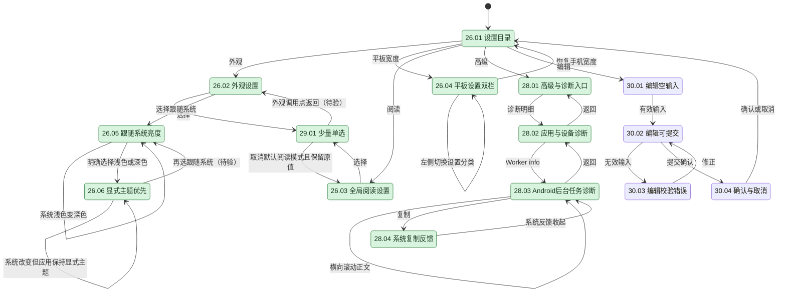

| 状态 ID | 最小必要信息/采集触发                                                             | 浅色                                                                    | 深色                                                                  |
| ------- | --------------------------------------------------------------------------------- | ----------------------------------------------------------------------- | --------------------------------------------------------------------- |
| 26.01   | 设置分类、标题/说明和返回；旧 `settings-main-default-dark` 实际为“更多”           | `s2601-settings-light`                                                  | `s2601-settings-dark`                                                 |
| 26.02   | 当前浅深模式、DEFAULT 卡、主题选中、显示偏好                                      | `s2602-appearance-light`                                                | `s2602-appearance-dark`                                               |
| 26.03   | 阅读显示/输入分组、当前值和说明；六段滚动主图，详见下文                           | `s2603-reader-preferences-*-light`                                      | `s2603-reader-preferences-*-dark`                                     |
| 26.04   | 平板设置目录/当前分类与外观同屏、当前主题、分栏边界；768×1024dp                   | `nav-settings-tablet-light`                                             | `s2604-settings-tablet-dark`                                          |
| 26.05   | 跟随系统选中、DEFAULT卡及实际应用表面；系统浅→深后仍停在原外观页                  | `s2605-appearance-system-light`                                         | `s2605-appearance-system-dark`                                        |
| 26.06   | 显式浅/深选中、与系统相反时仍使用应用主题，系统变化后保持该选择                   | `s2606-appearance-explicit-light`、`s2606-explicit-system-change-light` | `s2606-appearance-explicit-dark`、`s2606-explicit-system-change-dark` |
| 28.01   | 高级设置首屏、数据/网络、书架和阅读/扩展末段；中段有滚动偏差，未操作维护/网络选项 | `s2801-advanced-{top,network,library,extensions}-light`                 | `s2801-advanced-{top,network,library,extensions}-dark`                |
| 28.02   | 调试信息的版本、构建、安装测试ID、编译状态、WebView与设备；上下两段               | `s2802-debug-info-top-light`、`s2802-debug-info-device-light`           | `s2802-debug-info-top-dark`、`s2802-debug-info-device-dark`           |
| 28.03   | Worker info 的 Enqueued/Finished/Running、等宽正文、复制和返回；横向变体          | `s2803-worker-info-light`、`s2804-worker-horizontal-light`              | `s2803-worker-info-dark`、`s2804-worker-horizontal-dark`              |
| 28.04   | 系统复制预览；只能确认已显示的内容，不能由点击推断完整剪贴板校验                  | `s2804-worker-copy-readable-light`                                      | `s2804-worker-copy-readable-dark`                                     |
| 29.01   | 默认阅读模式标题、五个选项、当前右到左、取消；取消后原值不变                      | `s2901-reader-mode-choice-light`、`s2901-reader-mode-cancel-light`      | `s2901-reader-mode-choice-dark`、`s2901-reader-mode-cancel-dark`      |
| 30.01   | 标题、必填/禁用提交、取消、键盘；关联05.03/10.02/14.04                            | `s0503-category-create-keyboard-light`（分类分项）                      | `s0503-category-create-empty-dark`（分类分项）                        |
| 30.02   | 当前草稿、可用提交和取消；关联05.04/05.07/14.04                                   | `s0504-category-create-keyboard-light`（分类分项）                      | `s0504-category-create-keyboard-dark`（分类分项）                     |
| 30.03   | 原输入、具体校验错误、修正/取消；关联05.05/10.03                                  | `s0505-category-create-duplicate-light`（分类分项）                     | `s0505-category-create-duplicate-dark`（分类分项）                    |
| 30.04   | 对象、影响、确认/取消；逐操作关联04.02/05.08/09.03/10.06/19.03/21.01/25.02        | 待                                                                      | 待                                                                    |

2026-11-19，复核固定 Mihon 版本的六张分类原图和同名 XML，补登记 30.01–30.03 的空输入、可提交草稿和重名错误。两主题均实际显示键盘，应用输入框归一化边界均为 `[44,231,316,317]`，添加动作边界均为 `[258,341,316,389]`。XML 的可操作父节点分别报告禁用、启用、禁用。引用 05.03–05.05 的同一弹层原图，仓库、Source 输入及各确认动作继续分项复核。[分类参考基准](mihon-cupertino-fidelity.md#通用表单的分类参考复核)

26.03 的 `*` 依次为 `top`、`display`、`paged`、`webtoon`、`navigation`、`actions`，已实看 `settings-reference-pairs-0.jpg` 至 `settings-reference-pairs-2.jpg`。首屏与末段两主题的应用 XML 边界一致；中间四段有约 3–15 物理像素的滚动差，部分首尾文字受裁切，只计状态覆盖，不能用于同位置叠图。六段覆盖默认模式/提示、显示/E-Ink、章节跳过、单页/条漫、输入和操作菜单；未实现的 Android 专属设置及 E-Ink 只作参考，不增加无效产品入口。

固定源码的 `presentation/more/settings/widget/ListPreferenceWidget.kt` 使用可滚动单选对话框，没有查询；`presentation/browse/SourcesFilterScreen.kt` 和 `ExtensionFilterScreen.kt` 使用语言/来源开关列表。此前暂列的29.02/29.03“搜索选择/无匹配”没有该参考结构，现按源码依据改列产品独有29.K1/29.K2，仍须取得Karuyomi双主题画面；不伪造Mihon对应图。

26.04 已实看 `settings-tablet-pairs.jpg`：两栏各 384dp，左侧保留完整目录、当前“外观”高亮，右侧展示外观字段。深色多出“纯黑深色模式”一行，后续字段自然下移；不能把整张图强行套成相同纵坐标。恢复手机尺寸后返回独立页面。其它设置分类在双栏中的切换、输入与返回仍待，不能用外观主图代替。

26.05/26.06 已实看 `theme-system-reference-pairs.jpg`、`theme-explicit-reference-pairs.jpg` 与 `theme-explicit-transition-pairs.jpg`。先选择跟随系统，参考模拟器系统由浅变深时应用随之变化；再选显式浅色/深色，分别核对与系统相反的主图，以及系统变化后页面和选中值保持。跟随系统处于浅色时仍显示纯黑模式行，而显式浅色隐藏该行，不能用两种设置下的浅色图直接叠图。最后恢复原系统浅色、应用显式深色并暂停模拟器，未改网络、分类或阅读设置。以上是Mihon本地偏好的参考；Karuyomi主题仍须取得服务端确认才应用，两种保存语义分开验收。

28 和 29 已实看 `settings-reference-pairs-3.jpg` 至 `settings-reference-pairs-5.jpg`，并单独核对 Worker info 横向滚动及深色复制图。28.03 是 Mihon 的 Android WorkManager 诊断，与 Cloudflare Worker 无关；当时仅有一项 Enqueued，Finished/Running 为 `-`，其它运行状态仍待。横向滚动会移动整块正文，标题栏保持位置。28.04 属于独立 Android 系统反馈，不将系统容器配色纳入 Mihon 应用角色；未验证完整复制内容。29.01 本轮只取消，没有改动默认阅读模式；选中其他模式并返回仍待。

2026-11-17补齐28.04：在同一Mihon 0.21.3参考实例、720×1600物理像素/360×800dp下，实际切换应用显式浅色与深色，逐张实看`s2804-worker-copy-readable-{light,dark}.png`。两张系统预览均包含可读的测试任务ID及Tags开头，底层WorkManager诊断XML正文完全一致；没有独立读取或校验完整剪贴板。系统夜间模式始终为`no`，系统预览容器没有随应用主题变化，不能将它作为系统深色反馈证据。复制后先截PNG再导出XML，后者不代表同一瞬时的预览。旧`s2803-worker-copy-light`仅有空容器，继续排除。

本次将在线语言分组暂时关闭后仍有Local source，不是07.03真空态；切换标签后尚未稳定的旧画面也不计加载证据。语言分组与原Source选择已恢复，应用恢复原显式深色/DEFAULT/非纯黑，系统浅色保持；参考模拟器已关闭，ADB设备列表为空。AVD配置为2核/2048MB，但`20261117-emulator.log`记录启动器上调至2560MB，不将配置当作实际内存实测，Guest/RSS未独立核对。上述只补Mihon参考图，不增加Karuyomi的108/169主图计数，全部参考变体和转换继续按原门槛验收。

同日对照固定`feadad5e`源码：`AndroidSourceManager.kt`始终注册LocalSource，`GetEnabledSources.kt`将其排除在语言开关条件之外；`SourceOptionsDialog`不给LocalSource禁用动作，筛选器的`GetLanguagesWithSources.kt`只列在线源。因此关闭在线语言或普通源菜单不能完成先前设想的07.03触发；源码仍有EmptyScreen分支，正式APK纯空画面尚未取得，继续保留未采，不用Local source单项替代，也不以源码推导计作实拍通过。本次未重新启动模拟器。

28.01 后续补齐 `network`、`library`、`extensions` 三段，已实看 `extension-storage-pairs-5.jpg` / `extension-storage-pairs-6.jpg`。网络/书架中段约有 14 物理像素滚动差，上边缘个别文字受裁切；末段布局一致。未修改 DoH、User Agent、日志保护、数据库清理或文件名设置。仅通过正式“撤销已信任的未知插件”触发参考扩展未加载，完成两主题提示与取消后，已恢复原 MangaDex / xkcd 信任及 Afrikaans 启用。模拟器暂停在深色 MangaDex 详情。

## Karuyomi 独有状态与转换

这些节点没有 Mihon 的业务等价物，不能用参考应用图证明通过。应用同一套主题和页面骨架，并在目标 Web 产物中逐状态采集浅/深图；原生现场验收仍停止。

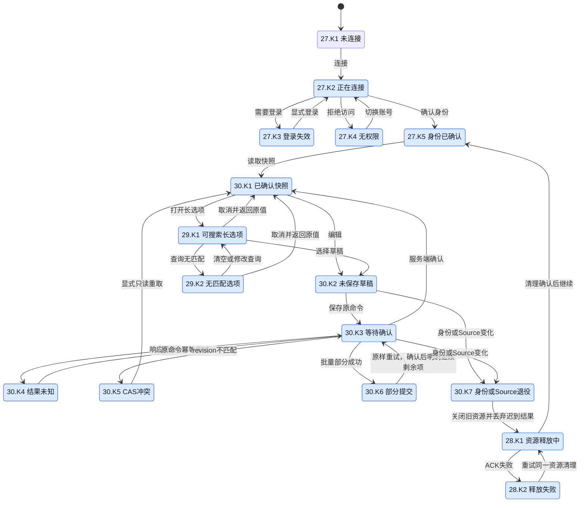

| 状态 ID | 最小必要信息与操作边界                                                | 浅色                                                                            | 深色                                                                           |
| ------- | --------------------------------------------------------------------- | ------------------------------------------------------------------------------- | ------------------------------------------------------------------------------ |
| 27.K1   | 当前服务地址、尚未连接、连接入口；地址非法时给出可修正原因            | 待                                                                              | 待                                                                             |
| 27.K2   | 正在连接的服务、进度及当前可用操作；不显示旧身份的已保存状态          | `karuyomi-0a28f6a-connection-pending-light`                                     | `karuyomi-19c2260-connection-pending-system`                                   |
| 27.K3   | 登录已失效、受影响操作、显式登录/重试入口及未确认草稿提示             | `karuyomi-0a28f6a-connection-expired-light`（带草稿变体待验）                   | `karuyomi-19c2260-connection-expired-dark`（带草稿变体待验）                   |
| 27.K4   | 当前服务、拒绝访问原因和切换账号/连接入口                             | `karuyomi-0a28f6a-connection-denied-light`                                      | `karuyomi-19c2260-connection-denied-dark`                                      |
| 27.K5   | 已确认的服务与身份、连接状态和后续可用入口                            | `karuyomi-19c2260-connection-ready-light`                                       | `karuyomi-19c2260-connection-ready-dark`                                       |
| 30.K1   | 当前对象、服务端已确认值及适用的保存反馈                              | `karuyomi-d0d963c-reader-settings-confirmed-light.jpg`                          | `karuyomi-d0d963c-reader-settings-confirmed-dark.jpg`                          |
| 30.K2   | 当前对象与草稿、尚未保存提示、可提交/校验原因及取消                   | `karuyomi-d0d963c-reader-settings-draft-light.jpg`                              | `karuyomi-d0d963c-reader-settings-draft-dark.jpg`                              |
| 30.K3   | 保存中、操作对象和提交范围；禁止重复提交并保留草稿                    | `karuyomi-d0d963c-reader-settings-waiting-light.jpg`                            | `karuyomi-d0d963c-reader-settings-waiting-dark.jpg`                            |
| 30.K4   | 结果尚未确认、保留的原操作及同一操作重试；不误报成功或失败            | `karuyomi-d0d963c-reader-settings-unknown-light.jpg`                            | `karuyomi-d0d963c-reader-settings-unknown-dark.jpg`                            |
| 30.K5   | 服务端值已变化、受影响草稿与显式重新读取入口                          | `karuyomi-d0d963c-reader-settings-conflict-light.jpg`                           | `karuyomi-d0d963c-reader-settings-conflict-dark.jpg`                           |
| 30.K6   | 已确认、未确认和未发送各一章，保留原作品、清单、稍后与原样重试        | `karuyomi-f084467-chapter-partial-light.jpg`                                    | `karuyomi-f084467-chapter-partial-dark.jpg`                                    |
| 30.K7   | 原窗口失效、受影响清单和各章状态可读，关闭后另行重连                  | `karuyomi-f084467-chapter-expired-light.jpg`                                    | `karuyomi-f084467-chapter-expired-dark.jpg`                                    |
| 28.K1   | 正在关闭的页面/资源、等待确认及受阻操作                               | `karuyomi-704d148-retired-search-releasing-light.jpg`                           | `karuyomi-704d148-retired-search-releasing-dark.jpg`                           |
| 28.K2   | 尚未释放的资源、失败原因和同一清理重试入口                            | `karuyomi-704d148-retired-search-failed-light.jpg`                              | `karuyomi-704d148-retired-search-failed-dark.jpg`                              |
| 29.K1   | 当前项、完整长名称/来源序号、查询/清空/取消与键盘；本轮为xkcd范围草稿 | `karuyomi-0c4da11-range-{current-choice,search-match,search-cleared}-light.jpg` | `karuyomi-0c4da11-range-{current-choice,search-match,search-cleared}-dark.jpg` |
| 29.K2   | 当前查询、无匹配、清空或修改查询及取消；保留调用方原值                | `karuyomi-0c4da11-range-search-empty-light.jpg`                                 | `karuyomi-0c4da11-range-search-empty-dark.jpg`                                 |

验收覆盖书架/分类与批量（02–06）、账户扩展/仓库（08–11）、Source 偏好（14）、停止/取消/分页/资源清理（12/15）、作品元数据/章节读态/书签/封面（16–19）、只读迁移映射与提交（20–21）、阅读进度/Access 恢复/设置覆盖（22–24）、全局设置和连接/诊断（26–28）。28.K1/K2 的主图取自跨源搜索失效，30.K1–K5 取自本漫画阅读设置，30.K6/K7 取自章节批量标记。各业务页的触发变体与完整转换继续验收。[章节失效与恢复](mihon-cupertino-fidelity.md#章节部分提交与编辑失效的正式-web-双主题验收)

### 04–06：Karuyomi 分类与批量确认的目标状态

2026-11-18，正式客户端`9a1c03c`完成[分类与部分批量双主题验收](mihon-cupertino-fidelity.md#分类与部分批量的正式-web-双主题验收)，补齐04.K4/K6和05.K10三对主图；28组十二路快照、16个相等区间和224条已结束审计核对原命令、零重复、读取零额外POST及四次受控400零应用。跨版本双主题主图119/169（70.4%），剩余50个主状态；本轮真实CAS、身份失效及全部变体仍单列待验。

2026-11-17，单作品及批量分类改用完整官方选项行，名称点击与勾选框共用同一草稿动作；两项现有业务流程先复现名称点击未选中，再修复，分类/批量29项回归及相关严格分析通过。正式Web新行布局及故障/变体仍待，历史主图不替代本版，计数不增加，见[选择行记录](mihon-cupertino-fidelity.md#选择行与搜索反馈的-cupertino-收敛)。

固定Mihon的参考主图见05.01–05.10、06.01–06.04和04.01–04.04。最终界面采用官方Cupertino分组、名称导航、更多菜单及危险红，不把原生Material四动作排列或对话框尺寸作为最终样式。以下状态来自正式分类草稿与批量控制器的实际分支。蓝色仅表示表中对应版本的正式Web双主题主图已取得，橙色为只完成一种主题，全部变体与转换继续分开验收。新建语义及确认正文缺口已有正式修复图，旧图保留在验证记录，不用组件回归填补其余待办。

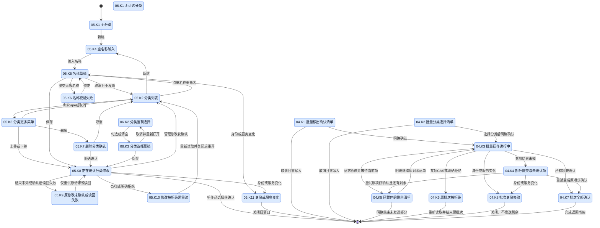

| 状态 ID | 最小必要信息                                                        | 浅色正式Web                                                                                                           | 深色正式Web                                                                                                         |
| ------- | ------------------------------------------------------------------- | --------------------------------------------------------------------------------------------------------------------- | ------------------------------------------------------------------------------------------------------------------- |
| 05.K1   | 无分类说明、新建、完成                                              | `karuyomi-bbf69d7-category-empty-light.jpg`                                                                           | `karuyomi-bbf69d7-category-empty-dark.jpg`                                                                          |
| 05.K2   | 按确认顺序的名称、重命名和独立更多入口、新建、完成                  | `karuyomi-bbf69d7-category-list-light.jpg`                                                                            | `karuyomi-bbf69d7-category-list-dark.jpg`                                                                           |
| 05.K3   | 分类上下文、上/下移边界禁用、危险删除、焦点与取消                   | `karuyomi-a9fb310-category-menu-light.jpg`                                                                            | `karuyomi-a9fb310-category-menu-dark.jpg`                                                                           |
| 05.K4   | 空名称、字段标识、约束、取消与保存                                  | `karuyomi-a9fb310-category-name-empty-light.jpg`                                                                      | `karuyomi-a9fb310-category-name-empty-dark.jpg`                                                                     |
| 05.K5   | 原名称或新名称草稿、保存、取消及键盘上方操作                        | `karuyomi-a9fb310-category-rename-draft-light.jpg`                                                                    | `karuyomi-a9fb310-category-rename-draft-dark.jpg`                                                                   |
| 05.K6   | 保留输入、可读校验错误、修正入口、不发送                            | `karuyomi-a9fb310-category-name-invalid-light.jpg`                                                                    | `karuyomi-a9fb310-category-name-invalid-dark.jpg`                                                                   |
| 05.K7   | 精确分类名、删除关联影响、保留收藏/进度、系统红确认与取消           | `karuyomi-a9fb310-category-delete-preview-light.jpg`                                                                  | `karuyomi-a9fb310-category-delete-preview-dark.jpg`                                                                 |
| 05.K8   | 原修改、等待确认、冻结动作、禁止忙碌关闭；排序与输入各验            | `karuyomi-49f3482-category-auto-rename-waiting-light.jpg`、`karuyomi-49f3482-category-auto-reorder-waiting-light.jpg` | `karuyomi-49f3482-category-auto-rename-waiting-dark.jpg`、`karuyomi-49f3482-category-auto-reorder-waiting-dark.jpg` |
| 05.K9   | 原请求保留、未确认与已确认后读回失败分别说明、对应精确重试/稍后处理 | `karuyomi-49f3482-category-auto-unknown-light.jpg`、`karuyomi-49f3482-category-auto-confirmed-read-failed-light.jpg`  | `karuyomi-49f3482-category-auto-unknown-dark.jpg`、`karuyomi-49f3482-category-auto-confirmed-read-failed-dark.jpg`  |
| 05.K10  | 拒绝/冲突说明、冻结原草稿、重新读取并关闭、不能自动重基             | `karuyomi-9a1c03c-library-ack-read-category-rejected-light.jpg`                                                       | `karuyomi-9a1c03c-library-ack-read-category-rejected-dark.jpg`                                                      |
| 05.K11  | 失效说明、旧动作禁用、明确关闭与重开                                | `karuyomi-138ccbd-category-expired-confirmed-light.jpg`                                                               | `karuyomi-b29c3bb-category-expired-system-dark.jpg`                                                                 |
| 06.K1   | 作品名、无分类原因、管理分类指引、关闭                              | `karuyomi-0e605c5-editors-category-empty-light.jpg`                                                                   | `karuyomi-0e605c5-editors-category-empty-dark.jpg`                                                                  |
| 06.K2   | 精确作品、完整分类名与确认选择、保存与取消                          | `karuyomi-a9fb310-category-picker-current-light.jpg`                                                                  | `karuyomi-a9fb310-category-picker-current-dark.jpg`                                                                 |
| 06.K3   | 未提交选择、未分类含义、保存/取消、原服务端值保留                   | `karuyomi-a9fb310-category-picker-draft-light.jpg`                                                                    | `karuyomi-a9fb310-category-picker-draft-dark.jpg`                                                                   |
| 04.K1   | 完整漫画清单、数量、保留进度/书签/分类的影响、危险确认及取消        | `karuyomi-a9fb310-batch-remove-preview-light.jpg`                                                                     | `karuyomi-a9fb310-batch-remove-preview-dark.jpg`                                                                    |
| 04.K2   | 添加/移出范围、待选分类、逐项原→目标关联、数量、确认/取消           | `karuyomi-a9fb310-batch-categories-preview-light.jpg`                                                                 | `karuyomi-a9fb310-batch-categories-preview-dark.jpg`                                                                |
| 04.K3   | 确认数/未开始数、逐项状态、当前等待、暂停及忙碌关闭禁用             | `karuyomi-94b7b82-category-batch-waiting-light.jpg`                                                                   | `karuyomi-94b7b82-category-batch-waiting-dark.jpg`                                                                  |
| 04.K4   | 已确认/未开始/未确认项、系统红错误、仅重试原项、稍后处理            | `karuyomi-9a1c03c-library-ack-read-batch-partial-light.jpg`                                                           | `karuyomi-9a1c03c-library-ack-read-batch-partial-dark.jpg`                                                          |
| 04.K5   | 冻结的剩余清单、当前确认数、明确继续或结束、无隐式发送              | `karuyomi-94b7b82-category-batch-paused-light.jpg`                                                                    | `karuyomi-94b7b82-category-batch-paused-dark.jpg`                                                                   |
| 04.K6   | 逐项拒绝原因、原清单、重新读取并结束、不得直接重试新revision        | `karuyomi-9a1c03c-library-ack-read-batch-rejected-light.jpg`                                                          | `karuyomi-9a1c03c-library-ack-read-batch-rejected-dark.jpg`                                                         |
| 04.K7   | 全部确认文字、逐项确认状态、完成及返回实际书架                      | `karuyomi-bbf69d7-batch-confirmed-light.jpg`                                                                          | `karuyomi-bbf69d7-batch-confirmed-dark.jpg`                                                                         |
| 04.K8   | 失效说明、原清单只读、关闭、迟到确认不得发送剩余                    | `karuyomi-5f5d287-batch-expired-light.jpg`                                                                            | `karuyomi-5f5d287-batch-expired-dark.jpg`                                                                           |

`a9fb310`浅色实际执行重排再恢复，名称草稿跨360↔390保留后取消；深色核对相同名称/顺序、菜单边界、输入校验与取消。浅色单作品初次勾选后误点保存，后续独立重做取消，不能把该次写入记为零写。批量全部确认浅色为添加分类、深色为移出分类，二者不是同一操作的全部变体。`bbf69d7`正式双主题主图进一步核对空态/列表独立新建、Tab/Return和批量系统正文色；新建草稿取消零附写。实际Web没有软件键盘，05.K5的软键盘上方操作仅有组件证据，仍待目标平台。独立API和完整边界见[分类验证](mihon-cupertino-fidelity.md#分类管理与批量确认的-cupertino-分组)。

`bcac704`顶部导航正式Web补得06.K1双主题主图：两分类真实删除后，单作品保留精确名称、无分类指引及顶部取消；取消零附写。分类空态/列表、新建/重命名草稿与空名称错误、菜单/危险预览、单作品选择和两部作品批量2/2确认均已双主题重验，不重复增加旧节点计数。深色删除预览和批量移出首次图缺导航，另存`dark-incomplete.jpg`后重拍稳定图，原残帧不计通过。保存等待、未知、拒绝、身份失效及全部变体仍待，详见[其余编辑面复验](mihon-cupertino-fidelity.md#顶部导航其余编辑面的正式-web-复验)。

`0e605c5`正式Web双主题重验06.K1的导航起点与16px左右边距，取消前后独立API相同；主图更新且旧图保留，不重复增加计数。其它分类/批量主图仍按各自版本记录，见[导航起点修复](mihon-cupertino-fidelity.md#短编辑内容的导航起点修复)。

### 16–18：Karuyomi 作品与章节的目标状态

`b6bc240`正式Web在官方Wrangler临时D1、acceptance-owner、无fixture、360×800内置浏览器中打开真实英文xkcd及相同3323章。当时长范围选项及已选起止标签仍省略必要的来源序号；该历史缺口保留，不能用完整AX名称代替可见画面。后续`0c4da11`补长选项与自然范围表单；蓝色仅表示表中对应版本的双主题主图已实看，不能代表全部转换和变体通过。

`0c4da11`已解除完整选择行/菜单/查询列表的单行限制，范围改为官方表单并删除固定宽度与排序重复标签。八项双主题/双倍文字用例及73项不同相关回归、完整push/PR CI通过；正式Web两主题的18.K2及29.K1/K2主图与已执行转换已补，独立API确认零附写。详见[长选项回归](mihon-cupertino-fidelity.md#长选项与范围表单的自然尺寸)。

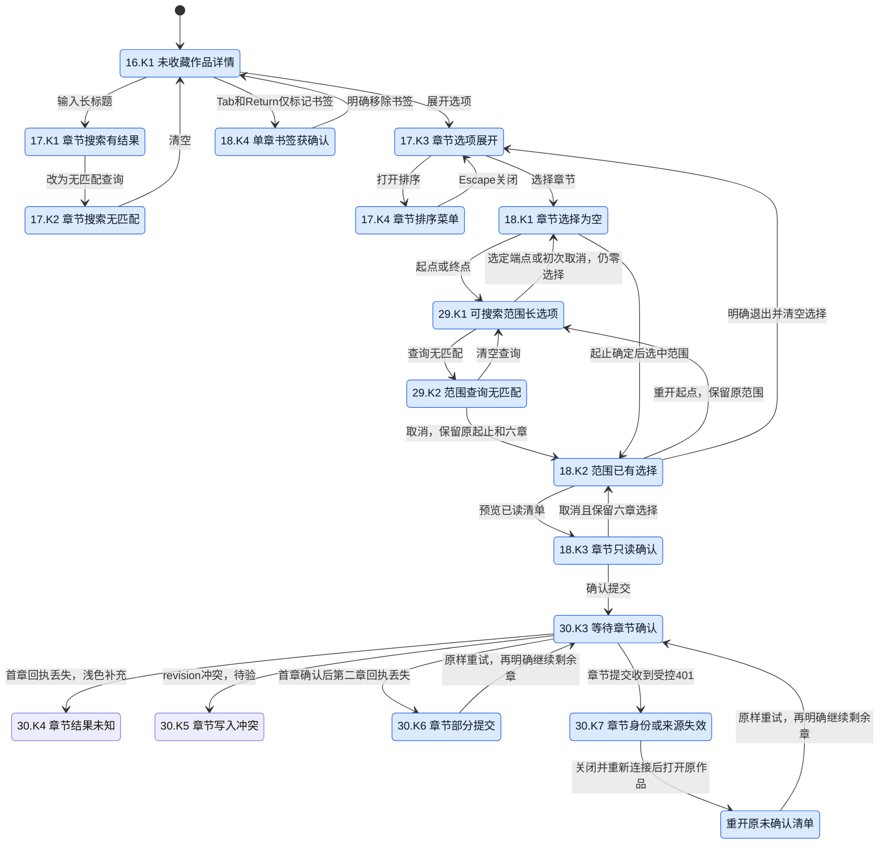

| 状态 ID | 最小必要信息                                                | 浅色正式Web                                       | 深色正式Web                                      |
| ------- | ----------------------------------------------------------- | ------------------------------------------------- | ------------------------------------------------ |
| 16.K1   | 名称、作者/源、简介、未收藏动作、章节数和返回；封面仍占位   | `karuyomi-b6bc240-details-uncollected-light.jpg`  | `karuyomi-b6bc240-details-uncollected-dark.jpg`  |
| 17.K1   | 当前查询、1/3323数量、完整两行标题、次级章号/读态、独立书签 | `karuyomi-b6bc240-chapter-search-match-light.jpg` | `karuyomi-b6bc240-chapter-search-match-dark.jpg` |
| 17.K2   | 查询、0/3323、无匹配说明及清空                              | `karuyomi-b6bc240-chapter-search-empty-light.jpg` | `karuyomi-b6bc240-chapter-search-empty-dark.jpg` |
| 17.K3   | 展开状态、当前排序、仅书签及数量、读态筛选与刷新            | `karuyomi-0c4da11-range-options-light.jpg`        | `karuyomi-0c4da11-range-options-dark.jpg`        |
| 17.K4   | 当前排序勾选、另一方向、官方菜单表面与可关闭                | `karuyomi-b6bc240-chapter-sort-light.jpg`         | `karuyomi-b6bc240-chapter-sort-dark.jpg`         |
| 18.K1   | 已选0/隐藏0、退出/全选、清空禁用、范围起止未选              | `karuyomi-b6bc240-chapter-select-empty-light.jpg` | `karuyomi-b6bc240-chapter-select-empty-dark.jpg` |
| 18.K2   | 六章/隐藏0、完整起止身份、包含两端说明和提交前预览          | `karuyomi-0c4da11-range-selected-light.jpg`       | `karuyomi-0c4da11-range-selected-dark.jpg`       |
| 18.K3   | 六章完整名称/来源序号、逐章提交与失败暂停影响、取消/确认    | `karuyomi-0c4da11-range-preview-light.jpg`        | `karuyomi-0c4da11-range-preview-dark.jpg`        |
| 18.K4   | 书签图标/移除名称、对应首章、未读保持；API核对仅此章        | `karuyomi-b6bc240-chapter-bookmarked-light.jpg`   | `karuyomi-b6bc240-chapter-bookmarked-dark.jpg`   |

历史`b6bc240`两主题实际选择来源第1→2项、预览两章并用Enter取消，再明确退出；单章书签由Tab聚焦后Return标记，未进入阅读器，随后明确移除。该轮独立API最终accountRevision8，仅含三次主题、一次安装和四次书签增删；两主题预览取消零附写。搜索匹配、已选范围两图滚动锚点有差异，不计同位置像素对齐。

`0c4da11`在新的临时D1中补齐完整长选项和来源第8→13项的六章范围。两主题均Tab/Return打开起点、实际查询/无匹配/清空/取消并恢复焦点，浅色另Tab/Return精确选择第8项；重开已选起点、改无匹配并取消仍保留两个端点及六章。清单中Shift/Tab聚焦取消，深色Return、浅色Space退出均保留原范围，明确退出才清空。独立Protobuf解析确认两主题的完整账户/作品快照前后相同：最终accountRevision/global.revision3，只有两次主题和一次安装，漫画revision0、无收藏/书签/进度或续读。三张`range-{form-pair,query-pairs,preview-pair}.jpg`联系表已实看，深色水平转场中间帧排除主图，选项首屏图滚动锚点不同。原图与检查结果留在忽略目录，console无warn/error，Source正常收尾，临时标签和harness已关闭。

后续八项浅/深×1x/2x回归已复现并修复短菜单和长列表的选中语义缺失，保留选中/未选中、互斥组与禁用状态；选择组件19项及相关共73项回归通过。`10379e5`完整格式/标准hook、两文件严格分析及push/PR CI通过，含860项Dart、531项Vitest、Web/Wasm。新artifact的Azure Blob下载超时，正式Web辅助树仍待，既有可见勾选主图不能替代。详见[选择语义](mihon-cupertino-fidelity.md#选择状态的辅助语义)。

`c5f6759`随后取得可核验CI产物，在正式Web补齐双主题短/长选择菜单的实际DOM：当前项`aria-current=true`，另一项`false`，主图为`karuyomi-c5f6759-choice-{short,long}-{light,dark}.jpg`，另存同名`dom.json`。实际选择来源第1项、重开及取消仅为范围草稿，独立API确认零附写；浅色短菜单Return保留当前值。禁用项未在正式UI触发，不能外推为读屏软件或全部语义验收，详见[本轮分项](mihon-cupertino-fidelity.md#封面与选择语义的正式-web-分项)。

`bcac704`另以真实xkcd的3323: Meteor Fear和3322: Dragonfly两章复验双主题顶部预览、明确标已读及2/2确认；深色另标未读复位。图为`karuyomi-bcac704-editors-chapters-{preview,confirmed}-{light,dark}.jpg`，独立API确认没有创建续读位置或书签。本轮是两章直接选择，保留18.K3原六章范围主图，不冒充六章新证据；30.K各业务范围及故障继续待。

`f084467` 的正式 Web 两主题使用真实 xkcd 的 3326、3325、3324 三章，核对等待、部分提交、受控 401、同一身份重开、原样重试和明确继续。主图登记为 30.K6/K7，18.K3 仍用原六章清单。普通 Source 封面、重复章节和扫描组、章节版本冲突、来源换代的失效变体、双倍字号实拍及生产继续验收。[章节批量](mihon-cupertino-fidelity.md#章节部分提交与编辑失效的正式-web-双主题验收) · [长选项验证](mihon-cupertino-fidelity.md#长选项与范围表单的自然尺寸)

### 19：Karuyomi 自定义封面的目标状态

以下由正式封面编辑器和CoverRepository的读取、原命令重试及身份生命周期分支整理。后续实现已修复首次读取前误报“服务端已确认”：读取、选图和等待确认分别呈现，已确认快照与草稿采用官方表单分组；四项浅/深×1x/2x流程与相关26项回归通过，详见[封面状态验证](mihon-cupertino-fidelity.md#自定义封面的读取草稿与确认)。`c5f6759`的正式Web补齐下表K3/K4/K6/K7正常双主题主图及K5非法输入变体，未截到的等待和故障仍待，组件结果不代替主图。未知结果、已拒绝、后续重取失败和身份失效分别保留，不合并成一个通用错误。读取图片字节失败是CustomCover自身的重试状态，不能据此把已确认封面记录改为未保存。

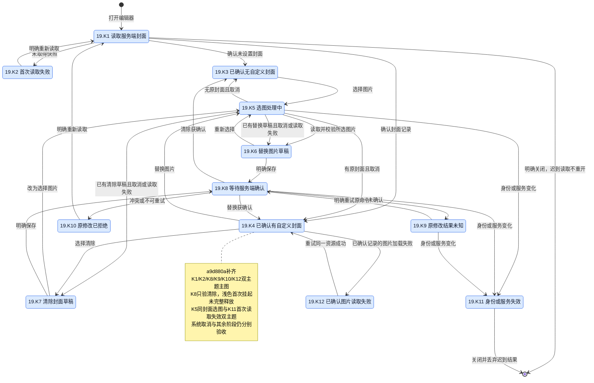

| 状态 ID | 最小必要信息与操作边界                                                                          | 浅色                                                           | 深色                                                       |
| ------- | ----------------------------------------------------------------------------------------------- | -------------------------------------------------------------- | ---------------------------------------------------------- |
| 19.K1   | 正在读取服务端封面、进度、编辑禁用、允许关闭；未取得快照时不显示已确认                          | `karuyomi-a9d880a-cover-k1-light.jpg`                          | `karuyomi-a9d880a-cover-k1-dark.jpg`                       |
| 19.K2   | 未取得服务端快照、读取失败原因、明确重读与关闭；不显示永不结束的加载文字                        | `karuyomi-a9d880a-cover-k2-light.jpg`                          | `karuyomi-a9d880a-cover-k2-dark.jpg`                       |
| 19.K3   | 已确认未设置自定义封面、选择图片和关闭；不把占位图当作已保存图片                                | `karuyomi-0e605c5-editors-cover-none-light.jpg`                | `karuyomi-0e605c5-editors-cover-none-dark.jpg`             |
| 19.K4   | 已确认的当前封面、替换和清除入口；清除用系统危险色，最终提交须由保存触发                        | `karuyomi-0e605c5-editors-cover-confirmed-light.jpg`           | `karuyomi-0e605c5-editors-cover-confirmed-dark.jpg`        |
| 19.K5   | 原已确认封面、选图处理中、编辑禁用；取消保持原值，非法/读取失败保留可修正原因，身份变化另转失效 | `karuyomi-1d29865-cover-picking-confirmed-light-fixed.jpg`     | `karuyomi-1d29865-cover-picking-system-dark.jpg`           |
| 19.K6   | 已确认封面与待保存图片分区、仅当前会话保留、明确保存或关闭；选图本身零上传                      | `karuyomi-c5f6759-cover-{draft,replace-draft}-light.jpg`       | `karuyomi-c5f6759-cover-{draft,replace-draft}-dark.jpg`    |
| 19.K7   | 当前封面、待清除提示、明确保存或关闭；清除草稿不先修改远端                                      | `karuyomi-d0d963c-cover-draft-light.jpg`                       | `karuyomi-d0d963c-cover-draft-dark.jpg`                    |
| 19.K8   | 原确认值、正在提交的原修改、等待确认、动作禁用；不能提前显示已保存，替换/清除分别验             | `karuyomi-d0d963c-cover-waiting-light.jpg`，清除               | `karuyomi-d0d963c-cover-waiting-dark.jpg`，清除            |
| 19.K9   | 尚未确认及原草稿、精确重试、稍后处理；重开/重取失败时仍保留原命令，不能换图覆盖                 | `karuyomi-a9d880a-cover-k9-light.jpg`                          | `karuyomi-a9d880a-cover-k9-dark.jpg`                       |
| 19.K10  | 冲突或拒绝原因、原确认值、明确重读；禁用提交与重试，重取失败仍保留错误及原确认快照              | `karuyomi-3a57cdf-migration-cover-rejected-light.jpg`          | `karuyomi-3a57cdf-migration-cover-rejected-dark.jpg`       |
| 19.K11  | 编辑已停用及关闭入口、旧操作结果不再应用；加载/选图/保存/待确认阶段分别触发并丢弃迟到结果       | `karuyomi-138ccbd-cover-expired-confirmed-light.jpg`，首次读取 | `karuyomi-b29c3bb-cover-expired-system-dark.jpg`，首次读取 |
| 19.K12  | 已确认封面记录保持、图片未能读取、重试同一资源；字节失败不得触发上传或清除记录                  | `karuyomi-a9d880a-cover-k12-light.jpg`                         | `karuyomi-a9d880a-cover-k12-dark.jpg`                      |

19.K1/K2与已确认快照、替换/清除草稿、等待确认的最小信息按当前业务边界验收。关闭未提交草稿不承诺跨会话恢复；19.K9的原请求由当前业务会话保留，重开和读取失败作为该节点变体单列。图中失效箭头仅列主要异步入口，已确认/草稿/拒绝状态同样必须验证身份变化，不能用一条箭头替代全部触发阶段。未填主图的节点仍为目标清单，不是通过证据。

K5非法图片变体为`karuyomi-c5f6759-cover-invalid-{light,dark}.jpg`，等待和手动系统取消仍待。正常转换已实测两主题的首次选图→草稿→确认、替换→草稿→确认、清除草稿→关闭→重开旧封面及再次清除→确认无封面；六次提交分别仅推进一次账户/作品revision，草稿、取消及重开零附写。最终accountRevision9、作品revision7，浅色另在新文档读回无封面。浅色清除的首张缺标题/底部动作帧保留为`cover-cleared-light-incomplete.jpg`且排除主图，后续新文档图完整；不把重拍计作全部转场通过。详细输入、边界与独立API见[本轮分项](mihon-cupertino-fidelity.md#封面与选择语义的正式-web-分项)。

`0e605c5`更新K3/K4/K7双主题主图，短表单从顶部导航下方开始排列；浅色另复验选图草稿与取消清除，深色复用已保存图片后明确清除。16组六路快照确认三次UI应用及其它区间零附写；此轮未提供请求审计。K5只补浅色处理中，深色仍待，不增加成对计数；K6及其它历史变体保留原版本，全部故障和当前版深色选图未外推通过，见[导航起点修复](mihon-cupertino-fidelity.md#短编辑内容的导航起点修复)。

`a9d880a`正式Web新增K1/K2/K8/K9/K10/K12六对主图，三张`a9d880a-cover-{reading,save,errors}-pairs.jpg`已实看；深色K1首次转场图另存并排除。两主题均实际关闭读取中的窗口，释放迟到结果后未重开；读取失败后明确重读，结果未知下关闭/重开及再次读取失败仍可精确重试。真实409与冲突后读取失败另存`cover-{conflict,conflict-read-failed}-{light,dark}.jpg`；图片503后重试同一资源恢复，权威记录不变。32组六路API快照与154条审计核对四次UI清除各应用一次、两次丢确认精确重试、两次真实409及两次明确400；API预置不计UI选图。浅色首次等待有主图，但审计sequence20未完成，不计正常释放成功；其原正文重试未重复应用，深色挂起正常释放。该版本明确拒绝状态的辅助说明仍提到重试，保留为原缺口；`3a57cdf`已修复并取得双主题拒绝说明主图，明确引导重新读取，API快照确认清除拒绝零覆盖。全部变体与K11继续待，详见[正式故障复验](mihon-cupertino-fidelity.md#封面故障状态的正式-web-复验)。

### 20–21：Karuyomi 迁移向导的目标状态

以下依据MigrationPage、MigrationController与MigrationRepository的正式分支整理，区分只读输入、草稿和写入确认。2026-11-16实现改用官方Cupertino表单、次级说明与系统错误色，修复首次输入加载误报“没有其他可用源”。浅/深×1x/2x组件流程已验证读取失败/重读、预览、提交阻塞/丢确认、只读诊断、重开只读等待和精确重试；组件证据不填入主图格。原请求的ID、版本与内部键移入诊断，主流程优先显示原/目标作品、源名称、所选范围及实际可用操作，检查范围见[验证记录](mihon-cupertino-fidelity.md#迁移向导的-cupertino-状态呈现)。`9228c11`双主题正式Web已复验候选行宽、源语言和独立预览语义，补齐分页与章节选择变体；`86d27e7`补齐深色范围、仅分类及搜索空态，实际坐标点击验证浅/深章节选择与确认取消后原位置、焦点和零写入。蓝色仅代表正常主图已核对，全部转换与输入方式仍分别验；语义定位动作后的位置变化及工具影响可能性单列保留，见[返回行为复验](mihon-cupertino-fidelity.md#迁移返回焦点与位置的正式-web-复验)。

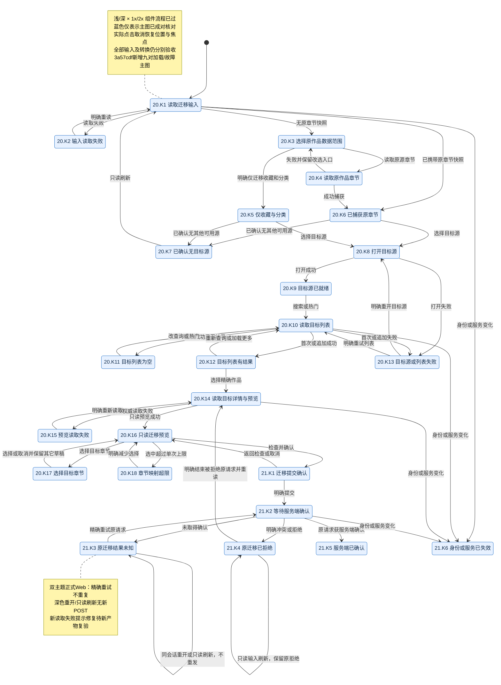

| 状态ID | 目标画面的最小必要信息及分别验收的变体                                                                                         | 浅色                                                                                                     | 深色                                                                                                   |
| ------ | ------------------------------------------------------------------------------------------------------------------------------ | -------------------------------------------------------------------------------------------------------- | ------------------------------------------------------------------------------------------------------ |
| 20.K1  | 原作品/源、读取输入进度、写入禁用；读取成功前不宣称无目标源                                                                    | `karuyomi-3a57cdf-migration-k1-light.jpg`                                                                | `karuyomi-3a57cdf-migration-k1-dark.jpg`                                                               |
| 20.K2  | 原作品、读取失败与明确重读/返回；无目标源和读取失败不混淆                                                                      | `karuyomi-3a57cdf-migration-k2-light.jpg`                                                                | `karuyomi-3a57cdf-migration-k2-dark.jpg`                                                               |
| 20.K3  | 原作品、未读取章节、读取章节或仅收藏/分类两种选择及影响                                                                        | `karuyomi-9228c11-migration-scope-light.jpg`                                                             | `karuyomi-86d27e7-migration-scope-dark.jpg`                                                            |
| 20.K4  | 原作品/源、正在读取章节、编辑禁用；失败仍可重读或明确改为仅收藏/分类                                                           | `karuyomi-3a57cdf-migration-k4-light.jpg`                                                                | `karuyomi-3a57cdf-migration-k4-dark.jpg`                                                               |
| 20.K5  | 已选择仅收藏/分类、章节与位置不复制、可选目标源                                                                                | `karuyomi-9228c11-migration-categories-only-light.jpg`                                                   | `karuyomi-86d27e7-migration-categories-only-dark.jpg`                                                  |
| 20.K6  | 已捕获章节数、快照随目标切换保留、可选目标源                                                                                   | `karuyomi-9228c11-migration-original-snapshot-light.jpg`                                                 | `karuyomi-9228c11-migration-original-snapshot-dark.jpg`                                                |
| 20.K7  | 已确认无其他已安装且启用的源、扩展管理指引、只读刷新和返回                                                                     | `karuyomi-3a57cdf-migration-k7-light.jpg`                                                                | `karuyomi-3a57cdf-migration-k7-dark.jpg`                                                               |
| 20.K8  | 正在打开的精确目标源、原作品上下文、操作禁用；失败不得误标已切换                                                               | `karuyomi-92d4f93-migration-open-target-opening-light.jpg`                                               | `karuyomi-92d4f93-migration-open-target-opening-dark.jpg`                                              |
| 20.K9  | 当前目标源、查询、搜索/热门动作及原作品；尚未请求不显示无结果                                                                  | `karuyomi-9228c11-migration-search-ready-light.jpg`                                                      | `karuyomi-9228c11-migration-search-ready-dark.jpg`                                                     |
| 20.K10 | 当前目标源、查询或热门、首次/追加进度；追加时保留已有结果                                                                      | `karuyomi-ef5f3dd-selection-migration-popular-loading-candidate-light.jpg`                               | `karuyomi-ef5f3dd-selection-migration-popular-loading-candidate-dark.jpg`                              |
| 20.K11 | 当前源和查询或热门、成功为空、修改查询或改浏览热门；两种空态分别验                                                             | `karuyomi-86d27e7-migration-search-empty-light.jpg`，仅搜索                                              | `karuyomi-86d27e7-migration-search-empty-dark.jpg`，仅搜索                                             |
| 20.K12 | 精确目标作品名称、源/URL区分、打开与有界分页；不因同名打开其它条目                                                             | `karuyomi-9228c11-migration-target-list-light.jpg`                                                       | `karuyomi-9228c11-migration-target-list-dark.jpg`                                                      |
| 20.K13 | 失败源/操作、可恢复原因、重试；开源失败保留原选择，追加失败保留结果和分页上下文，分别验                                        | `karuyomi-517a73e-migration-{open,page}-failure-light.jpg`                                               | `karuyomi-517a73e-migration-{open,page}-failure-dark.jpg`                                              |
| 20.K14 | 精确目标作品/源、读取详情/章节或权威预览的实际进度；取得预览前不能提交                                                         | `karuyomi-3a57cdf-migration-k14-light.jpg`                                                               | `karuyomi-3a57cdf-migration-k14-dark.jpg`                                                              |
| 20.K15 | 失败的目标和阶段、明确重读、零迁移提交；初次失败/重取失败分别验                                                                | `karuyomi-3a57cdf-migration-{k15,k15-actions,k15-reread-failed}-light.jpg`                               | `karuyomi-3a57cdf-migration-{k15,k15-actions,k15-reread-failed}-dark.jpg`                              |
| 20.K16 | 原/目标、原作品保留、目标已有数据保留、分类与章节复制选项、已选/上限及未复制标记数；仅分类、无标记、已占用目标和映射分页分别验 | `karuyomi-86d27e7-migration-{preview-summary,native-return,confirm-return}-light.jpg`                    | `karuyomi-86d27e7-migration-{preview-summary,native-return,confirm-return}-dark.jpg`                   |
| 20.K17 | 原章节、当前目标、完整名称/来源序号、占用禁用、查询/无匹配/清空与取消；取消保持原映射、其它选择及位置                          | `karuyomi-9228c11-migration-{chapter-choice,chapter-no-match}-light.jpg`；`86d27e7`实际返回              | `karuyomi-86d27e7-migration-{chapter-choice,chapter-no-match,native-return}-dark.jpg`                  |
| 20.K18 | 当前已选与上限、系统错误色、明确减少选择、确认禁用；不自动分批或部分提交                                                       | `karuyomi-78f4c4b-migration-limit-count-light.jpg`、`karuyomi-78f4c4b-migration-limit-confirm-light.jpg` | `karuyomi-78f4c4b-migration-limit-count-dark.jpg`、`karuyomi-78f4c4b-migration-limit-confirm-dark.jpg` |
| 21.K1  | 原/目标名称和源、所选复制影响、保留原作品/目标已有状态、返回检查和明确确认；弹窗/取消零写入                                    | `karuyomi-86d27e7-migration-{confirm,confirm-return}-light.jpg`                                          | `karuyomi-86d27e7-migration-{confirm,confirm-return}-dark.jpg`                                         |
| 21.K2  | 原请求的目标与复制范围、等待确认、编辑与重复提交禁用；未确认前不显示完成                                                       | `karuyomi-3a57cdf-migration-sending-light.jpg`                                                           | `karuyomi-3a57cdf-migration-sending-dark.jpg`                                                          |
| 21.K3  | 尚未确认、原目标和范围、精确重试及返回；同会话重开/只读刷新不重发，不允许改目标或映射覆盖原请求                                | `karuyomi-3a57cdf-migration-unknown-light.jpg`                                                           | `karuyomi-3a57cdf-migration-unknown-dark.jpg`                                                          |
| 21.K4  | 原目标、冲突或拒绝原因、提交/精确重试禁用、明确结束被拒绝原请求并重新预览；重读失败另验                                        | `karuyomi-3a57cdf-migration-{rejected,conflict}-light.jpg`                                               | `karuyomi-3a57cdf-migration-{rejected,conflict}-dark.jpg`                                              |
| 21.K5  | 明确服务端确认、确认的目标、实际新增已读/书签数、原作品保留及返回；新请求/原请求重试成功分别验                                 | `karuyomi-9228c11-migration-completed-light.jpg`，正常请求                                               | `karuyomi-9228c11-migration-completed-dark.jpg`，正常请求                                              |
| 21.K6  | 身份或服务已变化、旧向导永久停用及返回；各读取/预览/提交/待确认阶段分别触发并丢弃迟到结果                                      | `karuyomi-138ccbd-migration-expired-confirmed-light-stable.jpg`，预览重读                                | `karuyomi-b29c3bb-migration-preview-expired-system-dark.jpg`，预览重读                                 |

图中仅列主要失效入口，范围草稿、已加载列表、映射、拒绝及完成后同样检查身份变化；不能用一条箭头替代全部触发阶段。20.K13 的打开失败与热门追加已双主题复验；20.K14 的其余阶段、仅分类预览、21.K3/K4 的重开和重读失败须分别取图。预览、筛选、映射、分页与取消均为只读；只有21.K1明确确认和21.K3明确原请求重试可触发写入。`8c398d3`的新增标记和保留已有标记证据继续保留；`9228c11`两主题均为英文3,323章→中文的无标记流程，明确提交均新增0/0且各推进一次版本，九路完整快照确认查询/分页/取消零附写。章节选择已核对当前项`aria-current=true`、占用项禁用、无匹配及清空；`86d27e7`实际点击取消后映射、页码、位置保持且焦点恢复，跨独立API后的延迟只读观测同样保持，四个九路快照比较确认零写入。`86d27e7`返回复验未提交迁移，未新增完成写入次数。语义定位动作后的滚动观察和旧问题图保留，不将实际点击结果外推全部输入与转换，详见[返回行为复验](mihon-cupertino-fidelity.md#迁移返回焦点与位置的正式-web-复验)。

`3a57cdf`新增20.K1/K2/K4/K7/K14/K15和21.K2/K3/K4九对双主题主图；19.K10改用修正拒绝说明后的当前正式图。33组九路快照与256条审计核对三条原迁移各应用一次、两次原正文精确重试无重复、两次真实409与四次迁移/封面400零覆盖。浅色挂起sequence49未完整释放，深色sequence149正常释放；深色502后重开和只读失败无新POST，精确重试只应用一次。21.K3/K4的读取失败提示存在实际缺口，已在组件先复现并修正，但新产物Web仍待；原问题图不记该变体最终通过。K8/K10没有截到加载指示，保持待验；最终有效快照之后夹具达到256条上限，额外封面读取失败排除。详情、原始图与五张联系表见[迁移故障正式Web复验](mihon-cupertino-fidelity.md#迁移加载与故障的正式-web-复验)。

`25be6f5`正式Web另补21.K3/K5的待确认、书架重开及精确重试后阶段页脚双主题分项，前缀为`karuyomi-25be6f5-object-migration-{pending-footer,reopened-pending-footer,confirmed-footer}-{light,dark}.jpg`。两个仅分类原命令各应用一次、原文重试不重复；不替代上述正常新请求及其它复制范围证据。21组九路快照与107条完成审计已核对，四次独立准备单列，详见[正式双主题复验](mihon-cupertino-fidelity.md#分类对象与迁移页脚的正式-web-双主题复验)。20.K8候选有转场，20.K10候选虽有真实热门旋转却缺准确操作说明，均不填主图；准确说明已通过组件修复，正式Web仍待。书架独立勾选框名称缺失同样记录后修复，不以相邻卡片名称代替控件身份。

`92d4f93` 双主题补齐 20.K8。等待时显示 Komiic、语言和原作品 xkcd，原作品操作与目标选择禁用。整包偏好读取失败保留未选目标，明确重试成功才出现查找目标作品。目标源列表请求与迁移写入保持各自独立验收。[正式双主题验收](mihon-cupertino-fidelity.md#迁移打开目标源的正式-web-双主题验收)

### 24：Karuyomi 本漫画阅读设置的目标状态

以下依据共用SettingsEditor、SettingsController及SettingsRepository的正式分支。读取和提交使用不同activity；`busy`由activity推导，不增加独立、可能分歧的忙碌标志。标题限定本漫画，覆盖字段的空值表示继承，显式AUTO/0仍为真实覆盖值。继承说明采用官方Cupertino分组页脚，读取阶段不误报需要先确认身份，提交阶段不再显示尚未提交草稿。此图跟踪漫画编辑面；全局设置与阅读工具中的共享提示须分别取得画面，不以组件或本漫画主图代替。

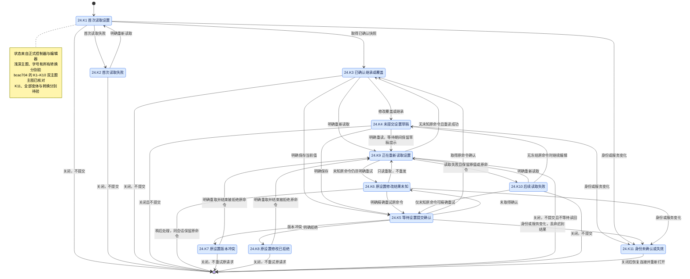

| 状态 ID | 最小必要信息与操作边界                                                       | 浅色正式Web                                                             | 深色正式Web                                                                |
| ------- | ---------------------------------------------------------------------------- | ----------------------------------------------------------------------- | -------------------------------------------------------------------------- |
| 24.K1   | 本漫画范围、明确读取进度、无已确认提示、编辑与保存不可用、关闭               | `karuyomi-bcac704-settings-k1-light.jpg`                                | `karuyomi-bcac704-settings-k1-dark.jpg`                                    |
| 24.K2   | 本漫画范围、读取失败、明确重新读取与关闭；无连接误报或假确认                 | `karuyomi-bcac704-settings-k2-light.jpg`                                | `karuyomi-bcac704-settings-k2-dark.jpg`                                    |
| 24.K3   | 本漫画范围、各字段继承/显式值、已确认状态、修改与重读                        | `karuyomi-d0d963c-reader-settings-confirmed-light.jpg`                  | `karuyomi-d0d963c-reader-settings-confirmed-dark.jpg`                      |
| 24.K4   | 原字段与当前草稿、尚未保存、明确保存和关闭；关闭零写入                       | `karuyomi-d0d963c-reader-settings-draft-light.jpg`                      | `karuyomi-d0d963c-reader-settings-draft-dark.jpg`                          |
| 24.K5   | 本漫画范围、正在提交的设置、等待服务端确认、编辑/重复保存/关闭禁用           | `karuyomi-d0d963c-reader-settings-waiting-light.jpg`                    | `karuyomi-d0d963c-reader-settings-waiting-dark.jpg`                        |
| 24.K6   | 原提交值、结果未确认、同一命令重试、只读重取；不能改值或误报成功             | `karuyomi-d0d963c-reader-settings-unknown-light.jpg`                    | `karuyomi-d0d963c-reader-settings-unknown-dark.jpg`                        |
| 24.K7   | 原草稿、具体版本冲突、重读入口、禁止重试新版本；重读成功前冻结               | `karuyomi-d0d963c-reader-settings-conflict-light.jpg`                   | `karuyomi-d0d963c-reader-settings-conflict-dark.jpg`                       |
| 24.K8   | 原草稿、明确拒绝、重读入口、原命令不可重试；与未知结果分开                   | `karuyomi-bcac704-settings-k8-light.jpg`                                | `karuyomi-bcac704-settings-k8-dark.jpg`                                    |
| 24.K9   | 明确读取进度、保留的原值/草稿/未知原命令、禁用重复动作、允许关闭；只读零提交 | `karuyomi-bcac704-settings-k9-light.jpg`                                | `karuyomi-bcac704-settings-k9-dark.jpg`                                    |
| 24.K10  | 读取错误与原值、原未知命令仍保留、对应重读/精确重试/关闭；失败不撤回确认     | `karuyomi-bcac704-settings-k10-light.jpg`                               | `karuyomi-bcac704-settings-k10-dark.jpg`                                   |
| 24.K11  | 连接与身份确认要求、隐藏旧字段和旧确认、禁止旧动作、明确关闭                 | `karuyomi-138ccbd-manga-settings-expired-confirmed-light.jpg`，只读重取 | `karuyomi-b29c3bb-manga-settings-reread-expired-system-dark.jpg`，只读重取 |

各确认/草稿/故障状态的身份变化均须分别验收，图中只列主要异步入口。初次无身份与旧身份失效是K11的不同触发变体；所有字段类型、键盘和减少动态仍分别跟踪。表中已有的是指定版本的主状态截图，不能外推全部变体或转换，留空处不能用控制器或组件证据填入。

`bcac704`的K1–K10主图及三张联系表已逐图实看；浅色K3初始为全继承，深色K3为浅色流程已经确认的覆盖值，不冒充同数据的像素叠图。两主题分别执行首次读取关闭、草稿关闭、保存等待、丢确认、失败重读、挂起重读关闭、重开精确重试、真实409恢复及明确拒绝。81条审计无超时或未完成门，18组七路快照确认两次精确重试不重复应用、草稿关闭零写入、冲突/拒绝零覆盖。K11的旧图仍以`settings-k11-{light,dark}.jpg`收存：浅色缺完整导航，深色失效后按当前实现回到系统浅色；不填本表主图。源收藏等待、全局保存等待和阅读工具提示仅取得实际执行的分项，完整共享状态及其余8处编辑面仍待，详见[分项复验](mihon-cupertino-fidelity.md#顶部导航正式-web-的设置状态复验)。

`42bc9bb`已执行浅色正式Web故障流程与七路独立D1审计，保留等待、未知、重读、冲突、拒绝及身份失效图；首次读取过渡帧、hold-read超时和草稿旧字段帧均单列，见[分项证据](mihon-cupertino-fidelity.md#正式-web-浅色故障流程与关闭反馈修复)。实拍暴露读取关闭与长表单反馈缺口，浅/深×1x/2x八项组件流程修复后通过，54项相关回归通过；这些历史证据当时未填主图，现仅以上述`bcac704`稳定画面填写K1–K10。

### 26：Karuyomi 最终 Cupertino 设置导航

以下沿用26组参考结构，同时保留Karuyomi的服务端确认语义；这是最终目标画面清单，不能用第一阶段旧配色截图填入。代码/组件验证与正式Web实拍分别记录。蓝色仅代表`729cbe3`的双主题主图已核对，全部变体与转换仍待。

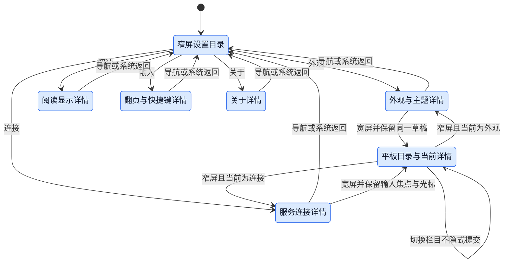

| 目标主画面/必要信息                                         | 浅色正式Web                                             | 深色正式Web                                            |
| ----------------------------------------------------------- | ------------------------------------------------------- | ------------------------------------------------------ |
| 窄屏目录：五个栏目、图标/标题/短说明、chevron               | `karuyomi-729cbe3-settings-directory-light.jpg`         | `karuyomi-729cbe3-settings-directory-dark.jpg`         |
| 外观：当前已确认值、保存/重新读取                           | `karuyomi-729cbe3-settings-appearance-light.jpg`        | `karuyomi-729cbe3-settings-appearance-dark.jpg`        |
| 阅读显示：模式/页组/适配/裁白/背景/调暗、辅助说明与确认状态 | `karuyomi-729cbe3-settings-reading-light.jpg`           | `karuyomi-729cbe3-settings-reading-dark.jpg`           |
| 输入：点击区与快捷键当前值、辅助说明与确认状态              | `karuyomi-729cbe3-settings-input-light.jpg`             | `karuyomi-729cbe3-settings-input-dark.jpg`             |
| 服务连接：地址、连接/登录与当前身份；Web同源只读            | `karuyomi-729cbe3-settings-connection-light.jpg`        | `karuyomi-729cbe3-settings-connection-dark.jpg`        |
| 关于：名称、版本与简述、返回                                | `karuyomi-729cbe3-settings-about-light.jpg`             | `karuyomi-729cbe3-settings-about-dark.jpg`             |
| 平板双栏：当前项、完整目录和对应连接详情                    | `karuyomi-729cbe3-settings-connection-tablet-light.jpg` | `karuyomi-729cbe3-settings-connection-tablet-dark.jpg` |

同一正式CI产物、官方隔离harness和临时D1，无fixture/Source。上述JPEG及联系表已实看，缺文字/底栏的早期帧已排除，原因未定，不能把重拍当作全部转场验收。两主题平板五项各有唯一可访问节点；聚焦只读地址后离页的DOM输入/提交均为0，独立API确认两次主题保存后revision为2、主题DARK。未保存/待确认、保存失败/精确重试、身份/Access恢复、字号/减少动态和全部导航转换的最终Web画面仍待；跨尺寸草稿/光标/焦点以及原生可编辑服务地址保留组件证据，不计为本次浏览器通过。证据范围见[验证记录](mihon-cupertino-fidelity.md#最终-cupertino-配色导航与设置路由)。

### 07/10/11：Karuyomi 最终 Cupertino 源目录、仓库与本机存储

`76309ed`正式Web已核对下表标蓝节点的双主题主图、菜单初始焦点和官方说明层级。仓库预览/确认使用明确标记的合成空目录；新增仓库的移除名称与多个副本清理名称仍有语义缺口，列表及移除确认留待修复后复验。深色存储收起后缺顶部的原帧排除，稳定主图另存，原因未定。以下分别跟踪真实客户端状态，源收藏使用账户确认，仓库需要只读预览和第二次明确确认，清理只删除本机可丢弃副本。组件双主题/双倍字号及键盘用例不能填入正式Web截图；加载与确认等待的瞬态未截到时继续留空。原Mihon参考节点和全部变体门槛保持不变。

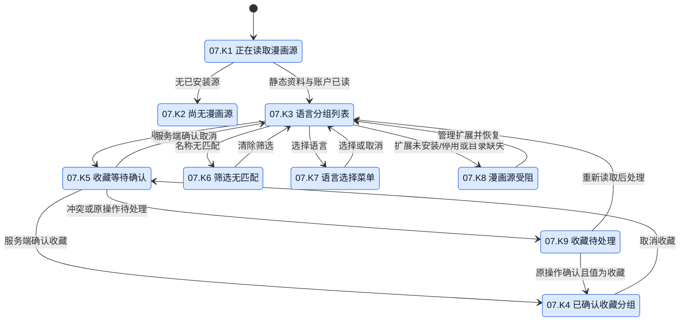

| 状态 ID | 最小必要信息                                  | 浅色正式Web                                                           | 深色正式Web                                                          |
| ------- | --------------------------------------------- | --------------------------------------------------------------------- | -------------------------------------------------------------------- |
| 07.K1   | 正在读取、原筛选与可用恢复入口                | `karuyomi-1bc3c70-source-pending-formal-sources-reading-light.jpg`    | `karuyomi-1bc3c70-source-pending-formal-sources-reading-dark.jpg`    |
| 07.K2   | 无已安装源、原因与扩展入口                    | `karuyomi-1e50a82-sources-empty-light.jpg`                            | `karuyomi-1e50a82-sources-empty-dark.jpg`                            |
| 07.K3   | 分组、源名、语言、独立打开与收藏动作          | `karuyomi-76309ed-sources-list-light.jpg`                             | `karuyomi-76309ed-sources-list-dark.jpg`                             |
| 07.K4   | 收藏分组、确认后的星标与取消入口              | `karuyomi-76309ed-sources-favorite-light.jpg`                         | `karuyomi-76309ed-sources-favorite-dark.jpg`                         |
| 07.K5   | 正在保存的源、等待标记、禁止重复提交          | `karuyomi-1bc3c70-source-pending-formal-favorite-waiting-light.jpg`   | `karuyomi-1bc3c70-source-pending-formal-favorite-waiting-dark.jpg`   |
| 07.K6   | 当前筛选、无匹配说明与清除入口                | `karuyomi-76309ed-sources-no-match-light.jpg`                         | `karuyomi-76309ed-sources-no-match-dark.jpg`                         |
| 07.K7   | 全部可用语言、当前值与取消操作                | `karuyomi-76309ed-sources-languages-light.jpg`                        | `karuyomi-76309ed-sources-languages-dark.jpg`                        |
| 07.K8   | 源身份、受阻原因、管理或恢复入口              | `karuyomi-2512c51-extension-recovery-formal-blocked-source-light.jpg` | `karuyomi-2512c51-extension-recovery-formal-blocked-source-dark.jpg` |
| 07.K9   | 原收藏操作、冲突或未知说明、精确重试/重新读取 | `karuyomi-1bc3c70-source-pending-formal-favorite-unknown-light.jpg`   | `karuyomi-1bc3c70-source-pending-formal-favorite-unknown-dark.jpg`   |

`fe57f2c`正式Web完成浅色读取、等待与未知恢复，但展开/收起原值并重试后，深色重开源目录因页面存储类型冲突而未能渲染。该提交`source-pending-formal`系列中的两张深色空内容图（包括名为`sources-reading-dark`的进入图）均为失败证据，不能作为读取主图，也未追溯填入下表，详见[记录](mihon-cupertino-fidelity.md#展开状态与滚动位置的存储隔离)。

`1bc3c70`新正式产物的双主题独立批次已补齐07.K1/K5/K9三对。真实加载/等待文案、原取消对象、刷新/重开、完整原值展开/收起与原文重试均核对；此前失败的深色重开及确认清除后的再次重开成功，控制台无错误/警告。16组六路快照、十个相等区间及73条终态审计核对两次准备、五次UI原操作（含一次主题保存）与两次零重复重试。07.K8、真实CAS/身份等变体、Mihon参考和最终像素门继续待验，见[正式双主题记录](mihon-cupertino-fidelity.md#源收藏与存储隔离的正式-web-双主题验收)。

`2512c51`完整CI与正式Web已补齐07.K8双主题：保留收藏的xkcd未安装时显示原源名、语言与受阻原因，实际点击转到扩展管理，不执行Source。与扩展共享的原卸载/安装对象及已确认读取恢复也已跨页复验；41张图、22组六路完整快照及113条审计的范围与首条人工挂起无终态限制见[正式记录](mihon-cupertino-fidelity.md#扩展与共享设置恢复的正式-web-双主题验收)。真实CAS/身份等全部变体、Mihon参考和最终像素门继续待验。

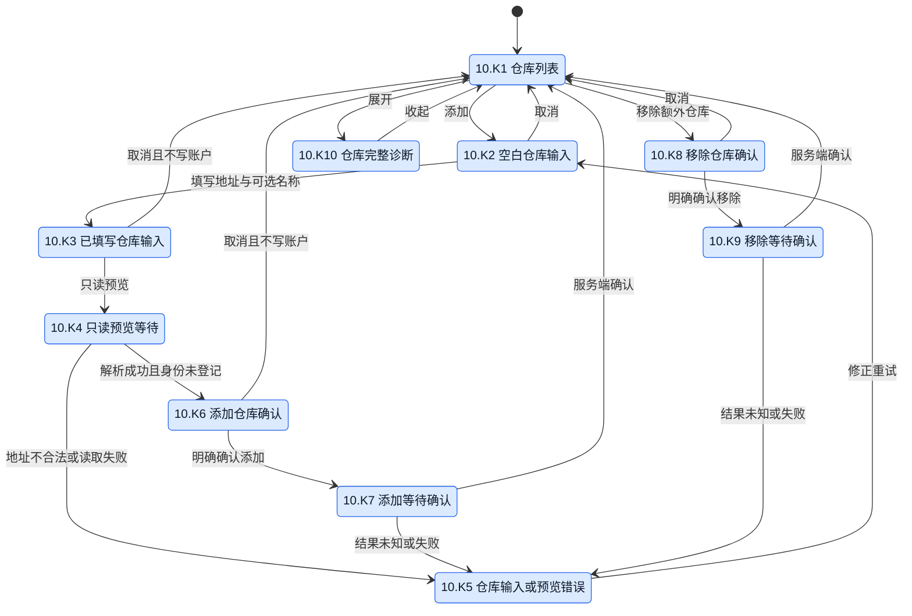

| 状态 ID | 最小必要信息                                                         | 浅色正式Web                                                                                        | 深色正式Web                                                                                      |
| ------- | -------------------------------------------------------------------- | -------------------------------------------------------------------------------------------------- | ------------------------------------------------------------------------------------------------ |
| 10.K1   | 仓库名、地址/状态、默认标记、独立移除、添加/刷新与诊断入口           | `karuyomi-4467ceb-repositories-added-light.jpg`、`karuyomi-4467ceb-repositories-removed-light.jpg` | `karuyomi-4467ceb-repositories-added-dark.jpg`、`karuyomi-4467ceb-repositories-removed-dark.jpg` |
| 10.K2   | 地址、可选名称、预览与取消                                           | `karuyomi-4467ceb-repositories-input-empty-light.jpg`                                              | `karuyomi-4467ceb-repositories-input-empty-dark.jpg`                                             |
| 10.K3   | 已填写地址/名称、预览与取消、键盘                                    | `karuyomi-4467ceb-repositories-input-filled-light.jpg`                                             | `karuyomi-4467ceb-repositories-input-filled-dark.jpg`                                            |
| 10.K4   | 正在预览、列表上下文、编辑禁用且尚未写账户                           | `karuyomi-270db05-repository-phases-formal-repository-preview-active-light.jpg`                    | `karuyomi-270db05-repository-phases-formal-repository-preview-active-dark.jpg`                   |
| 10.K5   | 具体错误、修改/重试入口和已登记列表                                  | `karuyomi-76309ed-repositories-invalid-light.jpg`                                                  | `karuyomi-76309ed-repositories-invalid-dark.jpg`                                                 |
| 10.K6   | 解析后的名称/域名/扩展数、明确添加与取消、真实Tab与键盘确认          | `karuyomi-4467ceb-repositories-add-confirm-light.jpg`                                              | `karuyomi-4467ceb-repositories-add-confirm-dark.jpg`                                             |
| 10.K7   | 原提交对象、等待服务端、禁止新操作                                   | `karuyomi-270db05-repository-phases-formal-repository-saving-light.jpg`                            | `karuyomi-270db05-repository-phases-formal-repository-saving-dark.jpg`                           |
| 10.K8   | 待移除对象、影响为空时明确“无”、危险确认与取消、真实Tab/Return/Space | `karuyomi-4467ceb-repositories-remove-confirm-light.jpg`                                           | `karuyomi-4467ceb-repositories-remove-confirm-dark.jpg`                                          |
| 10.K9   | 待移除对象、未确认状态和恢复入口                                     | `karuyomi-270db05-repository-phases-formal-repository-remove-unknown-light.jpg`                    | `karuyomi-270db05-repository-phases-formal-repository-remove-unknown-dark.jpg`                   |
| 10.K10  | 仓库完整URL/身份与读取错误、滚动和收起                               | `karuyomi-76309ed-repositories-diagnostics-light.jpg`                                              | `karuyomi-76309ed-repositories-diagnostics-dark.jpg`                                             |

`4467ceb`已实际完成两主题输入→预览→取消/确认添加→列表→取消/确认移除→列表的键盘转换，独立API确认取消不写入，五次明确写入至revision5。该批次未取得预览/保存瞬态及错误恢复主图，其它变体与整组验收也未完成；旧版`1e50a82`浅色确认点击未提交与诊断缺帧继续保留在验证记录。

`270db05`正式CI Web与官方Wrangler隔离夹具随后补齐10.K4/K7/K9双主题主图：预览保留完整对象且取消零写入，提交前后分别显示等待确认和目录读取；移除丢确认后的刷新、书架往返及精确重试保留原名称/地址。有效ACK后读取失败只恢复读取，中性原值标题、完整内容末端和确认清除后再次重开均已实看。23组六路完整快照、13个相等区间和114条终态审计核对九次UI原操作、两次零重复重试；40张图包含转场、校验失败及错过时刻的排除项，不当作40个状态。跨版本双主题主图126→129/169（76.3%），详情见[正式双主题验收](mihon-cupertino-fidelity.md#仓库预览与操作恢复的正式-web-双主题验收)。全部变体、真实CAS/身份、禁用辅助语义、Mihon参考和最终像素门仍待。

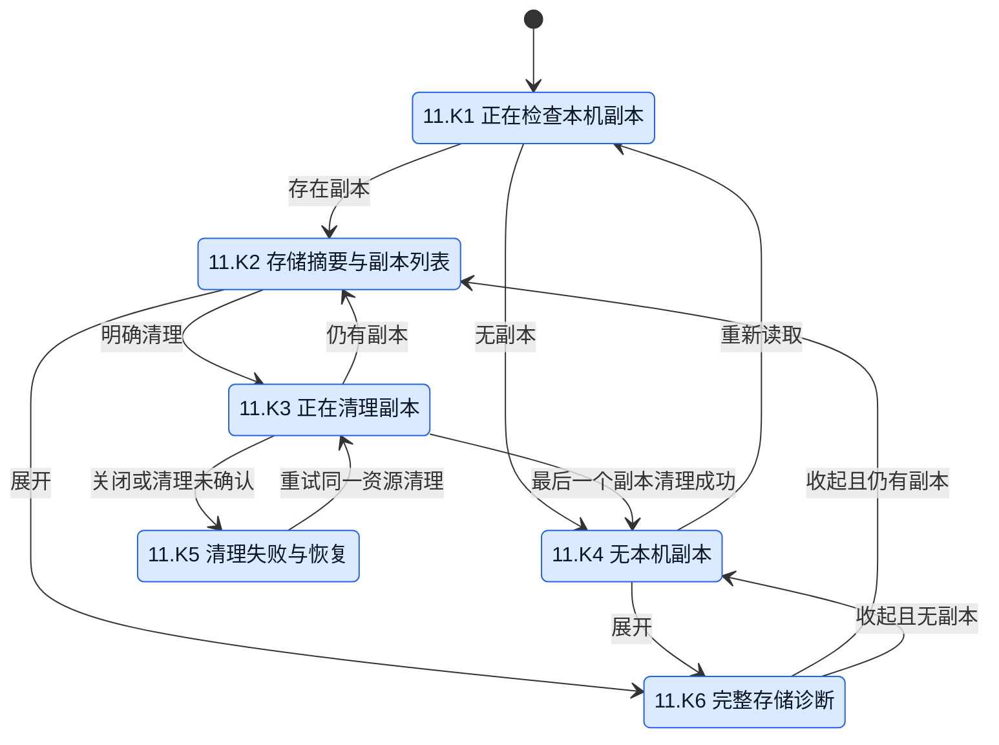

| 状态 ID | 最小必要信息                                               | 浅色正式Web                                              | 深色正式Web                                             |
| ------- | ---------------------------------------------------------- | -------------------------------------------------------- | ------------------------------------------------------- |
| 11.K1   | 正在检查、读取指示及账户/缓存作用范围                      | `karuyomi-a8997fa-extension-flow-storage-checking-light` | `karuyomi-a8997fa-extension-flow-storage-checking-dark` |
| 11.K2   | 数量/总占用、每副本名称/大小、含对象名的独立清理与作用范围 | `karuyomi-1e50a82-storage-copies-light.jpg`              | `karuyomi-1e50a82-storage-copies-dark.jpg`              |
| 11.K3   | 正在清理、重复操作受阻、账户安装保持                       | `karuyomi-ad41606-cache-removing-light.jpg`              | `karuyomi-ad41606-cache-removing-dark.jpg`              |
| 11.K4   | 零副本/占用、可重新下载与重新读取入口                      | `karuyomi-1e50a82-storage-empty-light.jpg`               | `karuyomi-1e50a82-storage-empty-dark.jpg`               |
| 11.K5   | 失败原因、未完成资源、精确重试/必要重建                    | `karuyomi-0a28f6a-storage-spacing-light`                 | `karuyomi-0a28f6a-storage-spacing-dark`                 |
| 11.K6   | 容量/数量限额、完整副本哈希、滚动与收起                    | `karuyomi-76309ed-storage-diagnostics-light.jpg`         | `karuyomi-76309ed-storage-diagnostics-dark.jpg`         |

### 08–09：Karuyomi 最终 Cupertino 扩展管理

以下记录产品当前的账户安装关系与可丢弃本机副本，不照搬Android安装权限或系统卸载框。行内容与尾部主操作采用并列官方按钮，分别进入详情和执行维护；启用只由详情开关修改，读取列表和展开诊断不提交账户。业务冲突、身份/Access失效、取消准备与清理失败仍按独有状态表逐项验收。

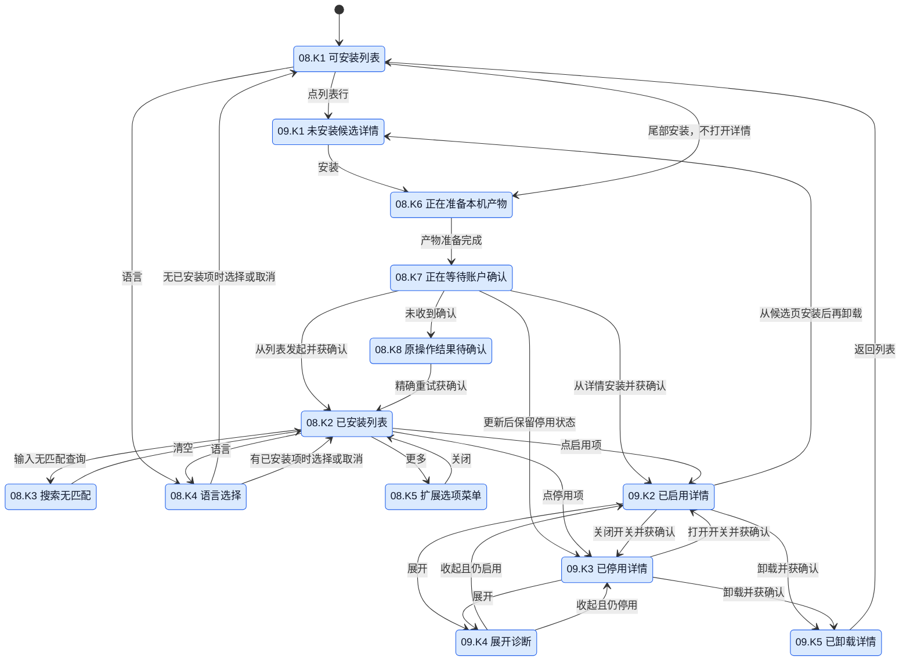

| 状态 ID | 最小必要信息                                          | 浅色正式Web                                                                           | 深色正式Web                                                                       |
| ------- | ----------------------------------------------------- | ------------------------------------------------------------------------------------- | --------------------------------------------------------------------------------- |
| 08.K1   | 分组、名称、当前候选版本/语言、状态、独立安装与行详情 | `karuyomi-9a09331-extensions-installed-light.jpg`                                     | `karuyomi-9a09331-extensions-available-system-dark.jpg`                           |
| 08.K2   | 已确认安装、精确版本/语言、本机准备状态、管理入口     | `karuyomi-9a09331-extensions-installed-light.jpg`                                     | `karuyomi-9a09331-extensions-install-observed-system-dark.jpg`                    |
| 08.K3   | 当前查询、无匹配原因、清空或清除筛选                  | `karuyomi-9a09331-extensions-empty-light.jpg`                                         | `karuyomi-9a09331-extensions-empty-system-dark.jpg`                               |
| 08.K4   | 当前语言、可选语言、全部语言与取消                    | `karuyomi-9a09331-extensions-language-light.jpg`                                      | `karuyomi-9a09331-extensions-language-system-dark.jpg`                            |
| 08.K5   | 仓库管理、本机存储和关闭                              | `karuyomi-9a09331-extensions-menu-light.jpg`                                          | `karuyomi-9a09331-extensions-menu-system-dark.jpg`                                |
| 08.K6   | 正在准备的状态、取消准备；不提前标记账户安装          | `karuyomi-a8997fa-extension-flow-preparing-light`                                     | `karuyomi-a8997fa-extension-flow-preparing-dark`                                  |
| 08.K7   | 等待账户确认、停用重复写入、保留原操作                | `karuyomi-2512c51-extension-recovery-formal-extension-install-auto-waiting-light.jpg` | `karuyomi-2512c51-extension-recovery-formal-extension-install-waiting-dark.jpg`   |
| 08.K8   | 未确认/冲突原因、原操作摘要、精确重试/重取            | `karuyomi-2512c51-extension-recovery-formal-extension-uninstall-unknown-light.jpg`    | `karuyomi-2512c51-extension-recovery-formal-extension-uninstall-unknown-dark.jpg` |
| 09.K1   | 候选版本/语言/状态、安装与源清单；未安装不打开源      | `karuyomi-9a09331-extension-candidate-enter-light.jpg`                                | `karuyomi-9a09331-extension-candidate-enter-system-dark.jpg`                      |
| 09.K2   | 精确状态、已开启开关、维护/卸载影响、源清单与诊断入口 | `karuyomi-2df0551-extension-enabled-light.jpg`                                        | `karuyomi-2df0551-extension-enabled-dark.jpg`                                     |
| 09.K3   | 已停用状态、关闭开关、可重新启用、源不可打开          | `karuyomi-9a09331-extension-disabled-light.jpg`                                       | `karuyomi-9a09331-extension-disabled-system-dark.jpg`                             |
| 09.K4   | 原仓库/包/构建身份、完整可选取正文、末端与收起        | `karuyomi-2df0551-extension-diagnostics-after-scroll-light.jpg`                       | `karuyomi-2df0551-extension-diagnostics-after-scroll-dark.jpg`                    |
| 09.K5   | 已确认卸载、返回扩展列表；书架等业务数据保留          | `karuyomi-2df0551-extension-uninstalled-light.jpg`                                    | `karuyomi-2512c51-extension-recovery-formal-extension-uninstalled-dark.jpg`       |

这里只跟踪当前目标画面；主图、变体及每条转换分别验收。08.K8的冲突/拒绝/结果未知、资源清理失败、已移除仓库/已下架构建、长文本与减少动态效果仍须分项补充，不用正常启停主图代替。

`5ed6dd6`浅色列表与候选详情已实看，Tab/空格可达，Enter仍失败，61语言还截断版本/状态，因此继续排除08.K1/09.K1最终通过。已安装MangaDex的绿色开关、系统红卸载及页脚已有浅色布局图，同样因摘要缺口不计09.K2完成。`9a09331`完整CI和上述双主题正式Web已确认版本/状态可见，候选Enter可用；历史失败继续保留。浅色列表有一个已安装项，深色可安装图尚未安装，不能作为同数据像素叠图。当时Source及诊断入口无键盘焦点，09.K2/09.K3仅为画面和启停证据；后续`2df0551`已补双主题键盘与独立语义，正文选择/复制和其它变体仍待。准备/等待确认未截到主图，诊断展开中标题缺失帧也排除。MangaDex英文Source初次和一次重试均容器中断，不能填入Source toggle的通过项。

`2512c51`完整push/PR CI、Web及push Wasm通过。正式内置浏览器补齐08.K7/K8两对主图和09.K5深色：自动等待收到真实确认，未知卸载保留原对象，刷新、跨页重开及完整原值末端可达，原请求精确重试无重复；有效ACK后的补读失败与未知分开，恢复只读。首次人工挂起sequence14无客户端终态，不能计正常释放；普通DOM摘要省略长组，另保存实际ARIA完整值。等待时重复安装实点零附写，但DOM未报告aria-disabled，禁用辅助语义继续待验。准备阶段仍未截到，08.K6保持待；冲突/拒绝、资源清理、身份、其它变体及最终像素门不变，详见[正式记录](mihon-cupertino-fidelity.md#扩展与共享设置恢复的正式-web-双主题验收)。

### 13：Karuyomi typed Source 筛选的目标状态

这里跟踪最终Cupertino表单的产品状态，与上方Mihon参考13.01–13.07分别验收。`86e7925`正式Web取得真实xkcd无筛选及干净会话Komiic select字段/失败的双主题主图，实际取消、重置及独立API零附写通过；瞬时进度未截到。Komiic镜像确认后容器中断的失败记录保留，默认站点真实查询同样失败，不记兼容通过。`c353604`已取得双主题正常关闭转场，`75c618a`补齐13px次级说明、菜单和草稿的完整双主题画面。蓝色仅表示主图成对取得；分组仍保留Source原始path，加载、重置、应用、失败及其它控件变体分别验收。

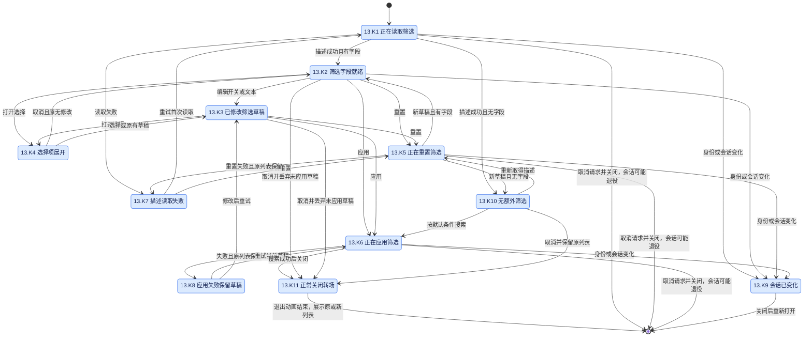

| 状态 ID | 最小必要信息                                                 | 浅色正式Web                                               | 深色正式Web                                              |
| ------- | ------------------------------------------------------------ | --------------------------------------------------------- | -------------------------------------------------------- |
| 13.K1   | 源内查询上下文、读取进度、取消后果、重复动作禁用             | `karuyomi-7461850-filters-loading-light.jpg`              | `karuyomi-7461850-filters-loading-dark.jpg`              |
| 13.K2   | 分组与typed当前值、重置/应用/取消；说明标题与空分组不丢失    | `karuyomi-75c618a-filters-ready-light.jpg`                | `karuyomi-75c618a-filters-ready-dark.jpg`                |
| 13.K3   | 修改后的值、仍未应用、原列表保持、明确应用/取消              | `karuyomi-75c618a-filters-draft-light.jpg`                | `karuyomi-75c618a-filters-draft-dark.jpg`                |
| 13.K4   | 选项、当前选择及键盘焦点、取消；长选项另走29组查询页         | `karuyomi-75c618a-filters-choice-light-390.jpg`           | `karuyomi-75c618a-filters-choice-dark-390.jpg`           |
| 13.K5   | 明确重置进度、旧已应用条件不变、取消后果、重复动作禁用       | `karuyomi-7461850-filters-resetting-light.jpg`            | `karuyomi-7461850-filters-resetting-dark.jpg`            |
| 13.K6   | 明确应用进度、冻结的草稿、原列表保持、取消后果、重复动作禁用 | `karuyomi-7461850-filters-applying-light.jpg`             | `karuyomi-7461850-filters-applying-dark.jpg`             |
| 13.K7   | 读取/重置失败原因、重试/关闭、原列表保持                     | `karuyomi-7461850-filters-{read,reset}-failure-light.jpg` | `karuyomi-7461850-filters-{read,reset}-failure-dark.jpg` |
| 13.K8   | 应用失败原因、保留的草稿、可编辑并重试/取消、原列表保持      | `karuyomi-86e7925-clean-filters-apply-outcome-light.jpg`  | `karuyomi-86e7925-clean-filters-apply-outcome-dark.jpg`  |
| 13.K9   | 会话变化说明、停止使用旧草稿、关闭并重新打开                 | `karuyomi-7461850-filters-session-retired-light.jpg`      | `karuyomi-7461850-filters-session-retired-dark.jpg`      |
| 13.K10  | 无额外筛选说明、默认条件搜索与取消、仍可重置                 | `karuyomi-86e7925-filters-empty-light.jpg`                | `karuyomi-86e7925-filters-empty-dark.jpg`                |
| 13.K11  | 退场期间保留原内容、停止接受操作、正常关闭不误报会话变化     | `karuyomi-c353604-filters-closing-observation-light.jpg`  | `karuyomi-c353604-filters-closing-observation-dark.jpg`  |

两主题取消后返回焦点至筛选入口：浅色使用Tab/Return，深色使用Tab/Space。重置与应用走真实Source，浅色应用后空结果主图为`karuyomi-86e7925-filters-applied-empty-result-light.jpg`，深色稳定同状态图为`karuyomi-86e7925-filters-cancel-space-dark.jpg`；两张联系表已实看。最后一次深色应用截图缺文字，排除主图；正常退场误报保留为修复依据。

`7461850` 使用真实 Komiic `.cc` 镜像，补齐首次读取、应用、长表单底部重置、读取及重置失败、真实重建后的会话失效。两主题均确认原热门或已应用结果保持，失败可重试，失效前后的筛选分别绑定不同运行代次。typed 字段的其它真实 Source、全部失败变体及最终像素门仍待。[筛选验收](mihon-cupertino-fidelity.md#漫画源筛选过程与恢复的正式-web-双主题验收)

13.K11为`c353604`正式Web真实xkcd成功应用后的两个自然退场时刻，浅深动画位置不同；不是全部转场帧或减少动态效果验收。

13.K2/K3/K4当前仅实测Komiic真实select条件，无加载的分类checkbox。`75c618a`已补13px次级标题的双主题正式画面、完整菜单与草稿主图；菜单在390×844、表单与草稿在360×800，不能作同视口叠图。两主题菜单随360→390收起且原值保留，重开选择“喜愛數”后回360仍保留草稿，取消重开恢复默认；深色真实Tab/Return选择并保留焦点圈。独立API确认筛选全程零附写，默认查询仍失败。13.K8继续使用旧版失败主图，其17px标题历史缺口不当作已修复；未外推text、tri-state、SortFilter方向、失败重试成功或全部转场。

### 14：Karuyomi Source 会话偏好的目标状态

2026-11-17，文本与多选子面新增浅/深×1x/2x组件证据：官方分组与次级说明、长名称整行选择、取消及一次应用、身份切换/403后隐藏旧输入与应用入口，连同既有回归共43项通过。内置浏览器两次连接超时，新正式Web未执行；不填14.03/14.05的Karuyomi对应画面，也不替代30.K7各业务范围，全部主图计数保持108/169。详情见[子编辑器记录](mihon-cupertino-fidelity.md#source-偏好子编辑器的分组与失效)。

此图补充真实Source的会话开关验证；文本、单选、多选、依赖、取消与账户恢复仍按14组参考和独有状态逐项补齐。`16baf47`已复验Sheet外围的双主题背景，替换关闭/开启及unsupported的主图；蓝色只表示最新双主题主画面已取得，转换及其它变体仍单列。重开/新文档的转换证据继续标明`2df0551`版本，该版顶部背景缺口保留；历史`5ed6dd6`主图也继续留存，不充当最新表单证据。

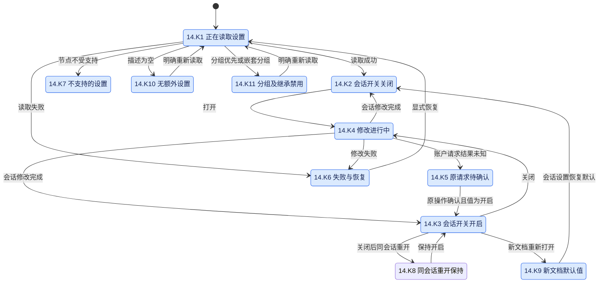

| 状态 ID | 最小必要信息                                               | 浅色正式Web                                                                                                     | 深色正式Web                                                                                                          |
| ------- | ---------------------------------------------------------- | --------------------------------------------------------------------------------------------------------------- | -------------------------------------------------------------------------------------------------------------------- |
| 14.K1   | 源身份、正在读取、关闭可取消                               | `karuyomi-92d4f93-source-preferences-formal-loading-main-light.jpg`                                             | `karuyomi-92d4f93-source-preferences-formal-loading-dark.jpg`                                                        |
| 14.K2   | 设置名、关闭值、会话范围                                   | `karuyomi-16baf47-source-preferences-off-light.jpg`                                                             | `karuyomi-16baf47-source-preferences-off-dark.jpg`                                                                   |
| 14.K3   | 设置名、开启值、会话范围                                   | `karuyomi-16baf47-source-preferences-on-light.jpg`                                                              | `karuyomi-16baf47-source-preferences-on-dark.jpg`                                                                    |
| 14.K4   | 请求进行中、重复操作禁用、关闭的影响                       | `karuyomi-bcac704-editors-source-preference-writing-on-light.jpg`                                               | `karuyomi-bcac704-editors-source-preference-writing-on-dark.jpg`                                                     |
| 14.K5   | 原请求身份/值、未知结果、精确重试与恢复                    | `karuyomi-92d4f93-source-preferences-formal-unknown-expanded-light.jpg`                                         | `karuyomi-92d4f93-source-preferences-formal-unknown-expanded-dark.jpg`                                               |
| 14.K6   | Source拒绝输入的原因、未改现值、明确重读；其余失败变体仍待 | `karuyomi-a12c779-source-text-rejected-top-light.jpg`、`karuyomi-a12c779-source-text-rejected-bottom-light.jpg` | `karuyomi-a12c779-source-text-rejected-stable-top-dark.jpg`、`karuyomi-a12c779-source-text-rejected-bottom-dark.jpg` |
| 14.K7   | 设置名、不支持原因、不可误操作                             | `karuyomi-16baf47-source-preferences-off-light.jpg`                                                             | `karuyomi-16baf47-source-preferences-off-dark.jpg`                                                                   |
| 14.K8   | 同一会话、已改值、范围说明                                 | `karuyomi-2df0551-source-preferences-reopened-light.jpg`                                                        | `karuyomi-2df0551-source-preferences-reopened-dark.jpg`                                                              |
| 14.K9   | 独立新文档、默认值、会话范围                               | `karuyomi-bcac704-editors-source-preferences-fresh-document-light.jpg`                                          | `karuyomi-bcac704-editors-source-preferences-fresh-document-dark.jpg`                                                |
| 14.K10  | 无额外设置说明、源上下文、重新读取/关闭；不创建空表单      | `karuyomi-5f5d287-preferences-empty-light.jpg`                                                                  | `karuyomi-5f5d287-preferences-empty-dark.jpg`                                                                        |
| 14.K11  | 分组/子分组与空分组标题、继承的不可编辑状态、原始路径      | `karuyomi-0e432ce-source-preferences-groups-light.jpg`                                                          | `karuyomi-0e432ce-source-preferences-groups-dark.jpg`                                                                |

`2df0551`完整CI含805项Dart/531项Vitest及Web/Wasm通过；以上最新表单已双主题实看，Source与诊断均实际Tab/Enter可达，各独立操作不再合并，诊断末端完整。动漫屋1.6.3的“章末吐槽页”两主题完成0→1和同会话重开仍1，深色恢复0；镜像菜单均Enter打开/Escape取消，未改镜像。浅色实际reload后确认会话值为0，安装与主题从服务端恢复；独立API确认这些操作不变更账户，Source entries为空。浅色独立卸载后revision从3到4。跨源范围仅浅色实际Tab/Enter展开/收起，深色继续待验；诊断首次深色缺项帧保留并排除主图。未执行unsupported Cookie或动漫屋图片阅读；新背景修复、其它偏好控件及全部转换仍待，不将这些主图称作全组通过。

随后`16baf47`完整CI通过（807项Dart/531项Vitest及Web/Wasm）。正式Web的新关闭/开启主图与`source-preferences-pair.png`已双主题实看，系统浅色/显式深色的Sheet顶部不再露出宿主浅灰背景；标准绿/灰开关与次级说明正常。同会话浅色0→1、改深色再进Source仍1、深色键盘Space恢复0及重开仍0通过。深色跨源范围也完成实际Tab/Enter收起/展开，图为`karuyomi-16baf47-cross-scope-{collapsed,expanded}-dark.jpg`，该缺口已补；独立API确认会话修改与范围导航不写账户。新文档转换仍只保留上版浅色证据，诊断首次缺项和其它类型/变体继续待办；这不是全组通过。

`bcac704`双主题分别实际开启动漫屋会话开关，再reload进入独立新文档，确认默认值恢复0，补齐14.K9；安装与主题由账户恢复。14.K4主图在实际0→1后立即取得，显示源名、spinner、关闭取消说明及禁用恢复/刷新；此时Source会话修改已确认，正在重开/重取描述，不代表账户保存等待或14.K5未知结果。首次`source-preference-processing-dark.jpg`实际已完成，排除K4；浅色另一次1→0仅作分项。镜像菜单Escape取消、unsupported Cookie未执行，七路快照确认会话开关及筛选零账户写入。MangaDex af容器中断，真实多选子面未进入；xkcd有Organization Method，不作为空偏好证据。详见[其余编辑面复验](mihon-cupertino-fidelity.md#顶部导航其余编辑面的正式-web-复验)。

`92d4f93` 双主题补齐 14.K1/K5。关闭读取弹层后回到 Komiic 热门。展开原保存请求可见原 Source、基线版本和两个同步值。关闭重开后可按原文重试，结果已确认时只重试读取。14.K4 的实际账户提交等待另有两张辅助图。14.K10/K11 继续待验。[Source 偏好读取与恢复](mihon-cupertino-fidelity.md#source-偏好读取与恢复的正式-web-双主题验收)

### 15：Karuyomi 跨源搜索的目标状态

2026-11-17，选源控制与列表已采用最终官方Cupertino分组、表单输入及次级页脚，整行选择、长名称、勾选框Tab/Space、隐藏已选项保留及校验/清理失败的系统错误色通过组件流程，页面/控制器/服务49项回归通过。15.K1等旧主图只保留其历史输入，新版本正式Web及其余状态/变体仍待，覆盖保持108/169。详情见[本轮收敛](mihon-cupertino-fidelity.md#选择行与搜索反馈的-cupertino-收敛)。

这张图跟踪产品自身的明确选源、独立重试与停止确认，不填入 Mihon 的参考画面。下表记录真实 CI Web 产物 `b826249` 与错误修复 `07342fb` 的隔离内置浏览器证据；已有截图不代表全部变体或最终配色验收完成。浏览器截图实际编码为 JPEG，不用于精确颜色采样。

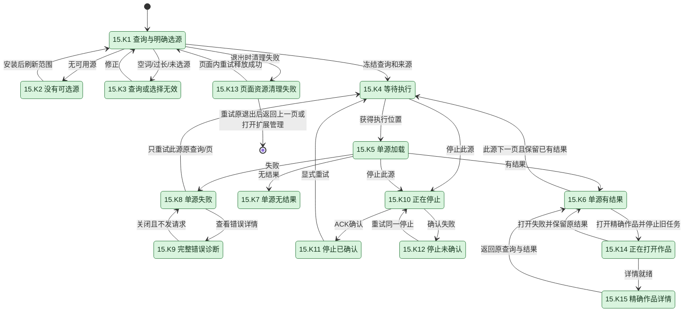

| 状态 ID | 最小必要信息与实际边界                                                      | 浅色                                                                                              | 深色                                                                                            |
| ------- | --------------------------------------------------------------------------- | ------------------------------------------------------------------------------------------------- | ----------------------------------------------------------------------------------------------- |
| 15.K1   | 查询、源数/上限、语言及明确选择、刷新和开始；主图过滤xkcd且未选源           | `karuyomi-a12c779-cross-scope-light.jpg`                                                          | `karuyomi-a12c779-cross-scope-dark.jpg`                                                         |
| 15.K2   | 无可选源原因及安装/刷新入口                                                 | `karuyomi-0a28f6a-no-sources-light`                                                               | `karuyomi-0a28f6a-no-sources-dark`                                                              |
| 15.K3   | 原输入与校验原因、可修正入口，不创建搜索任务                                | `karuyomi-a12c779-cross-validation-empty-light.jpg`                                               | `karuyomi-a12c779-cross-validation-empty-dark.jpg`                                              |
| 15.K4   | 源身份、等待执行及停止入口；同包五源的真实排队                              | `karuyomi-a12c779-cross-five-start-candidate-light.jpg`                                           | `karuyomi-a12c779-cross-five-start-candidate-dark.jpg`                                          |
| 15.K5   | 源名、语言、真实旋转指示、停止此源/全部和总进度；旧独立重试保留 xkcd 空结果 | `karuyomi-a12c779-cross-five-start-candidate-light.jpg`、`karuyomi-07342fb-cross-retry-light.jpg` | `karuyomi-a12c779-cross-five-start-candidate-dark.jpg`、`karuyomi-07342fb-cross-retry-dark.jpg` |
| 15.K6   | Komiic 备用镜像的三项真实结果；标题在封面下，普通封面仍占位                 | `karuyomi-b826249-cross-results-light.jpg`                                                        | `karuyomi-b826249-cross-results-dark.jpg`                                                       |
| 15.K7   | xkcd 返回零项、源状态及空结果说明；与成功源同屏                             | `karuyomi-b826249-cross-results-light.jpg`                                                        | `karuyomi-b826249-cross-results-dark.jpg`                                                       |
| 15.K8   | 默认镜像真实 HTTP 500；短说明、错误详情与重试独立命名，重试在首屏           | `karuyomi-07342fb-cross-error-light.jpg`                                                          | `karuyomi-07342fb-cross-error-dark.jpg`                                                         |
| 15.K9   | 源名、完整原始诊断和关闭；关闭后仍停在原失败，超长滚动浏览器变体待补        | `karuyomi-07342fb-cross-diagnostic-light.jpg`                                                     | `karuyomi-07342fb-cross-diagnostic-dark.jpg`                                                    |
| 15.K10  | 正在停止、当前源及禁止重复开始；不能用加载图代替                            | `karuyomi-392273b-search-stop-waiting-light.jpg`                                                  | `karuyomi-392273b-search-stop-waiting-dark.jpg`                                                 |
| 15.K11  | 两源均已停止、原查询与显式重试；本轮为零结果，非空保留/旧停止失败恢复待补   | `karuyomi-07342fb-cross-stopped-light.jpg`                                                        | `karuyomi-07342fb-cross-stopped-dark.jpg`                                                       |
| 15.K12  | 未确认的停止、同一停止重试、继续搜索受阻                                    | `karuyomi-392273b-search-stop-unconfirmed-light.jpg`                                              | `karuyomi-392273b-search-stop-unconfirmed-dark.jpg`                                             |
| 15.K13  | 页面资源尚未释放、精确清理重试、退出受阻                                    | `karuyomi-a251191-search-release-failed-light.jpg`                                                | `karuyomi-a251191-search-release-failed-dark.jpg`                                               |
| 15.K14  | 正在打开、目标作品与源、原分源结果与冻结操作                                | `karuyomi-0a28f6a-cross-opening-light`                                                            | `karuyomi-0a28f6a-cross-opening-dark`                                                           |
| 15.K15  | 《ONE PIECE航海王》、尾田榮一郎、238 章；返回保留原查询与三项结果           | `karuyomi-0a28f6a-cross-detail-resumed-light`、`karuyomi-0a28f6a-cross-return-resumed-light`      | `karuyomi-0a28f6a-cross-detail-resumed-dark`、`karuyomi-0a28f6a-cross-return-resumed-dark`      |

2026-11-17，内置浏览器恢复后使用`0a02ee6`正式CI Web补选源浅色分项及15.K3空查询浅色图，实际名称点击、Tab/Space、过滤隐藏选择仍保留通过；`cross-selection-hidden-light`保留完整AX。`cross-scope-stable-light`只展示67源目录的首段，不替代15.K1完整主图，初入场的`cross-scope-light`有转场残影，排除主图。真实xkcd查询`one piece`返回零项，`cross-xkcd-result-light`用于结果字号分项，不替代成功/空结果混合同屏或加载主图。新增15.K3只是一侧，成对覆盖仍108/169；单侧由8增至9，双侧均缺由53减至52。MangaDex多选/文本子面和输入拒绝的实际浅色过程见[本轮记录](mihon-cupertino-fidelity.md#内置浏览器恢复后的-source-实测与拒绝提示修复)，原普通正文拒绝提示保留为修复前失败，不计修复后通过。

`07342fb` 的三张 `cross-{start,errors,operations}-pairs.jpg` 联系表已实看，浅深均为 360×800、同样的 xkcd en / Komiic 和查询 `航海王`。两主题重试按钮 DOM 均为 `x=8,y=588,width=106.359375,height=57`，名称仅为“重试此源”。独立重试帧的 Komiic 旋转指示和 xkcd 已返回空态同时存在；深色 DOM 在截图后已回到失败，不用后续 DOM 冒充截图瞬间。错误详情为完整 HTTP 500 和原始 JS/Java 堆栈，关闭后仍为原失败。超长诊断的实际滚动、无请求的独立网络审计及取消 ACK 失败等仍待浏览器分项；100 行诊断/关闭不请求/取消失败恢复另有 29 项组件与控制器回归，不能互相替代。验收采用临时 D1、`acceptance-owner`、无 fixture；视口已恢复且 harness 已停止。

2026-11-17，`a12c779`完整push/PR CI与Web/Wasm通过，同一正式CI Web取得Source拒绝输入14.K6、空查询15.K3及同包排队15.K4三组双主题主图。跨版本成对主图108→111/169（65.7%），仅单侧8、双侧均缺50，剩余58个主状态；这是历史主图覆盖，不代表当前HEAD全状态或PR整体完成。15.K1更新为全部查询/选择/刷新/开始控件同屏的最新主图，15.K5新增真实加载图，旧独立重试证据继续保留。两张五源启动图均实际显示0/5、英文源旋转与其余源等待；截图后的AX已推进至浅色1/5、深色2/5，不冒充同一瞬时。两轮随后均完成五源零结果，不据此补停止/取消状态。MangaDex文本与多选的双主题实际取消、应用、重开、拒绝、重读和恢复初值是补充分项，不当作全部30.K业务范围。38张实拍、独立快照和审计边界见[正式双主题复验](mihon-cupertino-fidelity.md#source-与选源的正式-web-双主题复验)。

## 已核对的成对参考与差异

2026-11-14 已实看 `category-theme-pairs.jpg`、`library-theme-pairs-0.jpg` 与 `library-theme-pairs-1.jpg` 的 PNG 联系表，并与同名 XML 对照。首批覆盖书架有内容/空分类/搜索、选项三页签、多选/更多/移出初态、分类列表/输入/校验/删除及设置目录/外观。排序重新统一为“检查更新时间”降序，深色面板从普通书架打开，不沿用搜索条仍开着的旧图。

- 创建和重命名的重名错误为独立节点；移出确认的初始禁用态与选择范围后可提交态也分别记录。实际取消删除确认返回底层“迁移/删除”菜单，不能画作直接回书架。
- 固定 DEFAULT 的空书架与移出确认可提交态新增成对联系表 `library-empty-removal-pairs.jpg`。浅色确认移出唯一测试 xkcd 后显示空书架，切深色保留空态；随后从同一真实源详情重新添加 xkcd。深色取消可提交确认返回底层菜单，作品仍保留，确认成功转换仍待深色重放。未删除下载或进度；模拟器已暂停在 xkcd 多选态。空态颜文字不同，排除该字形的同内容叠图。
- 参考应用的空态颜文字每次随机变化，属于同一空态；保留实际生成结果，不为叠图修改上游。
- Gboard 是独立系统界面：本次应用切深色时键盘仍跟随 Android 系统浅色，需单独核对键盘占位及操作可达，不将键盘颜色作为 Mihon 配色角色。
- 外观深色新增“纯黑深色模式”一行，导致下方显示组位移；该开关本次关闭。列表、弹层和背景分别取色，不用单一黑白反转代替深色。
- 搜索无结果的主图含键盘，后续仍需无键盘及双倍字号变体；未覆盖的变体不因主状态成对而清零。
- 已实看 `chapter-results-reviewed-0.jpg`、`chapter-results-reviewed-1.jpg`、`image-actions-matched-reviewed.jpg` 和 `reader-settings-lower-reviewed.jpg`。章节多选、已读/未读、书签添加/删除均有成对主图；图片操作与封面确认已统一为同一页且底层工具隐藏，取消实际返回图片操作面板。确认封面后的落点仍待验。阅读设置的模式/常规滚动末端已成对；模式中段约有 7 个物理像素的滚动偏差，只作为覆盖证据，后续逐元素叠图须先对齐滚动锚点。
- `source-pairs-reviewed-0.jpg` 至 `source-pairs-reviewed-3.jpg` 已实看源列表/置顶/语言上段/源操作、xkcd 热门/搜索无结果、已安装扩展/目录/搜索清空、更多菜单及筛选独立空态的成对主图。源列表的语言条件统一为多语言/English。08.03 的未加载和更新、07.05 的下段、12.06 的无键盘及恢复仍待补；08.05 两侧启用语言不同，不能按同条件完成。Mihon 的“置顶”用于分组布局对照，不将其解释为 Karuyomi 的账户服务端收藏能力。
- `repository-pairs-reviewed-0.jpg` 至 `repository-pairs-reviewed-2.jpg` 已实看仓库空态、输入空/有效值、实际校验错误、处理中、成功列表和移除确认/取消/完成。仓库地址为 `https://raw.githubusercontent.com/keiyoushi/extensions/repo/index.min.json`；处理中浅色采用先截图后 XML，PNG 确实包含加载文字。深色空输入/错误图使用拼音键盘、有效地址和处理中已切 English；键盘作为独立系统变体保留，仍需同键盘条件对照。未将提交前的 `s1003-repository-invalid-dark` 误记为错误结果。
- 新节点 08.12 对应 `ExtensionFilterScreen.kt` 的 `state.isEmpty` 分支：无仓库语言目录时筛选页自身为空，区别于有值的语言筛选 08.05。xkcd 不支持最新，搜索实现返回空；搜索成功、最新与分页必须另用真实支持的 Source 采集，不以空结果覆盖。
- 后续 `extension-storage-pairs-0.jpg` 至 `extension-storage-pairs-6.jpg` 已实看；第 2 张取消深色图曾为旧帧，已替换为重新采集并实看的稳定返回图。未加载/信任/取消、来源关闭/恢复、存储首屏/占用/清理后、系统卸载确认及高级完整滚动段均新增双主题主图；未加载其它原因、更新/下载/安装、确认卸载与清理失败仍待。系统弹层和中段滚动限制见对应表，不将新增主图计为整组完成。

## 当前采集顺序与变体门槛

2026-11-16，`19c2260`正式Web取得迁移未知时的浅/深阅读进度与重新阅读阻塞提示，作为现有阅读状态的转换分项，不增加169个主状态的分母或108个成对分子。浅色从详情明确恢复原迁移、另行保存、续读通过；深色从书架重开却自动推进两次进度revision，保留为失败。19组九路快照、13个完全相等区间及121条范围内审计已核对，审计不包含进度POST。新门控修复的45项回归和同名作品身份修复的38项回归通过，正式新Web仍待，见[阅读进度复验](mihon-cupertino-fidelity.md#阅读进度阻塞的正式-web-复验与重开修复)。

2026-11-17，`a12c779`正式CI Web已双主题实看英文→法文xkcd原迁移确认后的书架重开，仍保留未保存页位、原因与明确重试；刷新及浅色另一次新页位不自动写入。明确保存各只推进一个版本，随后普通翻页自动保存恢复；两主题新文档均恢复服务端第2页。同名书架、更多与分类/续读入口包含语言及源名。30组九路独立快照、20个相等区间及172条完成审计（本轮包含进度JSON）核对实际边界，不追溯补全旧121条审计。33张图是现有阅读/书架转换分项，不增分子，主图仍111/169（65.7%）。`target-loading-candidate-dark`实际已返回，不补20.K10；中文目标两次中断保留为失败分项，尚未验证其恢复。分类面缺对象身份及迁移已确认仍显示初始范围引导已修复，51项回归通过，新正式Web仍待；未覆盖拒绝/重置等其余转换和全部变体，见[本轮复验](mihon-cupertino-fidelity.md#受阻草稿重开与同名书架的正式-web-复验)。

```mermaid
stateDiagram-v2
    state "迁移未知，阅读草稿受阻：浅/深已实看" as BlockedReading
    state "原迁移明确重试成功，草稿仍未保存" as ReleasedReading
    state "明确保存后续读：浅色已通过" as SavedReading
    state "从书架重开：旧正式Web深色失败" as ReopenedReading
    BlockedReading --> BlockedReading: 进度重试/重新阅读，零进度写入
    BlockedReading --> ReleasedReading: 明确重试原迁移，零重复应用
    ReleasedReading --> SavedReading: 明确重试保存进度
    ReleasedReading --> ReopenedReading: 继续阅读未保存草稿
    ReopenedReading --> ReleasedReading: 新修复应保持门控，组件通过，正式Web待验
```

2026-11-16，`19c2260`完整push/PR CI与Web/Wasm通过；正式Web新增27.K5双主题主图，跨版本成对主图107→108/169（63.9%）。27.K2/K3/K4只取得真实系统深色图，继续橙色partial；普通503连接失败另存，不替代27.K1未配置地址。7组六路快照与29条完成审计确认连接等待、401/403/503及显式恢复均不附写，1次明确UI主题保存单列。受控故障不是生产Access，登录交互、带进度草稿及全部其它变体仍待，详见[连接复验](mihon-cupertino-fidelity.md#连接状态的正式-web-复验)。

1. 书架/分类已完成首批成对核对，空书架、空分类管理、移出可提交及混合分类主态已补；继续补混合项修改/确认、深色移出成功及全部转换。流程图绿色只代表所标具体状态，不能代表该组全部状态已完成。
2. 继续源/扩展/仓库、浏览/筛选/偏好/跨源搜索、详情/章节/封面/迁移、阅读器、设置/诊断。每组采用双主题成对采集；网络错误只作用于参考模拟器并及时恢复。
3. 对所有已记录状态核对主要元素边界与颜色角色，再使用对应数据验证 Karuyomi 的 Cupertino 呈现；源码数值或参考图不能替代目标产物。
4. 完成每组的360px、宽屏/横屏、长中文、双倍文字、键盘/滚动末端和减少动态；键盘必须同时显示输入及可达的提交/取消。主题切换不能丢失选择或草稿。

已排除的误计：`reader-loading-default-dark` 是 Android 全屏引导；`cover-view-default-dark` 仍为详情；`extension-details-selected-default-dark` 仍为扩展列表；`settings-main-default-dark` 是更多页；`category-create-filled-default-dark` 输入仍为空。它们均不填入所命名的目标状态。

2026-11-16，`e8646f5`新读取提示的完整CI及正式Web双主题复验通过，33组九路快照与202条完成审计核对未知/拒绝的读取反馈、原请求保留及精确重试零重复。19.K11、21.K6、24.K11只登记有效深色主图；名义浅色截图实际也为系统深色，故成对主图仍107/169（63.3%）。其余触发阶段及设置禁用语义继续待验；20.K8/K10未截到进度，仍不计通过。连接阶段和阅读进度被迁移阻塞的提示已发现缺口，新增组件修复不能代替正式Web主图，详见[本轮复验](mihon-cupertino-fidelity.md#迁移读取提示及失效状态的正式-web-复验)。

2026-11-17，`ef5f3dd`正式CI Web双主题新增20.K10主图，首次热门、搜索与两种追加共八张实际旋转画面均已实看，文件为`karuyomi-ef5f3dd-selection-migration-{popular,more-popular,search,more-search}-loading-candidate-{light,dark}.jpg`。未提交输入不改变热门或原查询`one piece`的追加说明，等待时原候选保留；返回后实际取得新的列表尾部。开源候选已经是搜索内容，不填20.K8。九组九路快照、七个相等区间和43条完成审计核对三次独立准备、一次明确UI主题保存及其余零业务POST；另补同名勾选框实际键盘与四张空分类对象分项。跨版本成对主图111→112/169（66.3%），仅单侧8、双侧均缺49，剩余57个主状态及全部变体/转换/最终产物；历史主图覆盖不代表当前HEAD全部验收或PR整体完成。完整环境、23张实拍及边界见[正式双主题复验](mihon-cupertino-fidelity.md#勾选身份与目标列表加载的正式-web-双主题复验)。

2026-11-17，正式CI客户端`ef5f3dd`与独立记录的官方夹具`94b7b82`在内置浏览器补齐04.K3/K5双主题主图：相同两作品批量添加“待读”，首项实际提交后等待确认，请求暂停并释放后保留1/2确认和剩余原清单。两主题暂停时独立重复快照均相等；浅色明确继续后仅第二项应用，深色明确结束则第二项保持原值并在书架保留选择。13组九路快照、五个相等区间与94条审计已核对，首次分类挂起sequence17未完成交付单列，另外93条完成，不记全部生命周期通过。分类正常等待的旧“重试”提示缺口已复现并修复，35项回归通过，新正式Web仍待，不补05.K8。跨版本成对主图112→114/169（67.5%），仅单侧8、双侧均缺47，剩余55个主状态及全部变体/最终产物；不代表PR整体完成，详见[正式分项复验](mihon-cupertino-fidelity.md#批量等待与暂停的正式-web-复验)。

`61608c5`完整CI/Web/Wasm及正式Web浅色复验随后确认正常保存阶段文字；重排等待缺冻结对象/目标位置，ACK后读取503仍误称未确认并再次POST，均单列失败，不补05.K8/K9。七组九路快照、两个相等区间和64条完成审计已核对；额外相同正文重试没有重复应用。八张浅色实拍不增加任何成对主图，计数仍114/169；新修复83项相关回归通过，正式新产物和双主题仍待，见[分类确认与读取失败](mihon-cupertino-fidelity.md#分类确认与读取失败的正式-web-复验)。

`500b5a3`完整CI/Web/Wasm通过，但本轮内置浏览器四次控制调用均超时，未进入产品页面，不补05.K8/K9。确认后即时读取、只读关闭/书架重开、冲突读回交接及首次快照被无关通知提前放行均先复现再修复，相关154项回归通过；组件及仓库不替代正式Web，没有新主图，114/169及其它缺口保持，见[读取与关闭](mihon-cupertino-fidelity.md#分类确认后读取阶段的即时反馈)。

`49f3482`完整CI/Web/Wasm通过，刷新库存并选择当次实际内置浏览器后控制恢复；先前四次超时和未确认根因保留。正式Web浅色初探取得保存阶段、未知原命令重试及返回列表分项，首次确认交付sequence17无终态，不计正常释放。四组九路快照、两个相等区间和36条审计（35完成）核对一次UI应用与一次零重复重试；四张DOM实拍和一张辅助AX图不补05.K8/K9，仍114/169及原缺口。官方夹具新增短自动确认/读取及确认后读取失败，57项Workers/D1/R2回归和严格类型通过，新夹具完整CI、排序/已确认读取/冲突/失效及双主题正式验收仍待，见[恢复后的浅色复验](mihon-cupertino-fidelity.md#内置浏览器恢复后的分类浅色复验)。

正式CI客户端`49f3482`与夹具`5979361`随后完成双主题分类输入/排序确认、未知精确重试和已确认后读取失败，补05.K8/K9两对主图，114→116/169（68.6%）。读取中关闭、书架重开复用原任务，最新结果只更新新窗口；真实409后再次远端改名，重读仍交接最新目录并恢复编辑。05.K11只补深色：旧动作禁用且可关闭，同一身份重连保留原请求，未明确重试不附写。两主题400/409辅助说明沿用未知请求指引的实拍保留为失败，不补05.K10；已修复并通过69项相关回归，正式新提示仍待。28组九路快照、九个相等区间与247条完成审计已核对，31张DOM图中五张转场重开图不作主图，详见[正式双主题复验](mihon-cupertino-fidelity.md#分类保存与恢复的正式-web-双主题复验)。当前仅单侧9、双侧均缺44，剩余53个主状态及全部变体/最终产物；不代表PR整体完成。
