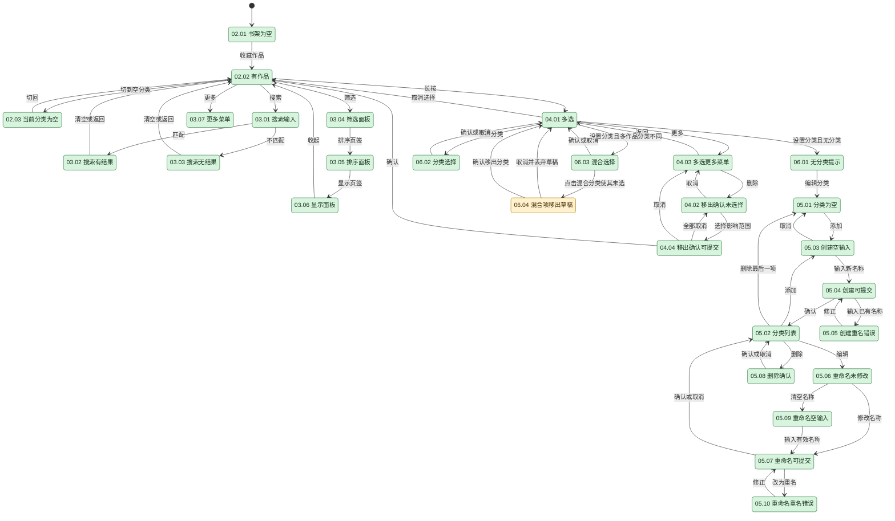
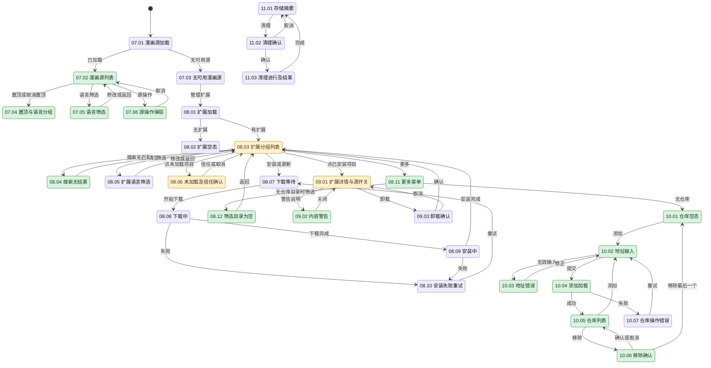
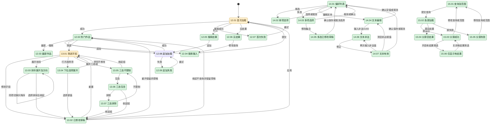
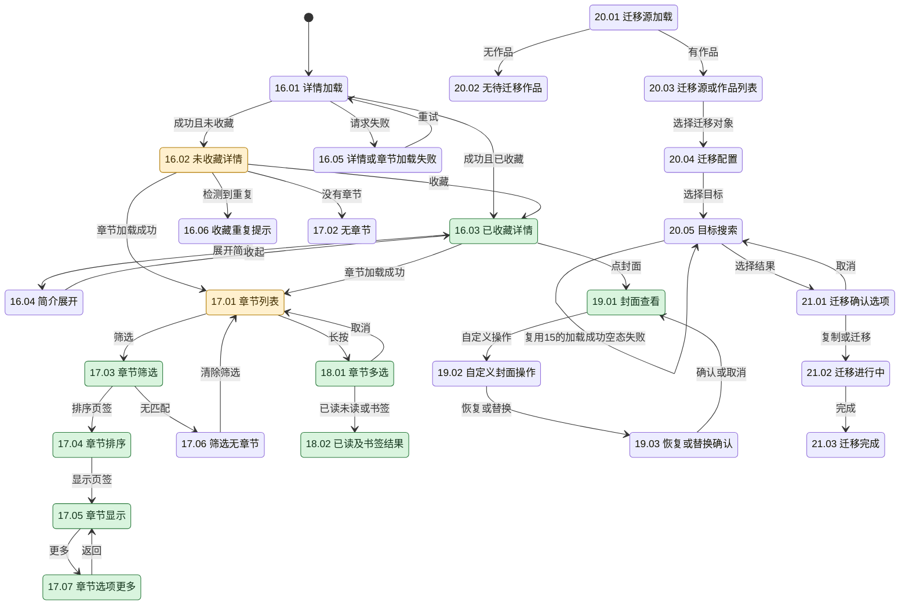
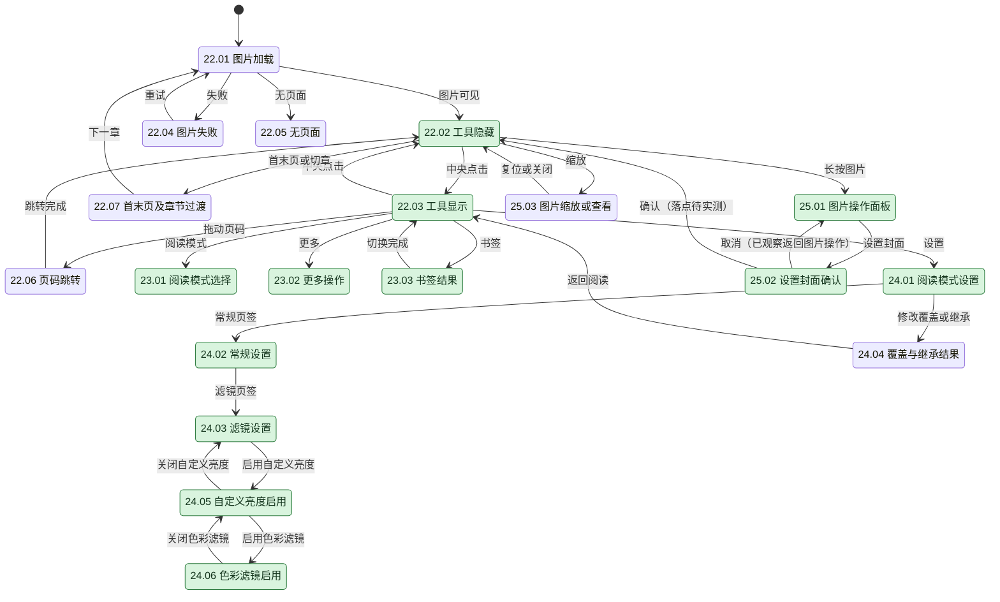
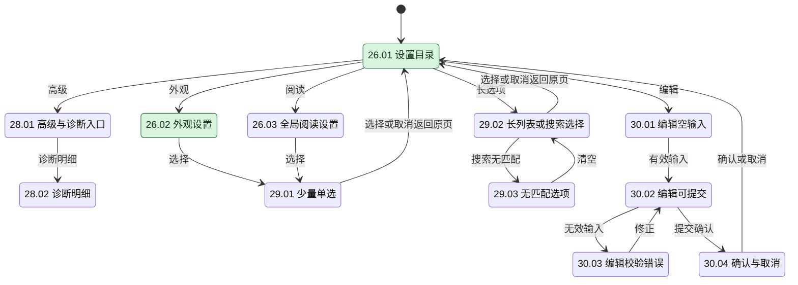
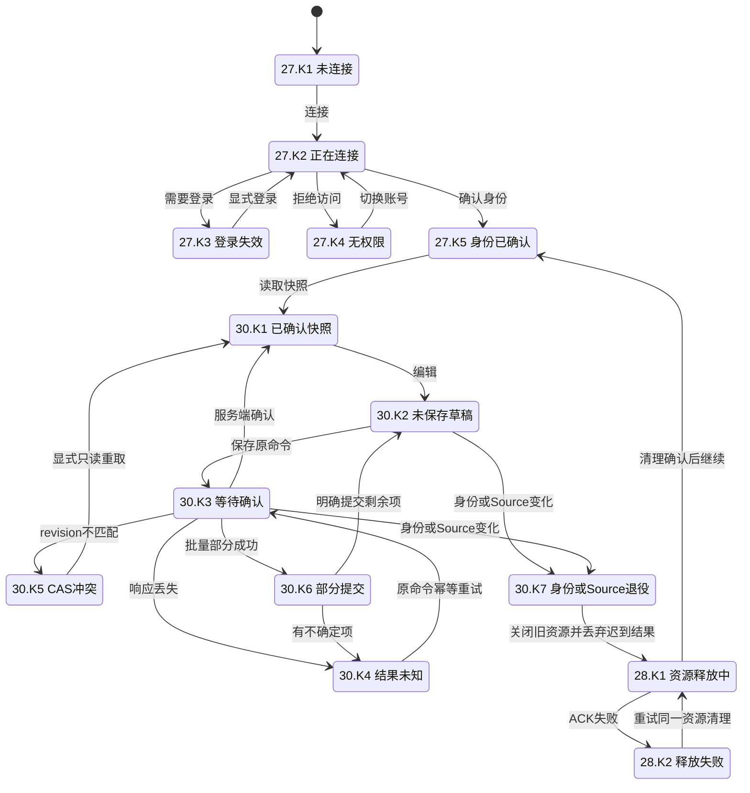
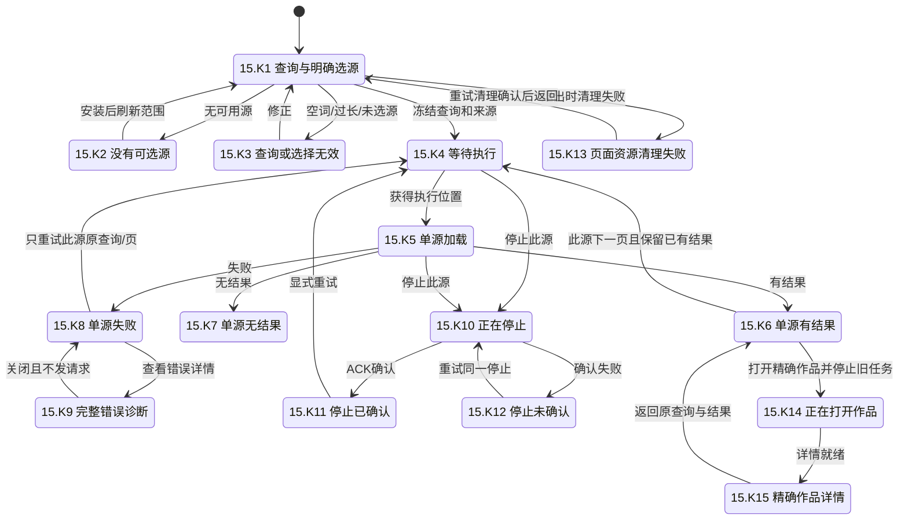

# Mihon 参考截图状态机

2026-11-14，进行中。用户要求截图触及每个 UI 状态，并同时考虑浅色、深色。此表细化[30 组界面矩阵](../design/mihon-cupertino-fidelity.md)，作为参考采集与后续 Cupertino 对照的工作清单。**目前尚无一组完成包含全部转换与变体的双主题验收；绿色只代表该节点的两张主状态参考图已核对。**

## 记录规则

- 状态由固定 Mihon v0.21.3 的页面、ViewModel 分支和弹层分支确定；不能仅按路由名计数。加载、内容、空结果、失败、选择、输入校验、确认和操作进行中分别记录。取消、返回、重试及成功后的落点也是待核对的转换。
- 每行分别记录浅色与深色截图。`待`表示未采集，文件名表示已核对实际 PNG/XML 的参考画面；只完成一侧仍为待完成。表中省略共同路径 `.local/mihon-reference/` 和后缀 `.png`，对应 XML 同名。原始材料保持在忽略目录。
- 图中节点对应表中 ID；橙色表示仅有单主题参考，未着色表示仍待采集，绿色只用于两种主题均已核对的状态。**参考截图完成不等于 Karuyomi 像素或交互验收通过。**
- DEFAULT 固定主题，360×800 逻辑视口、720×1600 物理像素、320dpi；系统栏单列。两种主题使用同一数据和同一状态。早期 Monet 图保留为历史，不填入 DEFAULT 栏。键盘、长中文、双倍字号、宽屏/横屏、减少动态另列变体，不用它们替代主状态。
- 同一可见状态只保留一个主 ID，可关联多组页面。Mihon 没有的服务端确认、CAS 冲突、身份失效、部分提交、清理 ACK 等状态列在末节，须由 Karuyomi 实测；不能伪造 Mihon 对应图。用户已列入后续的下载、历史、追踪、备份等独立功能保持原范围，不增加无效入口。
- 当新增源码分支或实际操作发现表外弹层，先补节点及转换，再采集；不把“不易触发”改记为不适用。瞬时状态须实际截到才能填表，未截到继续为待。

## 01–06：导航、书架、分类

依据：`ui/home/HomeScreen.kt`、`ui/library/LibraryTab.kt`、`presentation/library/LibrarySettingsDialog.kt`、`DeleteLibraryMangaDialog.kt`、`presentation/category/CategoryScreen.kt`、`components/CategoryDialogs.kt`。

| 状态 ID | 最小必要信息/采集触发                                                                | 浅色                                                                                                                     | 深色                                                                          |
| ------- | ------------------------------------------------------------------------------------ | ------------------------------------------------------------------------------------------------------------------------ | ----------------------------------------------------------------------------- |
| 01.01   | 三入口对应的 Mihon 底部导航：活动入口、图标、标题及正文边界；复用 02.02/07.02/26.01  | 待                                                                                                                       | `library-populated-default-dark`（书架分项）                                  |
| 01.02   | 宽屏/横屏导航及内容区域；旋转同一参考设备                                            | 待                                                                                                                       | 待                                                                            |
| 02.01   | 空书架标题、原因、入门指南；移出最后一部测试作品                                     | `s0201-library-empty-light`                                                                                              | `s0201-library-empty-dark`                                                    |
| 02.02   | 封面、标题、未读标记、续读位置及网格边界                                             | `s0202-library-content-light`                                                                                            | `s0202-library-content-dark`                                                  |
| 02.03   | 空分类名、空态及切回入口；切到新建分类                                               | `s0203-library-category-empty-light`                                                                                     | `s0203-library-category-empty-dark`                                           |
| 03.01   | 已打开的搜索框、查询、清空/退出；点搜索                                              | `s0301-library-search-light`                                                                                             | `s0301-library-search-dark`                                                   |
| 03.02   | 查询与匹配作品；输入 `xkcd`                                                          | `s0302-library-match-light`                                                                                              | `s0302-library-match-dark`                                                    |
| 03.03   | 查询、无结果说明、清空/退出；输入不会匹配的文本                                      | `s0303-library-no-results-light`                                                                                         | `s0303-library-no-results-dark`                                               |
| 03.04   | 筛选页签、选项及三态当前值；打开筛选                                                 | `s0304-library-filter-light`                                                                                             | `s0304-library-filter-dark`                                                   |
| 03.05   | 排序页签、当前排序和方向                                                             | `s0305-library-sort-light`                                                                                               | `s0305-library-sort-dark`                                                     |
| 03.06   | 显示页签、当前网格/列表设置                                                          | `s0306-library-display-light`                                                                                            | `s0306-library-display-dark`                                                  |
| 03.07   | 可用菜单项及正文锚点；点更多                                                         | `s0307-library-more-light`                                                                                               | `s0307-library-more-dark`                                                     |
| 04.01   | 选中数量、选中封面、退出/全选和底部批量操作                                          | `s0401-library-selection-light`                                                                                          | `s0401-library-selection-dark`                                                |
| 04.02   | 移出确认初态：影响范围选项均未选、确认禁用、取消                                     | `s0402-library-remove-confirm-light`                                                                                     | `s0402-library-remove-confirm-dark`                                           |
| 04.03   | 多选中的迁移/删除菜单、当前选择上下文及关闭                                          | `s0403-library-selection-more-light`                                                                                     | `s0403-library-selection-more-dark`                                           |
| 04.04   | 仅选移出书架、确认可用；浅色确认后为空书架；深色取消后返回迁移/删除菜单              | `s0404-library-remove-enabled-light`                                                                                     | `s0404-library-remove-enabled-dark`、`s0404-library-remove-cancel-dark`       |
| 05.01   | 无分类说明及添加入口                                                                 | `s0501-category-empty-light`                                                                                             | `category-manager-default-dark`                                               |
| 05.02   | 名称、拖动顺序、编辑和删除入口                                                       | `s0502-categories-two-light`                                                                                             | `s0502-categories-two-dark`                                                   |
| 05.03   | 标题、空名称、必填、禁用提交、取消及键盘                                             | `s0503-category-create-keyboard-light`                                                                                   | `s0503-category-create-empty-dark`                                            |
| 05.04   | 名称、可用提交、取消及键盘                                                           | `s0504-category-create-keyboard-light`                                                                                   | `s0504-category-create-keyboard-dark`                                         |
| 05.05   | 创建时重复名称、错误说明、禁用添加及键盘                                             | `s0505-category-create-duplicate-light`                                                                                  | `s0505-category-create-duplicate-dark`                                        |
| 05.06   | 原名称、禁用确认、取消及键盘                                                         | `s0506-category-rename-second-light`                                                                                     | `s0506-category-rename-second-dark`                                           |
| 05.07   | 修改后名称、可用确认、取消及键盘                                                     | `s0507-category-rename-valid-light`                                                                                      | `s0507-category-rename-valid-dark`                                            |
| 05.08   | 待删分类名、影响、取消和确认                                                         | `s0508-category-delete-second-light`                                                                                     | `s0508-category-delete-second-dark`                                           |
| 05.09   | 重命名清空名称、必填、禁用确认和键盘                                                 | `s0509-category-rename-empty-light`                                                                                      | `s0509-category-rename-empty-dark`                                            |
| 05.10   | 重命名为另一现有分类、重名错误、禁用确认和键盘                                       | `s0505-category-rename-duplicate-light`                                                                                  | `s0505-category-rename-duplicate-dark`                                        |
| 06.01   | 无分类说明及编辑分类入口                                                             | `s0601-no-category-dialog-light`                                                                                         | `library-categories-default-dark`                                             |
| 06.02   | 分类名、已选项、取消和确认                                                           | `s0602-library-category-choice-light`                                                                                    | `s0602-library-category-choice-dark`                                          |
| 06.03   | 两部作品跨分类选中，a 部分选中、b 未选；取消后保持多选，浅色重开仍混合，确认转换待补 | `s0603-library-categories-mixed-light`、`s0603-library-categories-cancel-light`、`s0603-library-categories-reopen-light` | `s0603-library-categories-mixed-dark`、`s0603-library-categories-cancel-dark` |
| 06.04   | 点击混合 a 后变为未选，取消重开恢复混合；未确认该草稿                                | `s0604-library-categories-none-draft-light`                                                                              | 待                                                                            |

## 07–11：漫画源、扩展、仓库与存储

依据：`presentation/browse/SourcesScreen.kt`、`SourcesFilterScreen.kt`、`ExtensionsScreen.kt`、`ExtensionFilterScreen.kt`、`ExtensionDetailsScreen.kt`、`extension/model/InstallStep.kt`、`presentation/more/settings/screen/browse/components/ExtensionStores*.kt`、`SettingsDataScreen.kt`。

| 状态 ID | 最小必要信息/采集触发                                          | 浅色                                                                                                       | 深色                                                                                                                                                    |
| ------- | -------------------------------------------------------------- | ---------------------------------------------------------------------------------------------------------- | ------------------------------------------------------------------------------------------------------------------------------------------------------- |
| 07.01   | 漫画源标题及加载指示；冷启动进入源页                           | 待                                                                                                         | 待                                                                                                                                                      |
| 07.02   | 源名、语言、最近使用、可执行尾部操作                           | `s0702-source-list-light`                                                                                  | `s0702-source-list-dark`                                                                                                                                |
| 07.03   | 无可用源说明与扩展入口；关闭已安装源                           | 待                                                                                                         | 待（Local source 项与真正空态分开）                                                                                                                     |
| 07.04   | Mihon 置顶分组与普通分组、取消置顶入口；对照 Karuyomi 收藏分组 | `s0704-source-pinned-light`                                                                                | `s0704-source-pinned-dark`                                                                                                                              |
| 07.05   | 语言列表及当前启用项；两侧只启用多语言/English                 | `s0705-source-language-light`（上段）；下段待补                                                            | `s0705-source-language-dark`（上段）；下段待补                                                                                                          |
| 07.06   | 当前源及置顶/隐藏等可用动作                                    | `s0706-source-actions-light`                                                                               | `s0706-source-actions-dark`                                                                                                                             |
| 08.01   | 标题、加载状态及禁用刷新；重新读取目录                         | 待                                                                                                         | 待                                                                                                                                                      |
| 08.02   | 无扩展原因与仓库入口                                           | 待                                                                                                         | 待                                                                                                                                                      |
| 08.03   | 未加载/已安装/可安装/更新分组、名称、语言、版本、主操作        | `s0803-extensions-installed-light`（已安装）、`s0803-extension-catalog-light`（可安装）；未加载/更新待补   | `s0803-extensions-installed-dark`（已安装）、`s0803-extension-catalog-dark`（可安装）、`extensions-mangadex-untrusted-default-dark`（未加载）；更新待补 |
| 08.04   | 查询、无匹配说明、清空/返回；清空后恢复列表                    | `s0804-extension-empty-light`；恢复 `s0804-extension-clear-light`                                          | `s0804-extension-empty-dark`；恢复 `s0804-extension-clear-dark`                                                                                         |
| 08.05   | 语言和内容筛选当前值                                           | `s0805-extension-filter-light`；启用语言与深色不同，待对齐重拍                                             | `s0805-extension-filter-dark`；待同条件重拍                                                                                                             |
| 08.06   | 未加载原因、插件名、信任/卸载；其他未加载原因分别补图          | 待                                                                                                         | `mangadex-trust-confirmation`（未信任分项）                                                                                                             |
| 08.07   | 对象、等待标记、取消                                           | 待                                                                                                         | 待                                                                                                                                                      |
| 08.08   | 对象、下载标记、进度/取消                                      | 待                                                                                                         | 待                                                                                                                                                      |
| 08.09   | 对象、安装中及系统权限/确认（若出现）                          | 待                                                                                                         | 待                                                                                                                                                      |
| 08.10   | 对象、失败与重试                                               | 待                                                                                                         | 待                                                                                                                                                      |
| 08.11   | 筛选和仓库入口                                                 | `s0811-extension-menu-light`                                                                               | `s0811-extension-menu-dark`                                                                                                                             |
| 08.12   | 筛选页没有仓库语言目录时的独立空态、标题和返回                 | `s0812-extension-filter-empty-light`                                                                       | `s0812-extension-filter-empty-dark`                                                                                                                     |
| 09.01   | 图标、名称、包名、版本/语言/警告、卸载、源列表/启停/偏好       | `s0901-mangadex-details-light`（启用）；禁用待补                                                           | `s0901-mangadex-details-dark`（启用）；禁用待补                                                                                                         |
| 09.02   | 内容警告原因和关闭动作                                         | `s0902-extension-warning-light`                                                                            | `s0902-extension-warning-dark`                                                                                                                          |
| 09.03   | 卸载对象、系统确认/取消                                        | 待                                                                                                         | 待                                                                                                                                                      |
| 10.01   | 无仓库说明、返回、刷新和添加                                   | `s1001-repository-empty-light`                                                                             | `s1001-repository-empty-dark`                                                                                                                           |
| 10.02   | 地址、必填、提交可用性、取消、键盘                             | `s1002-repository-add-empty-light`、`s1002-repository-add-filled-light`                                    | `s1002-repository-add-empty-dark`、`s1002-repository-add-filled-dark`                                                                                   |
| 10.03   | 提交数字 `987654321` 后的实际 scheme 错误、修正/取消           | `s1003-repository-invalid-result-light`                                                                    | `s1003-repository-invalid-result-dark`                                                                                                                  |
| 10.04   | 提交正式公开仓库地址后实际可见的“处理中…”                      | `s1004-repository-add-processing-light`                                                                    | `s1004-repository-add-processing-dark`                                                                                                                  |
| 10.05   | 仓库名、地址、移除/刷新；使用正式公开仓库                      | `s1005-repository-list-light`                                                                              | `s1005-repository-list-dark`                                                                                                                            |
| 10.06   | 待移除仓库、确认/取消；取消保留列表，确认移除最后一项回空态    | `s1006-repository-remove-confirm-light`、`s1006-repository-cancel-light`、`s1006-repository-removed-light` | `s1006-repository-remove-confirm-dark`、`s1006-repository-cancel-dark`、`s1006-repository-removed-dark`                                                 |
| 10.07   | 失败原因和可用恢复入口；连接失败分支                           | 待                                                                                                         | 待                                                                                                                                                      |
| 11.01   | 占用、存储范围及清理入口；仅对照同类存储布局                   | 待                                                                                                         | 待                                                                                                                                                      |
| 11.02   | 清理对象、影响、确认/取消                                      | 待                                                                                                         | 待                                                                                                                                                      |
| 11.03   | 清理进行/完成/失败的实际反馈，三个分项分别保留                 | 待                                                                                                         | 待                                                                                                                                                      |

## 12–15：源内浏览、筛选、偏好与跨源搜索

依据：`presentation/browse/BrowseSourceScreen.kt` 的 refresh/append Loading/Error/Empty、`ui/browse/source/browse/SourceFilterDialog.kt` 的 typed Filter、`ui/browse/extension/details/SourcePreferencesScreen.kt`、`presentation/browse/GlobalSearchScreen.kt` 的 Loading/Success/Error。

| 状态 ID | 最小必要信息/采集触发                                                                          | 浅色                                                                                                                           | 深色                                                                                                                             |
| ------- | ---------------------------------------------------------------------------------------------- | ------------------------------------------------------------------------------------------------------------------------------ | -------------------------------------------------------------------------------------------------------------------------------- |
| 12.01   | 源名、当前模式、加载指示；冷启动、切模式及重试分别记录                                         | `s1203-source-latest-loading-light`（切最新）、`s1201-source-retry-loading-light`（重试）；冷启动图截到路由动画，待补          | `s1201-mangadex-loading-dark`（冷启动）、`s1203-source-latest-loading-dark`（切最新）、`s1201-source-retry-loading-dark`（重试） |
| 12.02   | 源名、热门模式、封面与标题网格                                                                 | `s1202-xkcd-popular-light`、`s1202-mangadex-popular-light`                                                                     | `s1202-xkcd-popular-dark`、`s1202-mangadex-popular-dark`                                                                         |
| 12.03   | 源名、最新模式、作品；真实动态目录内容会变化，不用于同数据叠图                                 | `s1203-source-latest-light`                                                                                                    | `s1203-source-latest-dark`                                                                                                       |
| 12.04   | 空输入和精确查询 `987654321`、键盘、清空和提交                                                 | `s1204-source-search-input-light`、`s1204-source-search-filled-light`                                                          | `s1204-source-search-input-dark`、`s1204-source-search-filled-dark`                                                              |
| 12.05   | 精确查询 `one piece`、匹配作品、清空与返回；键盘已收起                                         | `s1205-mangadex-search-loaded-light`                                                                                           | `s1205-mangadex-search-loaded-dark`                                                                                              |
| 12.06   | 当前查询 `987654321`、无结果说明和恢复动作；主图含键盘                                         | `s1206-source-empty-light`；无键盘/恢复待补                                                                                    | `s1206-source-empty-dark`；无键盘/恢复待补                                                                                       |
| 12.07   | 模拟器断网时首次失败，错误正文、重试/帮助/WebView；离线重试仍失败，联网重试恢复热门            | `s1207-source-network-error-light`、`s1207-source-offline-retry-light`、`s1207-source-recovered-light`                         | `s1207-source-network-error-dark`、`s1207-source-offline-retry-dark`、`s1207-source-recovered-dark`                              |
| 12.08   | 已有作品、追加指示、滚动位置；只有实际可见旋转指示才通过                                       | 待（追加重试帧已为新内容，未截到指示）                                                                                         | 待（慢网/重试帧仍未截到指示）                                                                                                    |
| 12.09   | 追加失败保留已有作品，底部持久错误条、重试；恢复网络后加载更多                                 | `s1209-source-append-error-light`、`s1209-source-append-recovered-light`                                                       | `s1209-source-append-error-dark`、`s1209-source-append-recovered-dark`                                                           |
| 13.01   | text/check/select/tri-state/sort/group 当前值、重置/应用；文本筛选仍需其他真实源               | `s1301-source-filters-light`、`s1301-source-filter-group-light`；text 待                                                       | `s1301-source-filters-dark`、`s1301-source-filter-group-dark`；text 待                                                           |
| 13.02   | group/check/select 草稿，重置、收起重开和实际应用；下述转换另列文件                            | `s1302-source-filter-draft-light`、`s1302-source-filter-reset-light`、`s1304-source-filter-select-draft-light`                 | `s1302-source-filter-draft-dark`、`s1302-source-filter-reset-dark`、`s1304-source-filter-select-draft-dark`                      |
| 13.03   | Sort 展开、默认 Relevance 降序、点同项升序；上下滚动内容                                       | `s1301-source-filter-sort-light`、`s1301-source-filter-sort-lower-light`、`s1303-source-filter-sort-ascending-light`           | `s1301-source-filter-sort-dark`、`s1301-source-filter-sort-lower-dark`、`s1303-source-filter-sort-ascending-dark`                |
| 13.04   | Created within last 下拉展开，Any/Day/Week/Month/Year 和原值                                   | `s1304-source-filter-select-light`                                                                                             | `s1304-source-filter-select-dark`                                                                                                |
| 13.05   | Genre 的 Action 不限制，空框；点击后进入包含                                                   | `s1305-source-filter-tristate-neutral-light`                                                                                   | `s1305-source-filter-tristate-neutral-dark`                                                                                      |
| 13.06   | Action 包含，勾选图形与强调色；点击后进入排除                                                  | `s1305-source-filter-tristate-include-light`                                                                                   | `s1305-source-filter-tristate-include-dark`                                                                                      |
| 13.07   | Action 排除，叉号与强调色；点击后回不限制                                                      | `s1305-source-filter-tristate-exclude-light`、`s1305-source-filter-tristate-reset-light`                                       | `s1305-source-filter-tristate-exclude-dark`、`s1305-source-filter-tristate-reset-dark`                                           |
| 14.01   | MangaDex EN 偏好标题、当前值、说明及开关，上下段均采集                                         | `s1401-source-preferences-light`、`s1401-source-preferences-lower-light`                                                       | `s1401-source-preferences-dark`、`s1401-source-preferences-lower-dark`                                                           |
| 14.02   | Cover quality 字段、Original 当前选中、其他选项、取消；取消后值不变                            | `s1402-source-choice-light`、`s1402-source-choice-cancel-light`                                                                | `s1402-source-choice-dark`、`s1402-source-choice-cancel-dark`                                                                    |
| 14.03   | Filter original languages 多选初态，选项未选、确认/取消                                        | `s1403-source-multiple-light`                                                                                                  | `s1403-source-multiple-dark`                                                                                                     |
| 14.04   | Block groups by UUID 空输入、非必填、确定可用、取消与键盘                                      | `s1404-source-text-empty-light`                                                                                                | `s1404-source-text-empty-dark`                                                                                                   |
| 14.05   | Japanese 已选草稿、确认/取消；取消重开未选，确认重开已选                                       | `s1405-source-multiple-draft-light`、`s1405-source-multiple-cancel-reopen-light`、`s1405-source-multiple-applied-reopen-light` | `s1405-source-multiple-draft-dark`、`s1405-source-multiple-cancel-reopen-dark`、`s1405-source-multiple-applied-reopen-dark`      |
| 14.06   | 文本 `123`，非法 UUID 错误说明、确定禁用、可修正/取消                                          | `s1406-source-text-invalid-light`                                                                                              | `s1406-source-text-invalid-dark`                                                                                                 |
| 14.07   | 有效测试 UUID，错误消失、确定可用；确认后重开仍保留                                            | `s1407-source-text-valid-light`、`s1407-source-text-applied-reopen-light`                                                      | `s1407-source-text-valid-dark`、`s1407-source-text-applied-reopen-dark`                                                          |
| 15.01   | 空输入/查询、已置顶/全部范围、有结果筛选、返回与键盘                                           | `s1501-global-empty-light`、`s1501-global-query-light`                                                                         | `s1501-global-empty-dark`、`s1501-global-query-dark`                                                                             |
| 15.02   | 每源名称与实际旋转指示、总进度；瞬态 PNG 先于 XML，不用后来的 XML 推导该帧位置                 | `s1502-global-naruto-loading-light`                                                                                            | `s1502-global-loading-dark`                                                                                                      |
| 15.03   | 源名/语言与横向封面、封面下三行标题、进入源箭头；深色打开真实 One Piece 详情并返回，浅色转换待 | `s1503-global-top-light`                                                                                                       | `s1503-global-top-dark`、`s1503-global-open-before-dark`、`s1503-global-open-details-dark`、`s1503-global-return-dark`           |
| 15.04   | Local source 无结果；与 MangaDex 成功同屏                                                      | `s1503-global-top-light`                                                                                                       | `s1503-global-top-dark`                                                                                                          |
| 15.05   | 源名/语言、错误图标与说明；无独立重试按钮；混合成功/失败同屏另待                               | `s1505-global-error-light`                                                                                                     | `s1505-global-error-dark`                                                                                                        |
| 15.06   | 有结果筛选选中，只保留 MangaDex 两组；关闭恢复空结果源                                         | `s1503-global-only-results-light`                                                                                              | `s1503-global-only-results-dark`                                                                                                 |

实际转换补充（两种主题均已操作并核对 PNG）：

- MangaDex 筛选勾选 `Has available chapters`，返回收起后热门结果不变，重开仍勾选。证据为 `s1302-source-filter-checkbox-draft-{light,dark}`、`s1302-source-filter-dismissed-{light,dark}`、`s1302-source-filter-dismissed-reopen-{light,dark}`。这是保留未应用草稿，不能写成“取消丢弃”。Karuyomi 的显式取消继续丢弃草稿，作为已确认业务合同的交互差异记录。
- 点击筛选后截到实际加载指示，随后得到 Domino Kick 等真实结果，见 `s1302-source-filter-applying-{light,dark}` 与 `s1302-source-filter-applied-{light,dark}`。浅色瞬态同时截到面板淡出，不能当稳定面板像素基准；两侧等待与结果状态已取得。搜索 `one piece` 的匹配作品在加载完封面、收起键盘后另拍 12.05，不使用早期空封面帧作成对主图。
- 偏好多选的取消/确认后分别重开，检查未选/已选，最后恢复未选。文本编辑用 `00000000-0000-4000-8000-000000000001` 验证，通过确认及重开后清空恢复。完整动作图见同前缀的 `cancel`、`applied`、`reset` 及 `reset-draft` 文件。空值合法且确定可用；错误节点仅由实际非法 UUID 触发。
- 12.07/12.09 仅关闭专用模拟器 Wi-Fi/移动数据触发，真实错误是连接参考代理 `10.0.2.2:7890` 失败。首次失败使用整页错误与三个动作；追加失败保留列表并显示持久错误条，恢复网络重试后继续得到作品。两者均有双主题实际 PNG。错误页表情随机，封面缓存和追加后的滚动位置不同，排除同数据像素叠图；追加加载帧未明确出现旋转指示，12.08 仍待。曾尝试模拟器 2000ms/128kbit/s 网络配置，未据此推断其生效或性能；已恢复 delay none、speed full、Wi-Fi/移动数据启用并暂停模拟器。
- 跨源搜索两主题实际选择“全部”并查询 `one piece`，MangaDex 多语言/English 成功，Local source/xkcd 无结果；有结果筛选开启/关闭已操作。首次进入默认“已置顶”且无可搜源时是空内容区，不误记为加载。浅色真实旋转帧另用 `Naruto` 新查询捕获；`s1502-global-loading-light` 实际无目标、`s1502-global-all-loading-light` 实际为成功布局动画，均排除加载证据。断网后换查询才触发错误，重复提交相同查询没有重发；Mihon 跨源错误没有独立重试按钮，Karuyomi 继续保留单源重试。深色已从全局搜索打开真实 English One Piece 详情，返回后保留查询与结果。成功/失败混合同屏、浅色打开作品、进入源及恢复后再次成功仍是转换缺口。网络已恢复、模拟器已暂停。
- 旧 Android Preference/View 偏好弹层的浅色容器偏蓝，区别于 Mihon Compose 弹层；系统键盘仍按 Android 系统浅色，作为系统变体保留。筛选列表的滚动位置和打开/收起动画存在差异，当前只确认状态覆盖，未计为同位置叠图通过。最新目录两次请求间数据有变化，同样不能用于同数据像素叠图。

## 16–21：作品、章节、封面与迁移

依据：`ui/manga/MangaScreen.kt` 的 Loading/Success/dialog、`presentation/manga/MangaScreen.kt`、`ChapterSettingsDialog.kt`、`components/MangaCoverDialog.kt`、`DuplicateMangaDialog.kt`、`presentation/browse/Migrate*.kt`、`mihon/feature/migration/{config,list,dialog}`。Karuyomi 的只读映射预览是自身状态，不能把 Mihon 迁移选项截图称作映射预览。

| 状态 ID | 最小必要信息/采集触发                                                       | 浅色                                                                                                                           | 深色                                                                                                                       |
| ------- | --------------------------------------------------------------------------- | ------------------------------------------------------------------------------------------------------------------------------ | -------------------------------------------------------------------------------------------------------------------------- |
| 16.01   | 返回与加载指示；首次打开未缓存作品                                          | 待                                                                                                                             | 待                                                                                                                         |
| 16.02   | 封面、标题、作者、源、状态、收藏主操作、简介/标签                           | 待                                                                                                                             | `xkcd-details-default-dark`                                                                                                |
| 16.03   | 已在书架状态、分类/续读入口及同一元数据                                     | `s1603-details-light`                                                                                                          | `s1603-details-dark`                                                                                                       |
| 16.04   | 完整简介、标签及收起；使用足够长简介                                        | 待                                                                                                                             | 待                                                                                                                         |
| 16.05   | 请求失败信息、已有资料保留、重试；元数据/章节失败分别采集                   | 待                                                                                                                             | 待                                                                                                                         |
| 16.06   | 重复作品身份、查看/迁移/保留选择                                            | 待                                                                                                                             | 待                                                                                                                         |
| 17.01   | 章节数量、章节名、日期/翻译组、已读/书签标记和操作                          | 待                                                                                                                             | `reader-entry-details`                                                                                                     |
| 17.02   | 空章节说明和重新读取入口                                                    | 待                                                                                                                             | 待                                                                                                                         |
| 17.03   | 筛选页签、未读/书签等三态、翻译组入口                                       | `s1703-chapter-filter-light`                                                                                                   | `s1703-chapter-filter-dark`                                                                                                |
| 17.04   | 当前排序字段/方向                                                           | `s1704-chapter-sort-light`                                                                                                     | `s1704-chapter-sort-dark`                                                                                                  |
| 17.05   | 当前显示方式                                                                | `s1705-chapter-display-light`                                                                                                  | `s1705-chapter-display-dark`                                                                                               |
| 17.06   | 生效条件、无章节及清除/返回                                                 | 待                                                                                                                             | 待                                                                                                                         |
| 17.07   | 默认设置/重置菜单及底层上下文；参考附加分支，不据此扩展本轮产品功能         | `s1707-chapter-options-more-light`                                                                                             | `s1707-chapter-options-more-dark`                                                                                          |
| 18.01   | 选中数量、选中行、退出/全选和底部动作                                       | `s1801-chapter-selection-light`                                                                                                | `s1801-chapter-selection-dark`                                                                                             |
| 18.02   | 已读/未读/书签三类结果各自可见，不能只凭点击记录                            | `s1802-chapter-read-light`、`s1802-chapter-unread-light`、`s1802-chapter-bookmarked-light`、`s1802-chapter-unbookmarked-light` | `s1802-chapter-read-dark`、`s1802-chapter-unread-dark`、`s1802-chapter-bookmarked-dark`、`s1802-chapter-unbookmarked-dark` |
| 19.01   | 实际大封面、关闭和操作；旧 `cover-view-default-dark` 不符合                 | `s1901-cover-light`                                                                                                            | `s1901-cover-dark`                                                                                                         |
| 19.02   | 当前封面、可用自定义/重置动作                                               | 待                                                                                                                             | 待                                                                                                                         |
| 19.03   | 替换或恢复对象、影响、确认/取消；系统文件选择单列                           | 待                                                                                                                             | 待                                                                                                                         |
| 20.01   | 迁移标题和加载指示                                                          | 待                                                                                                                             | 待                                                                                                                         |
| 20.02   | 无作品说明及返回                                                            | 待                                                                                                                             | 待                                                                                                                         |
| 20.03   | 源名/数量或待迁移作品、排序与选择入口                                       | 待                                                                                                                             | 待                                                                                                                         |
| 20.04   | 原作品、目标源范围、迁移选项及开始                                          | 待                                                                                                                             | 待                                                                                                                         |
| 20.05   | 原作品、查询、目标源及结果；加载/空/失败复用15.02–15.05的结构并补实际迁移图 | 待                                                                                                                             | 待                                                                                                                         |
| 21.01   | 原/目标作品、迁移内容选项、查看/复制/迁移/取消                              | 待                                                                                                                             | 待                                                                                                                         |
| 21.02   | 原/目标上下文和进行中反馈、操作禁用                                         | 待                                                                                                                             | 待                                                                                                                         |
| 21.03   | 目标作品落点、原书架关系及完成后可用操作                                    | 待                                                                                                                             | 待                                                                                                                         |

## 22–25：阅读器与图片

依据：`presentation/reader/appbars/ReaderAppBars.kt`、`ReadingModeSelectDialog.kt`、`settings/ReaderSettingsDialog.kt` 的阅读模式/常规/滤镜页签、`ReaderPageActionsDialog.kt`、`ui/reader/viewer/pager/PagerPageHolder.kt` 及 webtoon holder。错误、空章节、首末页和章节间过渡均须实拍。

| 状态 ID | 最小必要信息/采集触发                                                          | 浅色                                                                                                     | 深色                                                                                                  |
| ------- | ------------------------------------------------------------------------------ | -------------------------------------------------------------------------------------------------------- | ----------------------------------------------------------------------------------------------------- |
| 22.01   | 作品/章节上下文、页位和图片加载指示                                            | 待                                                                                                       | 待（`reader-loading-default-dark` 实际为 Android 首次全屏提示）                                       |
| 22.02   | 实际图片与页码，工具隐藏                                                       | `s2202-reader-canvas-light`                                                                              | `s2202-reader-canvas-dark`                                                                            |
| 22.03   | 返回、作品/章节、书签/更多、页码与底部工具                                     | `s2203-reader-tools-light`                                                                               | `s2203-reader-tools-dark`                                                                             |
| 22.04   | 失败页、错误和重试；不要把外层全屏提示当图片失败                               | 待                                                                                                       | 待                                                                                                    |
| 22.05   | 无页面说明和退出/恢复                                                          | 待                                                                                                       | 待                                                                                                    |
| 22.06   | 当前/目标页码、滑杆拖动反馈及落点                                              | 待                                                                                                       | 待                                                                                                    |
| 22.07   | 首/末页边界、上一/下一章及无相邻章；分别采集                                   | 待                                                                                                       | 待                                                                                                    |
| 23.01   | 当前模式、可选模式、应用及关闭                                                 | `s2301-reader-mode-light`                                                                                | `s2301-reader-mode-dark`                                                                              |
| 23.02   | 当前章节可用操作与关闭                                                         | `s2302-reader-more-light`                                                                                | `s2302-reader-more-dark`                                                                              |
| 23.03   | 已加与已移除两种书签状态、可用反向动作                                         | `s2303-reader-bookmarked-light`、`s2303-reader-unbookmarked-light`                                       | `s2303-reader-bookmarked-dark`、`s2303-reader-unbookmarked-dark`                                      |
| 24.01   | 本作品范围、阅读模式、默认/显式值、输入选项；完整滚动段分项                    | `s2401-reader-settings-light`、`s2401-reader-settings-lower-light`、`s2401-reader-settings-bottom-light` | `s2401-reader-settings-dark`、`s2401-reader-settings-lower-dark`、`s2401-reader-settings-bottom-dark` |
| 24.02   | 常规页签、当前图像适配/显示选项；完整滚动段分项                                | `s2402-reader-settings-light`、`s2402-reader-settings-lower-light`                                       | `s2402-reader-settings-dark`、`s2402-reader-settings-lower-dark`                                      |
| 24.03   | 滤镜页签、亮度/色彩/灰度/反色关闭状态                                          | `s2403-reader-settings-light`                                                                            | `s2403-reader-settings-dark`                                                                          |
| 24.04   | 切换继承/显式设置后实际阅读呈现；两种各一图                                    | 待                                                                                                       | 待                                                                                                    |
| 24.05   | 亮度开关启用、当前数值和滑杆；参考附加分支                                     | `s2405-reader-brightness-enabled-light`                                                                  | `s2405-reader-brightness-enabled-dark`                                                                |
| 24.06   | 色彩开关、RGBA当前值、混合模式、灰度/反色；参考附加分支，RGB等未实现功能列后续 | `s2406-reader-color-filter-enabled-light`、`s2406-reader-color-filter-lower-light`                       | `s2406-reader-color-filter-enabled-dark`、`s2406-reader-color-filter-lower-dark`                      |
| 25.01   | 当前图片上下文、设置封面/保存等真实动作                                        | `s2501-reader-image-actions-light`                                                                       | `s2501-reader-image-actions-dark`                                                                     |
| 25.02   | 设置封面影响、确认/取消；取消返回图片操作面板，确认落点待验                    | `s2502-reader-cover-confirm-light`；取消图 `s2502-reader-cover-cancel-light`                             | `s2502-reader-cover-confirm-dark`                                                                     |
| 25.03   | 放大后的实际图片、复位/退出；Karuyomi 独立图片页另验                           | 待                                                                                                       | 待                                                                                                    |

## 26–30：设置、选择与通用弹层

依据：`presentation/more/settings/screen/SettingsMainScreen.kt`、`SettingsAppearanceScreen.kt`、`SettingsReaderScreen.kt`、`SettingsAdvancedScreen.kt`、`debug/DebugInfoScreen.kt`、`WorkerInfoScreen.kt`，以及官方 Preference 对应选择/编辑对话框。通用弹层复用前面已定义状态，不用另一个页面的常态代替。

| 状态 ID | 最小必要信息/采集触发                                                      | 浅色                     | 深色                                                      |
| ------- | -------------------------------------------------------------------------- | ------------------------ | --------------------------------------------------------- |
| 26.01   | 设置分类、标题/说明和返回；旧 `settings-main-default-dark` 实际为“更多”    | `s2601-settings-light`   | `s2601-settings-dark`                                     |
| 26.02   | 当前浅深模式、DEFAULT 卡、主题选中、显示偏好                               | `s2602-appearance-light` | `s2602-appearance-dark`                                   |
| 26.03   | 阅读显示/输入分组、当前值和说明；完整滚动段分别留图                        | 待                       | 待                                                        |
| 28.01   | 高级分组及诊断入口；主路径中的次级位置                                     | 待                       | 待                                                        |
| 28.02   | 诊断标题、字段值、复制/返回；DebugInfo 与 WorkerInfo 分别采集              | 待                       | 待                                                        |
| 29.01   | 选项标题、当前选中、选项、取消；可复用14.02但逐调用点核对                  | 待                       | `source-preference-choice-default-dark`（源偏好分项）     |
| 29.02   | 当前项、可搜索的长选项、搜索/取消和键盘                                    | 待                       | 待（先核对 Mihon 是否采用同样搜索结构）                   |
| 29.03   | 查询、无匹配、清空/取消                                                    | 待                       | 待（若 Mihon 无此界面，记为 Karuyomi 独有并保留源码依据） |
| 30.01   | 标题、必填/禁用提交、取消、键盘；关联05.03/10.02/14.04                     | 待                       | `category-create-default-dark`（分类分项）                |
| 30.02   | 当前草稿、可用提交和取消；关联05.04/05.07/14.04                            | 待                       | `category-ime-default-dark`（分类分项）                   |
| 30.03   | 原输入、具体校验错误、修正/取消；关联05.05/10.03                           | 待                       | 待                                                        |
| 30.04   | 对象、影响、确认/取消；逐操作关联04.02/05.08/09.03/10.06/19.03/21.01/25.02 | 待                       | 待                                                        |

## Karuyomi 独有状态与转换

这些节点没有 Mihon 的业务等价物，不能用参考应用图证明通过。应用同一套主题和页面骨架，并在目标 Web 产物中逐状态采集浅/深图；原生现场验收仍停止。

对应目标画面同样为**浅色待、深色待**。各业务页需要分别覆盖：书架/分类与批量（02–06）、账户扩展/仓库（08–11）、Source偏好（14）、停止/取消/分页/资源清理（12/15）、作品元数据/章节读态/书签/封面（16–19）、只读迁移映射与提交（20–21）、阅读进度/Access恢复/设置覆盖（22–24）、全局设置和连接/诊断（26–28）。共享状态机仅归纳语义，不能用一张设置错误截图代替全部业务上下文。

### 15：Karuyomi 跨源搜索的目标状态

这张图跟踪产品自身的明确选源、独立重试与停止确认，不填入 Mihon 的参考画面。下表记录真实 CI Web 产物 `b826249` 的隔离内置浏览器证据；已有截图不代表全部变体或最终配色验收完成。浏览器截图实际编码为 JPEG，不用于精确颜色采样。

| 状态 ID | 最小必要信息与实际边界                                                   | 浅色                                                                                           | 深色                                                                             |
| ------- | ------------------------------------------------------------------------ | ---------------------------------------------------------------------------------------------- | -------------------------------------------------------------------------------- |
| 15.K1   | 查询、源数/上限、语言及明确选择、刷新和开始；主图为未选源                | `karuyomi-b826249-cross-scope-light.jpg`                                                       | `karuyomi-b826249-cross-scope-dark.jpg`                                          |
| 15.K2   | 无可选源原因及安装/刷新入口                                              | 待                                                                                             | 待                                                                               |
| 15.K3   | 原输入与校验原因、可修正入口，不创建搜索任务                             | 待                                                                                             | 待                                                                               |
| 15.K4   | 源身份、等待执行及停止入口；同包排队要真实截到                           | 待                                                                                             | 待                                                                               |
| 15.K5   | 源名、语言、真实旋转指示、停止此源/全部和总进度                          | `karuyomi-b826249-cross-start-light.jpg`                                                       | `karuyomi-b826249-cross-start-dark.jpg`                                          |
| 15.K6   | Komiic 备用镜像的三项真实结果；标题在封面下，普通封面仍占位              | `karuyomi-b826249-cross-results-light.jpg`                                                     | `karuyomi-b826249-cross-results-dark.jpg`                                        |
| 15.K7   | xkcd 返回零项、源状态及空结果说明；与成功源同屏                          | `karuyomi-b826249-cross-results-light.jpg`                                                     | `karuyomi-b826249-cross-results-dark.jpg`                                        |
| 15.K8   | 默认镜像 HTTP 500 与独立重试；旧产物长堆栈挤占问题已发现，修复产物待复验 | `karuyomi-b826249-cross-mixed-error-light.jpg`、`karuyomi-b826249-cross-error-retry-light.jpg` | `karuyomi-b826249-cross-mixed-error-dark.jpg`                                    |
| 15.K9   | 源名、完整原始诊断、滚动和关闭；查看本身不请求                           | 待                                                                                             | 待                                                                               |
| 15.K10  | 正在停止、当前源及禁止重复开始；不能用加载图代替                         | 待                                                                                             | 待                                                                               |
| 15.K11  | 停止已确认、原查询与已有结果、显式重试；取消失败提示清除                 | 待                                                                                             | 待                                                                               |
| 15.K12  | 未确认的停止、同一停止重试、继续搜索受阻                                 | 待                                                                                             | 待                                                                               |
| 15.K13  | 页面资源尚未释放、精确清理重试、退出受阻                                 | 待                                                                                             | 待                                                                               |
| 15.K14  | 正在打开、原分源结果与冻结操作；实际过渡图仍待                           | 待                                                                                             | 待                                                                               |
| 15.K15  | 《ONE PIECE航海王》、尾田榮一郎、238 章；返回保留原查询与三项结果        | `karuyomi-b826249-cross-open-light.jpg`、`karuyomi-b826249-cross-return-light.jpg`             | `karuyomi-b826249-cross-open-dark.jpg`、`karuyomi-b826249-cross-return-dark.jpg` |

## 已核对的成对参考与差异

2026-11-14 已实看 `category-theme-pairs.jpg`、`library-theme-pairs-0.jpg` 与 `library-theme-pairs-1.jpg` 的 PNG 联系表，并与同名 XML 对照。首批覆盖书架有内容/空分类/搜索、选项三页签、多选/更多/移出初态、分类列表/输入/校验/删除及设置目录/外观。排序重新统一为“检查更新时间”降序，深色面板从普通书架打开，不沿用搜索条仍开着的旧图。

- 创建和重命名的重名错误为独立节点；移出确认的初始禁用态与选择范围后可提交态也分别记录。实际取消删除确认返回底层“迁移/删除”菜单，不能画作直接回书架。
- 固定 DEFAULT 的空书架与移出确认可提交态新增成对联系表 `library-empty-removal-pairs.jpg`。浅色确认移出唯一测试 xkcd 后显示空书架，切深色保留空态；随后从同一真实源详情重新添加 xkcd。深色取消可提交确认返回底层菜单，作品仍保留，确认成功转换仍待深色重放。未删除下载或进度；模拟器已暂停在 xkcd 多选态。空态颜文字不同，排除该字形的同内容叠图。
- 参考应用的空态颜文字每次随机变化，属于同一空态；保留实际生成结果，不为叠图修改上游。
- Gboard 是独立系统界面：本次应用切深色时键盘仍跟随 Android 系统浅色，需单独核对键盘占位及操作可达，不将键盘颜色作为 Mihon 配色角色。
- 外观深色新增“纯黑深色模式”一行，导致下方显示组位移；该开关本次关闭。列表、弹层和背景分别取色，不用单一黑白反转代替深色。
- 搜索无结果的主图含键盘，后续仍需无键盘及双倍字号变体；未覆盖的变体不因主状态成对而清零。
- 已实看 `chapter-results-reviewed-0.jpg`、`chapter-results-reviewed-1.jpg`、`image-actions-matched-reviewed.jpg` 和 `reader-settings-lower-reviewed.jpg`。章节多选、已读/未读、书签添加/删除均有成对主图；图片操作与封面确认已统一为同一页且底层工具隐藏，取消实际返回图片操作面板。确认封面后的落点仍待验。阅读设置的模式/常规滚动末端已成对；模式中段约有 7 个物理像素的滚动偏差，只作为覆盖证据，后续逐元素叠图须先对齐滚动锚点。
- `source-pairs-reviewed-0.jpg` 至 `source-pairs-reviewed-3.jpg` 已实看源列表/置顶/语言上段/源操作、xkcd 热门/搜索无结果、已安装扩展/目录/搜索清空、更多菜单及筛选独立空态的成对主图。源列表的语言条件统一为多语言/English。08.03 的未加载和更新、07.05 的下段、12.06 的无键盘及恢复仍待补；08.05 两侧启用语言不同，不能按同条件完成。Mihon 的“置顶”用于分组布局对照，不将其解释为 Karuyomi 的账户服务端收藏能力。
- `repository-pairs-reviewed-0.jpg` 至 `repository-pairs-reviewed-2.jpg` 已实看仓库空态、输入空/有效值、实际校验错误、处理中、成功列表和移除确认/取消/完成。仓库地址为 `https://raw.githubusercontent.com/keiyoushi/extensions/repo/index.min.json`；处理中浅色采用先截图后 XML，PNG 确实包含加载文字。深色空输入/错误图使用拼音键盘、有效地址和处理中已切 English；键盘作为独立系统变体保留，仍需同键盘条件对照。未将提交前的 `s1003-repository-invalid-dark` 误记为错误结果。
- 新节点 08.12 对应 `ExtensionFilterScreen.kt` 的 `state.isEmpty` 分支：无仓库语言目录时筛选页自身为空，区别于有值的语言筛选 08.05。xkcd 不支持最新，搜索实现返回空；搜索成功、最新与分页必须另用真实支持的 Source 采集，不以空结果覆盖。

## 当前采集顺序与变体门槛

1. 书架/分类已完成首批成对核对，空书架、空分类管理、移出可提交及混合分类主态已补；继续补混合项修改/确认、深色移出成功及全部转换。流程图绿色只代表所标具体状态，不能代表该组全部状态已完成。
2. 继续源/扩展/仓库、浏览/筛选/偏好/跨源搜索、详情/章节/封面/迁移、阅读器、设置/诊断。每组采用双主题成对采集；网络错误只作用于参考模拟器并及时恢复。
3. 对所有已记录状态核对主要元素边界与颜色角色，再使用对应数据验证 Karuyomi 的 Cupertino 呈现；源码数值或参考图不能替代目标产物。
4. 完成每组的360px、宽屏/横屏、长中文、双倍文字、键盘/滚动末端和减少动态；键盘必须同时显示输入及可达的提交/取消。主题切换不能丢失选择或草稿。

已排除的误计：`reader-loading-default-dark` 是 Android 全屏引导；`cover-view-default-dark` 仍为详情；`extension-details-selected-default-dark` 仍为扩展列表；`settings-main-default-dark` 是更多页；`category-create-filled-default-dark` 输入仍为空。它们均不填入所命名的目标状态。
