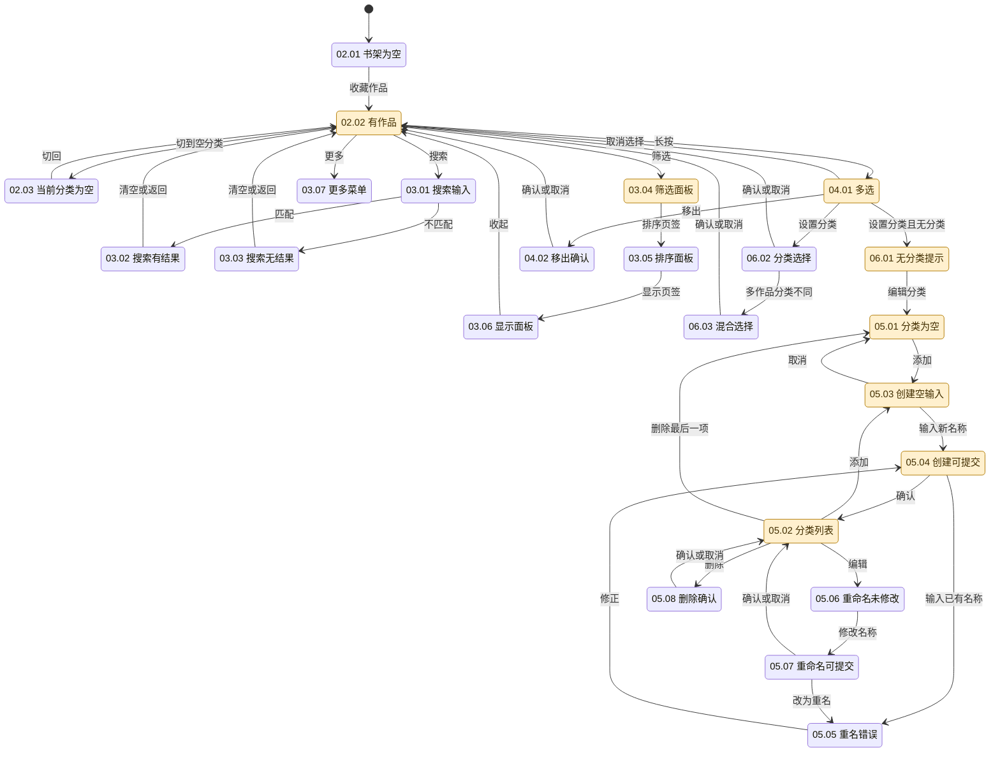
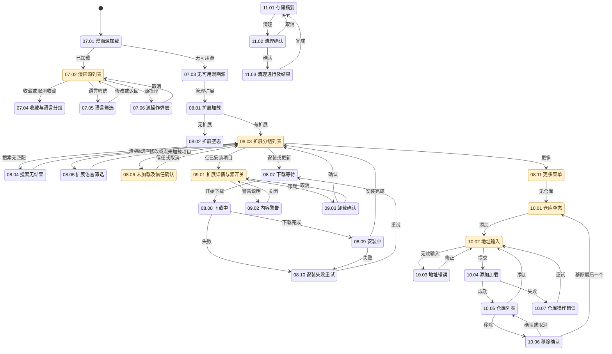
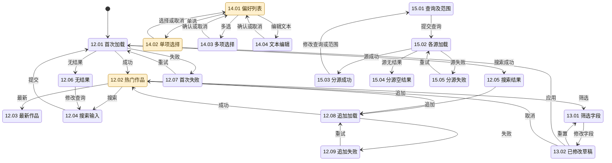
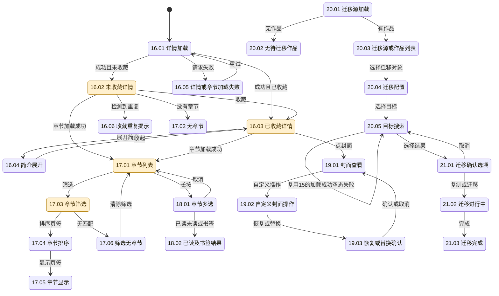
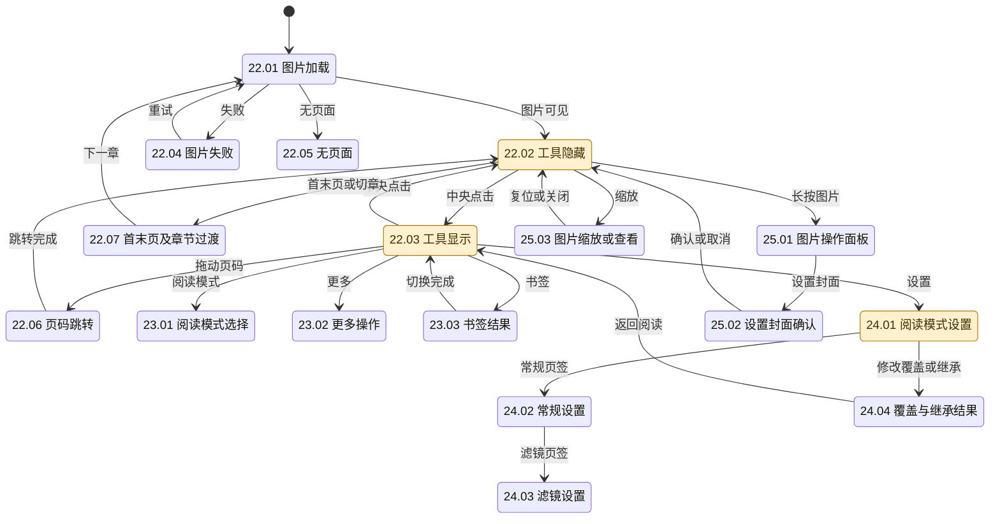
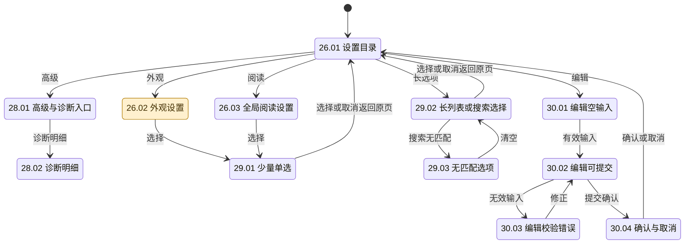
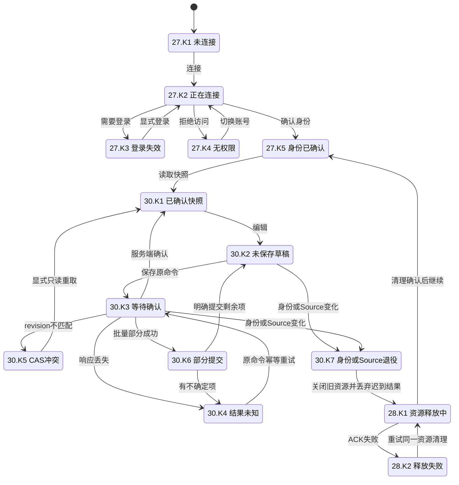

# Mihon 参考截图状态机

2026-11-14，进行中。用户要求截图触及每个 UI 状态，并同时考虑浅色、深色。此表细化[30 组界面矩阵](../design/mihon-cupertino-fidelity.md)，作为参考采集与后续 Cupertino 对照的工作清单。**目前没有任何一组完成双主题全状态验收。**

## 记录规则

- 状态由固定 Mihon v0.21.3 的页面、ViewModel 分支和弹层分支确定；不能仅按路由名计数。加载、内容、空结果、失败、选择、输入校验、确认和操作进行中分别记录。取消、返回、重试及成功后的落点也是待核对的转换。
- 每行分别记录浅色与深色截图。`待`表示未采集，文件名表示已核对实际 PNG/XML 的参考画面；只完成一侧仍为待完成。表中省略共同路径 `.local/mihon-reference/` 和后缀 `.png`，对应 XML 同名。原始材料保持在忽略目录。
- 图中节点对应表中 ID；橙色表示仅有单主题参考，未着色表示仍待采集，绿色只用于两种主题均已核对的状态。**参考截图完成不等于 Karuyomi 像素或交互验收通过。**
- DEFAULT 固定主题，360×800 逻辑视口、720×1600 物理像素、320dpi；系统栏单列。两种主题使用同一数据和同一状态。早期 Monet 图保留为历史，不填入 DEFAULT 栏。键盘、长中文、双倍字号、宽屏/横屏、减少动态另列变体，不用它们替代主状态。
- 同一可见状态只保留一个主 ID，可关联多组页面。Mihon 没有的服务端确认、CAS 冲突、身份失效、部分提交、清理 ACK 等状态列在末节，须由 Karuyomi 实测；不能伪造 Mihon 对应图。用户已列入后续的下载、历史、追踪、备份等独立功能保持原范围，不增加无效入口。
- 当新增源码分支或实际操作发现表外弹层，先补节点及转换，再采集；不把“不易触发”改记为不适用。瞬时状态须实际截到才能填表，未截到继续为待。

## 01–06：导航、书架、分类

依据：`ui/home/HomeScreen.kt`、`ui/library/LibraryTab.kt`、`presentation/library/LibrarySettingsDialog.kt`、`DeleteLibraryMangaDialog.kt`、`presentation/category/CategoryScreen.kt`、`components/CategoryDialogs.kt`。

| 状态 ID | 最小必要信息/采集触发                                                               | 浅色 | 深色                                         |
| ------- | ----------------------------------------------------------------------------------- | ---- | -------------------------------------------- |
| 01.01   | 三入口对应的 Mihon 底部导航：活动入口、图标、标题及正文边界；复用 02.02/07.02/26.01 | 待   | `library-populated-default-dark`（书架分项） |
| 01.02   | 宽屏/横屏导航及内容区域；旋转同一参考设备                                           | 待   | 待                                           |
| 02.01   | 空书架标题、原因、可执行入口；移出最后一部作品                                      | 待   | 待（早期 `library-empty-dark` 为 Monet）     |
| 02.02   | 封面、标题、未读标记、续读位置及网格边界                                            | 待   | `library-populated-default-dark`             |
| 02.03   | 空分类名、空态及切回入口；切到新建分类                                              | 待   | 待                                           |
| 03.01   | 已打开的搜索框、查询、清空/退出；点搜索                                             | 待   | 待                                           |
| 03.02   | 查询与匹配作品；输入 `xkcd`                                                         | 待   | 待                                           |
| 03.03   | 查询、无结果说明、清空/退出；输入不会匹配的文本                                     | 待   | 待                                           |
| 03.04   | 筛选页签、选项及三态当前值；打开筛选                                                | 待   | `library-options-default-dark`               |
| 03.05   | 排序页签、当前排序和方向                                                            | 待   | 待                                           |
| 03.06   | 显示页签、当前网格/列表设置                                                         | 待   | 待                                           |
| 03.07   | 可用菜单项及正文锚点；点更多                                                        | 待   | 待                                           |
| 04.01   | 选中数量、选中封面、退出/全选和底部批量操作                                         | 待   | `library-selection-default-dark`             |
| 04.02   | 将移出的对象/数量、影响、取消和确认                                                 | 待   | 待                                           |
| 05.01   | 无分类说明及添加入口                                                                | 待   | `category-manager-default-dark`              |
| 05.02   | 名称、拖动顺序、编辑和删除入口                                                      | 待   | `category-created-default-dark`              |
| 05.03   | 标题、空名称、必填、禁用提交、取消及键盘                                            | 待   | `category-create-default-dark`               |
| 05.04   | 名称、可用提交、取消及键盘                                                          | 待   | `category-ime-default-dark`                  |
| 05.05   | 重复名称、错误说明、禁用提交；创建及重命名分别核对                                  | 待   | 待                                           |
| 05.06   | 原名称、禁用确认、取消及键盘                                                        | 待   | 待                                           |
| 05.07   | 修改后名称、可用确认、取消及键盘                                                    | 待   | 待                                           |
| 05.08   | 待删分类名、影响、取消和确认                                                        | 待   | 待                                           |
| 06.01   | 无分类说明及编辑分类入口                                                            | 待   | `library-categories-default-dark`            |
| 06.02   | 分类名、已选项、取消和确认                                                          | 待   | 待                                           |
| 06.03   | 多作品混合选中态、最终选择及确认                                                    | 待   | 待（需要两部测试作品）                       |

## 07–11：漫画源、扩展、仓库与存储

依据：`presentation/browse/SourcesScreen.kt`、`SourcesFilterScreen.kt`、`ExtensionsScreen.kt`、`ExtensionFilterScreen.kt`、`ExtensionDetailsScreen.kt`、`extension/model/InstallStep.kt`、`presentation/more/settings/screen/browse/components/ExtensionStores*.kt`、`SettingsDataScreen.kt`。

| 状态 ID | 最小必要信息/采集触发                                    | 浅色 | 深色                                                                           |
| ------- | -------------------------------------------------------- | ---- | ------------------------------------------------------------------------------ |
| 07.01   | 漫画源标题及加载指示；冷启动进入源页                     | 待   | 待                                                                             |
| 07.02   | 源名、语言、最近使用、可执行尾部操作                     | 待   | `browse-root-resume`                                                           |
| 07.03   | 无可用源说明与扩展入口；关闭已安装源                     | 待   | 待（Local source 项与真正空态分开）                                            |
| 07.04   | 收藏分组与普通分组、取消收藏入口                         | 待   | 待                                                                             |
| 07.05   | 语言列表及当前启用项                                     | 待   | 待                                                                             |
| 07.06   | 当前源及收藏/禁用等可用动作                              | 待   | 待                                                                             |
| 08.01   | 标题、加载状态及禁用刷新；重新读取目录                   | 待   | 待                                                                             |
| 08.02   | 无扩展原因与仓库入口                                     | 待   | 待                                                                             |
| 08.03   | 未加载/已安装/可安装/更新分组、名称、语言、版本、主操作  | 待   | `extensions-mangadex-untrusted-default-dark`（未加载/已安装）；可安装/更新待补 |
| 08.04   | 查询、无匹配说明、清空/返回                              | 待   | 待                                                                             |
| 08.05   | 语言和内容筛选当前值                                     | 待   | 待                                                                             |
| 08.06   | 未加载原因、插件名、信任/卸载；其他未加载原因分别补图    | 待   | `mangadex-trust-confirmation`（未信任分项）                                    |
| 08.07   | 对象、等待标记、取消                                     | 待   | 待                                                                             |
| 08.08   | 对象、下载标记、进度/取消                                | 待   | 待                                                                             |
| 08.09   | 对象、安装中及系统权限/确认（若出现）                    | 待   | 待                                                                             |
| 08.10   | 对象、失败与重试                                         | 待   | 待                                                                             |
| 08.11   | 筛选和仓库入口                                           | 待   | `extensions-menu-default-dark`                                                 |
| 09.01   | 图标、名称、包名、版本/语言/警告、卸载、源列表/启停/偏好 | 待   | `mangadex-details-default-dark`（启用）；禁用分项待补                          |
| 09.02   | 内容警告原因和关闭动作                                   | 待   | 待                                                                             |
| 09.03   | 卸载对象、系统确认/取消                                  | 待   | 待                                                                             |
| 10.01   | 无仓库说明、返回、刷新和添加                             | 待   | `extension-repositories-default-dark`                                          |
| 10.02   | 地址、必填、提交可用性、取消、键盘                       | 待   | `repository-add-default-dark`（空输入）；有效地址分项待补                      |
| 10.03   | 无效地址与校验说明、修正/取消                            | 待   | 待                                                                             |
| 10.04   | 提交对象与正在读取反馈；实际可见加载，不凭方法推导       | 待   | 待                                                                             |
| 10.05   | 仓库名、地址、移除/刷新；使用正式公开仓库                | 待   | 待                                                                             |
| 10.06   | 待移除仓库名、影响、确认/取消                            | 待   | 待                                                                             |
| 10.07   | 失败原因和可用恢复入口；连接失败分支                     | 待   | 待                                                                             |
| 11.01   | 占用、存储范围及清理入口；仅对照同类存储布局             | 待   | 待                                                                             |
| 11.02   | 清理对象、影响、确认/取消                                | 待   | 待                                                                             |
| 11.03   | 清理进行/完成/失败的实际反馈，三个分项分别保留           | 待   | 待                                                                             |

## 12–15：源内浏览、筛选、偏好与跨源搜索

依据：`presentation/browse/BrowseSourceScreen.kt` 的 refresh/append Loading/Error/Empty、`ui/browse/source/browse/SourceFilterDialog.kt` 的 typed Filter、`ui/browse/extension/details/SourcePreferencesScreen.kt`、`presentation/browse/GlobalSearchScreen.kt` 的 Loading/Success/Error。

| 状态 ID | 最小必要信息/采集触发                                                             | 浅色 | 深色                                                  |
| ------- | --------------------------------------------------------------------------------- | ---- | ----------------------------------------------------- |
| 12.01   | 源名、当前模式、加载指示                                                          | 待   | 待（`xkcd-browse-default-dark` 须再核对是否截到指示） |
| 12.02   | 源名、热门模式、封面与标题网格                                                    | 待   | `xkcd-browse-loaded-default-dark`                     |
| 12.03   | 源名、最新模式、作品；使用支持最新的源                                            | 待   | 待                                                    |
| 12.04   | 查询、键盘、清空和提交                                                            | 待   | 待                                                    |
| 12.05   | 查询与匹配作品                                                                    | 待   | 待                                                    |
| 12.06   | 当前条件、无结果说明和恢复动作                                                    | 待   | 待                                                    |
| 12.07   | 错误正文、重试、返回；仅在参考模拟器制造网络不可用                                | 待   | 待                                                    |
| 12.08   | 已有作品、追加指示、滚动位置                                                      | 待   | 待                                                    |
| 12.09   | 已有作品、追加失败提示和重试                                                      | 待   | 待                                                    |
| 13.01   | text/check/select/tri-state/sort/group 当前值、重置/应用/取消；各字段类型分项采集 | 待   | 待                                                    |
| 13.02   | 修改后的值及应用/重置/取消后的结果                                                | 待   | 待                                                    |
| 14.01   | 源名、偏好标题、当前值、说明及开关                                                | 待   | `source-preferences-default-dark`（MangaDex）         |
| 14.02   | 字段名、选项、当前选中、取消                                                      | 待   | `source-preference-choice-default-dark`               |
| 14.03   | 字段名、多选项、当前集合、确认/取消                                               | 待   | 待（选择实际提供多选偏好的源）                        |
| 14.04   | 字段名、当前文本、输入约束、确认/取消和键盘                                       | 待   | 待（选择实际提供文本偏好的源）                        |
| 15.01   | 查询、源范围、提交/返回                                                           | 待   | 待                                                    |
| 15.02   | 每源名称与加载反馈，其他已完成源仍可见                                            | 待   | 待                                                    |
| 15.03   | 每源名称与横向作品、点击作品入口                                                  | 待   | 待                                                    |
| 15.04   | 对应源名及无结果说明                                                              | 待   | 待                                                    |
| 15.05   | 对应源名、错误和重试；混合成功/失败同屏另留图                                     | 待   | 待                                                    |

## 16–21：作品、章节、封面与迁移

依据：`ui/manga/MangaScreen.kt` 的 Loading/Success/dialog、`presentation/manga/MangaScreen.kt`、`ChapterSettingsDialog.kt`、`components/MangaCoverDialog.kt`、`DuplicateMangaDialog.kt`、`presentation/browse/Migrate*.kt`、`mihon/feature/migration/{config,list,dialog}`。Karuyomi 的只读映射预览是自身状态，不能把 Mihon 迁移选项截图称作映射预览。

| 状态 ID | 最小必要信息/采集触发                                                       | 浅色 | 深色                           |
| ------- | --------------------------------------------------------------------------- | ---- | ------------------------------ |
| 16.01   | 返回与加载指示；首次打开未缓存作品                                          | 待   | 待                             |
| 16.02   | 封面、标题、作者、源、状态、收藏主操作、简介/标签                           | 待   | `xkcd-details-default-dark`    |
| 16.03   | 已在书架状态、分类/续读入口及同一元数据                                     | 待   | `manga-added-default-dark`     |
| 16.04   | 完整简介、标签及收起；使用足够长简介                                        | 待   | 待                             |
| 16.05   | 请求失败信息、已有资料保留、重试；元数据/章节失败分别采集                   | 待   | 待                             |
| 16.06   | 重复作品身份、查看/迁移/保留选择                                            | 待   | 待                             |
| 17.01   | 章节数量、章节名、日期/翻译组、已读/书签标记和操作                          | 待   | `reader-entry-details`         |
| 17.02   | 空章节说明和重新读取入口                                                    | 待   | 待                             |
| 17.03   | 筛选页签、未读/书签等三态、翻译组入口                                       | 待   | `chapter-options-default-dark` |
| 17.04   | 当前排序字段/方向                                                           | 待   | 待                             |
| 17.05   | 当前显示方式                                                                | 待   | 待                             |
| 17.06   | 生效条件、无章节及清除/返回                                                 | 待   | 待                             |
| 18.01   | 选中数量、选中行、退出/全选和底部动作                                       | 待   | 待                             |
| 18.02   | 已读/未读/书签三类结果各自可见，不能只凭点击记录                            | 待   | 待                             |
| 19.01   | 实际大封面、关闭和操作；旧 `cover-view-default-dark` 不符合                 | 待   | 待                             |
| 19.02   | 当前封面、可用自定义/重置动作                                               | 待   | 待                             |
| 19.03   | 替换或恢复对象、影响、确认/取消；系统文件选择单列                           | 待   | 待                             |
| 20.01   | 迁移标题和加载指示                                                          | 待   | 待                             |
| 20.02   | 无作品说明及返回                                                            | 待   | 待                             |
| 20.03   | 源名/数量或待迁移作品、排序与选择入口                                       | 待   | 待                             |
| 20.04   | 原作品、目标源范围、迁移选项及开始                                          | 待   | 待                             |
| 20.05   | 原作品、查询、目标源及结果；加载/空/失败复用15.02–15.05的结构并补实际迁移图 | 待   | 待                             |
| 21.01   | 原/目标作品、迁移内容选项、查看/复制/迁移/取消                              | 待   | 待                             |
| 21.02   | 原/目标上下文和进行中反馈、操作禁用                                         | 待   | 待                             |
| 21.03   | 目标作品落点、原书架关系及完成后可用操作                                    | 待   | 待                             |

## 22–25：阅读器与图片

依据：`presentation/reader/appbars/ReaderAppBars.kt`、`ReadingModeSelectDialog.kt`、`settings/ReaderSettingsDialog.kt` 的阅读模式/常规/滤镜页签、`ReaderPageActionsDialog.kt`、`ui/reader/viewer/pager/PagerPageHolder.kt` 及 webtoon holder。错误、空章节、首末页和章节间过渡均须实拍。

| 状态 ID | 最小必要信息/采集触发                                | 浅色 | 深色                                                            |
| ------- | ---------------------------------------------------- | ---- | --------------------------------------------------------------- |
| 22.01   | 作品/章节上下文、页位和图片加载指示                  | 待   | 待（`reader-loading-default-dark` 实际为 Android 首次全屏提示） |
| 22.02   | 实际图片与页码，工具隐藏                             | 待   | `reader-canvas-default-dark`                                    |
| 22.03   | 返回、作品/章节、书签/更多、页码与底部工具           | 待   | `reader-tools-default-dark`                                     |
| 22.04   | 失败页、错误和重试；不要把外层全屏提示当图片失败     | 待   | 待                                                              |
| 22.05   | 无页面说明和退出/恢复                                | 待   | 待                                                              |
| 22.06   | 当前/目标页码、滑杆拖动反馈及落点                    | 待   | 待                                                              |
| 22.07   | 首/末页边界、上一/下一章及无相邻章；分别采集         | 待   | 待                                                              |
| 23.01   | 当前模式、可选模式、取消                             | 待   | 待                                                              |
| 23.02   | 当前章节可用操作与关闭                               | 待   | 待                                                              |
| 23.03   | 已加与已移除两种书签状态、可用反向动作               | 待   | 待                                                              |
| 24.01   | 本作品范围、阅读模式、默认/显式值、输入选项          | 待   | `reader-settings-default-dark`                                  |
| 24.02   | 常规页签、当前图像适配/显示选项                      | 待   | 待                                                              |
| 24.03   | 滤镜页签、背景、亮度/调暗及当前值                    | 待   | 待                                                              |
| 24.04   | 切换继承/显式设置后实际阅读呈现；两种各一图          | 待   | 待                                                              |
| 25.01   | 当前图片上下文、设置封面/保存等真实动作              | 待   | 待                                                              |
| 25.02   | 设置封面影响、确认/取消                              | 待   | 待                                                              |
| 25.03   | 放大后的实际图片、复位/退出；Karuyomi 独立图片页另验 | 待   | 待                                                              |

## 26–30：设置、选择与通用弹层

依据：`presentation/more/settings/screen/SettingsMainScreen.kt`、`SettingsAppearanceScreen.kt`、`SettingsReaderScreen.kt`、`SettingsAdvancedScreen.kt`、`debug/DebugInfoScreen.kt`、`WorkerInfoScreen.kt`，以及官方 Preference 对应选择/编辑对话框。通用弹层复用前面已定义状态，不用另一个页面的常态代替。

| 状态 ID | 最小必要信息/采集触发                                                      | 浅色 | 深色                                                      |
| ------- | -------------------------------------------------------------------------- | ---- | --------------------------------------------------------- |
| 26.01   | 设置分类、标题/说明和返回；旧 `settings-main-default-dark` 实际为“更多”    | 待   | 待（早期 `settings-main-dark` 为 Monet）                  |
| 26.02   | 当前浅深模式、DEFAULT 卡、主题选中、显示偏好                               | 待   | `settings-appearance-default-dark`                        |
| 26.03   | 阅读显示/输入分组、当前值和说明；完整滚动段分别留图                        | 待   | 待                                                        |
| 28.01   | 高级分组及诊断入口；主路径中的次级位置                                     | 待   | 待                                                        |
| 28.02   | 诊断标题、字段值、复制/返回；DebugInfo 与 WorkerInfo 分别采集              | 待   | 待                                                        |
| 29.01   | 选项标题、当前选中、选项、取消；可复用14.02但逐调用点核对                  | 待   | `source-preference-choice-default-dark`（源偏好分项）     |
| 29.02   | 当前项、可搜索的长选项、搜索/取消和键盘                                    | 待   | 待（先核对 Mihon 是否采用同样搜索结构）                   |
| 29.03   | 查询、无匹配、清空/取消                                                    | 待   | 待（若 Mihon 无此界面，记为 Karuyomi 独有并保留源码依据） |
| 30.01   | 标题、必填/禁用提交、取消、键盘；关联05.03/10.02/14.04                     | 待   | `category-create-default-dark`（分类分项）                |
| 30.02   | 当前草稿、可用提交和取消；关联05.04/05.07/14.04                            | 待   | `category-ime-default-dark`（分类分项）                   |
| 30.03   | 原输入、具体校验错误、修正/取消；关联05.05/10.03                           | 待   | 待                                                        |
| 30.04   | 对象、影响、确认/取消；逐操作关联04.02/05.08/09.03/10.06/19.03/21.01/25.02 | 待   | 待                                                        |

## Karuyomi 独有状态与转换

这些节点没有 Mihon 的业务等价物，不能用参考应用图证明通过。应用同一套主题和页面骨架，并在目标 Web 产物中逐状态采集浅/深图；原生现场验收仍停止。

对应目标画面同样为**浅色待、深色待**。各业务页需要分别覆盖：书架/分类与批量（02–06）、账户扩展/仓库（08–11）、Source偏好（14）、停止/取消/分页/资源清理（12/15）、作品元数据/章节读态/书签/封面（16–19）、只读迁移映射与提交（20–21）、阅读进度/Access恢复/设置覆盖（22–24）、全局设置和连接/诊断（26–28）。共享状态机仅归纳语义，不能用一张设置错误截图代替全部业务上下文。

## 当前采集顺序与变体门槛

1. 先补书架/分类全部状态的深色图，再以同一数据重走浅色；完成一组后更新每个节点，保留取消、确认及重试落点。
2. 继续源/扩展/仓库、浏览/筛选/偏好/跨源搜索、详情/章节/封面/迁移、阅读器、设置/诊断。每组采用双主题成对采集；网络错误只作用于参考模拟器并及时恢复。
3. 对所有已记录状态核对主要元素边界与颜色角色，再使用对应数据验证 Karuyomi 的 Cupertino 呈现；源码数值或参考图不能替代目标产物。
4. 完成每组的360px、宽屏/横屏、长中文、双倍文字、键盘/滚动末端和减少动态；键盘必须同时显示输入及可达的提交/取消。主题切换不能丢失选择或草稿。

已排除的误计：`reader-loading-default-dark` 是 Android 全屏引导；`cover-view-default-dark` 仍为详情；`extension-details-selected-default-dark` 仍为扩展列表；`settings-main-default-dark` 是更多页；`category-create-filled-default-dark` 输入仍为空。它们均不填入所命名的目标状态。
